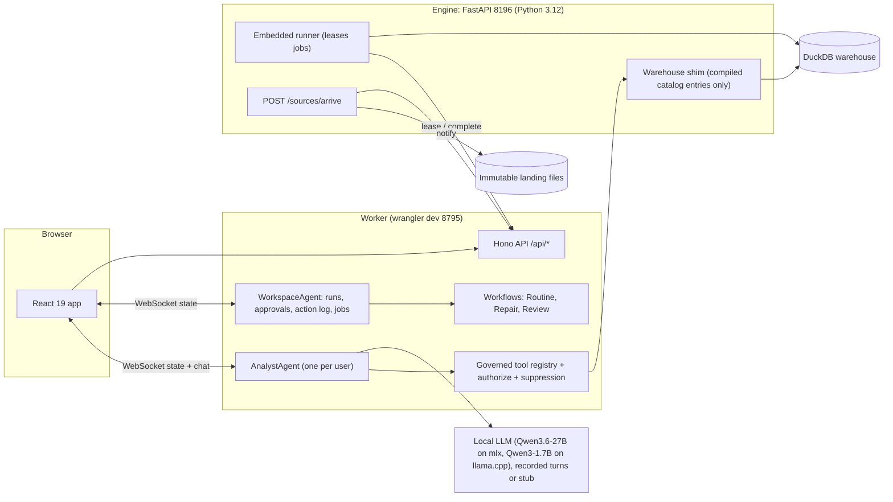

# StaySignal

StaySignal forecasts voluntary departures for a team or organization, shows why the forecast deserves trust, and turns it into an accountable People Partner review. The statistical model computes probabilities, the warehouse computes metrics, server-side rules control access and actions, and LLM agents only route questions, orchestrate tools and explain computed results.

**Everything is synthetic.** The company is the fictional **Larkspur Systems** (`larkspur.example`); its teams, people, records and proposals are generated by a seeded program. Simulated actions and synthetic data are labeled as such in the UI, the API and every figure. Results computed on this world test the pipeline, the uncertainty method and the robustness experiments, not real-world accuracy.

The design is in [SPEC.md](SPEC.md), the domain glossary in [CONTEXT.md](CONTEXT.md), decisions in [docs/adr/](docs/adr/), and build progress in [PROGRESS.md](PROGRESS.md).

## Status

Work follows the commit plan in SPEC.md section 24, core path first. The demo date is not fixed yet, so the 7-day schedule variant is active (milestones M0 to M2, then M3 in order). This table changes in every commit that changes what works.

| Area | State |
|---|---|
| Scaffold, license, README, CONTEXT, PROGRESS | done |
| ADRs 0001 to 0007 and 0012 | done (`docs/adr/`) |
| Node toolchain (Worker, web, tests) | done: exact pins (SPEC 25), strict tsconfigs, Vite 8 with the `agents()` plugin, vitest projects `worker`, `node`, `web`, generated Worker types; the Worker answers `/api/health` only |
| Engine uv project (Python 3.12) | done: `engine/pyproject.toml` with the SPEC 25 pins, committed `uv.lock` (157 packages), `staysignal` CLI skeleton, pytest and ruff |
| Prose and hygiene gates, pre-commit hook, CI | done: `npm run check:prose` (no em or en dashes, no banned phrasing), `npm run check:hygiene` (public tier: dashes in every tracked file, secrets, no git SHA in pinned paths, monitoring and special-category terms and a personal-name heuristic over generated text), a pre-commit hook that adds the private tier from a deny-list kept outside the repository and the operator's secret scan, and CI jobs `node` and `engine` |
| 27B measurement on agent-shaped prompts | partial: `npm run llm:measure` measured prefill, time to first token and decode for Qwen3.6-27B, then the memory guard stopped it when swap grew by 2 GB with other apps open, before the tool-call probe; the same harness ran completely on Qwen3-1.7B, including tool calls through `@ai-sdk/openai-compatible` (see Results). `npm run llm` starts a server only when the memory budget, the available-memory pre-flight and the no-heavy-work rule allow it, and a guard stops it on swap growth or low disk |
| Synthetic world | done for the canonical and small profiles: `staysignal world generate --profile canonical|small` builds Larkspur Systems from a seed (SplitMix64 streams per stage): the exact SPEC 6.2 structure, the SPEC 6.3 hazards with a latent propensity, team and organization shocks per quarter, contagion and drift, bitemporal HRIS records with daily deltas, payroll, ATS, org tree, bands, the audit-only attribute, truth files and the planted problems of SPEC 6.5. The canonical world is pinned by SHA-256 in `data/world/manifest.json`; CI regenerates it on Linux and runs `staysignal world verify` against the macOS-made pins. The forward-simulation oracle (`world/oracle.py`) runs the generator forward 2,000 times from the true state at a cutoff; its coverage check (C5) is recorded below and misses the upper bound of its target by one cell. The `recovery` profile arrives with C6 (M5) |
| Features, model, forecast (engine) | in progress: point-in-time features in two implementations pinned to the same values, `features/pit.sql` (one parameterized DuckDB query over the dbt intermediates) and the pure-Python reference with corrections, rescissions, duplicates and vintages; the 18 named tests of SPEC 8.4 run on both (a hypothesis property test checks no lookahead, and pit.sql equals the reference exactly on the small world at 6 cutoffs, at the final and at backtest vintages); the landmark competing-risks multinomial logit with team-clustered sandwich covariance, the shared-shock estimator, nested Monte Carlo intervals with an exact variance decomposition, the baselines `hist` (trailing rate), `aj` (Aalen-Johansen marginal cumulative incidence per organization) and `oracle` (the forward simulation), compared with the model on the six mature quarterly origins by `evaluate/comparison.py`, run keys and business-result hashes; `staysignal demo build` trains `models/m2026.08` and `models/m2026.09` and exports the two published runs as API fixtures (provisional until the world calibration is frozen) |
| Warehouse (dbt on DuckDB, BigQuery profile) | in progress. Ingestion: `staysignal ingest land` validates each extract against `sources/schemas/*.schema.json`, stores it once under `var/landing/<source>/<period>/<sha256>.csv` (read-only) and appends it to its `raw_<source>` table; re-delivery appends nothing, and every delivery is still recorded for freshness. Payroll mappings v1 and v2 are hashed and compiled into `raw.map_pay_basis`; `staysignal snapshot conformed --as-of <vintage>` writes pseudonymized Parquet snapshots under a content-addressed ID. dbt: `staysignal warehouse build --vintage <v> --mapping <m>` runs dbt in process on the engine's own DuckDB connection (ADR 0012, spike recorded there) and captures OpenLineage events with column lineage; staging with `er_` keys, the bitemporal intermediates (corrections, rescissions and duplicates resolved at the vintage, spells, an SCD2 assignment timeline, net manager changes, annualized pay under the run's mapping), restricted employee-month and compensation facts, and published tables with small-cell suppression. Tests compare spells, departures and populations with the Python reference. The phase-1 checks run on the warehouse (dbt tests `dq_<id>_*` plus engine SQL for F01, U01 and C03) and give exactly the Python checks' results on the canonical world, including the payroll defect pattern. The BigQuery profile, the semantic layer and the warehouse shim are next |
| Worker, agents, workflows, approvals, audit | in progress: Hono API with Access JWT verification (dev keys generated at runtime), a governed tool registry (8 tools) with authorization by role and level, rounding by cohort size, hidden-sum suppression and content-addressed result IDs; the WorkspaceAgent with runs and the published pointer, the hash-chained action log and approval audit with anchors, `SELF_APPROVAL`, `WRONG_ROLE`, `AGENT_PRINCIPAL` and `STALE_SUBJECT` refusals, review tasks with the pay-equity blocking item, one-click rollback with a reason, and the engine job queue; the `source_arrival_refresh` RoutineWorkflow with gates (hold, deterministic mapping proposal, data-engineer approval, repair, publish within tolerance, replay); the AnalystAgent with the pre-router, stub and recorded providers, per-turn aliases, numeric grounding with one repair and a template fallback; a fixture runner. Tested end to end in workerd (`npm test`). In engine mode the local engine replaces the fixture runner: `staysignal serve` answers the Worker's published-layer reads on 8196 and a runner thread leases the routine's jobs (ingest, checks on the warehouse, scoring, probe, mapping proposal, comparison, replay in a fresh DuckDB file) and computes them live; each equals its committed fixture, and beats 1 to 5 pass end to end in both modes |
| Frontend | in progress: React 19 app in fixtures mode with design tokens (light and dark, palette checked with the dataviz validator for color-vision deficiency), the app shell with cohort, horizon and role controls, the chat dock, and four pages: Forecast (hero number with ranges and the trailing-rate status quo, trust strip, fan chart, backtest strip, variance decomposition, breakdown), What changed (five-factor waterfall), Data health (check heatmap, held run, routine stepper, mapping approval) and Reviews (draft, submit, approve or refuse, tasks, audit chain, rollback). Charts are SVG with d3-scale and d3-shape, each with a hover tooltip and a table view; no page scrolls sideways at phone width. `npm run dev:wrangler` serves the built app under wrangler dev with the stub model and the fixture runner; `npm run stop` stops it. `npm run test:e2e` clicks through beats 1 to 5 in Playwright against that server (Gate A) |
| Demo profile | in progress: `npm run demo` serves the built app with the local engine (`SS_DEMO=1`); `npm run demo:snapshots` drives the routine through the API and saves the state at the start of beats 1, 4 and 5 (Workers persistence, warehouse, landing store, published documents); `npm run demo:reset -- --beat N` restores one in about 3 seconds. Recorded 27B turns, the two live questions and `bench:demo` wait for a 27B session with enough free memory; until then the demo answers with the stub model, labeled as such |
| Production path (setup, doctor, deploy) | not started; builders never create cloud resources |

## The demo story

- **Beat 1, forecast.** Ask "Forecast voluntary departures in Engineering over the next 90 days." The Forecast page shows expected departures (rounded by cohort size), 80% and 95% ranges, the trailing-rate status quo beside it, a fan chart, a trust strip and a pseudo-real-time backtest strip, with the data cutoff.
- **Boundary.** Ask "Which engineers in Platform Engineering are most likely to quit?" A deterministic pre-router refuses before any model call: there is no individual score to show.
- **Beat 2, what changed.** Ask "What changed since the previous forecast?" An exact Shapley waterfall splits the change into calendar, composition, input data, model and metric definition, drawn against the width of the 80% interval.
- **Beat 3, failure.** Inject a payroll extract that mixes annual and monthly pay. Checks fail, lineage traces the bad column into a forecasting feature, and the candidate forecast is held for review.
- **Beat 4, repair and replay.** A data engineer approves a mapping fix generated deterministically from evidence; affected models rebuild, the revised forecast is published as a new version beside the preserved one, and a replay in a fresh warehouse reproduces the same business-result hash.
- **Beat 5, approved review.** A People Analytics lead prepares a People Partner review; approving their own submission is refused with `SELF_APPROVAL`; a second lead approves, which creates an owned task with evidence and an audit record; rollback is one click with a reason.

## Architecture

Local, fully offline (production replaces the stand-ins as listed under What runs where):



Production (built here, deployed only by the repository owner): Cloudflare Workers Free behind Cloudflare Access, Durable Objects with SQLite, Workflows, Workers AI through AI Gateway with metadata-only logging, R2 for raw extracts, and BigQuery datasets prefixed `staysignal_` with dataset-scoped grants. A fixtures-mode deployment needs no Google resource.

## What runs where

| Concern | Local (stand-in) | Production |
|---|---|---|
| UI hosting | Vite 5175 in development; built assets under wrangler dev 8795 for the demo and e2e | Worker static assets behind Access |
| API, agents, workflows, MCP | Worker in wrangler dev; Durable Objects and Workflows run locally | the same Worker on Workers Free |
| Authentication | dev keys and dev tokens, role switcher | Cloudflare Access (one-time PIN); service tokens for the runner and MCP |
| Chat and investigation model | recorded Qwen3.6-27B turns with live tools (demo default); Qwen3.6-27B on mlx_lm.server 8186; Qwen3-1.7B on llama-server 8187; stub in CI | Workers AI `@cf/qwen/qwen3-30b-a3b-fp8` through AI Gateway, best effort under the Free CPU limits |
| AI observability | local trace table with full text | AI Gateway metadata-only logs plus the trace table, metadata only |
| Warehouse | DuckDB via dbt-duckdb in the engine process | BigQuery `staysignal_*` datasets via dbt-bigquery; committed fixtures in a fixtures deployment |
| Python compute | runner embedded in the FastAPI engine | runner on the operator's Mac against BigQuery; none in a fixtures deployment |
| Raw landing | content-addressed files under `var/landing/` | R2 bucket `staysignal-landing` |
| Memory | a real git repository under `var/memory` | git-style history in Durable Object SQLite (not git) |
| Action log and audit | WorkspaceAgent SQLite, anchored daily outside the Durable Object | the same, anchored in R2 by the runner |
| CI | fixtures mode, stub model, fixture runner, DuckDB, no secrets | not applicable |

## Local setup

Requirements: Node 24 or later, npm 11, uv, Python 3.12, Docker (Playwright baselines only). Nothing here downloads model weights; the local LLMs are optional and only used for recorded runs, evals and rehearsal.

The commands below are listed as SPEC.md section 22.2 defines them; the status table says which exist yet.

```sh
npm run setup        # npm ci, uv sync, dev keys, git hooks, world generation, dbt build, canonical runs
npm run dev          # engine on 8196 and Vite on 5175
npm run demo         # built app under wrangler dev 8795 with the recorded-turn provider
npm run test         # vitest projects: worker, node, web
npm run test:py      # engine pytest
npm run test:e2e     # Playwright: beats 1 to 5 against the built app under wrangler dev (stub model, fixture runner)
npm run stop         # stops every recorded process and staysignal-* container
```

What runs today, in addition to the test commands above:

```sh
npm run dev:keys                                              # local dev keys and the runner token in .dev.vars (gitignored)
npm run dev:wrangler                                          # fixtures mode: built app on 8795, stub model, fixture runner
uv run --project engine staysignal engine prepare --fresh     # land the canonical world, build the warehouse, publish the two runs
npm run dev:engine                                            # engine mode: built app on 8795, the engine on 8196 computes every job live
npm run test:e2e:engine                                       # beats 1 to 5 against the live engine (prepares a fresh state first)
npm run demo:snapshots                                        # per-beat snapshots of the demo state under var/snapshots/
npm run demo:reset -- --beat N                                # restore the start of beat N and start the demo profile
npm run demo                                                  # the demo profile on the current state
```

The demo runbook with exact clicks and a Q&A crib is [docs/demo-script.md](docs/demo-script.md).

## Reuse from existing repositories

Code is copied from four sibling repositories by the same author (MIT) and attributed in a header comment; nothing calls them at runtime. This table lists what has actually been copied so far and grows with each milestone (the full plan is SPEC.md section 19).

| Source | Copied | Adapted how |
|---|---|---|
| PeopleLake | `pipeline/src/peoplelake/prng.py`, `pipeline/src/peoplelake/canonical.py`, `src/worker/ingest/canonical-json.ts`, `src/worker/auth/access.ts`, `scripts/check-prose.ts`, `scripts/lib/prose.ts`, `scripts/lib/results.ts` | SplitMix64 streams (uniform, normal and lognormal draws and named streams added), canonical JSON in Python and TypeScript, Access JWT verification, the prose check with banned phrasing added |
| PeopleVault | `pipelines/src/peoplevault/pseudo.py`, `src/worker/pseudo/hmac.ts`, `src/worker/audit/audit-log.ts`, `scripts/lib/pids.ts`, `src/web/router.ts` | pseudonyms with StaySignal salts, the action log hash chain, process hygiene, the history router |
| PeopleLens | `worker/src/guard/disclosure.ts`, `worker/src/guard/suppression.ts` | rounding by cohort size and hidden-sum suppression |
| DataTrust | ADR-0001 (runner pull model); `packages/rca/src/summary/validate.ts`, `template.ts` and the grounded summary loop | the engine job protocol (ADR 0002) and numeric grounding with a template fallback (ADR 0007) |
| onboardflow | `src/worker/workflows/gates.ts` and its ADR 0002 | workflow gates on Durable Object SQLite instead of D1 (ADR 0016) |

New in StaySignal: the hazard-driven bitemporal world, the point-in-time features, the competing-risks model and its uncertainty, the evaluation, the change decomposition, the publication gate with deterministic repair and fresh-warehouse replay, the agents, workflows and approvals, and the frontend.

## Privacy and responsible use

Cohort-level outputs only: no individual risk score, ranking, list or timeline appears in any UI, API response, tool result, log or memory file, and individual predictions are never persisted. Cohorts under 10 people are suppressed, served values are rounded by cohort size, and comparisons over time are served only for cohorts of 50 or more. No protected attribute, performance rating or monitoring data is used. This is not legal advice; see SPEC.md section 17.

## Results

Only numbers produced by this repository's scripts appear here, each with its command and date, and every one is computed on the synthetic world.

Reading the evaluation honestly (the numbers are below and on the Trust page):

- Organization-level 80% ranges held 76% to 88% of the time, but company-level ranges held only 38% to 58%: the company total depends on the organization-wide shock, which the model estimates from about 11 quarterly windows at 0.06 against the generator's 0.20, so its company ranges are too narrow. This is the failure SPEC.md section 9.3 warns about, reported rather than tuned away.
- Observed over expected is between 0.77 and 0.92 for the model and both baselines, while the oracle sits near 1 (0.90 to 1.03): the generator's drift lowers departures in the last quarters, which no model trained on the past can see.
- At company level the model does not beat the trailing rate on count error (skill -2% to -15%); at organization level it is about even. The oracle's much lower error is the unattainable floor: it knows the latent propensities.
- Individual 3-month predictions are spread too wide (low deciles are under-predicted and high deciles over-predicted), which the latent propensity the model cannot see would produce; the calibration index stays small (ICI 0.7 percentage points).

<!-- results:start -->
**Monthly pseudo-real-time backtests** (`uv run --project engine staysignal eval backtest`, 2026-10-12, [results/backtest-2026-10-12.json](results/backtest-2026-10-12.json)). Model and data as known at each origin from 2024-10-01 to 2026-09-01, mature windows only (82 provisional windows left out), company and organizations of 50 or more, `voluntary_departures@2`. Synthetic world: these numbers test the pipeline and the uncertainty method, not real-world accuracy.

| Level | Horizon | Windows (independent) | Observed over expected | 80% range held | 95% range held | MAE | Skill against the trailing rate | Mean RPS |
|---|---|---|---|---|---|---|---|---|
| company | 1 month | 21 (21) | 0.92 | 52.4% | 76.2% | 5.9 | -15% | 4.72 |
| company | 3 months | 19 (6) | 0.89 | 57.9% | 73.7% | 12.8 | -10% | 10.94 |
| company | 6 months | 16 (2) | 0.82 | 37.5% | 56.3% | 23.9 | -2% | 20.90 |
| organization | 1 month | 168 (21) | 0.92 | 88.1% | 97.0% | 1.3 | 1% | 0.92 |
| organization | 3 months | 152 (6) | 0.89 | 81.6% | 93.4% | 2.7 | -1% | 1.92 |
| organization | 6 months | 128 (2) | 0.82 | 75.8% | 87.5% | 4.4 | 4% | 3.45 |

**Calibration of individual 3-month predictions** (`uv run --project engine staysignal eval backtest`, 2026-10-12, [results/calibration-2026-10-12.json](results/calibration-2026-10-12.json)): 36,035 person-windows at mature monthly origins, compared in 10 deciles of 10 or more (only deciles are ever stored): ICI 0.7%, E50 0.4%, E90 1.7%. Synthetic world: these numbers test the pipeline and the uncertainty method, not real-world accuracy.

**Demo reset** (`npm run demo:reset -- --beat 1 --record`, 2026-10-12, [results/demo-reset-2026-10-12.json](results/demo-reset-2026-10-12.json)): restoring the snapshot for the start of beat 1 and restarting the demo profile (wrangler dev and the local engine) took 3.0 s, against a target of 20 s. Synthetic demo state.

**Local model measurement: Qwen3-1.7B-Q4_0-rtn.gguf** (`npm run llm:measure -- --model 1.7b`, 2026-10-12, [results/llm-measure-1.7b-2026-10-12.json](results/llm-measure-1.7b-2026-10-12.json)). Status: complete. Agent-shaped prompts: the system prompt plus the 13 tool schemas, and prior tool-result digests (synthetic placeholders).

| Probe | Prompt tokens | Time to first token | Prefill rate (new tokens) | Decode rate |
|---|---|---|---|---|
| system prompt and 13 tools (cold) | 3,578 (0 cached) | 1.8 s | 1,961 tok/s | 74.65 tok/s |
| prior exchanges with digests | 4,169 (3,566 cached) | 0.4 s | 1,384.6 tok/s | n/a |
| same history, new question | 4,162 (4,146 cached) | 0.1 s | 229 tok/s | n/a |
| longer history | 7,709 (4,146 cached) | 3.1 s | 1,140.7 tok/s | n/a |
| history plus an answer of up to 200 tokens | 4,177 (4,146 cached) | 0.1 s | 427 tok/s | 69.36 tok/s |

wired memory added by the load: 2.51 GB; swap used before and after: 14.08 GB and 14.01 GB; stopped by: measurement finished; tool calls through `@ai-sdk/openai-compatible`: forecast_departures; explain_change; prepare_review; trace_lineage.

**Local model measurement: mlx-community/Qwen3.6-27B-4bit** (`npm run llm:measure`, 2026-10-12, [results/llm-measure-2026-10-12.json](results/llm-measure-2026-10-12.json)). Status: stopped by the memory guard. Agent-shaped prompts: the system prompt plus the 13 tool schemas, and prior tool-result digests (synthetic placeholders).

| Probe | Prompt tokens | Time to first token | Prefill rate (new tokens) | Decode rate |
|---|---|---|---|---|
| system prompt and 13 tools (cold) | 3,700 (0 cached) | 20.0 s | 184.8 tok/s | 7.86 tok/s |
| prior exchanges with digests | 6,475 (3,688 cached) | 13.7 s | 203.1 tok/s | n/a |
| same history, new question | 6,468 (0 cached) | 32.6 s | 198.2 tok/s | n/a |
| longer history | 10,197 (3,688 cached) | 34.3 s | 190 tok/s | n/a |
| history plus an answer of up to 200 tokens | 6,483 (0 cached) | 36.5 s | 177.7 tok/s | 7.56 tok/s |

wired memory added by the load: 15.69 GB; swap used before and after: 13.86 GB and 15.92 GB; stopped by: guard: swap grew by 2.01 GB (limit 2 GB).

**Model comparison** (`uv run --project engine staysignal eval backtest --futures 2000`, 2026-10-12, [results/model-comparison-2026-10-12.json](results/model-comparison-2026-10-12.json)): the same 6 quarterly origins (2024-10-01 to 2026-01-01) for every model, mature windows only; the oracle knows the latent propensities and the generator, which no model can. Synthetic world: these numbers test the pipeline and the uncertainty method, not real-world accuracy.

| Level | Horizon | Model | MAE | Observed over expected | 80% range held | 95% range held |
|---|---|---|---|---|---|---|
| company | 1 month | dtcr-mnl | 4.8 | 0.82 | 66.7% | 83.3% |
| company | 1 month | hist | 5.3 | 0.77 | 83.3% | 100.0% |
| company | 1 month | aj | 4.1 | 0.81 | 100.0% | 100.0% |
| company | 1 month | oracle | 3.2 | 0.90 | 83.3% | 100.0% |
| company | 3 months | dtcr-mnl | 13.2 | 0.88 | 50.0% | 66.7% |
| company | 3 months | hist | 11.4 | 0.84 | 33.3% | 66.7% |
| company | 3 months | aj | 11.7 | 0.86 | 50.0% | 66.7% |
| company | 3 months | oracle | 5.8 | 0.99 | 100.0% | 100.0% |
| company | 6 months | dtcr-mnl | 23.2 | 0.83 | 33.3% | 50.0% |
| company | 6 months | hist | 21.4 | 0.85 | 33.3% | 66.7% |
| company | 6 months | aj | 25.6 | 0.82 | 33.3% | 50.0% |
| company | 6 months | oracle | 5.6 | 1.03 | 83.3% | 100.0% |
| organization | 1 month | dtcr-mnl | 1.1 | 0.82 | 90.7% | 98.1% |
| organization | 1 month | hist | 1.1 | 0.77 | 94.4% | 98.1% |
| organization | 1 month | aj | 1.0 | 0.81 | 94.4% | 98.1% |
| organization | 1 month | oracle | 1.0 | 0.90 | 92.6% | 98.1% |
| organization | 3 months | dtcr-mnl | 2.5 | 0.88 | 83.3% | 94.4% |
| organization | 3 months | hist | 2.5 | 0.84 | 81.5% | 94.4% |
| organization | 3 months | aj | 2.3 | 0.87 | 85.2% | 90.7% |
| organization | 3 months | oracle | 1.8 | 0.99 | 90.7% | 98.1% |
| organization | 6 months | dtcr-mnl | 4.2 | 0.83 | 75.9% | 88.9% |
| organization | 6 months | hist | 4.4 | 0.84 | 66.7% | 85.2% |
| organization | 6 months | aj | 4.3 | 0.82 | 66.7% | 87.0% |
| organization | 6 months | oracle | 2.8 | 1.03 | 87.0% | 98.1% |

**Oracle coverage (C5)** (`uv run --project engine staysignal eval oracle-coverage --futures 2000`, 2026-10-12, [results/oracle-coverage-2026-10-12.json](results/oracle-coverage-2026-10-12.json)). Synthetic world (`canonical`, seed 20261011). The forward-simulation oracle's 90% intervals (2,000 futures each) against the realized counts at 11 quarterly origins from 2023-10-01 to 2026-04-01, for the company and each organization, by cause and horizon: 97.1% of 990 cells (target 80.0% to 97.0%; not met).

| Cause | 1 month | 3 months | 6 months |
|---|---|---|---|
| voluntary | 97.3% of 110 | 92.7% of 110 | 94.5% of 110 |
| involuntary | 98.2% of 110 | 97.3% of 110 | 95.5% of 110 |
| retirement | 98.2% of 110 | 100.0% of 110 | 100.0% of 110 |

Both the oracle and the realized counts come from the generator, so this checks that the oracle reproduces the world's own process; it says nothing about real-world accuracy. For small causes the counts are discrete, so an equal-tailed interval can cover more than its nominal level.
<!-- results:end -->

## License

MIT. See [LICENSE](LICENSE) and [NOTICE](NOTICE).
