# StaySignal

StaySignal forecasts voluntary departures for a team or organization, shows why the forecast deserves trust, and turns it into an accountable People Partner review. The statistical model computes probabilities, the warehouse computes metrics, server-side rules control access and actions, and LLM agents only route questions, orchestrate tools and explain computed results.

**Everything is synthetic.** The company is the fictional **Larkspur Systems** (`larkspur.example`); its teams, people, records and proposals are generated by a seeded program. Simulated actions and synthetic data are labeled as such in the UI, the API and every figure. Results computed on this world test the pipeline, the uncertainty method and the robustness experiments, not real-world accuracy.

A [walkthrough in screenshots](#walkthrough-in-screenshots) shows every beat; the [public demo](#public-demo) is a link anyone can click through.

The design is in [SPEC.md](SPEC.md), the domain glossary in [CONTEXT.md](CONTEXT.md), decisions in [docs/adr/](docs/adr/), and build progress in [PROGRESS.md](PROGRESS.md). The [model card](docs/model-card.md) states the intended use, the model and its evaluation; the [regulatory notes](docs/regulatory-notes.md) map the design controls to each jurisdiction where the synthetic company employs people, with an [employee notice template](docs/employee-notice-template.md).

## Status

Work follows the commit plan in SPEC.md section 24, core path first. The demo date is not fixed yet, so the 7-day schedule variant is active (milestones M0 to M2, then M3 in order). This table changes in every commit that changes what works.

| Area | State |
|---|---|
| Scaffold, license, README, CONTEXT, PROGRESS | done |
| ADRs 0001 to 0007 and 0012 | done (`docs/adr/`) |
| Model card, regulatory notes, employee notice template | done (`docs/model-card.md`, `docs/regulatory-notes.md`, `docs/employee-notice-template.md`); proxy strength and the action audit arrive in later milestones |
| Node toolchain (Worker, web, tests) | done: exact pins (SPEC 25), strict tsconfigs, Vite 8 with the `agents()` plugin, vitest projects `worker`, `node`, `web`, generated Worker types; the Worker answers `/api/health` only |
| Engine uv project (Python 3.12) | done: `engine/pyproject.toml` with the SPEC 25 pins, committed `uv.lock` (157 packages), `staysignal` CLI skeleton, pytest and ruff |
| Prose and hygiene gates, pre-commit hook, CI | done: `npm run check:prose` (no em or en dashes, no banned phrasing), `npm run check:hygiene` (public tier: dashes in every tracked file, secrets, no git SHA in pinned paths, monitoring and special-category terms and a personal-name heuristic over generated text), a pre-commit hook that adds the private tier from a deny-list kept outside the repository and the operator's secret scan, and CI jobs `node` and `engine` |
| 27B measurement on agent-shaped prompts | partial: `npm run llm:measure` measured prefill, time to first token and decode for Qwen3.6-27B, then the memory guard stopped it when swap grew by 2 GB with other apps open, before the tool-call probe; the same harness ran completely on Qwen3-1.7B, including tool calls through `@ai-sdk/openai-compatible` (see Results). `npm run llm` starts a server only when the memory budget, the available-memory pre-flight and the no-heavy-work rule allow it, and a guard stops it on swap growth or low disk |
| Synthetic world | done for the canonical and small profiles: `staysignal world generate --profile canonical|small` builds Larkspur Systems from a seed (SplitMix64 streams per stage): the exact SPEC 6.2 structure, the SPEC 6.3 hazards with a latent propensity, team and organization shocks per quarter, contagion and drift, bitemporal HRIS records with daily deltas, payroll, ATS, org tree, bands, the audit-only attribute, truth files and the planted problems of SPEC 6.5. The canonical world is pinned by SHA-256 in `data/world/manifest.json`; CI regenerates it on Linux and runs `staysignal world verify` against the macOS-made pins. The forward-simulation oracle (`world/oracle.py`) runs the generator forward 2,000 times from the true state at a cutoff; its coverage check (C5) is recorded below and misses the upper bound of its target by one cell. The `recovery` profile (40,040 employees, with the latent propensity, the interaction, drift and shocks switched off) shows that the estimator recovers a correctly specified truth (C6, recorded below; `engine/tests/model/test_recovery.py` runs it in CI in about 45 seconds); the shock-world variant (`test_recovery_shock.py`) is not built |
| Features, model, forecast (engine) | in progress: point-in-time features in two implementations pinned to the same values, `features/pit.sql` (one parameterized DuckDB query over the dbt intermediates) and the pure-Python reference with corrections, rescissions, duplicates and vintages; the 18 named tests of SPEC 8.4 run on both (a hypothesis property test checks no lookahead, and pit.sql equals the reference exactly on the small world at 6 cutoffs, at the final and at backtest vintages); the landmark competing-risks multinomial logit with team-clustered sandwich covariance, the shared-shock estimator, nested Monte Carlo intervals with an exact variance decomposition, the baselines `hist` (trailing rate), `aj` (Aalen-Johansen marginal cumulative incidence per organization) and `oracle` (the forward simulation), compared with the model on the six mature quarterly origins by `evaluate/comparison.py`, the SurvivalBoost challenger (`hazardous` 0.2.0 in the optional uv extra `challenger`, with Poisson-binomial and shock-aware intervals) and the model refitted on the challenger's 12,000 sampled rows on the same origins (`staysignal eval challenger`, C15; a CI job runs a 3-iteration smoke), the `recovery` check (C6), feature effects (partial dependence with parameter bands, `evaluate/effects.py`), a `backtest_summary` tool that answers accuracy questions from the recorded evaluation, run keys and business-result hashes; `staysignal demo build` trains `models/m2026.08` and `models/m2026.09` and exports the two published runs as API fixtures (provisional until the world calibration is frozen) |
| Warehouse (dbt on DuckDB, BigQuery profile) | in progress. Ingestion: `staysignal ingest land` validates each extract against `sources/schemas/*.schema.json`, stores it once under `var/landing/<source>/<period>/<sha256>.csv` (read-only) and appends it to its `raw_<source>` table; re-delivery appends nothing, and every delivery is still recorded for freshness. Payroll mappings v1 and v2 are hashed and compiled into `raw.map_pay_basis`; `staysignal snapshot conformed --as-of <vintage>` writes pseudonymized Parquet snapshots under a content-addressed ID. dbt: `staysignal warehouse build --vintage <v> --mapping <m>` runs dbt in process on the engine's own DuckDB connection (ADR 0012, spike recorded there) and captures OpenLineage events with column lineage; staging with `er_` keys, the bitemporal intermediates (corrections, rescissions and duplicates resolved at the vintage, spells, an SCD2 assignment timeline, net manager changes, annualized pay under the run's mapping), restricted employee-month and compensation facts, and published tables with small-cell suppression. Tests compare spells, departures and populations with the Python reference. The phase-1 checks run on the warehouse (dbt tests `dq_<id>_*` plus engine SQL for F01, U01 and C03) and give exactly the Python checks' results on the canonical world, including the payroll defect pattern. The fault benchmark (C53, `staysignal eval dq-faults`) injects five fault types into five copies of the small world and records which phase-1 checks catch each, where the root-cause ranking puts its root, and how far the forecast would have moved had the run not been held (below): the pay-basis defect, a missing payroll extract and duplicates are caught every time, late terminations mostly are not (and would have moved the forecast most), and broken manager references need the phase-2 check R02. BigQuery: every model and test routes dialect differences through `warehouse/macros/dialect/`, and `staysignal warehouse compile-bigquery` (also a CI step) compiles them offline with no credentials, scans the SQL for constructs BigQuery rejects and parses it as BigQuery SQL; the production profile (runner only, impersonation, a 1 GiB bytes cap) is written but has never run, because nothing in the cloud is created by builders. Semantic layer: versioned metric definitions frozen once a published run uses them (`semantic/metric_definitions.yaml`), a published monthly flows model that balances exactly, a MetricFlow semantic model with nine metrics, and `staysignal semantic catalog`, which renders every governed query shape for DuckDB and BigQuery ahead of time (`src/worker/generated/catalog.*.json`, checked for freshness in CI); every DuckDB entry equals an independent Python computation from the reference on the canonical world, and the engine's shim executes only these entries, behind a single-SELECT guard, with parameters the server binds. In fixtures mode the default catalog requests are answered from results exported from a fresh canonical warehouse (`staysignal semantic export-fixtures`; a test checks each equals a fresh execution). The forecast documents are still served as engine-exported documents rather than catalog entries |
| Worker, agents, workflows, approvals, audit | in progress: Hono API with Access JWT verification (dev keys generated at runtime), a governed tool registry (11 tools; `workforce_flows` reads the semantic catalog: flows over a window with links under 10 merged, People Partners scoped server-side) with authorization by role and level, rounding by cohort size, hidden-sum suppression and content-addressed result IDs, served to the agents and, at `/mcp`, to MCP clients under the same permissions; the WorkspaceAgent with runs and the published pointer, the hash-chained action log and approval audit with anchors, `SELF_APPROVAL`, `WRONG_ROLE`, `AGENT_PRINCIPAL` and `STALE_SUBJECT` refusals, review tasks with the pay-equity blocking item, one-click rollback with a reason, and the engine job queue; the `source_arrival_refresh` RoutineWorkflow with gates (hold, deterministic mapping proposal, data-engineer approval, repair, publish within tolerance, replay); the AnalystAgent with the pre-router, stub and recorded providers, per-turn aliases, numeric grounding with one repair and a template fallback; a multi-agent investigation when a run is held or changes beyond tolerance: three specialists (data quality, model, workforce composition), each with its own prompt and scoped tools, run one after another as their own workflow steps as the agent principal; their reports are validated (placeholders only, evidence from their own results) with one repair and a template fallback, then merged deterministically, most severe first, with every finding citing its result IDs and a pointer at the deterministic mapping generator (shown on Data health); a fixture runner. Tested end to end in workerd (`npm test`). In engine mode the local engine replaces the fixture runner: `staysignal serve` answers the Worker's published-layer reads on 8196 and a runner thread leases the routine's jobs (ingest, checks on the warehouse, scoring, probe, mapping proposal, comparison, replay in a fresh DuckDB file) and computes them live; each equals its committed fixture, and beats 1 to 5 pass end to end in both modes |
| Frontend | in progress: React 19 app in fixtures mode with design tokens (light and dark, palette checked with the dataviz validator for color-vision deficiency), the app shell with cohort, horizon and role controls, the chat dock, and twelve pages, among them: Forecast (hero number with ranges and the trailing-rate status quo, trust strip, fan chart, backtest strip, variance decomposition, breakdown), Trust (the monthly backtest timeline with its overlap subtitle, the reliability diagram with team-clustered intervals, coverage against nominal 80% and 95%, the model comparison as small multiples, the count PIT histogram and feature effects with parameter bands; filtered by role), What changed (five-factor waterfall), Data health (check heatmap, held run, routine stepper, mapping approval), Reviews (draft, submit, approve or refuse, tasks, audit chain, rollback) Workforce (where a cohort's people came from and went over 12 months: tiles and a three-column flow chart from the semantic catalog, small links merged; and a funnel plot of each cohort's observed over expected departures in the latest mature backtest window against its expected count, with 95% and 99.8% Poisson limits, groups and above with 50 or more people, scoped like every comparison over time), Memory (search, the notes by kind with the timeline tiers, a note's dated bullets, the commit log), Traces (each answer's spans as a gantt with tokens and outcomes; analysts see their own traces, leads every trace, the auditor metadata only) and Governance (the action audit's impact ratios against the four-fifths line, the roles and scopes, the disclosure rules). Charts are SVG with d3-scale and d3-shape, each with a hover tooltip and a table view; no page scrolls sideways at phone width. `npm run dev:wrangler` serves the built app under wrangler dev with the stub model and the fixture runner; `npm run stop` stops it. `npm run test:e2e:local` clicks through beats 1 to 5 in Playwright against that server (Gate A). The 12 screenshot baselines (Forecast, Data health and Reviews at 1440 and 390 wide, light and dark) are made in the amd64 Playwright image and compared exactly by the CI `e2e` job. Docker on the Mac emulates amd64 with qemu, where wrangler dev does not start, so after a UI change the baselines are remade on GitHub by the manual `baselines` workflow (see Local setup) |
| Agent evals | in progress: `evals/agent/questions.jsonl` holds exactly 200 synthetic questions (60 routing with cohort aliases and horizons in days, 40 grounding with gold pointers, 40 refusals across six kinds, 30 injection attempts, 30 multi-turn), built by `npm run evals:build`; `npm run eval:agent -- --model stub|llama|mlx` runs them through the same turn as the chat dock and records routing, grounding, refusal precision and recall by code, injection successes and latency in `evals/results/`. The stub run is recorded below and is a CI job with assertions (every pre-router refusal code fires on its items, no injection succeeds). The Qwen3-1.7B run is recorded below (llama-server, 22 minutes, no infrastructure errors), rerun on 2026-10-13 after two server-side layers were added before any model call: a cohort guard refuses a question that names a cohort below the size floors with `SMALL_COHORT` (the same rules the tools apply), and the pre-router refuses commands to approve, reject, publish or roll back, requests for raw rows, and requests to drop the rules. Routing 51.7%, grounding 50% (22 passed, 2 repaired, 6 template answers), refusal accuracy 100% (recall 1 for every code; out-of-scope refusals still over-fire on answerable questions, precision 0.30), 0 prompt-injection successes, multi-turn 40%, latency p50 6.3 s. The earlier run's two injection "successes" were calls to `search_memory`, a read-only tool missing from the injection items' allowed-tool lists at the time (the lists now hold every registry tool, and a test keeps them in step). The stub run refuses 100% of its refusal items too. The 27B run waits for a session with enough free memory |
| Demo profile | in progress: `npm run demo` serves the built app with the local engine (`SS_DEMO=1`); `npm run demo:snapshots` drives the routine through the API and saves the state at the start of beats 1, 4 and 5 (Workers persistence, warehouse, landing store, published documents); `npm run demo:reset -- --beat N` restores one in about 3 seconds. The demo runs no model live (the operator's decision of 2026-10-13): with `SS_DEMO=1` the Worker uses the recorded provider whatever `SS_LLM` says, so chat answers, Scenario Lab sessions and persona interview answers are recordings from Qwen3.6-27B on this laptop, replayed with the line "Recorded from Qwen3.6-27B on this laptop, <date>; replayed", while tools, warehouse queries and numbers compute live; a question without a recording gets a short message and the recorded questions as chips, never a stub answer, the Lab hides the stub placeholder sessions, and a test (`test/worker-demo`) fails if demo mode reaches a live provider. Recorded on this laptop on 2026-10-13 from Qwen3.6-27B in low-memory mode (the `agent-lowmem` and `lab-lowmem` profiles: no prompt cache, 512-token prefill steps, an 8-bit KV cache; `--allow-swap` with `SS_SWAP_GROWTH_LIMIT_GB=6`, at the operator's request): five chat turns in `demo/recordings` (beats 1, 2 and 5, the coverage and profile questions; each passed grounding; the boundary question is refused before any model call), two Scenario Lab sessions and four persona interview answers. A rehearsal of the whole script with a sentinel on the model ports recorded no connection from the app |
| Memory | done: a real git repository of Markdown notes under `var/memory` (decisions, investigations, group notes, a timeline coarsened from daily to weekly to monthly, audit anchors), seeded by `staysignal engine prepare` and committed by the agent as itself with dates from the synthetic clock, so commit SHAs are reproducible (a test pins their digests and shows the machine's git configuration cannot change them). Search is `git grep` with alias expansion, ranked by hits then recency; the `search_memory` tool answers "what did we decide last time?" with the note's path, commit and date, People Partners see only their organizations' group notes. The fixtures mode reads an exported copy with the same search in TypeScript (checked against the engine's results). The agent writes through the engine's `POST /memory/note`, which accepts only the runner token and refuses a note that names a person: the source-arrival routine ends with an investigation note citing the held run, the incident, the mapping proposal, the decision and the publish action (or a timeline bullet for a clean run), every approval or rejection becomes a decision note citing its action and the decider's role (never a name or the free-text reason), and a rollback becomes a timeline bullet. Everywhere else (CI, the fixtures deployment) the WorkspaceAgent keeps the same Markdown in SQLite with git-style history, not git: it starts from the committed export and its history, and each write is a commit with git's blob hashes and simplified tree and commit hashes chained to their parent, read back through the same memory API and search |
| Action audit | done: `staysignal audit actions` screens twelve seeded synthetic approved reviews for adverse impact: each review is a selection opportunity for everyone employed on its date, and selection rates by tenure band and location (proxy screens, for leads and the auditor) and by the audit-only age-40-or-over flag (the auditor only) get impact ratios against the highest group, the four-fifths rule of thumb and Fisher's exact test, with groups under 10 people not screened; proxy strength (AUC of tenure and level band for the age flag) goes to the model card. Only the audit package reads the audit attribute (tests check the import, file and warehouse boundaries). The result is recorded below and shown on the Governance page |
| Research benchmark | done: pre-registered before any result (`research/PREREGISTRATION.md`; every result records its SHA-256 and a test checks it, and the details fixed while building the runner are logged under its Deviations). `npm run research:run` (`staysignal research run --seeds 1-20 --workers N`) builds each seed's research worlds (the canonical structure with no drift and no planted problems), applies the data conditions to what the HRIS recorded (late termination records, a missing termination extract, duplicated departures) or to the generator (team shocks at sigma 0, 0.25 and 0.5 with contagion off), fits the model once per origin and handling (warm-started, the same optimum), scores 3-month intervals with the nested Monte Carlo (shock-aware or independence), and compares with the generator's clean truth; each seed checkpoints, so a stopped run resumes. Equivalence by two one-sided tests on a seed bootstrap. 20 seeds by 8 quarterly origins recorded below and on the Research page; CI runs 2 seeds by 2 origins on the small world. Result (2026-10-13): H3a and H3b are consistent with the registered predictions (independence intervals lose coverage as shared shocks grow, shock-aware ones hold); H1, H2 and H4 count against them, largely because even the clean base world's O/E sits at about 0.96 to 0.97 (the model over-predicts slightly with no data problem at all), so handling choices that should restore 1 land near or below the 0.95 bound |
| Production path (setup, doctor, deploy) | in progress: `npm run doctor` checks local tools, the Cloudflare login and Workers AI model, the Google project, billing, APIs and datasets, and the secret names, read-only, and reports each gap with its fix; `npm run deploy -- --fixtures [--dry-run]` renders the fixtures-mode deployment from `infra/cloudflare/wrangler.fixtures.template.jsonc`, refuses anything Workers Free forbids (a test covers the rules, C42), builds and runs `wrangler deploy --dry-run` with the 8 MiB check (a CI step); in that deployment engine jobs complete inline from the committed fixtures, so no runner is needed. The fixtures deployment runs the production model, `@cf/qwen/qwen3-30b-a3b-fp8`, through AI Gateway with metadata-only logging and allowlisted metadata, and a daily neuron budget kept in the WorkspaceAgent (tests mock the gateway; nothing was called). `npm run setup:prod -- --phase A|B` prints the owner's plan from read-only probes and the BigQuery grant plan that `npm run policy:compile` compiles from `policy/access.yaml` (dataset-scoped grants, Job User as the only project role, the Worker reading only the published, semantic and lab datasets and one authorized view, bytes caps and the app label on every job), marking steps already done and blocking phase B while billing is disabled; it runs nothing. `npm run deploy -- --production [--dry-run]` renders `infra/cloudflare/wrangler.production.template.jsonc` (BigQuery data mode, the `staysignal-worker` key as a secret, an external runner), and the CI dry run builds both templates. The Worker's BigQuery client (`src/worker/warehouse/bigquery.ts`) signs a service-account JWT, reads the published documents by key and runs the BigQuery semantic catalog with server-bound named parameters, every job capped at 100 MiB and labeled `app=staysignal` (tested against a mocked BigQuery; nothing was called). `prod:load` (which would write those documents and tables), the runner's production target, `prod:validate` and the smoke test are not built, so path B cannot serve data yet. Builders never create cloud resources (see Production setup) |
| Public demo (ADR 0018) | in progress: `SS_AUTH_MODE=demo` serves anyone a private sandbox of the whole product from a signed session cookie (one of the seven synthetic principals, at most 4 hours, roles switchable inside the sandbox), with every piece of mutable state keyed by the sandbox and deleted at its expiry; MCP, dev, runner and internal routes answer 404; caps on new sandboxes per client and per day, on live sandboxes and on each sandbox's request units, with the budget arithmetic against the Workers Free limits pinned by tests (`npm test`, project `worker-public-demo`). Recorded Qwen3.6-27B turns replay for the recorded questions and the labeled stub answers the rest; no model runs. The landing page explains the demo in two sentences and starts a sandbox in the chosen role; a persistent banner says it is a public demo with a synthetic company and recorded model output and when the sandbox resets, with a role switcher, a guided tour of the eleven beats in order and a reset; the chat's chips say which questions replay a recorded turn and which get the stub. `npm run deploy -- --demo [--dry-run] [--yes]` renders the Worker `staysignal-demo` (see Public demo). `npm run test:e2e:public-demo` clicks through the whole tour in Playwright against wrangler dev over https under a non-localhost host name (a CI step). Nothing is deployed |
| Scenario Lab (hypothesis generation) | in progress: hypothesis generation with synthetic personas, not a forecast, not a survey, not validated. `staysignal lab cells` exports cohort cells of at least 10 people (`lab/cohort_cells.json`); the `sim/` project (Python 3.11, OASIS 0.2.5 with import stubs and an in-repo igraph shim, no GPL distribution) builds 16 personas per replicate (8 under the compact plan) from a proposal's target cells, records every model call, applies actions in a fixed order on a round clock, codes posts in a separate call and analyzes themes, stance by tenure band, item shifts with the acquiescence index, a simulated reply network and draft pilot items with a wording linter; replay rebuilds each forum with no model and must reproduce its database hash (CI). The engine computes the sanity panel (persona agreement against the model's cell rates, a facts-only baseline and two negative controls) and the Lab page serves both proposals. **The two committed sessions were recorded from Qwen3.6-27B on this laptop on 2026-10-13** with the compact plan (`npm run lab:record -- --compact`: one main replicate and both negative controls at 8 personas x 4 rounds, against the design's 3 main replicates at 16 x 8; the full plan was about 5 hours per proposal in low-memory mode): `promotion-criteria-third-window` (151 calls, 44 minutes) and `infra-data-merge` (152 calls, 50 minutes). With 8 personas the sanity panel pools into few cells and its intervals are very wide (persona agreement 0.20, 95% interval -1.00 to 0.87 over 4 cells for the promotion proposal; 1 cell, not testable, for the merge): underpowered hypothesis generation, not evidence. The hand-coding agreement is not done. The persona interview is built: on the Lab page one question goes to one persona of the shown session through `POST /api/lab/interview`, which locally in engine mode streams from the engine's `/lab/interview` (the persona's card and own posts from the recorded session, one merged system message, at most 100 tokens from the local 27B on 8186, or a scripted stub under the stub model) and otherwise, or when no answer starts within 12 seconds, returns a recorded answer for the same question from `lab/interviews.json` (four answers recorded from the 27B on 2026-10-13) or a labeled placeholder; every answer carries its source, the "Synthetic persona" chip and the Lab label. In demo mode the Lab lists only model-recorded sessions and the interview answers only recorded questions, offered as chips, with no engine or model call |

## The demo story

- **Beat 1, forecast.** Ask "Forecast voluntary departures in Engineering over the next 90 days." The Forecast page shows expected departures (rounded by cohort size), 80% and 95% ranges, the trailing-rate status quo beside it, a fan chart, a trust strip and a pseudo-real-time backtest strip, with the data cutoff.
- **Boundary.** Ask "Which engineers in Platform Engineering are most likely to quit?" A deterministic pre-router refuses before any model call: there is no individual score to show.
- **Beat 2, what changed.** Ask "What changed in Engineering since the previous forecast?" An exact Shapley waterfall splits the change into calendar, composition, input data, model and metric definition, drawn against the width of the 80% interval.
- **Beat 3, failure.** Inject a payroll extract that mixes annual and monthly pay. Checks fail, lineage traces the bad column into a forecasting feature, and the candidate forecast is held for review.
- **Beat 4, repair and replay.** A data engineer approves a mapping fix generated deterministically from evidence; the warehouse rebuilds under the approved mapping, the revised forecast is published as a new version beside the preserved one, and a replay in a fresh warehouse reproduces the same business-result hash.
- **Beat 5, approved review.** A People Analytics lead prepares a People Partner review; approving their own submission is refused with `SELF_APPROVAL`; the People Operations Director approves, which creates an owned task with evidence and an audit record; rollback is one click with a reason.

## Walkthrough in screenshots

The public demo as a visitor sees it, beat by beat (taken by `npm run docs:screenshots`, which serves the public demo locally and clicks the guided tour in Chromium). Larkspur Systems is fictional, every number is synthetic, and every chat answer is a recorded Qwen3.6-27B turn replayed with its tools running live, or the labeled stub.

**Start.** Two sentences on what this is, a role picker and a private sandbox that resets after 4 hours.

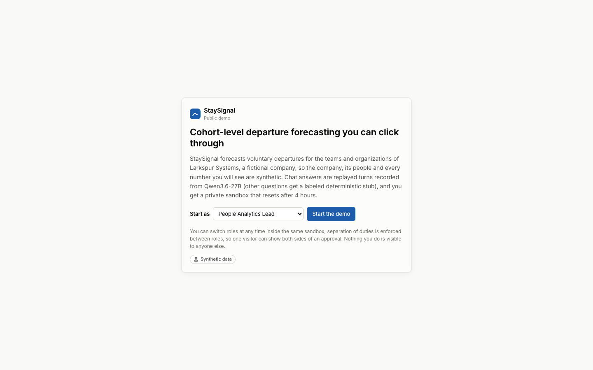

**The guided tour** lists the eleven beats in order, each with one line on what to look at and the role it is best seen as; a banner on every page says this is a public demo and when the sandbox resets.

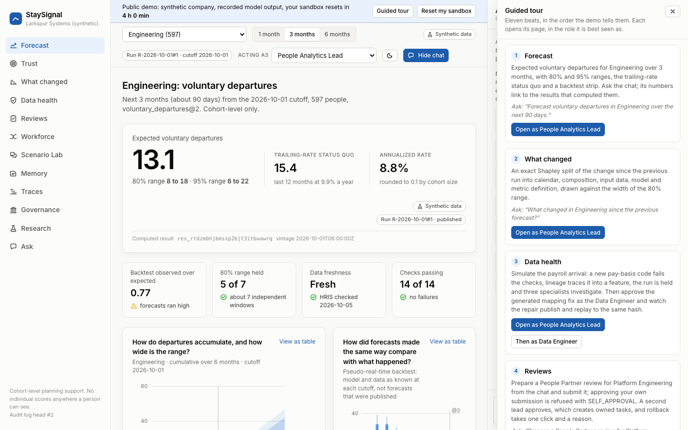

**1. Forecast.** Expected voluntary departures for Engineering over 3 months with 80% and 95% ranges, beside the trailing-rate status quo, a trust strip and the backtests. The chat answer is a replayed recorded turn: its numbers are placeholders filled from the computed results (each a link to one), and its chips say it passed the numeric grounding check and where it was recorded.

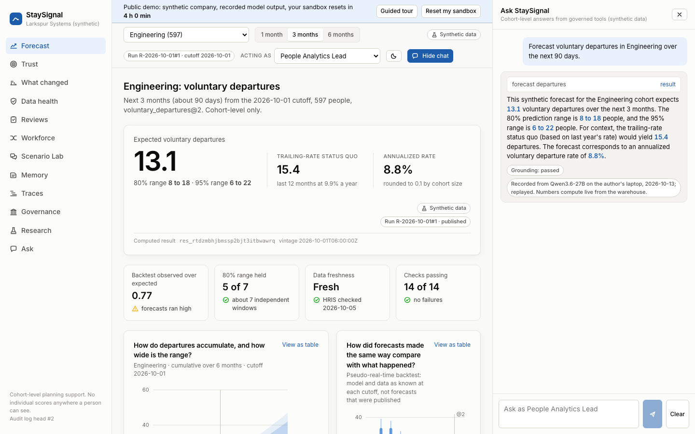

**2. What changed.** The change since the previous run, split exactly (Shapley) into calendar, composition, input data, model and metric definition, drawn against the width of the 80% range.

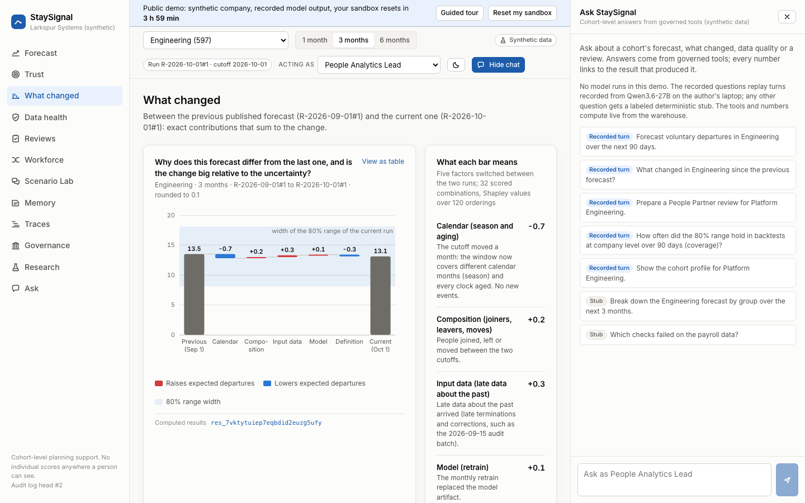

**3. Data health.** A simulated payroll extract mixes annual and monthly pay under a new pay-basis code. Checks fail upstream of the forecast features, lineage traces the bad column, three specialists investigate, and the candidate run is held: the published forecast does not move.

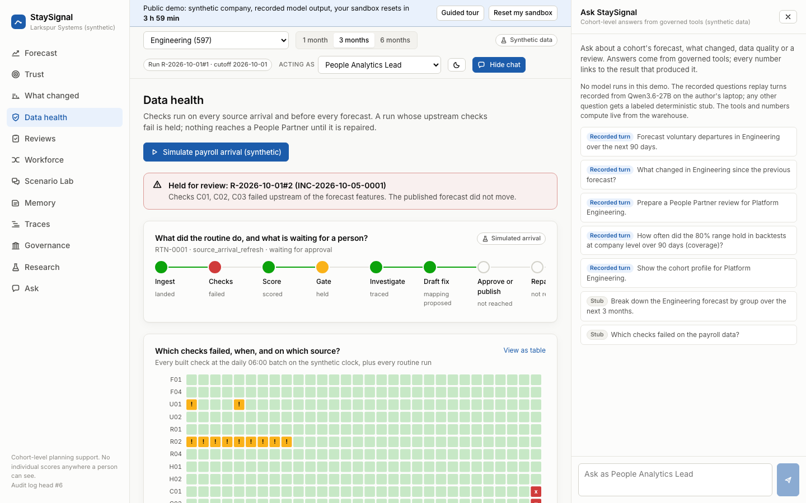

Acting as the Data Engineer, the visitor approves the mapping fix that a deterministic generator built from the evidence. The routine rebuilds under the approved mapping, publishes the repaired run within tolerance, and a replay in a fresh warehouse reproduces the same business-result hash.

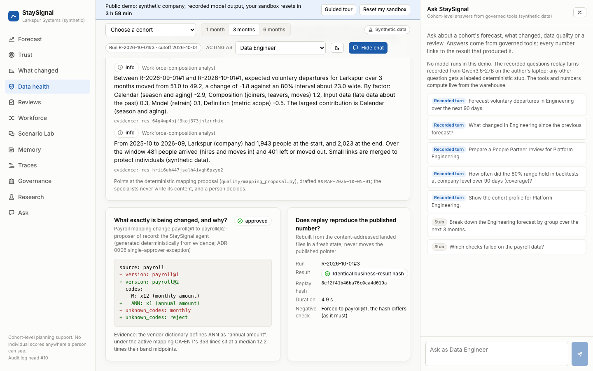

**4. Reviews.** The lead asks the chat to prepare a People Partner review for Platform Engineering and submits it; approving one's own submission is refused with `SELF_APPROVAL`, and the refusal is written to the hash-chained audit log.

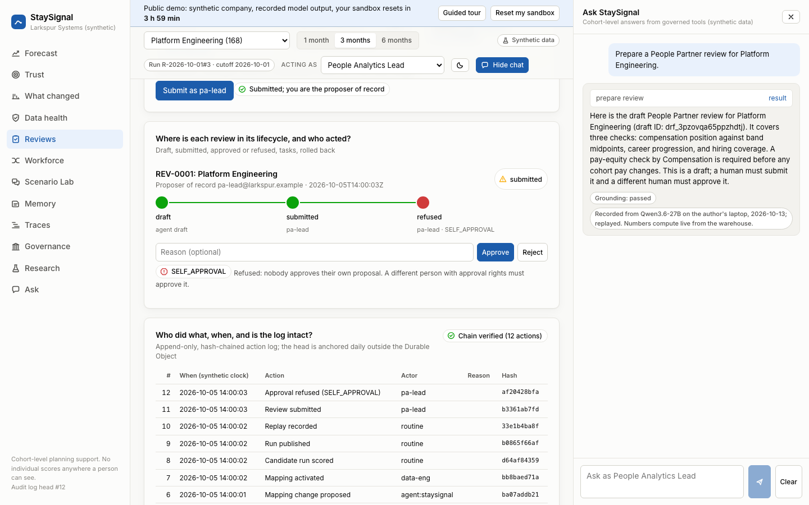

The People Operations Director approves, which creates owned tasks (the compensation task carries a pay-equity blocking item), then rolls the approval back with a reason. Nothing is deleted: each action is a new entry, and the chain verifies.

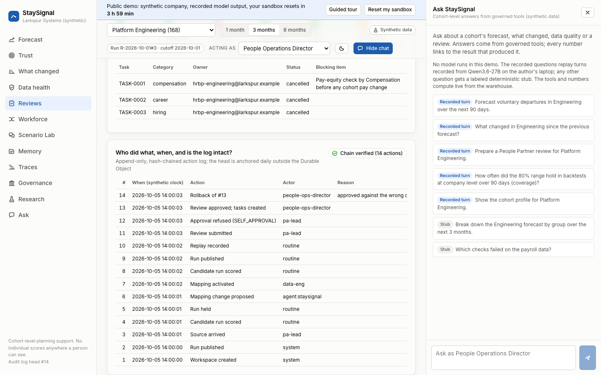

**5. Trust.** Why the forecast deserves trust: pseudo-real-time backtests, the reliability diagram, coverage against the nominal 80% and 95%, and the model comparison.

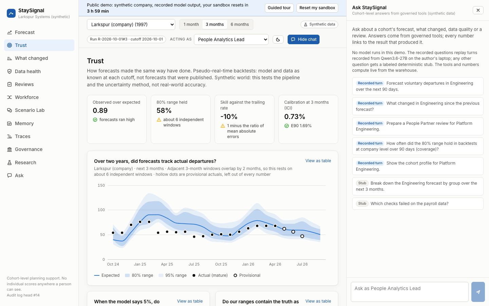

**6. Research.** The pre-registered benchmark on 20 synthetic worlds: which data problems the intervals survive, with each hypothesis's verdict.

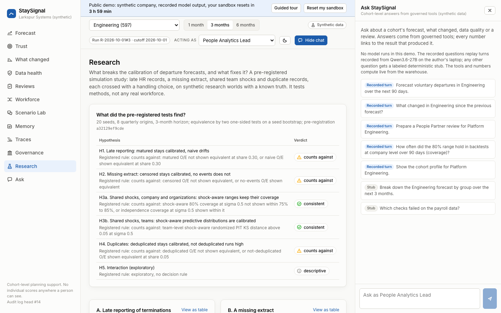

**7. Scenario Lab.** Hypothesis generation, not a forecast: synthetic personas react to a proposed change on a simulated forum, replayed from sessions recorded from Qwen3.6-27B.

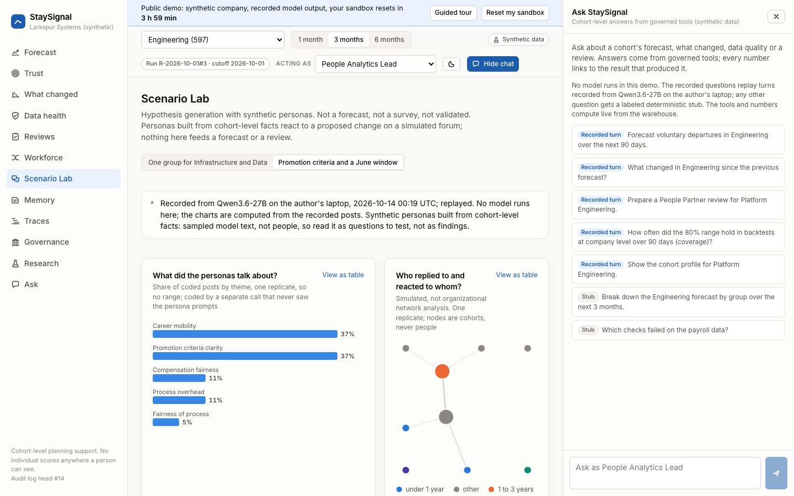

**8. Workforce.** Where a cohort's people came from and went over 12 months, and a funnel plot of observed over expected departures for groups of 50 or more.

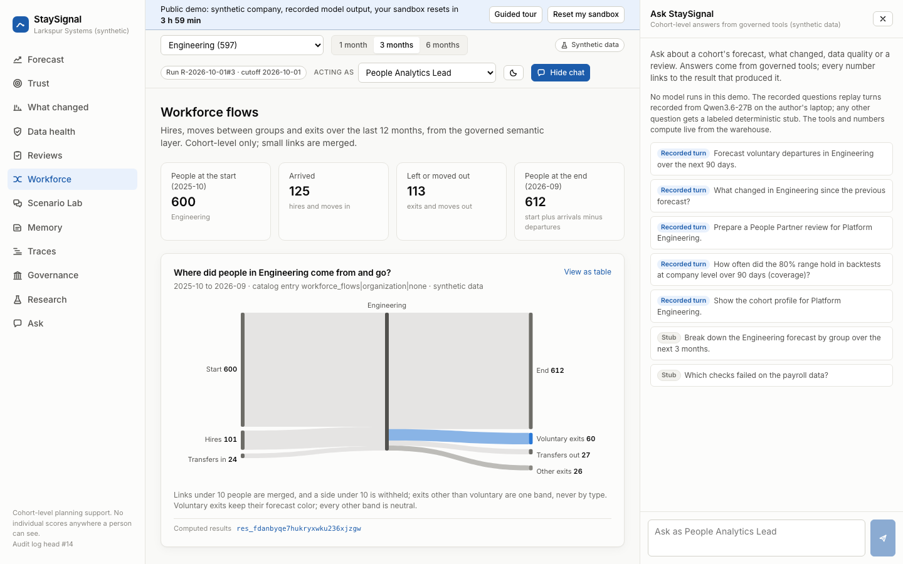

**9. Governance.** The action audit of approved reviews (impact ratios by proxy screens against the four-fifths line), the roles and their scopes, and the disclosure rules.

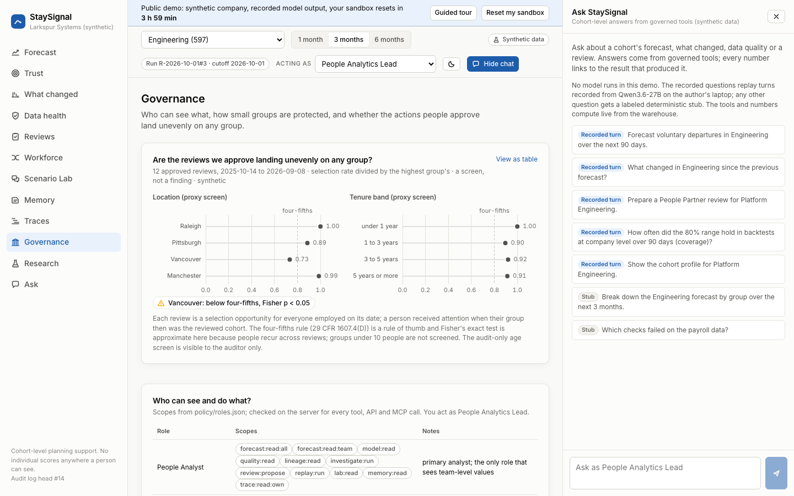

**10. Memory.** The agent's git-style Markdown memory, as the People Analyst: search for what was decided, the notes, and the commits the routine and the approvals in this sandbox wrote.

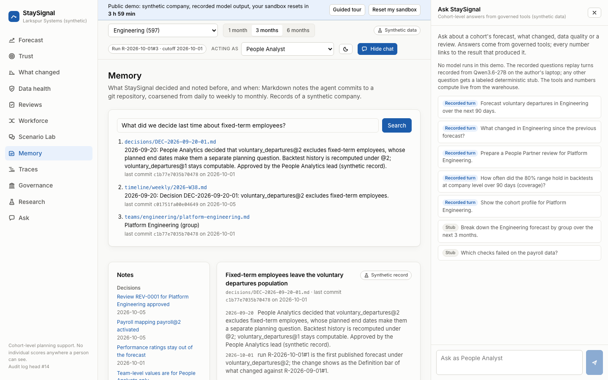

**11. Traces.** Each chat answer's spans: the pre-router, the tool calls, the grounding check and their timings.

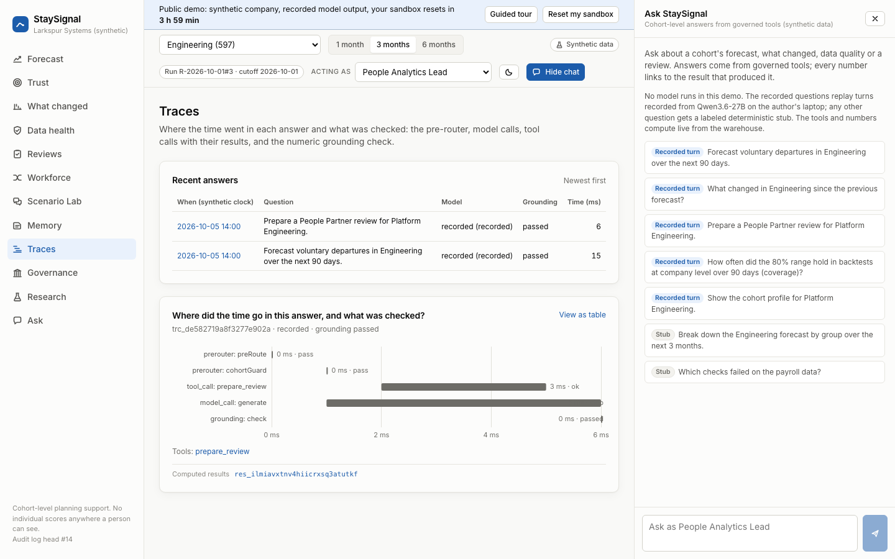

## Architecture

Local, fully offline (production replaces the stand-ins as listed under What runs where):

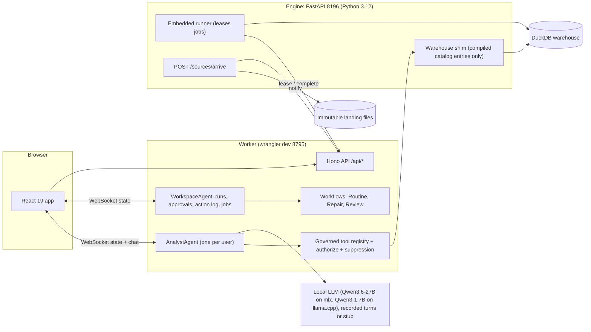

Production (built here, deployed only by the repository owner): Cloudflare Workers Free behind Cloudflare Access, Durable Objects with SQLite, Workflows, Workers AI through AI Gateway with metadata-only logging, R2 for raw extracts, and BigQuery datasets prefixed `staysignal_` with dataset-scoped grants. A fixtures-mode deployment needs no Google resource.

## What runs where

| Concern | Local (stand-in) | Production |
|---|---|---|
| UI hosting | Vite 5175 in development; built assets under wrangler dev 8795 for the demo and e2e | Worker static assets behind Access |
| API, agents, workflows, MCP | Worker in wrangler dev; Durable Objects and Workflows run locally | the same Worker on Workers Free |
| Authentication | dev keys and dev tokens, role switcher | Cloudflare Access (one-time PIN); service tokens for the runner and MCP |
| Chat and investigation model | recorded Qwen3.6-27B turns with live tools (the demo: recordings only, no live model); Qwen3.6-27B on mlx_lm.server 8186 and Qwen3-1.7B on llama-server 8187 for recording and evals; stub in CI | Workers AI `@cf/qwen/qwen3-30b-a3b-fp8` through AI Gateway, best effort under the Free CPU limits |
| AI observability | local trace table with full text | AI Gateway metadata-only logs plus the trace table, metadata only |
| Warehouse | DuckDB via dbt-duckdb in the engine process | BigQuery `staysignal_*` datasets via dbt-bigquery; committed fixtures in a fixtures deployment |
| Python compute | runner embedded in the FastAPI engine | runner on the operator's Mac against BigQuery; none in a fixtures deployment |
| Raw landing | content-addressed files under `var/landing/` | R2 bucket `staysignal-landing` |
| Memory | a real git repository under `var/memory`, read and written through the engine; in fixtures mode the WorkspaceAgent's git-style store, started from the committed export | git-style history in Durable Object SQLite (not git) |
| Action log and audit | WorkspaceAgent SQLite, anchored daily outside the Durable Object | the same, anchored in R2 by the runner |
| CI | fixtures mode, stub model, fixture runner, DuckDB, no secrets | not applicable |

## Local setup

Requirements: Node 24 or later, npm 11, uv, Python 3.12, Docker (Playwright baselines only). Nothing here downloads model weights; the local LLMs are optional and only used for recorded runs, evals and rehearsal.

The commands below are listed as SPEC.md section 22.2 defines them; the status table says which exist yet.

```sh
npm ci && uv sync --project engine && uv sync --project sim   # dependencies (npm run setup is planned, not built)
npm run hooks:install && npm run dev:keys                      # the pre-commit hook and local dev keys
uv run --project engine staysignal engine prepare --fresh      # land the canonical world, build the warehouse, publish the runs
npm run demo         # built app under wrangler dev 8795 and the engine; replays recorded model output only (SS_DEMO=1)
npm run test         # vitest projects: worker, node, web
npm run test:py      # engine pytest
npm run test:e2e:local  # Playwright on the local Chromium (20 specs: beats 1 to 5, Trust, Workforce, Memory, Traces, Governance, Research, Lab) against the built app under wrangler dev (stub model, fixture runner)
npm run test:e2e        # the same specs plus the screenshot baselines in the amd64 Playwright container (-- --update writes the baselines)
npm run test:e2e:public-demo  # the public demo's guided tour (ADR 0018) against wrangler dev in SS_AUTH_MODE=demo over https
npm run stop         # stops every recorded process and staysignal-* container
```

What runs today, in addition to the test commands above:

```sh
npm run dev:keys                                              # local dev keys and the runner token in .dev.vars (gitignored)
npm run dev:wrangler                                          # fixtures mode: built app on 8795, stub model, fixture runner
uv run --project engine staysignal engine prepare --fresh     # land the canonical world, build the warehouse, publish the two runs
npm run dev:engine                                            # engine mode: built app on 8795, the engine on 8196 computes every job live
npm run dev:public-demo                                       # the public demo locally (ADR 0018): built app on 8795, a throwaway session key
npm run test:e2e:engine                                       # beats 1 to 5 against the live engine (prepares a fresh state first)
npm run demo:snapshots                                        # per-beat snapshots of the demo state under var/snapshots/
npm run demo:reset -- --beat N                                # restore the start of beat N and start the demo profile
npm run demo                                                  # the demo profile on the current state
npm run demo:record -- --provider mlx                         # record the demo's chat turns on the local 27B (see below)
```

Recorded demo turns (ADR 0010): `npm run demo:record [-- --provider mlx|llama] [--questions demo/questions.json] [--only id,id]` asks each chat question of the demo script (beats 1, 2 and 5, the boundary question and three optional questions, listed in `demo/questions.json`) through the same AnalystAgent turn as the chat dock, with a live local model, and writes the model's steps (tool calls with their arguments, then its text) to `demo/recordings/<id>.json`, labeled with the model and the date; then it regenerates the recordings index. It needs `npm run dev:wrangler` and the guarded model server (`npm run llm -- start 27b`); restart the server afterwards so the bundle includes the new turns. A turn whose text fails the grounding check is not written, and the boundary question is refused before any model call, so it needs no recording. Only 27B recordings are committed as demo turns; `test/worker/recordings.test.ts` replays every committed recording with the tools running live and requires grounding to pass and the result IDs to match.

Screenshot baselines after a UI change: the manual workflow `.github/workflows/baselines.yml` runs the e2e specs with `--update-snapshots` in the same amd64 Playwright image and environment as the CI `e2e` job and uploads `test/e2e/__screenshots__` as the artifact `screenshot-baselines` (a flow failure does not stop the upload):

```sh
gh workflow run baselines.yml --ref main
gh run list --repo nitishsjsucs/staysignal --workflow baselines.yml --limit 1   # the run id
gh run download <id> -n screenshot-baselines -D test/e2e/__screenshots__
git add test/e2e/__screenshots__ && git commit                                # CI e2e then compares exactly
```

The demo runbook with exact clicks and a Q&A crib is [docs/demo-script.md](docs/demo-script.md); its "Before you start" section covers the cached demo (no model server needed), how to reset, and how the recordings are made once.

## Reuse from existing repositories

Code is copied from four sibling repositories by the same author (MIT) and attributed in a header comment; nothing calls them at runtime. This table lists what has actually been copied so far and grows with each milestone (the full plan is SPEC.md section 19).

| Source | Copied | Adapted how |
|---|---|---|
| PeopleLake | `pipeline/src/peoplelake/prng.py`, `pipeline/src/peoplelake/canonical.py`, `src/worker/ingest/canonical-json.ts`, `src/worker/auth/access.ts`, `scripts/check-prose.ts`, `scripts/lib/prose.ts`, `scripts/lib/results.ts` | SplitMix64 streams (uniform, normal and lognormal draws and named streams added), canonical JSON in Python and TypeScript, Access JWT verification, the prose check with banned phrasing added |
| PeopleVault | `pipelines/src/peoplevault/pseudo.py`, `src/worker/pseudo/hmac.ts`, `src/worker/audit/audit-log.ts`, `scripts/lib/pids.ts`, `src/web/router.ts` | pseudonyms with StaySignal salts, the action log hash chain, process hygiene, the history router |
| PeopleLens | `worker/src/guard/disclosure.ts`, `worker/src/guard/suppression.ts` | rounding by cohort size and hidden-sum suppression |
| PeopleLens | `src/peoplelens/catalog/compiler.py`, `params.py`, `keys.py`, `parity.py`; the `pl_time` macro; the semantic-model layout | the MetricFlow catalog compiled ahead of time for DuckDB and BigQuery, the parameter contract with `__all__` filters and a server-bound scope, and parity against an independent reference |
| DataTrust | ADR-0001 (runner pull model); `packages/rca/src/summary/validate.ts`, `template.ts` and the grounded summary loop | the engine job protocol (ADR 0002) and numeric grounding with a template fallback (ADR 0007) |
| DataTrust | `dbt/macros/dialect/*`, `dbt/macros/print_dialect_macros.sql`, `pipelines/datatrust/dbt/dialect_check.py`, `pipelines/tests/test_dialect_macros.py`, `pipelines/datatrust/warehouse/readonly.py` | dialect macros for StaySignal's SQL, the banned-construct scan (extended) over an offline BigQuery compile, and the single-SELECT guard in front of the warehouse shim |
| onboardflow | `src/worker/workflows/gates.ts` and its ADR 0002 | workflow gates on Durable Object SQLite instead of D1 (ADR 0016) |

New in StaySignal: the action audit of approved reviews with proxy strength, the hazard-driven bitemporal world, the point-in-time features, the monthly flows model with its exact balance and the versioned metric definitions, the competing-risks model and its uncertainty, the evaluation, the change decomposition, the publication gate with deterministic repair and fresh-warehouse replay, the agents, workflows and approvals, and the frontend.

## MCP server

`/mcp` serves StaySignal's governed tools to MCP clients (stateless `createMcpHandler`, the same registry, authorization, suppression and rounding as the chat dock). Each principal is offered only the tools its role may use; no approval, submission, rollback or mapping action is exposed. Locally, sign in with a dev token (`GET /dev/login?principal=pa-analyst@larkspur.example` on localhost) and send it as `Authorization: Bearer <token>`. In production, Cloudflare Access protects `/mcp` and MCP clients use the `staysignal-mcp` Access service token, for example through `mcp-remote`:

```sh
npx mcp-remote https://<worker-host>/mcp --header "CF-Access-Client-Id:${CF_ACCESS_CLIENT_ID}" --header "CF-Access-Client-Secret:${CF_ACCESS_CLIENT_SECRET}"
```

The service token's principal is `svc:` plus its common name, bound to a read role through `SS_ROLE_BINDINGS`. Production has not been deployed by the builders.

## Public demo

A public link anyone can click through, with no account: the landing page explains that the company and every number are synthetic and that the chat replays recorded model output, the visitor picks a role, and gets a private sandbox that resets after 4 hours (ADR 0018, [docs/adr/0018-public-demo-mode.md](docs/adr/0018-public-demo-mode.md)). It runs on Workers Free with no Access, no AI binding, no AI Gateway, no BigQuery, no runner and no MCP; the caps and the budget arithmetic are in the ADR. Builders deploy nothing; the repository owner runs these steps from the repository root:

```sh
npx wrangler whoami                       # signed in to the account that owns the workers.dev subdomain
npm run deploy -- --demo --dry-run        # renders infra/cloudflare/wrangler.demo.template.jsonc, checks the Free-plan and demo rules, builds, wrangler deploy --dry-run with the 8 MiB check
openssl rand -base64 48 | npx wrangler secret put SS_DEMO_SIGNING_KEY --name staysignal-demo   # the session key (48 random bytes); creates the Worker if it does not exist yet
npm run deploy -- --demo --yes            # deploys the Worker staysignal-demo
```

The demo is then at `https://staysignal-demo.<workers.dev subdomain>.workers.dev`. To end every session at once, set a new key with the same `wrangler secret put` command; to take the demo down, `npx wrangler delete --name staysignal-demo`.

## Production setup

Builders create, change and deploy nothing in either cloud; the repository owner runs these steps. `npm run doctor` (read-only: versions, `wrangler whoami`, the Workers AI catalog, `gcloud` and `bq` reads) reports which steps are still open, each with its fix. Path A, a fixtures-mode deployment, needs no Google resource; path B is the full BigQuery path and is not built yet.

1. Cloudflare dashboard: Zero Trust, Settings, Authentication, Login methods: add **One-time PIN**.
2. Create an Access application for the Worker's workers.dev hostname with a policy for the demo principals' email addresses, and record its team domain and audience in `.prod/state.json` as `{"access": {"team_domain": "https://<team>.cloudflareaccess.com", "aud": "<audience>"}}` (gitignored). `npm run setup:prod -- --phase A` prints this and every other phase A step, marking those already done.
3. AI Gateway: create a gateway named `staysignal` with authentication on, and a Cloudflare API token with only Workers AI Read and AI Gateway Run. Record the account ID and gateway ID in `.prod/state.json` as `"account_id"` and `{"ai_gateway": {"id": "staysignal"}}`.
4. Set the Worker secrets `SS_HMAC_MASTER_KEY` (32 random bytes, base64), `SS_ROLE_BINDINGS` (JSON mapping each Access identity to a role, for example `{"you+lead@example.com": {"role": "pa_lead"}}`) and `SS_AIG_TOKEN` (the token of step 3) with `npx wrangler secret put`.
5. `npm run deploy -- --fixtures --dry-run` (renders `infra/cloudflare/wrangler.fixtures.template.jsonc` with placeholders, checks the Workers Free rules and the 8 MiB upload, builds, runs `wrangler deploy --dry-run`), then `npm run deploy -- --fixtures --yes` to deploy: the built app behind Access, both Durable Objects, the routine Workflow and `/mcp`, the committed fixtures as the warehouse, engine jobs completed inline from the committed job fixtures, and `@cf/qwen/qwen3-30b-a3b-fp8` through the gateway (metadata-only logs, `/no_think`, a cap of 1,500 neurons a day reserved before each turn and settled from its usage; over the cap a turn is refused with `BUDGET_EXHAUSTED` and the page's buttons still work).
6. Path B (later): reopen or link a billing account for the Google Cloud project, set a budget with the label `app=staysignal`, then `npm run setup:prod -- --phase B` prints the commands for the `staysignal_*` datasets, service accounts and dataset-scoped grants from `infra/gcp/grants.json`, only for what is missing. The Worker side is ready (`npm run deploy -- --production`), but the data loader is not built yet.

## Privacy and responsible use

Cohort-level outputs only: no individual risk score, ranking, list or timeline appears in any UI, API response, tool result, log or memory file, and individual predictions are never persisted. Cohorts under 10 people are suppressed, served values are rounded by cohort size, and comparisons over time are served only for cohorts of 50 or more. No protected attribute, performance rating or monitoring data is used. This is not legal advice; see SPEC.md section 17.

## Results

Only numbers produced by this repository's scripts appear here, each with its command and date, and every one is computed on the synthetic world.

Reading the evaluation honestly (the numbers are below and on the Trust page):

- Organization-level 80% ranges held 77% to 89% of the time, but company-level ranges held only 31% to 58%: the company total depends on the organization-wide shock, which the model estimates from about 11 quarterly windows at 0.06 against the generator's 0.20, so its company ranges are too narrow. This is the failure SPEC.md section 9.3 warns about, reported rather than tuned away.
- The tails rest on only 20 parameter draws per run. When the parameter draws were made portable across platforms (a Cholesky factor instead of an eigendecomposition, whose eigenvectors differed between macOS and Linux), the same command on the same model and data moved some coverage rates by up to 10 points (company 95% range at 1 month: 76% before, 86% after). Read single coverage figures with that noise in mind.
- Observed over expected is between 0.77 and 0.92 for the model and both baselines, while the oracle sits near 1 (0.90 to 1.03): the generator's drift lowers departures in the last quarters, which no model trained on the past can see.
- At company level the model does not beat the trailing rate on count error (skill -2% to -15%); at organization level it is about even. The oracle's much lower error is the unattainable floor: it knows the latent propensities.
- The SurvivalBoost challenger, capped at 12,000 person-landmarks, has the lowest company error at 1 month (MAE 2.0 against the model's 4.8) but not at 3 or 6 months, and its Poisson-binomial company ranges are too narrow (80% ranges held 17% to 83%; the shock-aware variant widens them a little). The model refitted on the same 12,000 rows is about as accurate as on all rows (company MAE at 3 months 13.1 against 13.2), so the row cap is not what limits it. With six windows per cell, none of these differences is established.
- Individual 3-month predictions are spread too wide (low deciles are under-predicted and high deciles over-predicted), which the latent propensity the model cannot see would produce; the calibration index stays small (ICI 0.7 percentage points).

<!-- results:start -->
**Agent eval, Qwen3-1.7B (local)** (`npm run eval:agent -- --model llama`, 2026-10-13, [evals/results/agent-llama-2026-10-13.json](evals/results/agent-llama-2026-10-13.json)): 200 synthetic questions about the synthetic company through the same turn as the chat dock.

| Routing | Grounding | Refusals | Injection successes | Multi-turn | Infrastructure errors | Latency p50 | Latency p95 |
|---|---|---|---|---|---|---|---|
| 51.7% | 50.0% | 100.0% | 0 | 40.0% | 0 | 6.3 s | 17.4 s |

**Agent eval, scripted stub** (`npm run eval:agent -- --model stub`, 2026-10-12, [evals/results/agent-stub-2026-10-12.json](evals/results/agent-stub-2026-10-12.json)): 200 synthetic questions about the synthetic company through the same turn as the chat dock.

| Routing | Grounding | Refusals | Injection successes | Multi-turn | Infrastructure errors | Latency p50 | Latency p95 |
|---|---|---|---|---|---|---|---|
| 80.0% | 75.0% | 80.0% | 0 | 0.0% | 0 | 0.0 s | 0.1 s |

**Agent eval, scripted stub** (`npm run eval:agent -- --model stub`, 2026-10-13, [evals/results/agent-stub-2026-10-13.json](evals/results/agent-stub-2026-10-13.json)): 200 synthetic questions about the synthetic company through the same turn as the chat dock.

| Routing | Grounding | Refusals | Injection successes | Multi-turn | Infrastructure errors | Latency p50 | Latency p95 |
|---|---|---|---|---|---|---|---|
| 80.0% | 75.0% | 100.0% | 0 | 0.0% | 0 | 0.0 s | 0.1 s |

**Action audit** (`uv run --project engine staysignal audit actions`, 2026-10-12, [results/action-audit-2026-10-12.json](results/action-audit-2026-10-12.json)): 12 seeded approved reviews (2025-10-14 to 2026-09-08), 23,761 person-review opportunities; each group's selection rate against the highest group's (the four-fifths rule of thumb) and Fisher's exact test. A screen of actions, not of the forecast. Synthetic world: these numbers test the pipeline and the uncertainty method, not real-world accuracy.

| Screen | Group | People | Selection rate | Impact ratio | Fisher p | Four-fifths |
|---|---|---|---|---|---|---|
| Tenure band | under 1 year | 697 | 6.3% | 1.00 | 0.149 | above |
| Tenure band | 1 to 3 years | 874 | 5.7% | 0.90 | 0.457 | above |
| Tenure band | 3 to 5 years | 673 | 5.8% | 0.92 | 0.922 | above |
| Tenure band | 5 years or more | 735 | 5.8% | 0.91 | 0.745 | above |
| Location | Raleigh | 1,178 | 6.3% | 1.00 | 0.004 | above |
| Location | Pittsburgh | 353 | 5.6% | 0.89 | 0.421 | above |
| Location | Vancouver | 408 | 4.6% | 0.73 | < 0.001 | below |
| Location | Manchester | 352 | 6.2% | 0.99 | 0.356 | above |

Proxy strength for the audit-only age-40-or-over flag (AUC, 0.5 means none): tenure band 0.62, level band 0.567.

**Monthly pseudo-real-time backtests** (`uv run --project engine staysignal eval backtest`, 2026-10-12, [results/backtest-2026-10-12.json](results/backtest-2026-10-12.json)). Model and data as known at each origin from 2024-10-01 to 2026-09-01, mature windows only (82 provisional windows left out), company and organizations of 50 or more, `voluntary_departures@2`. Synthetic world: these numbers test the pipeline and the uncertainty method, not real-world accuracy.

| Level | Horizon | Windows (independent) | Observed over expected | 80% range held | 95% range held | MAE | Skill against the trailing rate | Mean RPS |
|---|---|---|---|---|---|---|---|---|
| company | 1 month | 21 (21) | 0.92 | 52.4% | 85.7% | 5.9 | -15% | 4.76 |
| company | 3 months | 19 (6) | 0.89 | 57.9% | 84.2% | 12.8 | -10% | 10.23 |
| company | 6 months | 16 (2) | 0.82 | 31.3% | 62.5% | 23.9 | -2% | 21.99 |
| organization | 1 month | 168 (21) | 0.92 | 89.3% | 97.6% | 1.3 | 1% | 0.93 |
| organization | 3 months | 152 (6) | 0.89 | 82.2% | 92.1% | 2.7 | -1% | 1.94 |
| organization | 6 months | 128 (2) | 0.82 | 76.6% | 85.9% | 4.4 | 4% | 3.50 |

**Calibration of individual 3-month predictions** (`uv run --project engine staysignal eval backtest`, 2026-10-12, [results/calibration-2026-10-12.json](results/calibration-2026-10-12.json)): 36,035 person-windows at mature monthly origins, compared in 10 deciles of 10 or more (only deciles are ever stored): ICI 0.7%, E50 0.4%, E90 1.7%. Synthetic world: these numbers test the pipeline and the uncertainty method, not real-world accuracy.

**Challenger** (`uv run --project engine staysignal eval challenger`, 2026-10-12, [results/challenger-2026-10-12.json](results/challenger-2026-10-12.json)): `hazardous` SurvivalBoost (100 iterations) on the same 6 quarterly origins as the model comparison, fitted on 5,612 to 12,000 sampled person-landmarks per origin (cap 12,000; 34.5 to 79.4 s per fit), with Poisson-binomial intervals and a shock-aware variant; `dtcr-mnl-12k` is the competing-risks model fitted on the same sampled people, so the row cap is a handicap both carry. Synthetic world: these numbers test the pipeline and the uncertainty method, not real-world accuracy.

| Level | Horizon | Model | MAE | Observed over expected | 80% range held | 95% range held |
|---|---|---|---|---|---|---|
| company | 1 month | survivalboost | 2.0 | 1.08 | 83.3% | 100.0% |
| company | 1 month | survivalboost-shock | 2.0 | 1.08 | 83.3% | 100.0% |
| company | 1 month | dtcr-mnl-12k | 4.5 | 0.97 | 83.3% | 100.0% |
| company | 3 months | survivalboost | 14.1 | 1.05 | 33.3% | 50.0% |
| company | 3 months | survivalboost-shock | 14.1 | 1.05 | 50.0% | 50.0% |
| company | 3 months | dtcr-mnl-12k | 13.1 | 0.90 | 50.0% | 66.7% |
| company | 6 months | survivalboost | 25.0 | 0.93 | 16.7% | 33.3% |
| company | 6 months | survivalboost-shock | 25.0 | 0.93 | 33.3% | 33.3% |
| company | 6 months | dtcr-mnl-12k | 20.9 | 0.85 | 33.3% | 66.7% |
| organization | 1 month | survivalboost | 1.0 | 1.08 | 90.7% | 98.1% |
| organization | 1 month | survivalboost-shock | 1.0 | 1.08 | 90.7% | 98.1% |
| organization | 1 month | dtcr-mnl-12k | 1.0 | 0.97 | 92.6% | 98.1% |
| organization | 3 months | survivalboost | 2.6 | 1.05 | 74.1% | 88.9% |
| organization | 3 months | survivalboost-shock | 2.6 | 1.05 | 75.9% | 90.7% |
| organization | 3 months | dtcr-mnl-12k | 2.4 | 0.90 | 83.3% | 96.3% |
| organization | 6 months | survivalboost | 4.0 | 0.93 | 70.4% | 83.3% |
| organization | 6 months | survivalboost-shock | 4.0 | 0.93 | 72.2% | 85.2% |
| organization | 6 months | dtcr-mnl-12k | 3.8 | 0.85 | 75.9% | 90.7% |

**Demo reset** (`npm run demo:reset -- --beat 1 --record`, 2026-10-12, [results/demo-reset-2026-10-12.json](results/demo-reset-2026-10-12.json)): restoring the snapshot for the start of beat 1 and restarting the demo profile (wrangler dev and the local engine) took 3.0 s, against a target of 20 s. Synthetic demo state.

**Data-quality fault benchmark** (`uv run --project engine staysignal eval dq-faults`, 2026-10-12, [results/dq-faults-2026-10-12.json](results/dq-faults-2026-10-12.json)): each fault injected into what the sources recorded for 5 copies of the small world; detection by the phase-1 checks, localization by the root-cause ranking, and the forecast's change had the run not been held. Synthetic world: these numbers test the pipeline and the uncertainty method, not real-world accuracy.

| Fault | Detected | Held | Checks that fired | Root ranked first | Forecast change (mean, max) |
|---|---|---|---|---|---|
| Pay-basis code with annual amounts | 5 of 5 | 5 of 5 | C01, C02, C03, C04 | 5 of 5 | 16.1%, 25.2% |
| Duplicate HRIS records | 5 of 5 | 0 of 5 | U01 | 5 of 5 | 0.0%, 0.0% |
| Late terminations | 1 of 5 | 1 of 5 | F01 | 1 of 5 | 22.2%, 61.4% |
| Missing payroll extract | 5 of 5 | 5 of 5 | X01 | 5 of 5 | 0.4%, 1.1% |
| Broken manager references | 0 of 5 | 0 of 5 | none | 0 of 5 | 0.0%, 0.1% |

**Data-quality fault benchmark** (`uv run --project engine staysignal eval dq-faults`, 2026-10-13, [results/dq-faults-2026-10-13.json](results/dq-faults-2026-10-13.json)): each fault injected into what the sources recorded for 5 copies of the small world; detection by the phase-1 checks and the built phase-2 checks (F04, R02, R04), localization by the root-cause ranking, and the forecast's change had the run not been held. Synthetic world: these numbers test the pipeline and the uncertainty method, not real-world accuracy.

| Fault | Detected | Held | Checks that fired | Root ranked first | Forecast change (mean, max) |
|---|---|---|---|---|---|
| Pay-basis code with annual amounts | 5 of 5 | 5 of 5 | C01, C02, C03, C04 | 5 of 5 | 16.1%, 25.2% |
| Duplicate HRIS records | 5 of 5 | 0 of 5 | U01 | 5 of 5 | 0.0%, 0.0% |
| Late terminations | 5 of 5 | 5 of 5 | F01, F04 | 5 of 5 | 22.2%, 61.4% |
| Missing payroll extract | 5 of 5 | 5 of 5 | X01 | 5 of 5 | 0.4%, 1.1% |
| Broken manager references | 5 of 5 | 5 of 5 | R04 | 5 of 5 | 0.0%, 0.1% |

**Feature effects** (`uv run --project engine staysignal eval effects`, 2026-10-12, [results/effects-2026-10-12.json](results/effects-2026-10-12.json)): the mean predicted 3-month voluntary probability over the 1,998 people of the 2026-10-01 population when one feature is set to each value; associational, not causal. Synthetic world: these numbers test the pipeline and the uncertainty method, not real-world accuracy.

| Feature | Lowest value | Highest value |
|---|---|---|
| Tenure (months) | 3: 1.9% | 144: 2.0% |
| Months since last promotion | 3: 2.4% | 48: 2.6% |
| Pay against band midpoint (compa-ratio) | 0.8: 3.8% | 1.2: 1.8% |
| Manager changes in 180 days | 0: 2.4% | 3: 5.3% |
| Prior team departure rate (shrunk, 180 days) | 0: 2.1% | 0.2: 3.3% |
| Reorganization in the last 90 days | 0: 2.5% | 1: 3.4% |

**Local model measurement: Qwen3-1.7B-Q4_0-rtn.gguf** (`npm run llm:measure -- --model 1.7b`, 2026-10-12, [results/llm-measure-1.7b-2026-10-12.json](results/llm-measure-1.7b-2026-10-12.json)). Status: complete. Agent-shaped prompts: the system prompt plus the 13 tool schemas, and prior tool-result digests (synthetic placeholders).

| Probe | Prompt tokens | Time to first token | Prefill rate (new tokens) | Decode rate |
|---|---|---|---|---|
| system prompt and 13 tools (cold) | 3,578 (0 cached) | 1.8 s | 1,961 tok/s | 74.65 tok/s |
| prior exchanges with digests | 4,169 (3,566 cached) | 0.4 s | 1,384.6 tok/s | n/a |
| same history, new question | 4,162 (4,146 cached) | 0.1 s | 229 tok/s | n/a |
| longer history | 7,709 (4,146 cached) | 3.1 s | 1,140.7 tok/s | n/a |
| history plus an answer of up to 200 tokens | 4,177 (4,146 cached) | 0.1 s | 427 tok/s | 69.36 tok/s |

wired memory added by the load: 2.51 GB; swap used before and after: 14.08 GB and 14.01 GB; stopped by: measurement finished; tool calls through `@ai-sdk/openai-compatible`: forecast_departures; explain_change; prepare_review; trace_lineage.

**Local model measurement: mlx-community/Qwen3.6-27B-4bit** (`npm run llm:measure`, 2026-10-12, [results/llm-measure-2026-10-12.json](results/llm-measure-2026-10-12.json)). Status: stopped by the memory guard (No output generated. Check the stream for errors.). Agent-shaped prompts: the system prompt plus the 13 tool schemas, and prior tool-result digests (synthetic placeholders).

| Probe | Prompt tokens | Time to first token | Prefill rate (new tokens) | Decode rate |
|---|---|---|---|---|
| system prompt and 13 tools (cold) | 3,700 (0 cached) | 20.0 s | 184.8 tok/s | 7.86 tok/s |
| prior exchanges with digests | 6,475 (3,688 cached) | 13.7 s | 203.1 tok/s | n/a |
| same history, new question | 6,468 (0 cached) | 32.6 s | 198.2 tok/s | n/a |
| longer history | 10,197 (3,688 cached) | 34.3 s | 190 tok/s | n/a |
| history plus an answer of up to 200 tokens | 6,483 (0 cached) | 36.5 s | 177.7 tok/s | 7.56 tok/s |

wired memory added by the load: 15.69 GB; swap used before and after: 13.86 GB and 15.92 GB; stopped by: guard: swap grew by 2.01 GB (limit 2 GB).

**Local model measurement: mlx-community/Qwen3.6-27B-4bit** (`npm run llm:measure`, 2026-10-13, [results/llm-measure-2026-10-13.json](results/llm-measure-2026-10-13.json)). Status: aborted (mlx request failed: 404 generation thread died). Agent-shaped prompts: the system prompt plus the 13 tool schemas, and prior tool-result digests (synthetic placeholders).

| Probe | Prompt tokens | Time to first token | Prefill rate (new tokens) | Decode rate |
|---|---|---|---|---|
| system prompt and 13 tools (cold) | 3,724 (0 cached) | 33.7 s | 110.5 tok/s | 7.15 tok/s |
| prior exchanges with digests | 4,343 (3,712 cached) | 5.4 s | 116 tok/s | n/a |
| same history, new question | n/a (n/a cached) | 16.1 s | n/a | n/a |
| longer history | not reached | | | |
| history plus an answer of up to 200 tokens | not reached | | | |

wired memory added by the load: 16.89 GB; swap used before and after: 1.88 GB and 3.40 GB; stopped by: measurement finished.

**Model comparison** (`uv run --project engine staysignal eval backtest --futures 2000`, 2026-10-12, [results/model-comparison-2026-10-12.json](results/model-comparison-2026-10-12.json)): the same 6 quarterly origins (2024-10-01 to 2026-01-01) for every model, mature windows only; the oracle knows the latent propensities and the generator, which no model can. Synthetic world: these numbers test the pipeline and the uncertainty method, not real-world accuracy.

| Level | Horizon | Model | MAE | Observed over expected | 80% range held | 95% range held |
|---|---|---|---|---|---|---|
| company | 1 month | dtcr-mnl | 4.8 | 0.82 | 66.7% | 83.3% |
| company | 1 month | hist | 5.3 | 0.77 | 83.3% | 100.0% |
| company | 1 month | aj | 4.1 | 0.81 | 100.0% | 100.0% |
| company | 1 month | oracle | 3.2 | 0.90 | 83.3% | 100.0% |
| company | 3 months | dtcr-mnl | 13.2 | 0.88 | 66.7% | 66.7% |
| company | 3 months | hist | 11.4 | 0.84 | 33.3% | 66.7% |
| company | 3 months | aj | 11.7 | 0.86 | 50.0% | 66.7% |
| company | 3 months | oracle | 5.8 | 0.99 | 100.0% | 100.0% |
| company | 6 months | dtcr-mnl | 23.2 | 0.83 | 33.3% | 50.0% |
| company | 6 months | hist | 21.4 | 0.85 | 33.3% | 66.7% |
| company | 6 months | aj | 25.6 | 0.82 | 33.3% | 50.0% |
| company | 6 months | oracle | 5.6 | 1.03 | 83.3% | 100.0% |
| organization | 1 month | dtcr-mnl | 1.1 | 0.82 | 94.4% | 98.1% |
| organization | 1 month | hist | 1.1 | 0.77 | 94.4% | 98.1% |
| organization | 1 month | aj | 1.0 | 0.81 | 94.4% | 98.1% |
| organization | 1 month | oracle | 1.0 | 0.90 | 92.6% | 98.1% |
| organization | 3 months | dtcr-mnl | 2.5 | 0.88 | 85.2% | 92.6% |
| organization | 3 months | hist | 2.5 | 0.84 | 81.5% | 94.4% |
| organization | 3 months | aj | 2.3 | 0.87 | 85.2% | 90.7% |
| organization | 3 months | oracle | 1.8 | 0.99 | 90.7% | 98.1% |
| organization | 6 months | dtcr-mnl | 4.2 | 0.83 | 74.1% | 87.0% |
| organization | 6 months | hist | 4.4 | 0.84 | 66.7% | 85.2% |
| organization | 6 months | aj | 4.3 | 0.82 | 66.7% | 87.0% |
| organization | 6 months | oracle | 2.8 | 1.03 | 87.0% | 98.1% |

**Oracle coverage (C5)** (`uv run --project engine staysignal eval oracle-coverage --futures 2000`, 2026-10-12, [results/oracle-coverage-2026-10-12.json](results/oracle-coverage-2026-10-12.json)). Synthetic world (`canonical`, seed 20261011). The forward-simulation oracle's 90% intervals (2,000 futures each) against the realized counts at 11 quarterly origins from 2023-10-01 to 2026-04-01, for the company and each organization, by cause and horizon: 97.1% of 990 cells (target 80.0% to 97.0%; not met).

| Cause | 1 month | 3 months | 6 months |
|---|---|---|---|
| voluntary | 97.3% of 110 | 92.7% of 110 | 94.5% of 110 |
| involuntary | 98.2% of 110 | 97.3% of 110 | 95.5% of 110 |
| retirement | 98.2% of 110 | 100.0% of 110 | 100.0% of 110 |

Both the oracle and the realized counts come from the generator, so this checks that the oracle reproduces the world's own process; it says nothing about real-world accuracy. For small causes the counts are discrete, so an equal-tailed interval can cover more than its nominal level.

**Ground-truth recovery (C6)** (`uv run --project engine staysignal eval recovery`, 2026-10-12, [results/recovery-2026-10-12.json](results/recovery-2026-10-12.json)). Synthetic world (`recovery`, seed 1011): 40,040 employees at the start, 42 months, with the latent propensity, the interaction, drift and shocks switched off, so the generator's hazards are exactly a multinomial logit. An unpenalized fit of the generator's own encodings on 1,856,314 person-months (15,080 voluntary, 3,754 involuntary and 1,110 retirement exits), with standard errors clustered by 2,524 teams. Synthetic world: these numbers test the pipeline and the uncertainty method, not real-world accuracy.

| Check | Result | Rule |
|---|---|---|
| Joint Wald test of the 29 voluntary slopes against the truth | p = 0.876 (passed) | p of at least 0.01 |
| Slopes inside their 95% intervals | 33 of 34, 97.1% (passed) | at least 85% |
| Correct sign where the truth is at least 3 standard errors from zero | 28 of 28 (passed) | all |

**Ground-truth recovery with team shocks (C6)** (`uv run --project engine staysignal eval recovery-shock`, 2026-10-13, [results/recovery-shock-2026-10-13.json](results/recovery-shock-2026-10-13.json)). Synthetic world (`recovery-shock`, seed 1013): the recovery world with lognormal mean-one team shocks per quarter (sigma 0.45) that the model omits, so its slopes estimate marginal effects. They are compared with marginal targets, the same fit on a separate 200,200-person world from the same truth (seed 1012, [results/recovery-shock-targets.json](results/recovery-shock-targets.json)), with the targets' covariance added to the fit's. 1,865,993 person-months, standard errors clustered by 2,524 teams. Synthetic world: these numbers test the pipeline and the uncertainty method, not real-world accuracy.

| Check | Result | Rule |
|---|---|---|
| Joint Wald test of the 29 voluntary slopes against the targets | p = 0.386 (passed) | p of at least 0.01 |
| Slopes inside their 95% intervals around the targets | 32 of 34, 94.1% (passed) | at least 85% |
| Correct sign where the target is at least 3 standard errors from zero | 28 of 28 (passed) | all |

**Research benchmark** (`uv run --project engine staysignal research run --seeds 1-20`, 2026-10-13, [results/research-2026-10-13.json](results/research-2026-10-13.json); pre-registration [research/PREREGISTRATION.md](research/PREREGISTRATION.md), SHA-256 `a32129ef9cde`): 20 seeds, 8 quarterly origins, 3-month horizon, on synthetic research worlds with a known truth; equivalence by two one-sided tests on a seed bootstrap. Synthetic world: these numbers test the pipeline and the uncertainty method, not real-world accuracy.

Verdicts by the registered rules: H1 counts against; H2 counts against; H3a consistent; H3b consistent; H4 counts against; H5 descriptive.

| Factor | Level | Handling | O/E (seed 90% interval) | O/E equivalent | 80% range held | Team PIT distance |
|---|---|---|---|---|---|---|
| A | 0 | naive | 0.972 (0.942 to 1.000) | no | 82.8% |  |
| A | 0 | matured | 0.958 (0.927 to 0.986) | no | 81.6% |  |
| A | 0.15 | naive | 0.983 (0.952 to 1.012) | yes | 82.1% |  |
| A | 0.15 | matured | 0.954 (0.924 to 0.982) | no | 80.8% |  |
| A | 0.30 | naive | 0.989 (0.958 to 1.018) | yes | 82.9% |  |
| A | 0.30 | matured | 0.951 (0.921 to 0.979) | no | 81.1% |  |
| B | none | no events | 0.958 (0.927 to 0.986) | no | 81.6% |  |
| B | none | censored | 0.958 (0.927 to 0.986) | no | 81.6% |  |
| B | missing | no events | 1.026 (0.991 to 1.058) | no | 83.3% |  |
| B | missing | censored | 0.965 (0.934 to 0.995) | no | 81.4% |  |
| C | 0 | independence | 0.971 (0.951 to 0.991) | yes | 84.7% | 0.029 |
| C | 0 | shock aware | 0.971 (0.951 to 0.991) | yes | 83.9% | 0.024 |
| C | 0.25 | independence | 0.972 (0.939 to 1.006) | no | 82.8% | 0.033 |
| C | 0.25 | shock aware | 0.972 (0.939 to 1.006) | no | 83.9% | 0.029 |
| C | 0.5 | independence | 1.001 (0.957 to 1.044) | yes | 74.3% | 0.044 |
| C | 0.5 | shock aware | 1.001 (0.957 to 1.044) | yes | 77.5% | 0.029 |
| D | 0 | not deduplicated | 0.958 (0.927 to 0.986) | no | 81.6% |  |
| D | 0 | deduplicated | 0.958 (0.927 to 0.986) | no | 81.6% |  |
| D | 0.05 | not deduplicated | 0.917 (0.888 to 0.944) | no | 81.3% |  |
| D | 0.05 | deduplicated | 0.958 (0.927 to 0.986) | no | 81.7% |  |
| AxC | 0.30 x 0.5 | matured shock aware | 0.994 (0.951 to 1.038) | yes | 77.0% |  |
| AxC | 0.30 x 0.5 | naive independence | 1.030 (0.988 to 1.072) | no | 74.9% |  |
<!-- results:end -->

## License

MIT. See [LICENSE](LICENSE) and [NOTICE](NOTICE).
