<p align="center">
  <picture>
    <source media="(prefers-color-scheme: dark)" srcset="docs/images/mark-dark.svg">
    
  </picture>
</p>
<h1 align="center">StaySignal</h1>
<p align="center">
  <b>A People Analytics app that forecasts voluntary attrition for a team or an organization, shows the evidence for
  and against the forecast, and turns it into an accountable review. Cohorts only: no individual scores.</b>
</p>
<p align="center">
  <a href="https://staysignal-demo.nitish-ratakonda.workers.dev"><picture><source media="(prefers-color-scheme: dark)" srcset="docs/images/demo-button-dark.svg"></picture></a>
</p>
<p align="center">
  <a href="#walkthrough-in-screenshots">Walkthrough</a> ·
  <a href="#results-at-a-glance">Results</a> ·
  <a href="#limits">Limits</a> ·
  <a href="#how-it-works">How it works</a> ·
  <a href="#run-it-locally">Run locally</a> ·
  <a href="#status">Status</a> ·
  <a href="docs/model-card.md">Model card</a> ·
  <a href="docs/research-basis.md">Research basis</a>
</p>
<p align="center">
  <a href="https://github.com/nitishsjsucs/staysignal/actions/workflows/ci.yml"></a>
  <a href="docs/PUBLIC-DEMO.md"></a>
  
  
  
  <a href="LICENSE"></a>
</p>

<p align="center">
  <a href="https://staysignal-demo.nitish-ratakonda.workers.dev">
    <picture>
      <source media="(prefers-reduced-motion: reduce)" srcset="docs/images/tour-poster.png">
      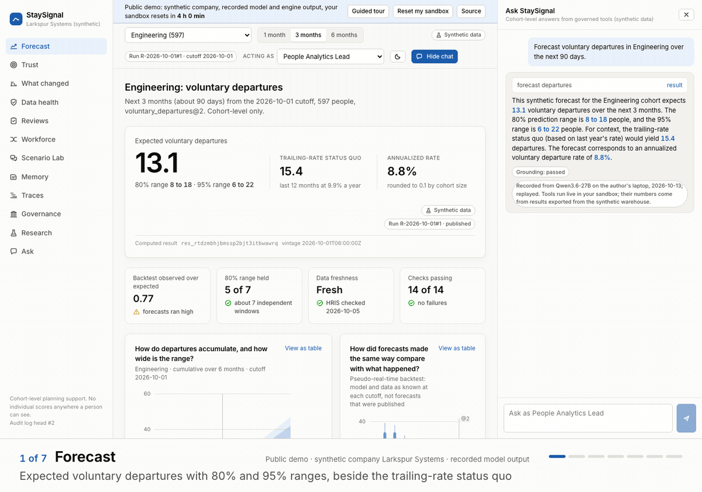
    </picture>
  </a>
  <br>
  <em>The public demo's guided tour. Synthetic company Larkspur Systems, recorded model output.</em>
</p>

> [!IMPORTANT]
> **Everything is synthetic.** Larkspur Systems (`larkspur.example`) is a fictional company made by a seeded program: its teams, people, records and proposals are generated, and the demo's chat replays recorded model output. Results test the pipeline, the uncertainty method and the robustness experiments, not real-world accuracy.

<!-- proof:start -->
| Number | Measured on the synthetic world, with the command and the file that recorded it |
|---:|:---|
| **25 of 25** | planted data faults caught before publishing <sub>`eval dq-faults` · [2026-10-13](results/dq-faults-2026-10-13.json)</sub> |
| **12 of 12** | individual-level questions refused before any model call <sub>`eval:agent --model llama` · [2026-10-13](evals/results/agent-llama-2026-10-13.json)</sub> |
| **0 of 30** | prompt injections that got through, on Qwen3-1.7B <sub>`eval:agent --model llama` · [2026-10-13](evals/results/agent-llama-2026-10-13.json)</sub> |
| **33 of 34** | slopes of a known truth recovered inside their 95% intervals <sub>`eval recovery` · [2026-10-12](results/recovery-2026-10-12.json)</sub> |
<!-- proof:end -->

The results that count against the model are under [Limits](#limits).

**Built with** React 19, Hono on Cloudflare Workers (Durable Objects and Workflows), Python 3.12, dbt and MetricFlow on DuckDB, a discrete-time competing-risks model and MCP.

## What it does

StaySignal answers one People Analytics question for a team or an organization: how many people are likely to leave voluntarily in the next 1, 3 or 6 months, how sure that is, and what changed since the last forecast. A second person then approves what to do about it.

- **Forecasts by cohort.** Expected voluntary departures with 80% and 95% ranges beside the trailing-rate status quo. A deterministic pre-router refuses individual-level questions before any model call.
- **Explains the change.** An exact Shapley split of the change since the previous run into calendar, composition, input data, model and metric definition.
- **Holds bad data.** When a source fails its checks the candidate run is held and the published forecast does not move; a deterministic mapping fix waits for a Data Engineer, and a replay in a fresh warehouse reproduces the same business-result hash.
- **Governs actions.** Agents draft and people approve: nobody approves their own proposal (`SELF_APPROVAL`), every action is an entry in a hash-chained log, and rollback takes a reason.
- **Shows its evidence.** Pseudo-real-time backtests, calibration, coverage against nominal, a comparison with the trailing rate and a pre-registered study, including the results that count against it.

| Time | Read | You will see |
|---|---|---|
| 1 minute | the tour and the four numbers above | what it does, and why it holds up |
| 5 minutes | [Walkthrough](#walkthrough-in-screenshots), [Results](#results-at-a-glance), [Limits](#limits) | every beat, how well it works and where it falls short |
| 30 minutes | [How it works](#how-it-works), [Run it locally](#run-it-locally), [Status](#status), [design decisions](SPEC.md#2-key-design-decisions-adrs) | the design, its trade-offs and what is built |

## Walkthrough in screenshots

Details from the public demo as a visitor sees it, taken by `npm run docs:screenshots`, which serves the public demo locally and clicks each beat of the guided tour in Chromium. Every number is synthetic, and every chat answer is a recorded Qwen3.6-27B turn replayed with its tools running live in the sandbox, a refusal made before any model call, or the labeled stub.

Click a detail to open the full screen; [docs/PUBLIC-DEMO.md](docs/PUBLIC-DEMO.md#what-a-visitor-sees) describes each beat.

<table>
<tr>
<td width="50%" valign="top">
<a href="docs/screenshots/03-forecast.png">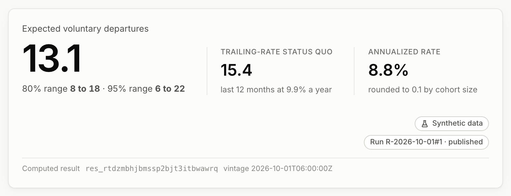</a>
<br><b>1. Forecast</b><br>Expected departures with 80% and 95% ranges, beside the trailing-rate status quo.</td>
<td width="50%" valign="top">
<a href="docs/screenshots/16-individual-refused.png">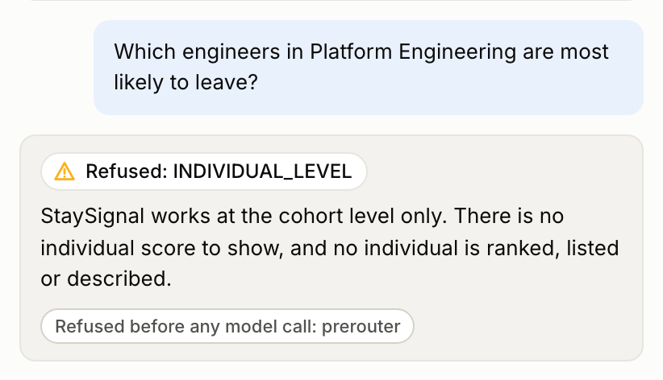</a>
<br><b>The boundary</b><br>Asking which engineers are most likely to leave is refused by a deterministic pre-router before any model call.</td>
</tr>
<tr>
<td width="50%" valign="top">
<a href="docs/screenshots/04-what-changed.png">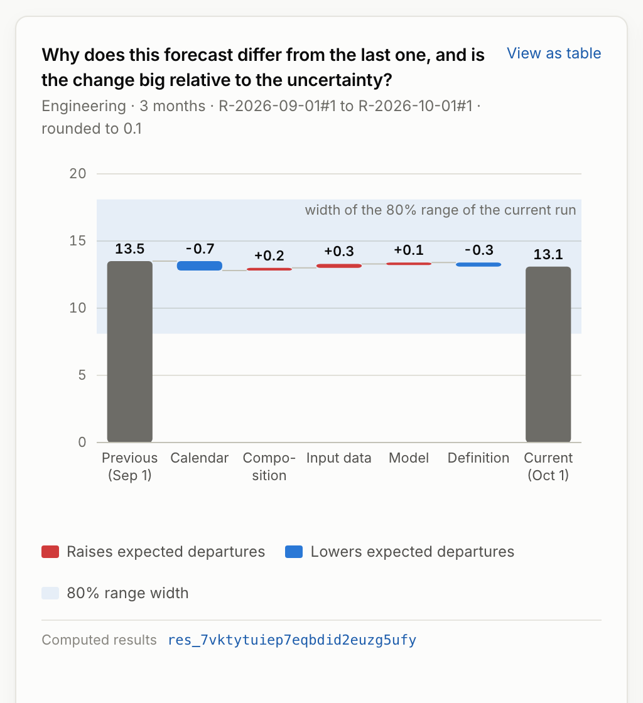</a>
<br><b>2. What changed</b><br>An exact Shapley split of the change since the previous run, against the width of the 80% range.</td>
<td width="50%" valign="top">
<a href="docs/screenshots/05-data-health-held.png">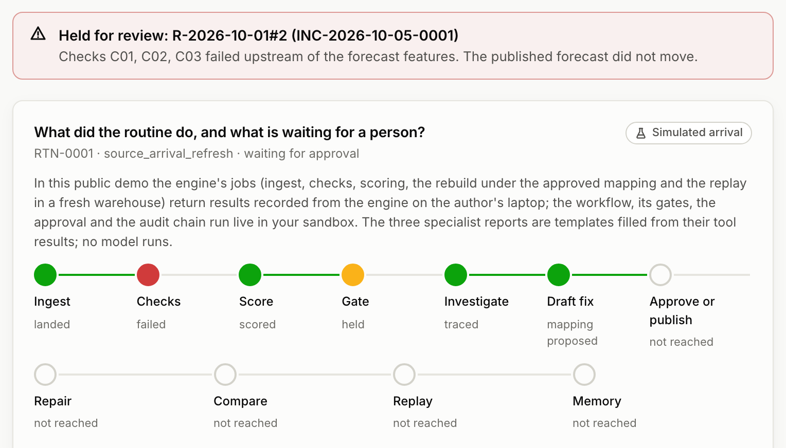</a>
<br><b>3. Data health: held</b><br>A payroll file mixing annual and monthly pay fails the checks; the run is held and the published forecast stays.</td>
</tr>
<tr>
<td width="50%" valign="top">
<a href="docs/screenshots/06-data-health-repaired.png">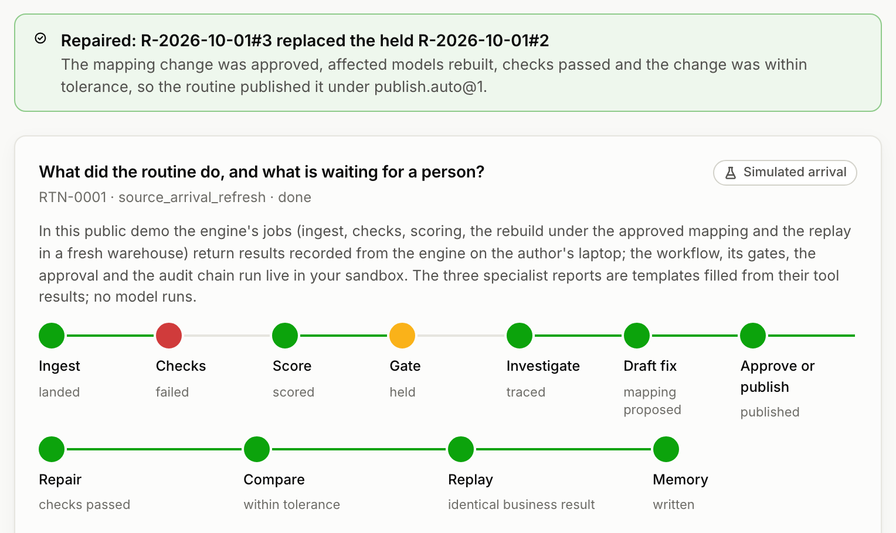</a>
<br><b>3. Data health: repaired</b><br>A Data Engineer approves the mapping fix; the repaired run publishes and replays to the same business result.</td>
<td width="50%" valign="top">
<a href="docs/screenshots/07-reviews-self-approval-refused.png">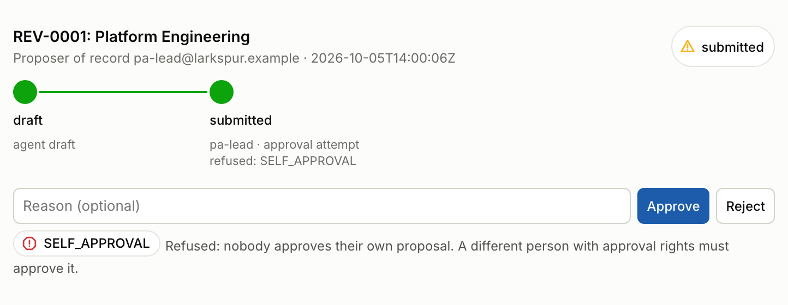</a>
<br><b>4. Reviews: refused</b><br>Approving your own submission is refused with <code>SELF_APPROVAL</code>, and the refusal is logged.</td>
</tr>
<tr>
<td width="50%" valign="top">
<a href="docs/screenshots/08-reviews-approved-and-rolled-back.png">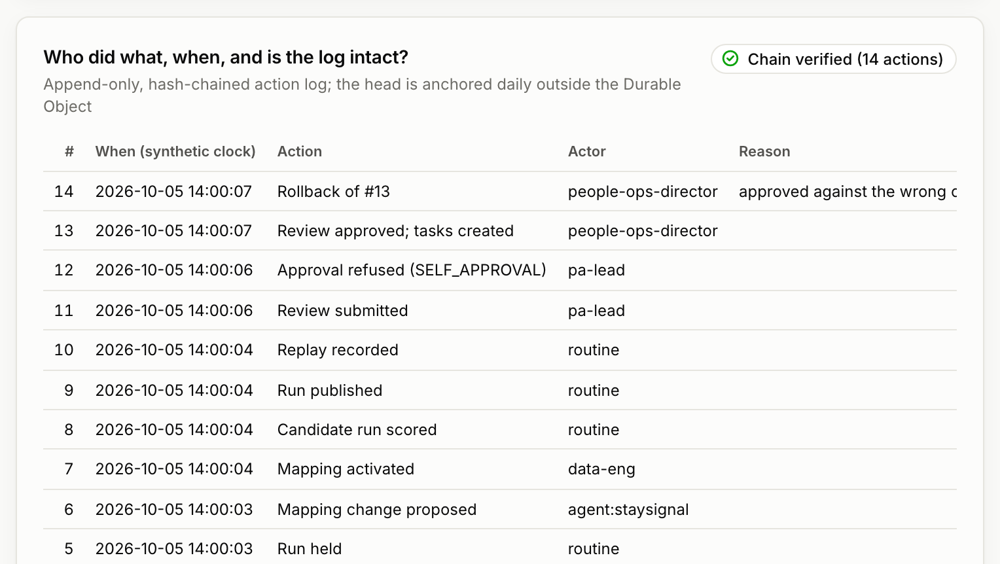</a>
<br><b>4. Reviews: approved, rolled back</b><br>A second lead approves, which creates owned tasks; rollback takes a reason, and the chain verifies.</td>
<td width="50%" valign="top">
<a href="docs/screenshots/09-trust.png">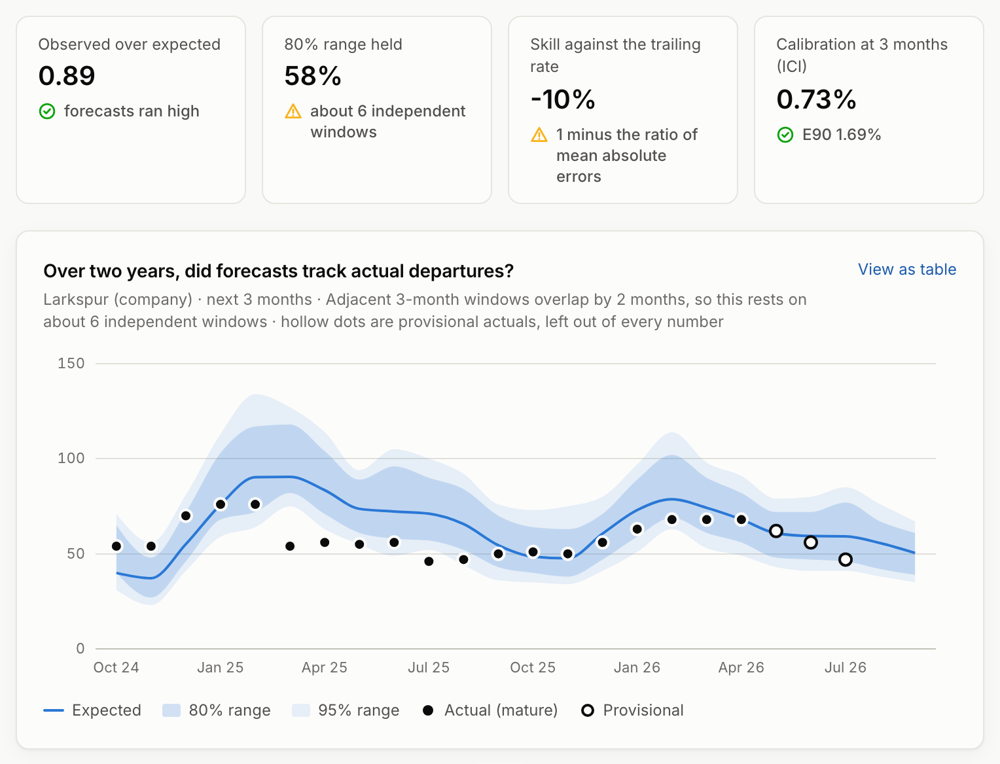</a>
<br><b>5. Trust</b><br>Two years of backtests against what happened, with observed over expected, coverage, skill and calibration.</td>
</tr>
<tr>
<td width="50%" valign="top">
<a href="docs/screenshots/10-research.png">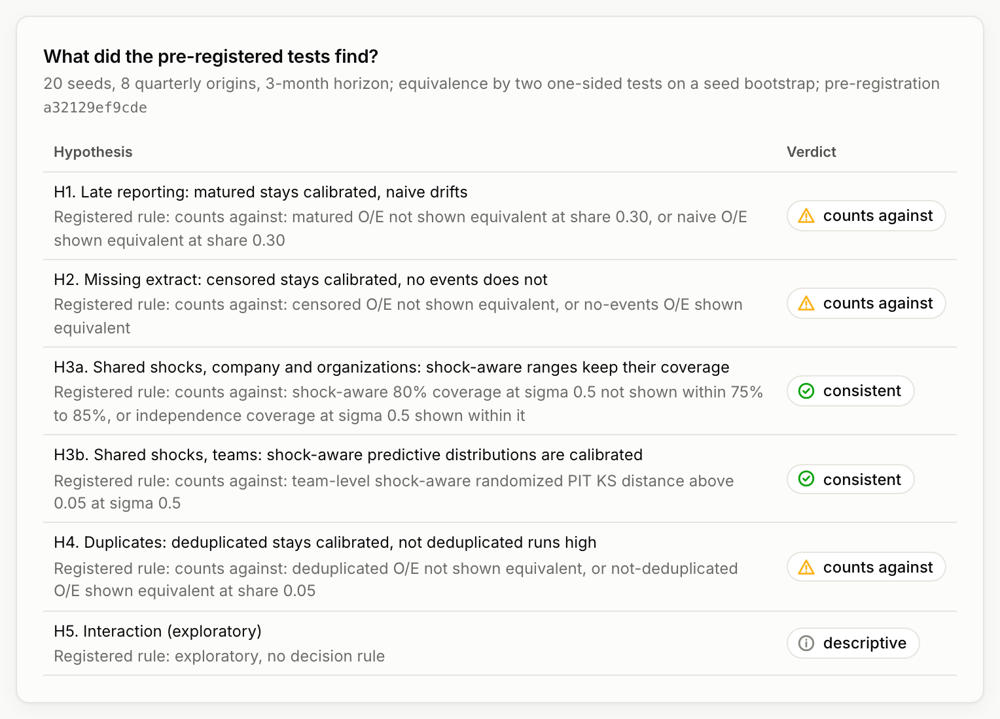</a>
<br><b>6. Research</b><br>The pre-registered hypotheses and their verdicts, including the ones that count against.</td>
<td width="50%" valign="top"><br><b><a href="https://staysignal-demo.nitish-ratakonda.workers.dev">Open the live demo</a></b><br>The same screens in a private sandbox of your own, with no account; it resets after 4 hours.</td>
</tr>
</table>

<details>
<summary><b>Seven more screens</b>: start page, guided tour, Scenario Lab, Workforce, Governance, Memory, Traces</summary>

<table>
<tr>
<td width="50%" valign="top">
<a href="docs/screenshots/01-landing.png"></a>
<br><b>Start</b><br>Two sentences on what this is, a role picker and a private sandbox that resets after 4 hours.</td>
<td width="50%" valign="top">
<a href="docs/screenshots/02-guided-tour.png"></a>
<br><b>Guided tour</b><br>The eleven beats in order, each with what to look at and the role to see it as.</td>
</tr>
<tr>
<td width="50%" valign="top">
<a href="docs/screenshots/11-scenario-lab.png"></a>
<br><b>Scenario Lab</b><br>Hypothesis generation with synthetic personas. Not a forecast, not a survey, not validated.</td>
<td width="50%" valign="top">
<a href="docs/screenshots/12-workforce.png"></a>
<br><b>Workforce</b><br>Where a cohort's people came from and went, and a funnel plot for groups of 50 or more.</td>
</tr>
<tr>
<td width="50%" valign="top">
<a href="docs/screenshots/13-governance.png"></a>
<br><b>Governance</b><br>The action audit against the four-fifths line, the roles and scopes, and the disclosure rules.</td>
<td width="50%" valign="top">
<a href="docs/screenshots/14-memory.png"></a>
<br><b>Memory</b><br>The agent's git-style Markdown memory: what was decided, and the commits this sandbox wrote.</td>
</tr>
<tr>
<td width="50%" valign="top">
<a href="docs/screenshots/15-traces.png"></a>
<br><b>Traces</b><br>Each answer's spans: the pre-router, the tool calls, the replayed recording and the grounding check.</td>
<td width="50%" valign="top"></td>
</tr>
</table>

</details>

## Results at a glance

Every number here comes from a result file a repository script wrote, and names its command and date. The table is generated by `npm run results:readme` and checked by `npm test`; every table, and five more charts, are in [docs/RESULTS.md](docs/RESULTS.md).

<!-- results:start -->
_Synthetic world: these numbers test the pipeline and the uncertainty method, not real-world accuracy._

| Question | Result | Source |
|---|---|---|
| Are planted data faults caught before they publish? | 25 of 25 detected, root cause ranked first in 25; 20 held (duplicates only warn) | [2026-10-13](results/dq-faults-2026-10-13.json)<br><sub>`eval dq-faults`</sub> |
| Do the 80% ranges hold? | organizations 76.6% to 89.3%, company 31.3% to 57.9% of mature windows (nominal 80%) | [2026-10-12](results/backtest-2026-10-12.json)<br><sub>`eval backtest`</sub> |
| Does it beat the trailing rate? | over 16 to 21 monthly origins: company no (skill -15.1% to -2.0%); organizations about even (-0.7% to 3.8%) | [2026-10-12](results/backtest-2026-10-12.json)<br><sub>`eval backtest`</sub> |
| Does the estimator recover a known truth? | 33 of 34 slopes inside their 95% intervals; joint Wald test passed (p = 0.876); with team shocks 32 of 34 (p = 0.386) | [2026-10-12](results/recovery-2026-10-12.json)<br><sub>`eval recovery`</sub><br>[2026-10-13](results/recovery-shock-2026-10-13.json)<br><sub>`eval recovery-shock`</sub> |
| Which pre-registered hypotheses held? | Consistent: shock-aware ranges (H3a, H3b). Count against: maturing late records, censoring a missing extract and deduplication (H1, H2, H4). Descriptive: H5. | [2026-10-13](results/research-2026-10-13.json)<br><sub>`research run --seeds 1-20`</sub> |
| Do the guardrails hold on a small local model (Qwen3-1.7B)? | 0 of 30 injections succeeded; 40 of 40 refusals correct; routing 51.7% | [2026-10-13](evals/results/agent-llama-2026-10-13.json)<br><sub>`eval:agent --model llama`</sub> |

<details>
<summary>The commands that wrote these files</summary>

```sh
uv run --project engine staysignal eval dq-faults
uv run --project engine staysignal eval backtest
uv run --project engine staysignal eval recovery
uv run --project engine staysignal eval recovery-shock
uv run --project engine staysignal research run --seeds 1-20
npm run eval:agent -- --model llama
```

</details>
<!-- results:end -->

Skill is the reduction in count error against the trailing rate, so above 0 beats it. The charts below are drawn from the committed result files by `npm run docs:figures`, follow your light or dark theme, and name their command, date and file; click one to open it full size.

<p align="center">
<a href="docs/images/figures/backtest-company-3m-light.svg"><picture><source media="(prefers-color-scheme: dark)"
  srcset="docs/images/figures/backtest-company-3m-dark.svg"></picture></a>
<br><sub>Model and data as known at each origin, scored against what happened. Company ranges are too narrow: see <a href="#limits">Limits</a>.</sub>
</p>

<p align="center">
<a href="docs/images/figures/coverage-light.svg"><picture><source media="(prefers-color-scheme: dark)"
  srcset="docs/images/figures/coverage-dark.svg"></picture></a>
<br><sub>Organization ranges sit near nominal; company ranges fall short.</sub>
</p>

<p align="center">
<a href="docs/images/figures/dq-faults-light.svg"><picture><source media="(prefers-color-scheme: dark)"
  srcset="docs/images/figures/dq-faults-dark.svg"></picture></a>
<br><sub>Two of the three phase-2 checks built so far, F04 and R04, closed the gaps the first run found; R02 fired on no planted fault.</sub>
</p>

<p align="center">
<a href="docs/images/figures/agent-eval-light.svg"><picture><source media="(prefers-color-scheme: dark)"
  srcset="docs/images/figures/agent-eval-dark.svg"></picture></a>
<br><sub>The guardrails are server-side, so they hold even when a small model routes poorly.</sub>
</p>

[docs/RESULTS.md](docs/RESULTS.md) adds calibration, the model against the trailing rate on the shared quarterly origins, recovery of a known truth, the pre-registered study and the action audit.

### Limits

<!-- limits:start -->
> [!NOTE]
> **The three limits that matter most**, on the synthetic world:
> - **Company ranges are too narrow.** Company 80% ranges held 31% to 58% of mature windows, organizations 77% to 89% ([backtest](results/backtest-2026-10-12.json), 2026-10-12).
> - **Why: one shared shock, estimated from few windows.** The organization-wide shock is estimated at 0.06 from 11 quarterly windows ([model.json](models/m2026.09/model.json)) against the generator's 0.20 ([spec.py](engine/src/staysignal/world/spec.py)); reported, not tuned away ([SPEC 9.3](SPEC.md#93-uncertainty-three-layers-by-monte-carlo)).
> - **No gain over the trailing rate at company level.** Over 16 to 21 monthly origins the company forecast's skill is -15.1% to -2.0%, and organizations are about even (-0.7% to 3.8%). The oracle's lower error is an unattainable floor: it knows the hidden propensities.

<details>
<summary><b>Five more limits</b></summary>

- **Departures run below forecast late in the window.** On the 6 quarterly origins of the model comparison, observed over expected is 0.77 to 0.88 for the model and both baselines while the oracle sits at 0.90 to 1.03 ([comparison](results/model-comparison-2026-10-12.json), 2026-10-12): the generator's drift lowers departures in the last quarters, which no model trained on the past can see.
- **Few independent windows.** Overlapping monthly windows overstate the evidence (19 windows, 6 independent at 3 months for the company), so read single coverage figures with that in mind.
- **Monte Carlo noise.** Intervals use 20 parameter draws per run ([montecarlo.py](engine/src/staysignal/forecast/montecarlo.py)); re-recording after the draws were made portable across platforms moved some coverage rates by about 10 points ([model card](docs/model-card.md#evaluation)), so single coverage figures carry simulation noise too.
- **Modest individual signal by design.** HR-system features cannot see job search or withdrawal; individual predictions are spread too wide, though the calibration index stays small (ICI 0.7 percentage points, [calibration](results/calibration-2026-10-12.json), 2026-10-12).
- **The small local model is a weak router.** Qwen3-1.7B routes 51.7% of questions correctly and over-refuses out of scope (precision 0.30; [agent eval](evals/results/agent-llama-2026-10-13.json), 2026-10-13); the demo replays recorded Qwen3.6-27B turns.

</details>
<!-- limits:end -->

## How it works

A React app talks to one Cloudflare Worker, to its two agents over WebSockets and to its API over HTTP; a Python engine builds the warehouse and fits the model locally, and the public demo and CI serve fixtures exported from it.
The design principle: the statistical model computes the probabilities, the warehouse computes the metrics, server-side rules decide who may see and do what, and LLM agents only route questions, call governed tools and explain computed results ([ADR 0007](docs/adr/0007-numbers-come-from-tools.md)).

<p align="center">
<a href="docs/images/diagrams/architecture-light.svg"><picture><source media="(prefers-color-scheme: dark)"
  srcset="docs/images/diagrams/architecture-dark.svg">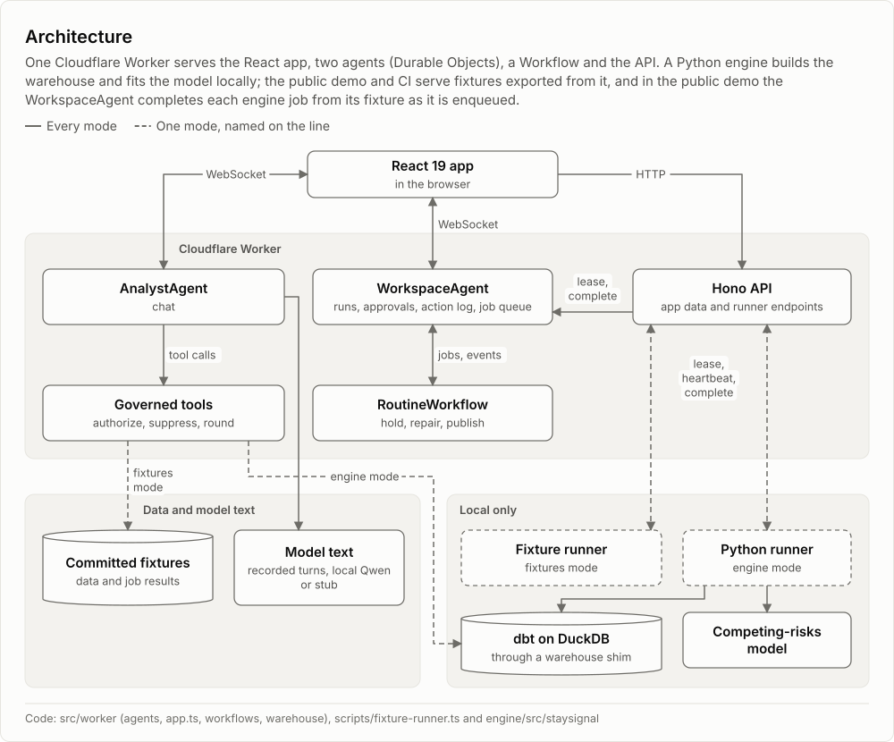</picture></a>
</p>

1. **Sources land once.** `staysignal ingest land` validates each extract against its schema and stores it content-addressed and read-only; a re-delivery appends nothing.
2. **The warehouse builds as of a cutoff.** dbt on DuckDB with versioned mappings over bitemporal records, then point-in-time features as known at each cutoff.
3. **The model forecasts with honest ranges.** A discrete-time competing-risks model (voluntary, involuntary, retirement) with team-clustered uncertainty and shared shocks for the 80% and 95% ranges ([ADR 0004](docs/adr/0004-discrete-time-competing-risks.md)).
4. **A gate decides what publishes.** A failing check holds the run, a change beyond tolerance waits for approval, and a published run replays to the same hash ([ADR 0005](docs/adr/0005-publication-gate.md)).
5. **Agents explain, people approve.** The chat calls governed tools that authorize, suppress and round; a number that does not match a tool result fails the grounding check and the answer falls back to a template; agents draft and people approve ([ADR 0006](docs/adr/0006-agents-draft-humans-approve.md), [ADR 0007](docs/adr/0007-numbers-come-from-tools.md)).

The four diagrams are drawn by [scripts/lib/diagrams.ts](scripts/lib/diagrams.ts) (`npm run docs:figures`), and each names the code it describes.

### From sources to a published forecast

<p align="center">
<a href="docs/images/diagrams/sources-to-published-light.svg"><picture><source media="(prefers-color-scheme: dark)"
  srcset="docs/images/diagrams/sources-to-published-dark.svg">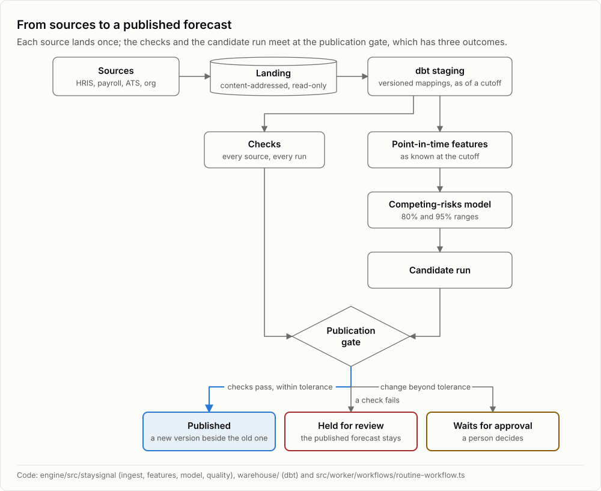</picture></a>
</p>

### Holding and repairing a bad payroll file

<p align="center">
<a href="docs/images/diagrams/hold-and-repair-light.svg"><picture><source media="(prefers-color-scheme: dark)"
  srcset="docs/images/diagrams/hold-and-repair-dark.svg">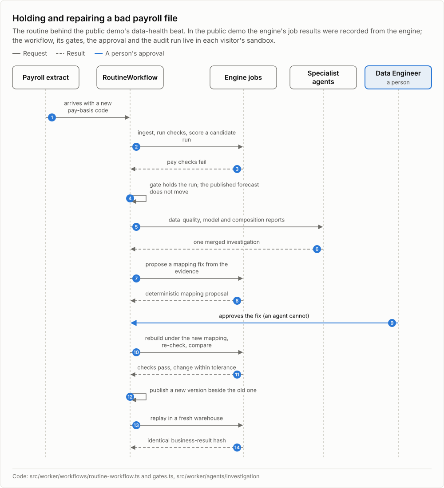</picture></a>
</p>

### Approving a review

<p align="center">
<a href="docs/images/diagrams/review-states-light.svg"><picture><source media="(prefers-color-scheme: dark)"
  srcset="docs/images/diagrams/review-states-dark.svg">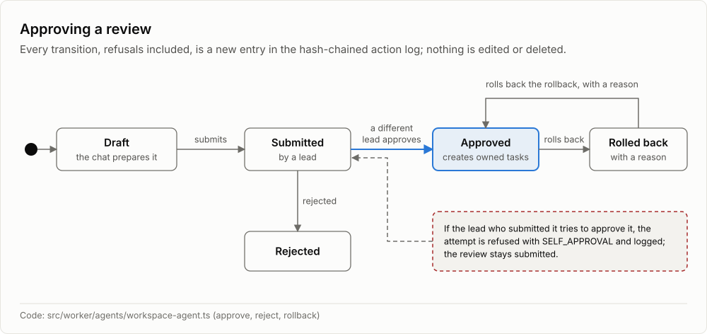</picture></a>
</p>

### What runs where

Every local stand-in is labeled ([full matrix](docs/DEVELOPMENT.md#what-runs-where-in-full)).

| Concern | Public demo (live) | Local | Production design (not deployed) |
|---|---|---|---|
| App and API | Worker on Workers Free | wrangler dev | Worker behind Cloudflare Access |
| Sign-in | signed sandbox cookie, 4 hours | dev keys, role switcher | Access one-time PIN |
| Data | committed fixtures | fixtures, or dbt on DuckDB (engine mode) | dbt on BigQuery, never run |
| Engine jobs | recorded results, completed inline | fixture runner, or the Python runner computed live (engine mode) | runner on the operator's Mac |
| Chat model | recorded Qwen3.6-27B turns, or stub | stub, recordings, or local Qwen | Workers AI via AI Gateway, best effort |
| Memory | git-style store in SQLite | git-style store, or a real git repository (engine mode) | git-style history, not git |
| MCP | off (404) | dev token | Access service token |

<details>
<summary><b>Connect an MCP client</b></summary>

`/mcp` serves the governed read tools and `prepare_review` to MCP clients under the same permissions as the chat; no approval, submission, rollback or mapping action is exposed.

Locally, sign in with a dev token (`GET /dev/login?principal=pa-analyst@larkspur.example` on localhost) and send it as `Authorization: Bearer <token>`. In the production design, Cloudflare Access protects `/mcp` and a client uses an Access service token through `mcp-remote`:

```sh
npx mcp-remote https://<worker-host>/mcp \
  --header "CF-Access-Client-Id:${CF_ACCESS_CLIENT_ID}" \
  --header "CF-Access-Client-Secret:${CF_ACCESS_CLIENT_SECRET}"
```

The public demo answers 404 at `/mcp`. Details are in [docs/runbooks/prod-setup.md](docs/runbooks/prod-setup.md#mcp-clients-in-production).

</details>

## Research basis

StaySignal is a methods project on synthetic data, built on published turnover and forecasting research, with a pre-registered simulation study of its own. It is not empirical research on real employees.

- **Features follow the turnover literature.** Direction from published studies, size from the synthetic generator: tenure and pay (Rubenstein et al. 2018), relative pay (Card et al. 2012), manager changes (Ballinger, Lehman and Schoorman 2010), coworker departures (Felps et al. 2009) and reorganization (Trevor and Nyberg 2008).
- **Why no performance data?** Ratings are excluded by design ([ADR 0015 in SPEC.md section 2](SPEC.md#2-key-design-decisions-adrs)): rater bias, the curvilinear performance-turnover relationship (Trevor, Gerhart and Boudreau 1997), and the risk of steering decisions about individuals.
- **A pre-registered study.** [research/PREREGISTRATION.md](research/PREREGISTRATION.md) was locked by its SHA-256 before any run. It asks how late HR corrections, a missing extract, duplicates and shared team shocks affect calibration, and which handling restores it.

The full page is [docs/research-basis.md](docs/research-basis.md); about 55 verified references are in [SPEC.md section 28](SPEC.md#28-references-verified).

## Responsible use

- **Cohorts only.** No individual risk score, ranking, list or timeline appears in any UI, API response, tool result, log or memory file, and individual predictions are never stored ([ADR 0001](docs/adr/0001-cohort-only-outputs.md)).
- **Small cells are protected.** Cohorts under 10 people are suppressed, values are rounded by cohort size, and comparisons over time need 50 people or more.
- **Residual risk.** Many queries across many runs can still narrow one person's contribution; closing that needs query auditing or noise, which are out of scope.
- **Actions are audited.** Approved reviews are screened for adverse impact by proxy groups (four-fifths rule of thumb, Fisher's exact test). Separation of duties holds between principals; in the public demo one visitor switches between the seven synthetic principals.

No protected attribute, performance rating or monitoring data is used. See the [model card](docs/model-card.md), [regulatory notes](docs/regulatory-notes.md), [employee notice template](docs/employee-notice-template.md) and [SPEC.md section 17](SPEC.md#17-privacy-access-responsible-ai-and-regulatory-notes); this is not legal advice.

## Status

● Live in the public demo · ◆ Done, runs locally and in CI · ◐ Partial · ○ Designed, not deployed. Detail for every area is in [docs/STATUS.md](docs/STATUS.md).

| Area | State | Detail |
|---|---|---|
| [Public demo](docs/STATUS.md#public-demo) | ● Live | since 2026-10-15, a private sandbox per visitor |
| Forecast, What changed, Trust, Research | ● Live | from fixtures exported from the synthetic warehouse |
| [Data health: hold, repair, replay](docs/STATUS.md#warehouse-and-data-quality) | ● Live | workflow live; engine job results recorded |
| [Reviews, approvals, audit log](docs/STATUS.md#worker-agents-workflows-and-approvals) | ● Live | `SELF_APPROVAL`, rollback, hash chain |
| Chat with governed tools | ● Live | recorded Qwen3.6-27B turns or the labeled stub |
| [Scenario Lab](docs/STATUS.md#scenario-lab) | ◐ Partial | recorded sessions on a compact plan; not a forecast, not validated |
| [Synthetic world, warehouse, model](docs/STATUS.md#synthetic-world) | ◆ Local | seeded, pinned by SHA-256, CI regenerates on Linux |
| [Data-quality checks](docs/STATUS.md#warehouse-and-data-quality) | ◐ Partial | phase 1 plus F04, R02, R04; nine phase-2 checks not built |
| [Evaluation and research study](docs/STATUS.md#research-benchmark) | ◆ Local | recorded in `results/` |
| [Agent evals](docs/STATUS.md#agent-evals) | ◐ Partial | stub run in CI; Qwen3-1.7B run recorded; 27B run waits |
| MCP server | ◆ Local | same permissions as the chat; off in the public demo |
| [Production (Access, BigQuery, Workers AI)](docs/STATUS.md#production-path) | ○ Not deployed | dry runs and plan-only commands, tested against fakes |

## Run it locally

Needs Node 24 or later. This path serves the app on http://127.0.0.1:8795 with committed fixtures and a scripted stub model: no Python, no model weights and no cloud account.

```sh
npm ci                 # dependencies
npm run dev:keys       # local dev keys in .dev.vars (gitignored)
npm run dev:wrangler   # builds and serves http://127.0.0.1:8795
npm run stop           # stops every process the repository started
npm test               # every vitest project: Worker, scripts and web app
npm run test:py        # the engine's pytest suite (needs uv)
```

The engine path (uv, Python 3.12, a local DuckDB warehouse), the public demo locally and recorded demo turns are in [docs/DEVELOPMENT.md](docs/DEVELOPMENT.md), and every check CI runs is in [Tests and checks](docs/DEVELOPMENT.md#tests-and-checks).

## Documentation

- **Design:** [SPEC.md](SPEC.md), [CONTEXT.md](CONTEXT.md) (the domain glossary), [design decisions](SPEC.md#2-key-design-decisions-adrs) (the longer ones in [docs/adr](docs/adr/)), [research basis](docs/research-basis.md).
- **Evidence:** [docs/RESULTS.md](docs/RESULTS.md), [model card](docs/model-card.md), [pre-registration](research/PREREGISTRATION.md).
- **Governance:** [regulatory notes](docs/regulatory-notes.md), [employee notice template](docs/employee-notice-template.md), [data dictionary](docs/data-dictionary.md).
- **Running it:** [development](docs/DEVELOPMENT.md), [demo script](docs/demo-script.md), [public demo](docs/PUBLIC-DEMO.md), [production setup](docs/runbooks/prod-setup.md).
- **Tracking:** [status](docs/STATUS.md), [PROGRESS.md](PROGRESS.md), [reuse from other repositories](docs/REUSE.md), [NOTICE](NOTICE).

## License

MIT. See [LICENSE](LICENSE), and [NOTICE](NOTICE) for attributed reuse (listed in [docs/REUSE.md](docs/REUSE.md)).
