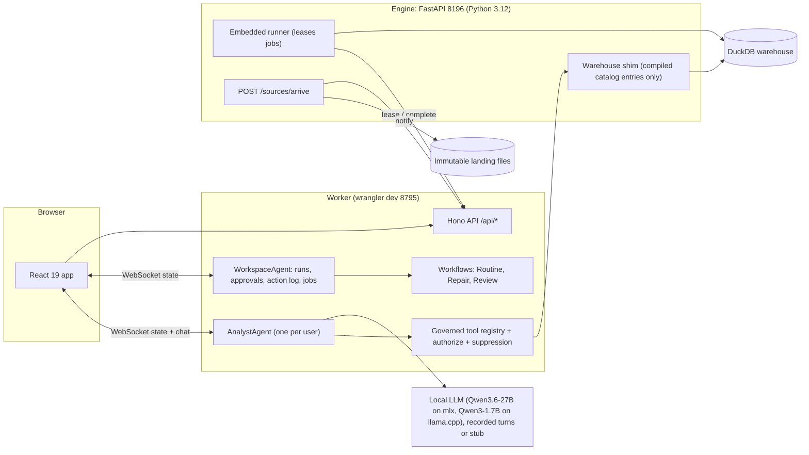

# StaySignal

StaySignal forecasts voluntary departures for a team or organization, shows why the forecast deserves trust, and turns it into an accountable People Partner review. The statistical model computes probabilities, the warehouse computes metrics, server-side rules control access and actions, and LLM agents only route questions, orchestrate tools and explain computed results.

**Everything is synthetic.** The company is the fictional **Larkspur Systems** (`larkspur.example`); its teams, people, records and proposals are generated by a seeded program. Simulated actions and synthetic data are labeled as such in the UI, the API and every figure. Results computed on this world test the pipeline, the uncertainty method and the robustness experiments, not real-world accuracy.

The design is in [SPEC.md](SPEC.md), the domain glossary in [CONTEXT.md](CONTEXT.md), decisions in [docs/adr/](docs/adr/), and build progress in [PROGRESS.md](PROGRESS.md).

## Status

Work follows the commit plan in SPEC.md section 24, core path first. The demo date is not fixed yet, so the 7-day schedule variant is active (milestones M0 to M2, then M3 in order). This table changes in every commit that changes what works.

| Area | State |
|---|---|
| Scaffold, license, README, CONTEXT, PROGRESS | done |
| ADRs 0001 to 0007 and 0012 | done (`docs/adr/`) |
| Node toolchain (Worker, web, tests) | done: exact pins (SPEC 25), strict tsconfigs, Vite 8 with the `agents()` plugin, vitest projects `worker`, `node`, `web`, generated Worker types; the Worker answers `/api/health` only |
| Engine uv project (Python 3.12) | done: `engine/pyproject.toml` with the SPEC 25 pins, committed `uv.lock` (157 packages), `staysignal` CLI skeleton, pytest and ruff |
| Prose and hygiene gates, pre-commit hook, CI | done: `npm run check:prose` (no em or en dashes, no banned phrasing), `npm run check:hygiene` (public tier: dashes in every tracked file, secrets, no git SHA in pinned paths, monitoring and special-category terms and a personal-name heuristic over generated text), a pre-commit hook that adds the private tier from a deny-list kept outside the repository and the operator's secret scan, and CI jobs `node` and `engine` |
| 27B measurement on agent-shaped prompts | partial: `npm run llm:measure` measured prefill, time to first token and decode for Qwen3.6-27B, then the memory guard stopped it when swap grew by 2 GB with other apps open, before the tool-call probe; the same harness ran completely on Qwen3-1.7B, including tool calls through `@ai-sdk/openai-compatible` (see Results). `npm run llm` starts a server only when the memory budget, the available-memory pre-flight and the no-heavy-work rule allow it, and a guard stops it on swap growth or low disk |
| Synthetic world | in progress: `staysignal world generate --profile canonical|small` builds Larkspur Systems from a seed (SplitMix64 streams per stage): the exact SPEC 6.2 structure, the SPEC 6.3 hazards with a latent propensity, team and organization shocks per quarter, contagion and drift, bitemporal HRIS records with daily deltas, payroll, ATS, org tree, bands, the audit-only attribute, truth files and the planted problems of SPEC 6.5; manifests and cross-platform pins arrive in M2 |
| Features, model, forecast (engine) | in progress: point-in-time features (pure-Python reference with corrections, rescissions, duplicates and vintages), the landmark competing-risks multinomial logit with team-clustered sandwich covariance, the shared-shock estimator, nested Monte Carlo intervals with an exact variance decomposition, the trailing-rate baseline, run keys and business-result hashes; `staysignal demo build` trains `models/m2026.08` and `models/m2026.09` and exports the two published runs as API fixtures (provisional until the world calibration is frozen) |
| Warehouse (dbt on DuckDB, BigQuery profile) | not started (M2) |
| Worker, agents, workflows, approvals, audit | not started |
| Frontend | not started |
| Production path (setup, doctor, deploy) | not started; builders never create cloud resources |

## The demo story

- **Beat 1, forecast.** Ask "Forecast voluntary departures in Engineering over the next 90 days." The Forecast page shows expected departures (rounded by cohort size), 80% and 95% ranges, the trailing-rate status quo beside it, a fan chart, a trust strip and a pseudo-real-time backtest strip, with the data cutoff.
- **Boundary.** Ask "Which engineers in Platform Engineering are most likely to quit?" A deterministic pre-router refuses before any model call: there is no individual score to show.
- **Beat 2, what changed.** Ask "What changed since the previous forecast?" An exact Shapley waterfall splits the change into calendar, composition, input data, model and metric definition, drawn against the width of the 80% interval.
- **Beat 3, failure.** Inject a payroll extract that mixes annual and monthly pay. Checks fail, lineage traces the bad column into a forecasting feature, and the candidate forecast is held for review.
- **Beat 4, repair and replay.** A data engineer approves a mapping fix generated deterministically from evidence; affected models rebuild, the revised forecast is published as a new version beside the preserved one, and a replay in a fresh warehouse reproduces the same business-result hash.
- **Beat 5, approved review.** A People Analytics lead prepares a People Partner review; approving their own submission is refused with `SELF_APPROVAL`; a second lead approves, which creates an owned task with evidence and an audit record; rollback is one click with a reason.

## Architecture

Local, fully offline (production replaces the stand-ins as listed under What runs where):



Production (built here, deployed only by the repository owner): Cloudflare Workers Free behind Cloudflare Access, Durable Objects with SQLite, Workflows, Workers AI through AI Gateway with metadata-only logging, R2 for raw extracts, and BigQuery datasets prefixed `staysignal_` with dataset-scoped grants. A fixtures-mode deployment needs no Google resource.

## What runs where

| Concern | Local (stand-in) | Production |
|---|---|---|
| UI hosting | Vite 5175 in development; built assets under wrangler dev 8795 for the demo and e2e | Worker static assets behind Access |
| API, agents, workflows, MCP | Worker in wrangler dev; Durable Objects and Workflows run locally | the same Worker on Workers Free |
| Authentication | dev keys and dev tokens, role switcher | Cloudflare Access (one-time PIN); service tokens for the runner and MCP |
| Chat and investigation model | recorded Qwen3.6-27B turns with live tools (demo default); Qwen3.6-27B on mlx_lm.server 8186; Qwen3-1.7B on llama-server 8187; stub in CI | Workers AI `@cf/qwen/qwen3-30b-a3b-fp8` through AI Gateway, best effort under the Free CPU limits |
| AI observability | local trace table with full text | AI Gateway metadata-only logs plus the trace table, metadata only |
| Warehouse | DuckDB via dbt-duckdb in the engine process | BigQuery `staysignal_*` datasets via dbt-bigquery; committed fixtures in a fixtures deployment |
| Python compute | runner embedded in the FastAPI engine | runner on the operator's Mac against BigQuery; none in a fixtures deployment |
| Raw landing | content-addressed files under `var/landing/` | R2 bucket `staysignal-landing` |
| Memory | a real git repository under `var/memory` | git-style history in Durable Object SQLite (not git) |
| Action log and audit | WorkspaceAgent SQLite, anchored daily outside the Durable Object | the same, anchored in R2 by the runner |
| CI | fixtures mode, stub model, fixture runner, DuckDB, no secrets | not applicable |

## Local setup

Requirements: Node 24 or later, npm 11, uv, Python 3.12, Docker (Playwright baselines only). Nothing here downloads model weights; the local LLMs are optional and only used for recorded runs, evals and rehearsal.

The commands below are listed as SPEC.md section 22.2 defines them; the status table says which exist yet.

```sh
npm run setup        # npm ci, uv sync, dev keys, git hooks, world generation, dbt build, canonical runs
npm run dev          # engine on 8196 and Vite on 5175
npm run demo         # built app under wrangler dev 8795 with the recorded-turn provider
npm run test         # vitest projects: worker, node, web
npm run test:py      # engine pytest
npm run stop         # stops every recorded process and staysignal-* container
```

## Reuse from existing repositories

Code is copied from four sibling repositories by the same author (MIT) and attributed in a header comment; nothing calls them at runtime. This table lists what has actually been copied so far and grows with each milestone (the full plan is SPEC.md section 19).

| Source | Copied | Adapted how |
|---|---|---|
| (none yet) | | |

New in StaySignal: the hazard-driven bitemporal world, the point-in-time features, the competing-risks model and its uncertainty, the evaluation, the change decomposition, the publication gate with deterministic repair and fresh-warehouse replay, the agents, workflows and approvals, and the frontend.

## Privacy and responsible use

Cohort-level outputs only: no individual risk score, ranking, list or timeline appears in any UI, API response, tool result, log or memory file, and individual predictions are never persisted. Cohorts under 10 people are suppressed, served values are rounded by cohort size, and comparisons over time are served only for cohorts of 50 or more. No protected attribute, performance rating or monitoring data is used. This is not legal advice; see SPEC.md section 17.

## Results

Only numbers produced by this repository's scripts appear here, each with its command and date, and every one is computed on the synthetic world.

<!-- results:start -->
**Local model measurement: Qwen3-1.7B-Q4_0-rtn.gguf** (`npm run llm:measure -- --model 1.7b`, 2026-10-12, [results/llm-measure-1.7b-2026-10-12.json](results/llm-measure-1.7b-2026-10-12.json)). Status: complete. Agent-shaped prompts: the system prompt plus the 13 tool schemas, and prior tool-result digests (synthetic placeholders).

| Probe | Prompt tokens | Time to first token | Prefill rate (new tokens) | Decode rate |
|---|---|---|---|---|
| system prompt and 13 tools (cold) | 3,578 (0 cached) | 1.8 s | 1,961 tok/s | 74.65 tok/s |
| prior exchanges with digests | 4,169 (3,566 cached) | 0.4 s | 1,384.6 tok/s | n/a |
| same history, new question | 4,162 (4,146 cached) | 0.1 s | 229 tok/s | n/a |
| longer history | 7,709 (4,146 cached) | 3.1 s | 1,140.7 tok/s | n/a |
| history plus an answer of up to 200 tokens | 4,177 (4,146 cached) | 0.1 s | 427 tok/s | 69.36 tok/s |

wired memory added by the load: 2.51 GB; swap used before and after: 14.08 GB and 14.01 GB; stopped by: measurement finished; tool calls through `@ai-sdk/openai-compatible`: forecast_departures; explain_change; prepare_review; trace_lineage.

**Local model measurement: mlx-community/Qwen3.6-27B-4bit** (`npm run llm:measure`, 2026-10-12, [results/llm-measure-2026-10-12.json](results/llm-measure-2026-10-12.json)). Status: stopped by the memory guard. Agent-shaped prompts: the system prompt plus the 13 tool schemas, and prior tool-result digests (synthetic placeholders).

| Probe | Prompt tokens | Time to first token | Prefill rate (new tokens) | Decode rate |
|---|---|---|---|---|
| system prompt and 13 tools (cold) | 3,700 (0 cached) | 20.0 s | 184.8 tok/s | 7.86 tok/s |
| prior exchanges with digests | 6,475 (3,688 cached) | 13.7 s | 203.1 tok/s | n/a |
| same history, new question | 6,468 (0 cached) | 32.6 s | 198.2 tok/s | n/a |
| longer history | 10,197 (3,688 cached) | 34.3 s | 190 tok/s | n/a |
| history plus an answer of up to 200 tokens | 6,483 (0 cached) | 36.5 s | 177.7 tok/s | 7.56 tok/s |

wired memory added by the load: 15.69 GB; swap used before and after: 13.86 GB and 15.92 GB; stopped by: guard: swap grew by 2.01 GB (limit 2 GB).
<!-- results:end -->

## License

MIT. See [LICENSE](LICENSE) and [NOTICE](NOTICE).
