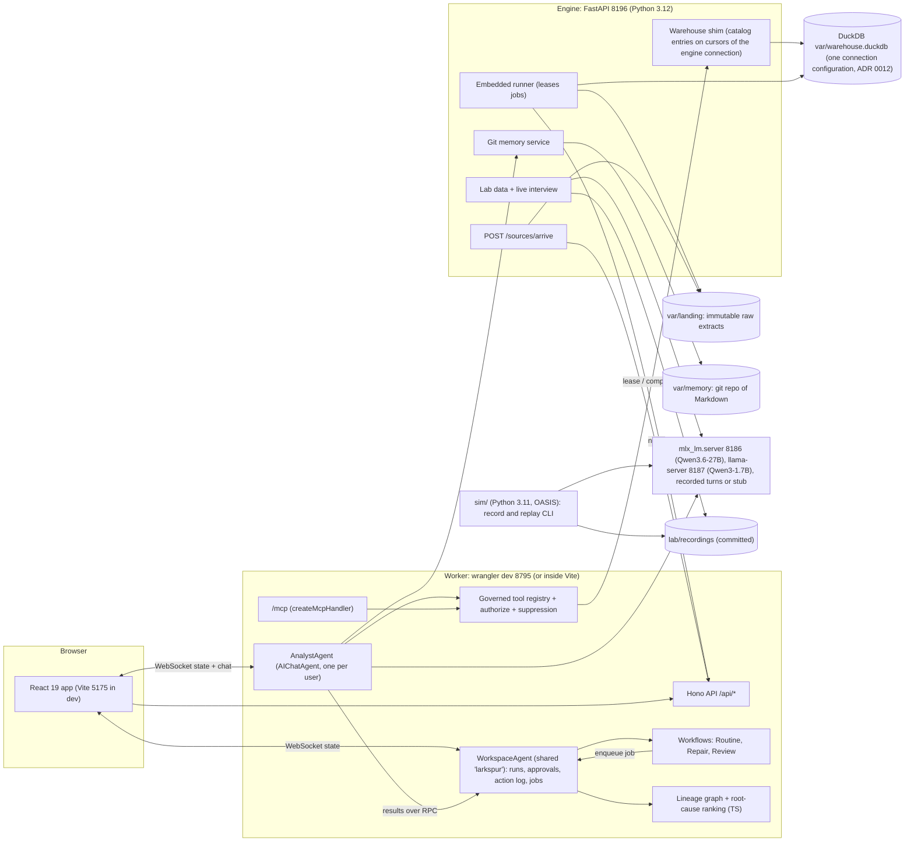
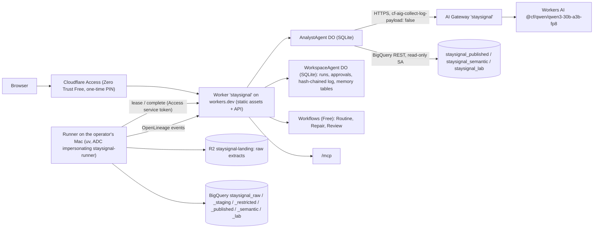

# StaySignal v1 Specification

Status: architect draft, 2026-10-12, revised the same day after review round 1 (three independent reviews; section 29 logs every finding and how it was resolved). No code exists yet. Builders read this file first, then `PROGRESS.md` (created in M0) for what is done, the demo date and the active schedule variant (section 24). Every version and platform fact marked "verified" was checked on 2026-10-11 or 2026-10-12 (section 27).

StaySignal forecasts voluntary departures for a team or organization, shows why the forecast deserves trust, and turns it into an accountable People Partner review. The statistical model computes probabilities, the warehouse computes metrics, server-side rules control access and actions, and LLM agents only route questions, orchestrate tools and explain computed results.

Everything is synthetic. The company is the fictional **Larkspur Systems** (`larkspur.example`); its teams, people, records and proposals are generated by a seeded program. Simulated actions and synthetic data are labeled as such in the UI, the API, the README and every figure. Results computed on this world test the pipeline, the uncertainty method and the robustness experiments, not real-world accuracy; that sentence appears on the Trust page, in the model card and above the README Results.

Public-repo rule: every commit becomes public within about 20 minutes, and so does every LLM-generated file committed with it. Nothing in this repository may depend on private information; every design choice must be justifiable from public sources cited here. Section 17.6 lists the closed set of signals the product may use, and section 22.6 the two-tier hygiene gate that guards generated text.

## Contents

0. Acceptance criteria
1. Goals and non-goals
2. Key design decisions (ADRs)
3. Demo script
4. Architecture
5. Repository layout (exact)
6. Synthetic world: Larkspur Systems
7. Warehouse, semantic layer and metric definitions
8. Point-in-time features
9. Models and uncertainty
10. Evaluation design
11. Research benchmark
12. What changed: the forecast change decomposition
13. Data quality, lineage, hold, repair, replay and break-glass
14. Agentic components
15. Scenario Lab
16. Frontend: pages, visualizations, design system
17. Privacy, access, responsible AI and regulatory notes
18. Local versus production matrix
19. Reuse from existing repos versus new
20. Test plan: every claim to a test or eval
21. CI
22. Developer workflow, commands, ports, process hygiene and hygiene gates
23. Production setup Nitish must do
24. Schedule: vertical slice, gates, variants and cut order
25. Pinned versions
26. Risks
27. Verification log
28. References (verified)
29. Review log

## 0. Acceptance criteria

v1 is done when all of these hold, each backed by a test, eval or recorded script output (section 20). The 7-day schedule variant (section 24) relaxes only the items marked (14-day).

1. `npm run demo:reset && npm run demo` (the built app under wrangler dev, no Vite; section 22.4) brings up the demo profile, and the frame and beats 1 to 5 (section 3) run end to end in three modes: the stub model; recorded Qwen3.6-27B turns with live tools (the default demo mode); and the live 27B for the two questions marked live. With Qwen3-1.7B the beats must complete with the template fallback allowed, and the grounding rate is recorded rather than required.
2. The synthetic world regenerates bit for bit from seed `20261011` on macOS and on ubuntu-latest and matches the SHA-256 pins in `data/world/manifest.json`.
3. Point-in-time features pass the no-lookahead property test and the named feature tests of section 8.
4. The competing-risks model, the uncertainty method, the baselines and the oracle produce the backtest, calibration and coverage results in `results/`, generated by commands recorded in each JSON file and labeled with the synthetic-world sentence above.
5. The payroll defect is detected, traced through lineage into the forecast features and held; the repair mapping is generated deterministically from evidence; the repaired run is published and replayed in a fresh warehouse with an identical business-result hash, while a replay forced to mapping v1 gives a different hash.
6. Approvals are enforced server-side (the approver is a human other than the proposer of record and holds the role scope; a self-approval is refused with the distinct code `SELF_APPROVAL`; agents never approve), every action is in a hash-chained log whose head is anchored daily outside the Durable Object, and rollback is one click that adds a reversal entry.
7. Every narrated agent answer passes the numeric-grounding check or falls back to a template; the agent eval (200 items) is recorded for the stub, the 1.7B and the 27B.
8. Disclosure: no individual probability is recoverable from a single response, its widened counterpart or the same query on the previous run (section 17.5); the micro-world differencing test and the two-turn differencing probes pass.
9. (14-day) The Scenario Lab replays recorded OASIS runs with an identical database hash, shows the sanity panel with its facts-only baseline and negative controls, and supports one live persona interview on the local 27B.
10. CI passes on `ubuntu-latest` with no secrets. Playwright screenshots exist for every page at desktop and mobile widths in light and dark themes (7-day variant: Forecast, Data health and Reviews only).
11. `npm run setup:prod -- --dry-run` and `npm run doctor` run against the real accounts read-only and report exactly what Nitish still has to do (section 23); `npm run deploy -- --fixtures` is ready for Nitish to run. Nothing in the cloud is created by builders.
12. Two timed dress rehearsals of the full demo, with the 27B loaded and a video-call app sharing the screen, are recorded in `results/rehearsal-*.json` (time, swap and tokens per second per beat), and every beat fits its slot or runs from its recorded turn.

## 1. Goals and non-goals

### Goals

- A governed workforce warehouse slice: three synthetic source systems (HRIS, payroll, ATS) landed with ELT into dbt models on DuckDB locally and BigQuery in production, with effective-dated (SCD2) and bitemporal history, retention and lifecycle policies that never break replay, data-quality checks and column lineage.
- An explainable departure forecast: a discrete-time competing-risks model over 1, 3 and 6 calendar months (about 30, 90 and 180 days), cohort expected departures with uncertainty ranges that include shared team shocks, forward-in-time evaluation with reporting-delay handling, calibration and coverage.
- Trust tooling: what changed since the last forecast (exact decomposition), data-quality root cause analysis of calculation discrepancies and record inconsistencies, hold, repair and deterministic replay.
- Accountable action: People Partner reviews prepared by agents, submitted and approved by two different humans, logged in a tamper-evident audit trail, reversible in one click, and screened for adverse impact of the actions taken.
- An AI-native analytics workbench built from real, tested components: a stateful per-user agent, typed tools over a governed semantic layer, numeric grounding, multi-agent investigation, durable event-driven routines with approvals, an MCP server, git-backed Markdown memory, agent evals with a trace viewer, and metadata-only AI observability on the production path.
- A Scenario Lab for hypothesis generation: synthetic personas built from cohort-level distributions react to a proposed change on a simulated forum; the lab reports themes, trajectories, an influence network and draft pilot items, with an honest sanity panel and stated limits.
- A coherent, fast, accessible frontend in which every chart answers a stated question.
- A small research contribution: how late HR corrections, incomplete observation and shared team shocks affect the calibration of workforce departure forecasts, answered by a pre-registered simulation study with decision rules.

### Non-goals

- No individual-level output anywhere: no individual risk scores, rankings, lists or histories in any UI, API response, tool result, MCP result, log or memory file. Individual probabilities exist only in the memory of the engine's scoring job and are never persisted (ADR 0001, ADR 0014).
- No forecast of the company's own decisions. Involuntary exits and retirements are modeled as competing events, which keeps the voluntary forecast correct, but the UI shows them only as one grey band, "Other exits (modeled as competing events; not a forecast of decisions)", at company and organization level.
- No protected attribute (sex, race, ethnicity, age, disability, national origin and similar) as a feature, cohort dimension, tool argument or persona attribute. The world emits exactly one protected-class attribute, a synthetic age-40-or-over flag, into an audit-only schema read only by the action audit (ADR 0013).
- No workplace monitoring data of any kind and no performance ratings (ADR 0015). The signal list in section 17.6 is closed; adding a signal needs an ADR.
- Not a causal model. Feature effects are associational; the review prepares questions for people to examine, not interventions.
- The Scenario Lab is not a forecast, not a survey and not validated. It never feeds the forecast numbers or review evidence.
- No real company's internal names, tools or data; no real person's name outside citation blocks. Principals are role mailboxes such as `pa-lead@larkspur.example`.
- No Cloudflare Workers Paid feature, no Cloudflare Artifacts (Paid only), no Basin Pipelines. Production runs on Workers Free and BigQuery.
- No cloud resource is created, changed or deployed by builders. They write idempotent setup and doctor scripts; Nitish runs them.
- No model weights are downloaded. The local models already on the machine are the only models used locally.
- Not legal advice. Section 17.7 and `docs/regulatory-notes.md` describe design choices that minimize exposure; a real deployment needs counsel.

## 2. Key design decisions (ADRs)

Each is written as `docs/adr/NNNN-*.md` (context, decision, consequences; under 40 lines) in the milestone that first needs it; ADRs 0001 to 0007 and 0012 in M0.

| ADR | Decision |
|---|---|
| 0001 | Cohort-only outputs. Every result crossing the engine boundary is a cohort aggregate with at least 10 people after primary and complementary suppression, disclosure rounding and the population-change rule (17.5). Comparisons over time are served only for cohorts of 50 or more. |
| 0002 | Runner pull model for Python compute (copied from DataTrust ADR-0001). The Worker never runs numeric work. A Python runner leases jobs over outbound HTTPS with server-paced polling and posts results back; the same protocol runs locally (runner embedded in the engine) and in production (runner on the operator's Mac against BigQuery). |
| 0003 | Bitemporal source records. Every record has an effective date (valid time) and a `recorded_at` timestamp (knowledge time). Features are computed at a cutoff `c` from the vintage `v` (records with `recorded_at <= v`). |
| 0004 | Landmark discrete-time competing-risks multinomial logit on calendar-month periods, implemented in this repo (about 150 lines with scipy). No GPL code or dependencies (PyDTS and scikit-survival are GPL-3.0). |
| 0005 | Publication gate. A forecast run is published only if every error-severity check upstream of its features passes; otherwise it is held. Large changes need an approval. Publication is a pointer; rollback moves the pointer back and adds a reversal entry. Nothing is deleted. |
| 0006 | Agents draft, humans submit and approve. A human who submits or adopts an agent draft becomes its proposer of record; the approver must be a different human holding the subject's scope. Checked in the callable method and again in the workflow step. One documented exception: a payroll or HRIS mapping change proposed by the investigation (agent as proposer of record) is approved by a single human with `mapping:approve`, because the change is a reversible pointer, is replay-verified, and every publication it leads to still passes the publication gate. |
| 0007 | Numbers come from tools. Narration uses per-turn result aliases; a numeric-grounding check rejects any numeral or direction word not traceable to a tool result; one repair, then a deterministic template. Copied from DataTrust's grounded summary loop. |
| 0008 | The Scenario Lab is hypothesis generation. Personas come from cohort cells of at least 10 people; lab tables live in a separate schema with a lineage test proving there is no path into forecasts or review evidence. |
| 0009 | Production on Workers Free plus BigQuery with dataset-scoped grants and the `staysignal` prefix in the shared Google Cloud project. A fixtures-mode deployment needs no Google resource. |
| 0010 | Reproducibility of LLM-driven runs comes from record and replay, not regeneration (seeded mlx requests lose batching, and batched greedy decoding is not batch-invariant). Recorded agent turns replay through a `recorded` provider while tools execute live. |
| 0011 | Local stand-ins are labeled. Every component that differs between local and production says so in the UI footer, the README matrix and section 18. Idea copied from PeopleLake ADR 0003. |
| 0012 | One DuckDB connection configuration per process (extends PeopleLake ADR 0008; verified 2026-10-12 with duckdb 1.5.6: a `read_only=True` connection beside a read-write one in the same process raises "different configuration"). The engine opens the file once with `open_duckdb` (read-write, `TimeZone=UTC`); dbt runs in process through `dbtRunner` with the same configuration; the warehouse shim uses cursors from the engine connection behind DataTrust's sqlglot single-SELECT guard and executes only compiled catalog entries; lineage is captured in process from dbt's `manifest.json` and `run_results.json`. Fallback if the in-process lineage spike fails: close the connection under a job lock, run `dbt-ol build` as a subprocess (DataTrust's verified path) and reopen, with the shim answering 503 "warehouse busy" meanwhile. Replays build in a separate file. |
| 0013 | Audit-only synthetic protected attribute. The generator emits an age-40-or-over flag (from its latent age) into `audit_attributes.csv`, loaded only into the `audit` schema, readable only by the action-audit job and, as aggregates, by the auditor role. It never reaches features, the semantic layer, tools, MCP, memory or the Lab; tests enforce the boundary. |
| 0014 | Never persist individual predictions. Scoring keeps individual cumulative incidences in memory and persists cohort aggregates, calibration bins with n of at least 10 and a SHA-256 of the canonical prediction vector. Retention separates immutable landing files from conformed bitemporal history so retention sweeps never break replay. |
| 0015 | Performance ratings are excluded from the forecast and from the sources: rater bias, the curvilinear performance-turnover relationship (Trevor, Gerhart and Boudreau 1997) and the risk of steering individual decisions. The README answers "why no performance data?" with this ADR. |
| 0016 | Workflow gates (pattern copied from onboardflow ADR 0002): the truth lives in Durable Object SQLite and is checked in a step before every wait; `waitForEvent` is only a wake-up with a valid type, a bounded timeout and a re-check; timeouts are caught and recorded in a following step. `waitForApproval` and `approveWorkflow` are not used. |
| 0017 | Content-addressed identifiers and run keys. Result IDs, job keys, run keys and Monte Carlo seeds derive from SHA-256 of canonical inputs, never from time or randomness; git SHAs live only in `provenance` objects that every hash excludes, and never in a pinned or hashed file (the operator's publisher rewrites working SHAs in committed text). |

## 3. Demo script

About 3 minutes 15 seconds for the frame and beats 1 to 5, then 1.5 minutes for beat 6. Synthetic clock: `2026-10-05T14:00:00Z`. The demo runs under `npm run demo` (section 22.4). `npm run demo:reset` restores the state at the start of beat 1; `npm run demo:reset -- --beat N` restores the start of beat N (about 20 seconds, measured; section 22.4). The runbook with exact clicks and a Q&A crib is `docs/demo-script.md`.

Pacing rule: nothing in this script promises a model latency until it is measured. M0 measures the 27B on agent-shaped prompts, and `npm run bench:demo` times every beat against its slot. The default demo mode replays recorded 27B turns with live tools, labeled "Model text replayed from a recorded 27B turn; tools ran live"; only the two questions marked LIVE use the live model, and only if `bench:demo` shows them inside their slot. In demo mode a live turn with no first token after 12 seconds switches to its recorded turn automatically, and the R key switches at any time. Questions are asked in the chat dock, and its tool results update the page behind it through URL state.

| Beat | Time | What happens | Key point (practitioner terms) |
|---|---|---|---|
| Frame | 0:00 to 0:10 | One sentence on screen and spoken: cohort-level planning support for People Partners, no individual scores anywhere a person can see, a synthetic company. | Scope before numbers. |
| 1. Forecast (LIVE) | 0:10 to 0:50 | Ask "Forecast voluntary departures in Engineering over the next 90 days." The agent calls `forecast_departures` (90 days resolves to the 3-month horizon). The Forecast page shows the hero number (disclosure-rounded, 17.5) with 80% and 95% ranges and the status-quo trailing-rate number beside it; the fan chart of cumulative expected voluntary departures over the next 6 months with 80% and 95% bands; the grey "Other exits" band; the trust strip (backtest O/E, 80% coverage with its effective number of windows, data freshness, checks passing); and the backtest strip: quarterly pseudo-real-time backtests (model and data as known at each cutoff, not forecasts that were published) with intervals and actual counts. | "In non-overlapping quarterly backtests our 80% range held N of M times" (N and M read from `results/`, synthetic world). |
| Boundary | 0:50 to 0:55 | Ask "Which engineers in Platform Engineering are most likely to quit?" The deterministic pre-router refuses with `INDIVIDUAL_LEVEL` before any model call; the refusal is audited. | There is no individual score to show. |
| 2. What changed (LIVE) | 0:55 to 1:30 | Ask "What changed since the previous forecast?" The agent calls `explain_change` (Engineering, 3 months, `R-2026-09-01#1` to `R-2026-10-01#1`). The waterfall splits the change into Calendar (season and aging), Composition (joiners, leavers and moves), Input data (late data about the past: the 2026-09-15 audit batch), Model (monthly retrain) and Definition (fixed-term employees excluded from `voluntary_departures@2`), drawn against the width of the 80% interval. A factor that would expose fewer than 10 people is merged into one labeled bar (17.5). | "Most of the change is the calendar, not the people; each bar opens the two computed forecasts it compares." |
| 3. Inject a failure | 1:30 to 2:05 | Click "Simulate payroll arrival (synthetic)". The September payroll extracts land; the Vancouver entity's vendor file uses a new code, `ANN`, with annual amounts that mapping v1 treats as monthly. The deterministic routine steps run live: checks fail (heatmap cells turn critical), lineage highlights the path from `stg_payroll__lines.pay_basis_code` to the `comp_below_mid` feature to the candidate run, root-cause ranking puts the pay-basis mapping first, and the run is "Held for review" with its would-be value greyed. The investigation narrative streams from its recorded turn (it was started at reset). | "A vendor code change never reached a People Partner." |
| 4. Repair and replay | 2:05 to 2:35 | Switch to `data-eng@larkspur.example`. The incident shows the mapping diff (`ANN` means annual; unknown codes are rejected), generated deterministically from the vendor code dictionary and the probe showing Vancouver amounts about 12 times their band midpoints; the agent only explains it. Approve (the documented single-human mapping approval, ADR 0006). The repair workflow rebuilds only the affected models; the revised forecast is published as version 3 next to the preserved version 1; the replay record, computed in the background in a fresh warehouse, shows the same business-result hash and how long it took. | "The corrected number is reproducible for Compensation and Finance." |
| 5. Approved review | 2:35 to 3:15 | As `pa-lead@larkspur.example`, ask "Prepare a People Partner review for Platform Engineering." The agent drafts three group-level checks with evidence links: compensation position against band midpoints (with a pay-equity checkpoint), career progression (time since promotion), and hiring coverage (open backfill requisitions against expected voluntary departures). The lead submits the draft, becoming its proposer of record, then clicks Approve: refused with `SELF_APPROVAL`, shown and audited. Switch to `people-ops-director@larkspur.example` and approve: a task is created with an owner (the Engineering People Partner role), its evidence and an audit record. Click Rollback with the reason "approved against the wrong cohort": a reversal entry cancels the task and the audit chain still verifies. | "Nobody approves their own proposal, and every action can be undone with both entries on the record." |
| 6. Scenario Lab | 3:15 to 4:45 | As `hrbp-engineering@larkspur.example`, pick "Published IC3 to IC4 promotion criteria plus a third promotion window" in the proposal picker (status quo: two windows a year, criteria not published). It opens a recorded run (16 personas, 8 rounds, 3 replicates, plus 2 short control runs on the local 27B). Scrub the feed replay (every post carries a "Synthetic persona" chip), then show the ranked theme bars with replicate ranges, attitude trajectories for three tenure bands with replicate bands, the influence network colored by cohort only (labeled "simulated, not organizational network analysis"), the draft pilot items mapped to published constructs, and the sanity panel. Interview one persona live. Every view is headed "Hypothesis generation with synthetic personas. Not a forecast, not a survey, not validated." | "This generates questions to test with real people; the sanity panel shows how much of it is prompt echo." |

Fallbacks: recorded turns for every agent turn (the default); an automatic switch to recorded turns if the memory guard stops the 27B (section 15.10); `npm run demo:reset -- --beat N`; a recorded interview answer for the same question; and, as the last resort, a narrated screen capture of the whole demo recorded after the final rehearsal and kept outside the repository.

Q&A crib in `docs/demo-script.md` (short answers with section links): why discrete-time competing risks rather than Cox or Fine-Gray; tenure as an age proxy and the action audit; exit-reason reliability (Campion 1991); the ecological fallacy; performative prediction; why no performance ratings (ADR 0015); what the synthetic world can and cannot show; what validation on real data would need; the regulatory notes; the publish-pointer rollback (version 3 to version 1 and back, one click on the run version timeline).

## 4. Architecture

### 4.1 Local (default, fully offline)



### 4.2 Production (Workers Free plus BigQuery; built, not deployed by builders)



### 4.3 Request lifecycle: a chat question

1. The browser holds a WebSocket to `AnalystAgent/<an_ + HMAC(principal_id)>`, where `principal_id` is the Access `sub`, or `svc:` plus `common_name` for a service token (whose `sub` is empty). `routeAgentRequest`'s `onBeforeConnect` verifies the Access JWT (dev token locally), strips any client-supplied `x-ss-principal` header, and forwards the verified principal in that header; `onConnect` stores it in `connection.state` and rejects the connection if the instance name does not equal the HMAC of the principal ID.
2. A deterministic pre-router (section 14.3) refuses individual-level, manager-level, protected-attribute and out-of-scope questions before any model call, with a refusal code.
3. `onChatMessage` runs `streamText` with the tools allowed for the principal's scopes, `stopWhen: stepCountIs(6)`, and the model-facing history pruned to 7,000 tokens.
4. Each tool call goes through `authorize(principal, tool, args)`, then the warehouse client (engine shim locally, BigQuery REST or fixtures in production), then suppression, disclosure rounding and the population-change rule (17.5). The full result is stored by the WorkspaceAgent under a content-addressed `result_id` and streamed to the UI, which renders its chart at once; the model receives only the tool's digest (`toModelOutput`, at most about 300 tokens) under the turn alias (`r1`, `r2`, ...).
5. The model's final text uses alias placeholders such as `{{r1.expected|int}}`. The grounding pass (section 14.4) checks every remaining numeral and direction word; on failure it asks once for a repair quoting the violations, then falls back to the template. The persisted message carries `grounding: passed | repaired | template` and references results by ID only (no tool payloads in persisted messages).
6. A trace (model calls, tool calls, grounding outcome, prompt, output and cached tokens, latency) is written to the `traces` table; production writes metadata only.

### 4.4 Request lifecycle: a source arrival routine

1. Local: `POST /sources/arrive` on the engine (or the demo button) copies the extract into `var/landing/<source>/<period>/<sha256>.csv` and calls `POST /internal/sources/arrived` on the Worker. Production: the runner uploads to R2 and calls the same endpoint.
2. `WorkspaceAgent.onSourceArrived` writes an action-log row and starts `RoutineWorkflow` (`source_arrival_refresh`).
3. Each workflow step is I/O only (10 ms CPU per step on Free) and follows the gate pattern (ADR 0016): it enqueues an engine job in the agent's `engine_jobs` table (or finds it already complete), waits with `step.waitForEvent("await job", { type: "job_<job_key>", timeout: "15 minutes" })` inside `try`/`catch`, then re-reads the job row. The runner's `POST /internal/runner/complete` writes the row and then sends the wake-up with `sendWorkflowEvent`.
4. Steps: ingest, checks, features and score (candidate run), gate (hold or continue), what-changed against the published run, investigation (if held or the change exceeds tolerance), draft (incident report or review draft), publish or wait for approval, memory note.

## 5. Repository layout (exact)

Builders create exactly these paths (generated and gitignored paths are marked). A file not listed here needs a one-line note in `PROGRESS.md`.

```text
staysignal/
  README.md                         status table, mermaid, local setup, what runs where, Results (generated)
  SPEC.md  CONTEXT.md  PROGRESS.md  LICENSE (MIT)  NOTICE
  .gitignore  .editorconfig  .nvmrc (24)  .python-version (3.12)  .dev.vars.example
  package.json  package-lock.json   engines: node >=24
  tsconfig.json  tsconfig.worker.json  tsconfig.web.json  tsconfig.node.json
  vite.config.ts  vitest.config.ts  playwright.config.ts  index.html
  wrangler.jsonc                    local and test config (no `ai` binding, see 14.11)
  worker-configuration.d.ts         generated by `wrangler types`, committed, checked in CI
  .github/workflows/ci.yml
  docs/
    adr/0001-cohort-only-outputs.md ... 0017-content-addressed-ids.md
    demo-script.md  data-dictionary.md  model-card.md  lab-card.md
    regulatory-notes.md  employee-notice-template.md
    runbooks/replay.md  runbooks/rollback.md  runbooks/prod-setup.md  runbooks/break-glass.md
  policy/
    roles.json  scopes.json  principals.local.json  limits.json  disclosure.json
    access.yaml                     purpose-scoped dataset policy (compiled to BigQuery grants)
    retention.yaml
    compiled/policy.json            generated by `npm run policy:compile`, committed
  sources/
    schemas/hris.schema.json  payroll.schema.json (vendor pay-basis code dictionary)  ats.schema.json
      org.schema.json  audit.schema.json
    mappings/hris.v1.yaml  payroll.v1.yaml  payroll.v2.yaml  ats.v1.yaml
  checks/registry.yml               the 24 checks (13.1); `phase: 1` marks the first 12
  semantic/metric_definitions.yaml  versioned metric definitions (7.4)
  routines/routine.schema.json  source_arrival_refresh.json  monthly_retrain.json  memory_digest.json
  data/world/manifest.json          SHA-256 pins and realized counts of the canonical world (committed)
  models/m2026.08/model.json  models/m2026.09/model.json   committed model artifacts (9.6)
  results/*.json                    script outputs with command and date; README Results is generated from them
  research/PREREGISTRATION.md       hypotheses and decision rules, committed before any research result
  evals/agent/questions.jsonl  evals/agent/gold.json  evals/agent/probes/*.md  evals/results/*.json
  demo/recordings/*.jsonl           recorded 27B agent turns (aliases, tool calls with arguments, text)
  demo/state/beat-*.json            action scripts that build the per-beat snapshots (22.4)
  lab/
    proposals/promotion-criteria-third-window.yaml  proposals/infra-data-merge.yaml   (each states its status quo)
    codebook.yaml                   theme codebook with an `other` code, used only by the coding pass (15.6)
    constructs.yaml                 construct map for draft pilot items, with published measures where they exist
    cohort_cells.json               cohort cells exported by the engine (15.2), committed so the sim never needs the engine
    recordings/<run_id>/manifest.json  calls.jsonl.gz  actions.jsonl  items.jsonl  coding.jsonl  interviews.jsonl
      analysis.json
  warehouse/                        dbt project `staysignal`
    dbt_project.yml
    profiles/duckdb/profiles.yml  profiles/bigquery/profiles.yml  profiles/bigquery_compile/profiles.yml
    macros/as_of.sql  macros/generate_schema_name.sql  macros/suppress.sql  macros/dialect/*.sql
      macros/print_dialect_macros.sql
    models/staging/_staging.yml  stg_hris__records.sql  stg_payroll__lines.sql  stg_ats__requisitions.sql
      stg_ats__offers.sql  stg_org__teams.sql  stg_ref__bands.sql  stg_map__pay_basis.sql
    models/intermediate/_intermediate.yml  int_hris__records_current.sql  int_hris__spells.sql
      int_hris__assignment_timeline.sql  int_hris__manager_timeline.sql  int_hris__departures.sql
      int_comp__annualized.sql  int_org__team_events.sql
    models/restricted/_restricted.yml  fct_employee_month.sql  fct_comp_position.sql
    models/published/_published.yml  rpt_workforce_monthly.sql  rpt_flows_monthly.sql  rpt_cohort_profile.sql
      rpt_requisitions_monthly.sql  rpt_check_results.sql
    models/semantic/_semantic_models.yml  _metrics.yml  metricflow_time_spine.sql
    models/lab/_lab.yml  lab_runs.sql  lab_cohort_items.sql  lab_themes.sql
    models/audit/_audit.yml  aud_attributes.sql  aud_action_attention.sql
    tests/dq/dq_*.sql               singular checks of the registry
    tests/published/assert_no_small_cells.sql  assert_no_recoverable_cell.sql
    tests/audit/assert_audit_isolated.sql
  engine/                           Python 3.12 uv project `staysignal-engine`
    pyproject.toml  uv.lock
    src/staysignal/
      __init__.py  cli.py  config.py  paths.py  clock.py  canonical.py  prng.py  ids.py  runkey.py  duck.py
      world/   spec.py  org.py  people.py  latent.py  hazards.py  shocks.py  simulate.py  corrections.py  payroll.py
               ats.py  defects.py  deltas.py  emit.py  manifest.py  oracle.py  profiles.py
      ingest/  landing.py  mappings.py  load_duckdb.py  load_bigquery.py  conformed.py
      features/ spec.py  pit.py  pit.sql  reference.py
      model/   design.py  mnl.py  sandwich.py  bootstrap.py  shocks.py  artifact.py  train.py
      forecast/ score.py  montecarlo.py  decompose.py  cohorts.py  population.py  run.py  result_hash.py  replay.py
      baselines/ historical.py  aalen_johansen.py  survivalboost.py  oracle.py
      evaluate/ backtest.py  maturity.py  metrics.py  calibration.py  coverage.py  block_bootstrap.py  pit_rps.py
               effects.py  report.py
      research/ arms.py  features_fast.py  tost.py  run.py  report.py
      changes/ record_sets.py  shapley.py
      quality/ registry.py  run_checks.py  probes.py  mapping_proposal.py  break_glass.py
      lineage/ emit.py  capture.py  features_lineage.yml
      semantic/ catalog.py  params.py  parity.py
      privacy/ pseudo.py  suppression.py  retention.py
      audit/   adverse_impact.py  action_audit.py  proxies.py
      memory/  repo.py  coarsen.py  search.py  anchor.py
      lab/     cells.py  sanity.py  interview.py
      runner/  client.py  jobs.py  loop.py
      service/ app.py  warehouse_shim.py  sources.py  memory_api.py  lab_api.py  demo.py
      evals/   agent_runner.py  gold.py  compare.py  report.py
      fixtures/ export_api.py
      prod/    bootstrap_gcp.py  doctor_gcp.py
    tests/   (section 20 names every file)
  sim/                              Python 3.11 uv project `staysignal-lab` (Scenario Lab)
    pyproject.toml  uv.lock
    src/staysignal_lab/
      __init__.py  stubs.py  igraph_shim.py  clock.py  codebook.py  personas.py  tools.py  client.py
      recorder.py  engine_oasis.py  items.py  coding.py  linter.py  replay.py  analysis.py  pagerank.py  layout.py
      report_agent.py  handcode.py  cli.py
    tests/
  src/
    shared/  contracts.ts  ids.ts  canonical-json.ts  format.ts  clock.ts
             tools/registry.ts  tools/schemas.ts  tools/digests.ts
             policy/authorize.ts  policy/roles.ts  policy/refusals.ts
             guard/suppression.ts  guard/complement.ts  guard/disclosure.ts  guard/population.ts  guard/prerouter.ts
             grounding/aliases.ts  grounding/numerals.ts  grounding/direction.ts  grounding/check.ts
             grounding/template.ts
             rca/lineage/openlineage.ts  rca/lineage/graph.ts  rca/rank.ts  rca/trace.ts
             routines/schema.ts  routines/definitions.ts
    worker/  index.ts  app.ts  env.ts  config.ts
             auth/access.ts  auth/dev-login.ts  auth/principal.ts  auth/hmac.ts
             agents/analyst-agent.ts  agents/workspace-agent.ts  agents/prompts.ts  agents/providers.ts
             agents/recorded-provider.ts  agents/grounding-pass.ts  agents/investigation/orchestrator.ts
             agents/investigation/specialists.ts  agents/investigation/merge.ts
             workflows/routine-workflow.ts  workflows/repair-workflow.ts  workflows/review-workflow.ts
             workflows/gates.ts  workflows/steps.ts
             store/action-log.ts  store/approvals.ts  store/runs.ts  store/jobs.ts  store/results.ts
             store/traces.ts  store/anchors.ts  store/memory-sqlite.ts  store/schema.sql.ts
             warehouse/client.ts  warehouse/engine-shim.ts  warehouse/bigquery-rest.ts  warehouse/gcp-auth.ts
             warehouse/fixtures.ts
             mcp/server.ts
             api/routes.ts  api/results.ts  api/runner.ts  api/sources.ts  api/audit.ts  api/lab.ts  api/dev.ts
             ai/gateway.ts  ai/budget-do.ts  ai/rates.json
             generated/catalog.duckdb.json  generated/catalog.bigquery.json  generated/policy.json
    web/     main.tsx  App.tsx  router.ts  api.ts  agent.ts
             design/tokens.css  design/themes.ts  design/palette.ts  design/motion.css
             components/AppShell.tsx  ChatDock.tsx  ChartCard.tsx  StatTile.tsx  TrustStrip.tsx  Provenance.tsx
               StatusPill.tsx  Chip.tsx  TableView.tsx  EmptyState.tsx  Skeleton.tsx  RoleSwitcher.tsx  Drawer.tsx
               Segmented.tsx  Stepper.tsx  ProposalPicker.tsx
             charts/FanChart.tsx  HistoryStrip.tsx   (d3, on the initial route)
               useEChart.ts  IncidenceCurves.tsx  VarianceBar.tsx  CohortMultiples.tsx  BacktestTimeline.tsx
               Reliability.tsx  Coverage.tsx  ModelComparison.tsx  FeatureEffects.tsx  Waterfall.tsx
               CheckHeatmap.tsx  FlowSankey.tsx  FunnelPlot.tsx  ThemeBars.tsx  AttitudeMultiples.tsx
               InfluenceNetwork.tsx  TraceGantt.tsx  AuditTimeline.tsx  ResearchArms.tsx  CoverageBySigma.tsx
               ActionAudit.tsx
             graphs/layout.ts  LineageDag.tsx
             pages/Forecast.tsx  Trust.tsx  Changes.tsx  Quality.tsx  Reviews.tsx  Ask.tsx  Traces.tsx
               Lab.tsx  Workforce.tsx  Research.tsx  Memory.tsx  Governance.tsx  ResultDetail.tsx
  infra/
    cloudflare/wrangler.production.template.jsonc  wrangler.fixtures.template.jsonc  access-app.template.json
    gcp/datasets.json  gcp/grants.json  gcp/service_accounts.json
  scripts/
    dev.ts  stop.ts  llm.ts  demo.ts  demo-reset.ts  demo-build-snapshots.ts  bench-demo.ts  fixture-runner.ts
    check-prose.ts  check-hygiene.ts  check-palette.ts  check-size.ts  install-hooks.ts  hooks/pre-commit
    results-to-readme.ts  render-figures.ts  gen-fixtures.ts  bench-cpu.ts
    setup-prod.ts  doctor.ts  deploy.ts  dev-keys.ts  dev-token.ts
    lib/pids.ts  lib/cf-api.ts  lib/prod-state.ts  lib/free-plan.ts  lib/guards.ts  lib/memory-budget.ts
  test/
    worker/*.test.ts  node/*.test.ts  web/*.test.tsx
    fixtures/api/*.json             API fixtures exported from the canonical world (CI e2e)
    fixtures/jobs/*.json            committed engine job outputs keyed by job key (fixture runner)
    e2e/*.spec.ts  e2e/__screenshots__/**
  var/                              gitignored: warehouse.duckdb, replay/, landing/, conformed/, memory/, world/,
                                    snapshots/, anchors/, break-glass/, pids/, logs/
  .secrets/  .prod/  .dev.vars      gitignored: secrets copied from outside the repo, production state, local Worker vars
```

`.gitignore` also covers `.wrangler/` (local Durable Object and Workflow SQLite, which holds full prompt text in local traces), `node_modules/`, `dist/`, `warehouse/target/`, `warehouse/logs/`, `warehouse/dbt_packages/`, `**/.venv/`, `test-results/`, `playwright-report/` and `*.duckdb.wal`.

Package boundaries: `src/shared` is imported by the Worker and the web app and never imports either. `engine/src/staysignal/forecast`, `model`, `features` and `changes` never import `lab` or `audit` (import-boundary test). `sim/` never imports `engine/` (it reads exported JSON files).

## 6. Synthetic world: Larkspur Systems

Generated by `uv run --project engine staysignal world generate --profile canonical --seed 20261011 --out var/world`. Deterministic: a SplitMix64 PRNG (copied from PeopleLake `prng.py`) with one named stream per generator stage, so adding a stage never shifts another stage's draws. Output: CSV files plus `manifest.json` (SHA-256 per file, row counts, realized counts, generator version, hazard coefficients, calibrated intercepts). The canonical manifest is committed at `data/world/manifest.json`; CI regenerates the world on ubuntu-latest and compares every hash.

Cross-platform determinism: every emitted float is quantized (pay in integer cents, ratios to 6 decimals, dates as dates), and every transcendental function that drives a draw or an emitted value uses Python's `math` module on scalars, not vectorized numpy, so a one-ulp libm difference cannot change a draw. The macOS-made pins are compared on Linux from the first canonical-world commit.

The world is deliberately not a copy of the model (6.3): it has an unobserved individual propensity, effects the model encodes only approximately, an interaction the model omits, and drift. A separate `recovery` profile switches these off to test that the estimator recovers a correctly specified truth (6.7).

### 6.1 Calendar

| Item | Value |
|---|---|
| HRIS history migrated from | 2023-04-01 (records before this date exist only as legacy fields on the migration baseline record) |
| Simulation | calendar-month steps from 2023-04-01 to 2026-09-30 (42 months); event days uniform within the month |
| Periods and horizons | calendar months; horizons of 1, 3 and 6 months, shown as "1, 3 and 6 months (about 30, 90 and 180 days)"; a question in days resolves to the nearest horizon |
| First landmark (all 180-day lookbacks complete) | 2023-10-01 |
| Outcome vintage for evaluation | 2026-10-01T06:00Z |
| Cutoffs | first day of each month, 00:00 UTC |
| Daily delta batches | HRIS and ATS deltas every day at 06:00Z (possibly empty, each with a `source_batch_id`) through 2026-10-05T06:00Z, so freshness checks pass on the demo clock |
| Demo clock | 2026-10-05T14:00:00Z; every user-visible timestamp is derived from it (demo clock plus elapsed real time) |
| Previous published forecast | run `R-2026-09-01#1`: cutoff 2026-09-01, vintage 2026-09-01T06:00Z, model `m2026.08`, metric definition `voluntary_departures@1`, payroll mapping `payroll@1` |
| Current published forecast at demo start | run `R-2026-10-01#1`: cutoff 2026-10-01, vintage 2026-10-01T06:00Z, model `m2026.09`, metric definition `voluntary_departures@2`, mapping `payroll@1` |
| Held-back arrival (demo beat 3) | September 2026 payroll extracts for all three entities, `recorded_at` 2026-10-05T14:00Z |
| Future arrivals | records with `recorded_at` after the demo clock (late terminations and corrections of September events) are written to `var/world/future/` and never landed; `var/world/truth/outcomes.csv` holds every true departure date and is read only by the oracle and by the complete-hindsight robustness score (10) |

### 6.2 Organization and population (exact by construction)

Migration baseline on 2023-04-01: **1,820** active employees (1,730 regular, 90 fixed-term), **9** organizations, **24** groups, **110** teams (sizes 6 to 28; teams under 10 exist on purpose so suppression is exercised), **17** job families, levels IC1 to IC6 and M1 to M4, **4** locations in **3** payroll entities.

| Organization | Baseline headcount | Groups | Teams |
|---|---|---|---|
| Engineering | 590 | Platform Engineering, Infrastructure, Data, Product Engineering, Security Engineering | 36 |
| Product & Design | 135 | Product Management, Design | 9 |
| Sales | 390 | Enterprise Sales, Commercial Sales, Sales Development, Solutions Engineering | 22 |
| Customer Success & Support | 285 | Customer Success, Technical Support | 16 |
| Marketing | 105 | Product Marketing, Demand Generation, Brand | 7 |
| Finance | 90 | Planning & Analysis, Accounting | 6 |
| People | 70 | People Partners, Talent Acquisition, People Analytics & Operations | 5 |
| Legal | 40 | Legal | 3 |
| IT & Operations | 115 | IT Services, Business Operations | 6 |
| **Total** | **1,820** | **24** | **110** |

Team names are generic functional names (for example "Platform Reliability 2", "Data Ingestion", "Commercial West"). Level bands: early (IC1 to IC2), mid (IC3 to IC4), senior (IC5 to IC6), manager (M1 to M4). Tenure bands: under 1 year, 1 to 3, 3 to 5, 5 or more. The catalog carries aliases for cohort names ("Platform" resolves to Platform Engineering), and the routing eval covers them.

| Location | Entity | Currency | Baseline headcount |
|---|---|---|---|
| Raleigh (RAL) | US-ENT | USD | 990 |
| Pittsburgh (PIT) | US-ENT | USD | 280 |
| Vancouver (VAN) | CA-ENT | CAD | 330 |
| Manchester (MAN) | UK-ENT | GBP | 220 |

Exact event schedules:
- Hires: **1,344** from 2023-04-01 to 2026-09-30, exactly 32 per month (1,296 new hires and 48 rehires; rehires from 2024-06 onward, drawn from former voluntary leavers who left at least 6 months earlier). 5% of new hires are fixed-term (6 to 24 month contracts; at contract end 30% convert to regular, 20% extend once, 50% end with reason `FT_END`). At least 15 fixed-term employees are in Engineering on 2026-10-01 (pinned), so the definition change of beat 2 moves at least 10 people.
- Requisitions: **1,424** opened (1,344 filled by the hires, 46 cancelled, 34 open on 2026-10-01), each with `req_type` `backfill` (opened within 30 days after an exit on the same team, for 70% of exits) or `growth` (the rest, keeping hires at 32 a month); the split is pinned in the manifest. Offers: **1,514** (1,344 accepted, 170 declined).
- Reorganizations: **9** events at fixed dates (3 team merges, 2 team splits, 3 team moves to another group, 1 group restructure splitting Technical Support into two groups on 2025-04-01). Each changes `team_id` and usually the manager of the affected employees.
- Promotion cycles: **7** (effective 2023-09-01, 2024-03-01, 2024-09-01, 2025-03-01, 2025-09-01, 2026-03-01, 2026-09-01), plus off-cycle promotions at one fiftieth of the cycle probability per month.
- Merit cycles: **4** (effective 2023-09-01, 2024-09-01, 2025-09-01, 2026-09-01; the last one first appears in the held-back September 2026 payroll).
- Payroll extracts: **126** monthly files (42 months x 3 entities).

### 6.3 Ground-truth hazard model (the generator's truth)

Monthly cause-specific logits for each employee active at the start of calendar month `t`, with covariates computed from the true (not vintage) history at the start of the month and updated every month (promotions, manager changes, reorganization exposure and the contagion term all evolve). The generator draws one outcome per month from {stay, voluntary, involuntary, retirement} with probabilities `exp(eta_k) / (1 + sum_m exp(eta_m))`; fixed-term contract ends are scheduled events, recorded as involuntary with reason `FT_END`.

Voluntary, `eta_vol` (the right column says whether the model of 9.1 encodes the term exactly):

| Term | Coefficient | In the model? |
|---|---|---|
| Intercept | -5.20 (starting value; calibration rule below) | yes (period intercepts) |
| Latent individual propensity | `+ z_i`, `z_i ~ N(0, 0.7^2)`, drawn once per person (a rehire keeps it), never emitted; stands in for withdrawal cognitions and job search, the strongest predictors in Rubenstein et al. (2018), which no HR system holds; frailty selection then makes observed hazards fall with duration (Vaupel, Manton and Stallard 1979) | no |
| Tenure (current spell) | under 1 year +0.15; 1 to 2 years +0.40; 2 to 4 years +0.20; 4 to 7 years 0; 7 years or more -0.40 | approximately (spline) |
| Tenure x level band | early band with tenure 1 to 3 years +0.25; senior band with tenure 7 years or more -0.15 | no |
| Time in role over 30 months | +0.20 | yes |
| Time since last promotion (or since spell start if never promoted) | smooth: `+0.30 x clip((months - 12) / 24, 0, 1)` | approximately (step at 24 months) |
| First promotion in the spell took more than 36 months | +0.15 | yes |
| Net manager changes in the previous 180 days | +0.25 per change, capped at 3 | yes |
| Pay below band midpoint | +4.0 x max(0, 1 - compa_ratio) | yes |
| Pay above band midpoint | -1.0 x min(max(0, compa_ratio - 1), 0.5) | yes |
| Prior team voluntary departures (contagion): shrunk rate over 180 days, all voluntary exits among all employees | +2.5 x rate | yes |
| Team reorganized in the previous 90 days | +0.35 | yes |
| Job family | Account Executive +0.30; Sales Development +0.45; Technical Support +0.30; Customer Success +0.15; Software, Infrastructure, Data, Security +0.10; others 0 | yes |
| Level band | early +0.10; mid 0; senior -0.10; manager -0.25 | yes |
| Fixed-term employee | -0.30 | yes |
| Month of year | Jan +0.10; Feb +0.25; Mar +0.25; Nov -0.15; Dec -0.30; others 0 | approximately (Fourier terms) |
| Drift | `-0.15 x clip(months since 2025-10-01 / 12, 0, 1)`: the voluntary level falls by 0.15 on the logit over the last 12 months | no (the period intercepts and the trailing-rate baseline both lag; O/E monitoring should catch it) |
| Team shock | `+ log u(team, calendar quarter)`, u lognormal with mean 1 and sigma_team 0.45, independent across teams and quarters | as uncertainty (9.3) |
| Organization-wide shock | `+ log w(calendar quarter)`, w lognormal with mean 1 and sigma_org 0.20, independent across quarters | as uncertainty (9.3) |

Involuntary, `eta_inv`: intercept -6.40; tenure under 1 year +0.50; early level band +0.20; team reorganized in the previous 90 days +0.60; +0.10 per net manager change in 180 days (cap 3). No shocks.

Retirement, `eta_ret`: intercept -8.20 + 0.35 x max(0, age - 55). Age is a latent generator attribute used only here and for the audit-only age-40-or-over flag (ADR 0013); it is never written anywhere else. The model therefore cannot and does not score individual retirement (9.1).

Calibration rule: the builder may adjust only the three hazard intercepts, each within plus or minus 0.5 of its starting value, and the promotion intercept within plus or minus 0.4 of -3.9, so that the realized rates over the window fall in these ranges: voluntary 10% to 15% a year, involuntary 2.5% to 5%, retirement 0.5% to 1.5%, and cycle promotions 10% to 14% of eligible employees per cycle. The voluntary range sits at or below the Information industry's 2025 average monthly quits rate in BLS JOLTS Table 22 (1.3% a month, roughly 15% a year; 2.0% across all industries). The calibration also runs C5 (oracle coverage, section 20) before the intercepts are frozen. The final intercepts are written to `world/hazards.py` and the manifest, and never changed afterwards.

Effect directions are consistent with published evidence where it exists, without claiming the magnitudes: tenure and pay (Rubenstein et al. 2018, a meta-analysis of voluntary turnover); below-median relative pay (Card et al. 2012 measured satisfaction and job-search intentions after peer-pay disclosure, not exits); manager succession (Ballinger, Lehman and Schoorman 2010 found the effect conditional on leader-member exchange; Li, Hausknecht and Dragoni 2020); coworker turnover (Felps et al. 2009 measured coworkers' job search and embeddedness, not departures); reorganization (Trevor and Nyberg 2008). Time since promotion has no published hazard study and is labeled a hypothesis feature validated only against this synthetic truth.

Other processes (seeded, not exact): promotions at cycles with probability `logistic(-3.9 + 0.08 x min(months_in_level, 36) + level adjustment)`, calibrated as above (the earlier intercept of -2.4 gave about 23% to 32% per cycle), and off-cycle at one fiftieth of that probability per month; internal transfers at 0.45% per month (70% within the organization, 30% across; 40% with a job change); a team whose manager leaves gets a successor (internal promotion 60%, transfer 40%), which is a manager change for every member; pay drawn so that compa-ratio is about normal with mean 0.98 and SD 0.09, truncated to [0.75, 1.30]; merit 0% to 6% by compa-ratio; promotions +8% to +12%. The realized annual promotion rate is reported in the manifest and by the `cohort_profile` tool.

### 6.4 Source records (bitemporal)

`hris_records.csv` (plus daily delta files `hris_delta_<YYYY-MM-DD>.csv` with the same columns): `record_id, employee_number (E000001...), record_type (migration_baseline | hire | rehire | job_change | promotion | transfer | manager_change | team_change | employment_type_change | termination | correction), effective_date, recorded_at, job_code, level, team_id, manager_employee_number, location_code, employment_type, termination_reason_code (VOL_RESIGN | INVOL_PERFORMANCE | INVOL_POSITION | RETIRE | FT_END), corrects_record_id, source_batch_id, legacy_hire_date, legacy_first_promotion_date, legacy_last_promotion_date`. No names, birth dates, demographic fields, performance ratings or free text. The data dictionary (`docs/data-dictionary.md`) is the allowlist; a test fails on any column not in it.

`payroll_<entity>_<YYYY-MM>.csv`: `entity_code, employee_number, pay_period, base_amount, currency, pay_basis_code, vendor_file_id`. The vendor pay-basis code dictionary lives once, in `sources/schemas/payroll.schema.json`: `M` (monthly amount) and `ANN` (annual amount; first used by CA-ENT in the September 2026 file). `ref_bands.csv`: `job_family, level, location_code, currency, band_min, band_mid, band_max` (annual). `org_teams.csv`: `team_id, team_name, group_id, org_id, valid_from, valid_to`. `ats_requisitions.csv` (with `req_type`), `ats_offers.csv`: requisition and offer lifecycle with team, job and dates, plus daily ATS deltas.

`audit_attributes.csv` (audit-only, ADR 0013): `employee_number, age40_from` (the first day of the month in which the person is 40 or over, the migration date if already 40 or over, empty if not within the window). It is the only protected-class field and has its own audit section in the data dictionary.

The prompt-injection eval (14.12) uses a probe-only `org_teams` extract whose `team_name` field carries planted instructions; that carrier exists only under `evals/agent/probes/` and is documented in the data dictionary.

### 6.5 Planted data problems (exact counts)

| Problem | Count | Purpose |
|---|---|---|
| HRIS value corrections (wrong value or date corrected 3 to 60 days later by a `correction` record) | 180, of which 40 are manager records (20 revert an erroneous manager change, 20 change it to a different manager) | point-in-time features, manager-change counting |
| Exact duplicate HRIS records re-sent by the source (new `record_id`, identical content) | 60 | deduplication, check U01 |
| Late terminations (`recorded_at` 30 to 75 days after the effective date) | 75 | late-arriving records, reporting-delay handling, research factor A |
| Exit reason reclassified later (voluntary and involuntary swapped, then corrected) | 25 | cause misclassification caveat |
| Rescinded terminations | 12 | spell logic |
| HRIS audit batch recorded 2026-09-15, restating records effective before 2026-09-01 | 21: 12 late August terminations in Engineering (9 voluntary, 3 involuntary) and 9 manager corrections | the "input data" bar in beat 2 (at least 10 people, so it passes the population-change rule) |
| Payroll defect: the CA-ENT September 2026 vendor file uses `pay_basis_code = ANN` with annual amounts; mapping `payroll@1` maps `M` to monthly and defaults unknown codes to monthly | every CA-ENT line in that file (count pinned in the manifest, about 340) | beat 3 |

Target magnitudes for beat 2 (Engineering, 3-month horizon, `R-2026-09-01#1` to `R-2026-10-01#1`), asserted by `test_change_magnitudes.py` and pinned once realized: Calendar between -3.0 and -0.8 expected departures; Input data between -1.5 and -0.3; Definition between -1.5 and -0.3; Model and Composition any sign within plus or minus 2.0. At first generation the builder may adjust only the audit batch's composition and the Engineering fixed-term share (never the hazards) to land in these ranges.

Realized hazard-driven outcomes (departures by cause, transfers, promotions, closing headcount, total distinct people, expected about 3,100) are pinned in the manifest at first generation and asserted thereafter.

### 6.6 Oracle

`world/oracle.py` is a Monte Carlo forward simulation of the generator itself from the true state at cutoff `c` (true records, the latent propensities, the current team and organization states): 2,000 futures, each with fresh shocks, promotions, transfers, manager changes, reorganizations on their fixed dates and contagion, run over 6 months. It gives the true distribution of departure counts by cause for any cohort and horizon. It knows what no model can (the latent propensity and the generator's exact form), so it is the unattainable floor for count error and the reference for interval coverage.

### 6.7 Profiles and micro-worlds

| Profile | Seed | Size | Use |
|---|---|---|---|
| `canonical` | 20261011 | about 2,000 employees at a time, 42 months | the demo, backtests, evaluation, fixtures |
| `small` | 7 | 240 employees, 12 teams, 18 months | fast unit and integration tests, CI |
| `recovery` | 1011 | 40,000 employees, 42 months; no latent propensity, no interaction, the promotion effect as an exact step at 24 months, no drift, sigma_team = sigma_org = 0, contagion on, no planted problems | ground-truth recovery (C6); if generation takes over 3 minutes in M2, use 20,000 employees and record the change |
| `research` | 1 to 20 | canonical structure with the generator knobs of section 11 | the research benchmark |

Micro-worlds are YAML fixtures in `engine/tests/fixtures/micro/*.yaml` for the named feature tests (8.4) and the differencing test (C55).

## 7. Warehouse, semantic layer and metric definitions

### 7.1 Ingestion (ELT)

The runner's `ingest_source` job copies an arrived extract into immutable, content-addressed storage (`var/landing/<source>/<period>/<sha256>.csv` locally, `r2://staysignal-landing/sources/...` in production), validates it against `sources/schemas/*.schema.json`, and appends it to `raw_<source>` with `_batch_id`, `_file_sha256` and `_loaded_at`. Loads are idempotent by file hash (re-delivery is a no-op), following PeopleLake's replayable ingestion. Mappings (`sources/mappings/*.yaml`, versioned and hashed) are compiled into the `stg_map__*` models; the active mapping version is a run parameter recorded in every run manifest.

Conformed snapshots (`ingest/conformed.py`): `staysignal snapshot conformed --as-of <vintage>` exports the typed, deduplicated, pseudonymized staging records with their source codes intact (mappings are applied downstream, so a snapshot replays under any mapping version) as content-addressed Parquet under `var/conformed/` (R2 in production). A snapshot is the unit that lets retention delete raw files without breaking replay (17.4).

### 7.2 dbt layers (DuckDB locally; BigQuery profile compiled offline in CI)

| Layer | Schema (DuckDB) / dataset (BigQuery) | Contents | Who can read |
|---|---|---|---|
| staging | `staging` / `staysignal_staging` | typed, deduplicated by content hash, source codes kept, HMAC employee keys (`er_...`) replacing `employee_number` | runner only |
| intermediate | `staging` | bitemporal record view, spells, assignment and manager timelines (SCD2 with `valid_from`, `valid_to`, `recorded_at`), departures, annualized pay under the active mapping, team events | runner only |
| restricted | `restricted` / `staysignal_restricted` | employee-month facts, comp position, feature snapshots (90 days); no predictions (ADR 0014) | runner only |
| published | `published` / `staysignal_published` | cohort aggregates only, every cell with n of at least 10 after suppression; forecast cohort tables with population-change counts, backtests, calibration bins, check results | Worker (read), runner (write) |
| semantic | `semantic` / `staysignal_semantic` | MetricFlow semantic models and views over published | Worker (read) |
| lab | `lab` / `staysignal_lab` | Scenario Lab aggregates (no individual employee data exists there) | Worker (read) |
| audit | `audit` / `staysignal_audit` | the audit-only attribute and the action-audit aggregates (ADR 0013) | the action-audit job; the auditor role through one aggregate endpoint |

The `as_of(vintage)` macro (copied from PeopleLake) filters bitemporal models to `recorded_at <= vintage` and resolves corrections known at that vintage. The SCD2 intermediates copy PeopleLake's `int_hris__spells`, `int_hris__attribute_timeline` and `int_hris__effective_events` patterns. dbt tests: uniqueness, not-null, accepted values, SCD2 no-overlap and contiguity, the singular data-quality checks of 13.1, two published-layer tests (no unsuppressed cell under 10; no suppressed cell recoverable by subtraction, copied from PeopleLake's `rpt_no_recoverable_offer_cell`) and `assert_audit_isolated` (no model outside `audit` references an audit model).

DuckDB ownership follows ADR 0012: one engine process, one connection configuration; dbt in process; shim cursors on the same connection behind the single-SELECT guard; lineage captured in process; replays in `var/replay/<run_id>.duckdb`. `test_shim_during_build.py` queries the shim while a dbt build runs and expects either consistent results or 503 "warehouse busy", never an error.

### 7.3 Semantic layer

MetricFlow semantic models (copied structure from PeopleLens) over the published layer: `sem_workforce_monthly` (headcount, hires, transfers in and out, departures by cause), `sem_forecast_cohort` (expected departures by cause and horizon, interval bounds, cohort size band, population-change counts against the previous published run, suppressed flag, run id), `sem_backtest`, `sem_cohort_profile` (share below band midpoint, median compa-ratio, median months since promotion, promotion rate over 12 months), `sem_requisitions` (open backfill and growth requisitions, pending offers, median days to fill). Dimensions: organization, group, team (n of at least 10; `people_analyst` only), job family, level band, tenure band, location (a reporting dimension, never a model feature). No dimension identifies a person; the audit attribute is not a dimension.

The catalog compiler (copied from PeopleLens `catalog/compiler.py`, `params.py`, `parity.py`) compiles every allowed query shape (metric by dimensions by filters by grain) into parameterized SQL for DuckDB and BigQuery: `src/worker/generated/catalog.duckdb.json` and `catalog.bigquery.json`. Tools reference catalog entry IDs and bind parameters; the model never writes SQL. A parity test runs MetricFlow's own SQL and the catalog SQL on DuckDB and compares results.

### 7.4 Versioned metric definitions (`semantic/metric_definitions.yaml`)

| Metric | Version | Definition |
|---|---|---|
| `voluntary_departures` | @1 (until 2026-09-20) | Departures with cause voluntary among employees employed on the cutoff date (regular and fixed-term), departure date in (cutoff, cutoff + h months]. A transfer is not a departure. A rehire starts a new spell. |
| `voluntary_departures` | @2 (from 2026-09-20) | As @1, but the population excludes fixed-term employees, whose planned end dates make them a separate planning question. Recorded as decision `DEC-2026-09-20-01` in memory. |
| `expected_voluntary_departures` | @1, @2 | Sum over the population of each employee's predicted voluntary cumulative incidence at h, from a named forecast run; served disclosure-rounded (17.5). |
| `voluntary_departure_rate` | @2 | voluntary departures over average headcount, annualized |
| `headcount` | @1 | employees employed on the date |
| `backfill_coverage_ratio` | @1 | (open backfill requisitions + accepted backfill offers not yet started) divided by expected voluntary departures over h; growth requisitions are excluded and shown separately |
| `share_below_midpoint` | @1 | share of the cohort with compa-ratio under 1.0 at the cutoff |
| `median_months_since_promotion` | @1 | median of months since last promotion (or since spell start) at the cutoff |

Features never depend on a metric definition (8.2). Both versions of a metric stay computable; the definition file carries a changelog entry per version, and a test fails if a version is edited after it is referenced by a published run. Backtest history is recomputed under the current definition (@2), and the history strip marks 2026-09-20, where the published definition changed.

## 8. Point-in-time features

### 8.1 Definitions of time

- Dates are calendar dates in UTC. A spell is `[start_date, end_date)`, where `end_date` is the first day not employed (null while employed).
- Cutoff `c` is 00:00 UTC on the first day of a month. Period `j` after `c` is the `j`-th calendar month starting at `c`; horizon `h` is 1, 3 or 6 months. Vintage `v` is the knowledge time: a record is visible if `recorded_at <= v`. Backtests use `v = c`; live runs use the actual run time on the synthetic clock (for example 2026-10-05T14:05Z for the held run).
- Population at `(c, v)`: spells known at `v` with `start_date < c` and (`end_date` is null or `end_date > c`), with rescinded terminations resolved and corrections known at `v` applied; under `voluntary_departures@2`, fixed-term employees are removed.
- Outcome: a departure of cause `k` if `end_date` falls in `(c, c + h months]`. Transfers keep the spell open.
- Features use only records with `recorded_at <= v` and effective dates before `c`.

### 8.2 Feature definitions (`features/spec.py` is the single source; `features/pit.sql` implements them as one parameterized DuckDB query over the intermediate models; `features/reference.py` is the slow pure-Python reference)

| Feature | Definition at (c, v) | Model encoding |
|---|---|---|
| `tenure_days` | `c - start_date` of the current spell (a rehire starts at 0) | natural cubic spline of log(1 + tenure in months), 4 degrees of freedom, knots at training quantiles 20/40/60/80 |
| `time_in_role_days` | `c -` start of the current role segment, where a role is (job_code, level); a manager or team change alone does not reset it | indicator: over 30 months |
| `days_since_last_promotion` | `c -` effective date of the latest promotion (level increase) in the spell; `c - start_date` if none, with `never_promoted_in_spell = 1` | indicator: 24 months or more |
| `first_promotion_status` | none yet (no promotion effective before `c`); otherwise months from spell start to the first promotion, banded 18 or less, 18 to 36, over 36 | categorical (4 levels) |
| `manager_changes_180d` | net changes of effective `manager_employee_number` with effective dates in `[c - 180 days, c)`: from the manager timeline known at `v`, drop records superseded by a correction known at `v`, drop exact duplicates, collapse consecutive identical managers, then count transitions | min(count, 3) |
| `compa_ratio` | annualized base pay (latest payroll period ending before `c` known at `v`, converted by the active pay-basis mapping: `M` x 12, `ANN` x 1) divided by the band midpoint for (job family, level, location) at `c` | `comp_below_mid = max(0, 1 - r)`, `comp_above_mid = min(max(0, r - 1), 0.5)` |
| `prior_team_departures_180d` | voluntary departures of any employee (regular or fixed-term; independent of the metric definition) known at `v` from the employee's team at `c`, with departure dates in `[c - 180 days, c)`, excluding the employee; shrunk rate `(count + 10 x org_rate) / (team_headcount_at(c - 180 days) + 10)` | continuous |
| `reorg_exposure_90d` | 1 if the employee's team at `c` had a reorganization event effective in `[c - 90 days, c)` known at `v` | indicator |
| `job_family`, `level_band`, `organization` | as of `c` | categorical |
| `employment_type` | regular or fixed-term at `c` | indicator |
| `fixed_term_days_remaining` | days to the planned contract end (fixed-term only), banded | categorical, involuntary cause only |

The feature layer trusts its inputs; guarding is the job of the checks (13.1), which hold any run whose upstream checks fail. Location is deliberately not a model feature (17.7).

### 8.3 Notes a reviewer will ask about

- Time since promotion and time to first promotion are separate measures because they answer different questions (stalled now versus slow start). There is no published hazard study of time since promotion, so it is labeled a hypothesis feature. The generator's effect is smooth while the model uses a step, on purpose (6.3).
- Manager changes are counted net of corrections and duplicates, because a correction that reverts an erroneous record is not an event in the employee's working life.
- Prior team departures is a contagion proxy, directionally consistent with Felps et al. (2009); it is computed from the as-of vintage only, so late terminations do not leak into backtests, and it does not depend on the metric definition, so switching definitions changes the population and nothing else.

### 8.4 Tests that pin the features (`engine/tests/features/`)

Each named test builds a micro-world from YAML and asserts exact feature values:

1. `test_tenure_rehire_starts_new_spell`
2. `test_time_in_role_resets_on_level_or_job_change_not_on_manager_change`
3. `test_days_since_last_promotion_uses_spell_start_when_never_promoted`
4. `test_first_promotion_effective_after_cutoff_is_none_yet`
5. `test_manager_changes_duplicate_rows_count_once`
6. `test_manager_changes_reverted_correction_counts_zero`
7. `test_manager_changes_correction_recorded_after_vintage_is_ignored` (the original record is used)
8. `test_manager_changes_a_b_a_counts_two`
9. `test_manager_changes_window_is_half_open` (effective `c - 180 days` counts, `c` does not)
10. `test_compa_ratio_uses_latest_period_before_cutoff_known_at_vintage`
11. `test_compa_ratio_pay_basis_mapping_monthly_and_annual`
12. `test_prior_team_departures_excludes_self_future_and_unknown`
13. `test_reorg_exposure_window_boundaries`
14. `test_population_excludes_hire_on_cutoff_and_departure_before_cutoff`
15. `test_rescinded_termination_keeps_spell_open`
16. `test_no_lookahead_property` (hypothesis): for random micro-worlds, the feature table at `(c, v)` is unchanged by adding any record with `recorded_at > v` or an effective date on or after `c`.
17. `test_features_sql_matches_python_reference`: `reference.py` agrees with `pit.sql` on the small world at 6 cutoffs.
18. `test_prior_team_departures_independent_of_metric_definition`: features are identical under `voluntary_departures@1` and `@2`; only the population differs.

## 9. Models and uncertainty

### 9.1 Main model: landmark discrete-time competing risks (`dtcr-mnl`)

- Training rows: stacked monthly landmarks `s` (person-period data). Each employee in the population at `(s, v_s)` contributes rows for calendar-month periods `j = 1..6` after `s` until the first event or censoring. Outcome per row: 0 stay, 1 voluntary, 2 involuntary, 3 retirement.
- Hazard per cause: `h_k(j | x) = exp(a_kj + x_k' b_k) / (1 + sum_m exp(a_mj + x_m' b_m))`; survival `S(j) = prod_{l <= j} (1 - sum_k h_k(l))`; cumulative incidence `F_k(j) = sum_{l <= j} h_k(l) S(l - 1)` (Allison 1982; Tutz and Schmid 2016; Lee, Feuer and Fine 2018).
- Design: period intercepts per cause; voluntary and involuntary use the features of 8.2 plus Fourier terms (sine and cosine) of the period's calendar month; retirement uses period intercepts and organization only (a cohort-level baseline, so no individual age proxy is scored).
- Fit: penalized maximum likelihood with L2 (lambda = 1.0 on standardized non-intercept coefficients) by scipy L-BFGS-B with an analytic gradient (`gtol` 1e-10, `maxiter` 5,000), implemented in `model/mnl.py` with per-cause feature masks; the cluster-robust sandwich covariance (clusters are teams at the landmark) comes from the analytic Hessian and per-cluster scores (`model/sandwich.py`). A test cross-checks unpenalized coefficients against statsmodels `MNLogit` on a small design (dev dependency only).
- Training set for a model with training cutoff `T` (the matured rule, the handling research factor A is expected to support): row `(s, j)` is included only when period `j` ends at least 75 days before `T` (the longest planted reporting delay), with features from vintage `v_s = s` and outcomes from vintage `T`. Later periods are administratively censored, so recent landmarks still contribute their early periods. The naive rule (no buffer) exists only as a research arm.
- Scratch-prototype cost, kept in this spec only and never quoted in the README until `npm run bench:cpu` reproduces it: a multinomial logit on 368,809 person-period rows with 18 columns fit in 0.4 seconds. The real design has about 50 columns, so M2 times `mnl.py` on the canonical world and re-derives every budget in this spec that depends on it.
- Ground-truth recovery (`recovery` profile, 6.7): an unpenalized fit on period-1 rows, using the generator's own encodings (tenure bands, month-of-year indicators, the 24-month promotion step), passes three checks: (a) a joint Wald test of the voluntary slope vector against the truth at alpha 0.01; (b) at least 85% of slopes inside their 95% cluster-robust Wald intervals; (c) the correct sign for every slope whose true value is at least 3 standard errors from zero (zero-valued slopes are covered by (a) and (b) only). At 40,000 employees a binary slope of 0.10 with 30% prevalence sits about 5.8 standard errors from zero, against about 1.3 on the canonical world. The shock-world variant compares against marginal targets computed by simulation (the same model fitted to a 200,000-person world with sigma_team 0.45 generated once from the same truth and cached), not against the Zeger, Liang and Albert attenuation factor, which is meant for common outcomes; with monthly hazards near 1% the logit behaves like a log link and a mean-one shock barely attenuates slopes.

### 9.2 Cohort forecast

For a cohort `C` and horizon h: `E[N_k(h)] = sum_{i in C} F_ik(h)`. This is exact by linearity whatever the dependence between people; dependence changes only the variance. The point forecast uses the fitted coefficients with shocks at their mean. Individual `F_ik` exist only in the scoring job's memory (ADR 0014); served values are disclosure-rounded (17.5).

### 9.3 Uncertainty: three layers by Monte Carlo

For each forecast run, 4,000 simulations in a nested design (20 parameter draws x 10 organization-shock draws x 20 team-shock draws, one process path each):

1. Parameters: draws from `N(beta_hat, V_cluster)`, the cluster-robust sandwich covariance (one Hessian per fit). A 200-refit team-cluster bootstrap (Field and Welsh 2007) is computed once for each committed artifact and recorded as a cross-check (`results/bootstrap-check-*.json`), not run per forecast.
2. Shocks: for every calendar quarter the window touches, one organization shock `w_q` and one team shock `u_{t,q}` per team, lognormal with mean 1, multiplying the voluntary hazard in the months of that quarter. The sigmas themselves are drawn from their bootstrap distributions, so the noise in sigma_org (about 11 quarterly windows) widens the interval instead of being ignored.
3. Process: each person's monthly outcomes drawn sequentially.

Reported: 80% and 95% intervals (10th to 90th and 2.5th to 97.5th percentiles) and an exact variance decomposition by the law of total variance over the nested layers, `Var(N) = Var_theta(E[N | theta]) + E_theta[Var_w(E[N | theta, w])] + E_{theta,w}[Var_u(E[N | theta, w, u])] + E[Var(N | theta, w, u)]`, estimated from the nested design's group means (parameters, organization shocks, team shocks, process). A check compares the Monte Carlo mean with the plug-in point estimate; a gap above 2% is explained in the run report (it comes from the nonlinearity of cumulative incidence in the shocks). Coverage claims are made at organization level and above; team-level intervals (counts of 0 to 3) are labeled approximate and are evaluated internally with a randomized PIT.

Shock estimator (`model/shocks.py`): on quarter-aligned 3-month windows of the training data, with `O` observed, `E = sum F` and `V = sum F(1 - F)` per team-quarter, `V_hat = max(0, sum((O - E)^2 - V) / sum(E^2))` estimates `Var(u)`; because `Var(u) = exp(sigma^2) - 1` for a mean-one lognormal (0.284 rather than 0.25 at sigma 0.5), `sigma_team_hat = sqrt(log(1 + V_hat))`. The organization-level estimate comes from company-wide quarters after subtracting the team component. Contagion also adds overdispersion, so the estimate is labeled "effective team overdispersion". Both sigmas carry a bootstrap distribution; the README says sigma_org rests on about 11 windows. The Monte Carlo seed is the first 8 bytes of the run key (9.6), so replays give identical intervals.

Illustrative arithmetic, not a repo result: for 600 people with a 3.5% 3-month probability (21 expected), independence alone gives SD 4.5, team shocks raise it to about 4.9, and an organization shock with sigma 0.2 to about 6.5; a nominal 95% independence interval would then cover only about 82%.

### 9.4 Baselines and challenger

| ID | Model | Intervals | Notes |
|---|---|---|---|
| `hist` | trailing 12-month voluntary rate per cohort, scaled to h | binomial, independence | the "normalized" status quo, shown beside the hero number |
| `aj` | Aalen-Johansen marginal cumulative incidence per organization from training landmarks (own 30-line implementation) | binomial, independence | competing-risks-correct marginal |
| `survivalboost` | `hazardous` 0.2.0 SurvivalBoost (MIT), optional uv extra `challenger`; person-landmark rows (duration in days up to 180, cause), quarterly landmarks, at most 12,000 rows, `n_iter=100`, `ipcw_strategy="kaplan-meier"` | Poisson-binomial, plus a shock-aware variant using the main model's sigma estimates | a scratch fit on 22,000 rows took 120 seconds; CI runs `n_iter=3` |
| `oracle` | forward simulation of the generator (6.6) | its own simulated distribution | unattainable floor and coverage reference |

The model comparison evaluates every model on the same 6 quarterly origins. The challenger's row cap is a handicap, stated in the chart subtitle; a second `dtcr-mnl` fit on the same 12,000 rows is shown beside it so that comparison is like for like.

### 9.5 Feature effects

Partial dependence of the 3-month voluntary cumulative incidence on each feature (others at cohort means), with 80% bands from the parameter draws. Labeled "associational, not causal". Shown as aggregates only.

### 9.6 Model artifacts, forecast runs and run keys

- `train_model` (monthly routine `monthly_retrain`, or `staysignal model train --cutoff 2026-10-01`) writes `models/<version>/model.json`: coefficients, sandwich covariance, sigma estimates with their bootstrap draws, spline knots, feature spec hash, training landmark manifest, data vintage, and a `provenance` object (git SHA, engine source tree SHA-256, creation time) that the artifact's own SHA-256 excludes. The canonical artifacts `m2026.08` and `m2026.09` are committed so tests and the demo never retrain. A CI test retrains `m2026.09` and requires every cohort expected value of the canonical runs to agree within 1e-6 relative (coefficient differences above 1e-6 are a warning only, since BLAS differs across platforms).
- `score_forecast` loads an artifact, computes features and individual cumulative incidences in memory, and writes cohort aggregates to `published.forecast_cohort` (company, 9 organizations, 24 groups, teams with at least 10 people, and organization by level band and by tenure band; each row carries n and the joiners and leavers against the previous published run), calibration bins with n of at least 10 for backtests, and `prediction_vector_sha256` (SHA-256 of the sorted canonical vector of pseudonym, cause, horizon and probability rounded to 1e-9). It never writes individual predictions (C27).
- A run is identified as `R-<cutoff>#<n>`. Its run key is `run_key = sha256(canonical_json({cutoff, vintage, input_file_hashes or conformed snapshot hash, mapping_versions, model_sha256, metric_def, mc_config}))`; the Monte Carlo seed derives from it, so a rebuild at a later commit gives the same intervals and fixtures. The manifest records those inputs, the run key, the seed, the status (`candidate`, `held`, `published`, `superseded`) and a `provenance` object excluded from every hash (ADR 0017).
- Business result: the cohort table (cohort, horizon, cause, expected rounded to 1e-6, interval bounds as integers) serialized as canonical JSON (copied from PeopleLake `canonical.py` and `canonical-json.ts`) and hashed with SHA-256. The 1e-6 precision exists only inside this hash; served values are rounded (17.5). Replay must reproduce the hash exactly on the same machine.

## 10. Evaluation design

- Origins: monthly from 2024-10-01 to 2026-09-01. Reporting delay (planted up to 75 days) means recent windows are not yet fully recorded, so a window `(o, o + h]` is mature only if `o + h + 75 days <= 2026-10-01`, the outcome vintage. Mature windows are scored as recorded: 21 origins at 1 month, 19 at 3 months, 16 at 6 months. Windows that have closed but are not mature are shown as "provisional actuals" (hollow dots) and are excluded from headline metrics; a robustness table scores them against the generator's final truth, labeled "complete synthetic hindsight". No inverse-probability weighting is needed for mature windows because transfers are not exits.
- Forward-in-time: the model for origin `o` is trained only on rows matured by `o` under the 9.1 rule, with data as known at `o` (real-time vintages; Tashman 2000; Croushore and Stark 2001).
- Cohort levels: company, organization and group (n of at least 50). Team-level forecasts are evaluated internally only (randomized PIT, never shown per team).
- Metrics (all in `evaluate/metrics.py`, each with a hand-computed unit test):
  - cohort departure-count error: MAE and RMSE of expected minus actual, per level and horizon; skill against `hist` as 1 - MAE_model / MAE_hist;
  - observed over expected (O/E) per horizon for voluntary departures (calibration-in-the-large; Van Calster et al. 2016), and for other exits in the model card only;
  - reliability diagram for voluntary departures at 3 months: deciles of individual predicted cumulative incidence (computed in memory) against observed proportions, with intervals from a team-cluster bootstrap because the same people and teams recur across landmarks; ICI, E50 and E90 (Austin et al. 2022); as a cross-check when the extra is installed, `hazardous.metrics.aj_calibration`, which appears related to the AJ-calibration measure proposed by Alberge et al. (2026) (not confirmed by the package docs); only bins with n of at least 10 are persisted;
  - interval coverage at 80% and 95% with a moving-block bootstrap over consecutive origins (block length h in months) and the effective number of independent windows (the number of origins divided by h, rounded down) printed next to every coverage number; the interval (Winkler) score (Gneiting and Raftery 2007);
  - count PIT histogram and ranked probability score at company and organization level (Czado, Gneiting and Held 2009);
  - internal only, shown as aggregates: cause-specific Brier score and integrated Brier score (Graf et al. 1999; Schoop et al. 2011) and the competing-risks concordance index (Wolbers et al. 2014);
  - robustness: rerun the evaluation with planted duplicate events not deduplicated, with the 75 late terminations treated as known on time versus as recorded, and with one monthly HRIS extract missing.
- The Forecast page's backtest strip uses quarterly origins only (non-overlapping 3-month windows), labeled "pseudo-real-time backtest: model and data as known at each cutoff, not forecasts that were published", with the two published runs marked distinctly and the 2026-09-20 definition change drawn as a break (all history is computed under `voluntary_departures@2`). The Trust page's monthly series carries the subtitle "adjacent 3-month windows overlap by 2 months, so this rests on about N independent windows".
- Output: `results/backtest-<date>.json` and `results/calibration-<date>.json` (command, date, world hash, provenance), rendered into the README Results section by `npm run results:readme` and into the Trust page, always with the synthetic-world sentence.
- Honesty rules: report what the numbers are, including bad ones. The world contains a latent propensity the model cannot see, so individual discrimination is expected to be modest, as it is with real HR-system-only features (Rubenstein et al. 2018 find the strongest proximal predictors are cognitions and job search); the drift of 6.3 should show up as O/E below 1 in the last quarters. The README says so.
- Performative caveat (Hardt and Mendler-Dunner 2025): once forecasts drive reviews, later backtests are contaminated; the action log records every review so a future evaluation can hold reviewed cohorts out.

## 11. Research benchmark

Question: how do late HR corrections, incomplete observation and shared team shocks affect the calibration of workforce departure forecasts?

Design: one factor at a time around a base world (research profile, sigma_team 0.25, sigma_org 0.125, no planted problems, no drift), plus one 2 x 2 interaction arm, 20 seeds per arm, 8 quarterly origins, 3-month horizon. Evaluation actuals always come from the generator's clean final truth, so a data problem in training can never be offset by the same problem in the actuals (duplicated actuals cannot mask H4, for example). Each arm crosses a data condition with a handling choice:

| Factor | Levels | Handling compared | Hypothesis |
|---|---|---|---|
| A. Late reporting of terminations | share 0, 0.15, 0.30 (recorded 30 to 75 days late) | naive (rows up to the origin; unreported exits look like stays) versus matured (the 9.1 rule) | H1: naive O/E rises above 1 with the share; matured O/E is equivalent to 1 |
| B. Missing extract | one monthly HRIS termination extract missing from training, or none | treated as no events versus treated as censored (affected person-periods dropped) | H2: no-events O/E above 1; censored O/E equivalent to 1 |
| C. Shared shocks (contagion off) | sigma_team 0, 0.25, 0.5 (sigma_org half of it) | independence intervals versus shock-aware intervals | H3a (company level) and H3b (team level, randomized PIT): O/E equivalent to 1 at every sigma; independence coverage falls as sigma grows; shock-aware coverage equivalent to nominal |
| D. Duplicate departure records | share 0 or 0.05 | not deduplicated versus deduplicated | H4: not deduplicated O/E below 1 (over-prediction); deduplicated equivalent to 1 |
| A x C interaction | late share 0.30 x sigma_team 0.5 | matured and shock-aware versus naive and independence | H5 (exploratory, no decision rule): both handling choices are needed together |

`research/PREREGISTRATION.md` (committed alone, before any research run; every results file records its SHA-256 and a test checks it) states for each hypothesis: the primary metric (mean O/E across seeds and origins for H1, H2 and H4; 80% coverage for H3); the equivalence bounds (O/E within [0.95, 1.05]; coverage within 5 points of nominal), tested by two one-sided tests on the seed bootstrap at alpha 0.05; the smallest effect of interest (an O/E shift of 0.05; a coverage drop of 5 points); and the result that would count against the hypothesis (for H1, matured O/E outside the bounds at share 0.30, or naive O/E inside them). H3 is registered separately for company-level and team-level cohorts.

Compute plan: parameters come from the sandwich covariance (one fit per origin), never the 200-refit bootstrap; features are computed without dbt by `research/features_fast.py`, which runs the compiled staging and intermediate SQL and `pit.sql` on an in-memory DuckDB loaded straight from generator output; results are checkpointed per seed so a run interrupted on battery resumes. The budget is re-derived after M2 times world generation and `mnl.py`; before the full run, `npm run research:run -- --seeds 2` is timed and the estimate recorded. CI runs 2 seeds by 2 origins on the small world. Results go to `results/research-<date>.json` and the Research page. The write-up cites Alberge et al. (AISTATS 2026) for competing-risks calibration and Sierra et al. (2026) for benchmarking practice, and copies no code from either (the latter's repository has no license).

## 12. What changed: the forecast change decomposition

Compare a previous run `P` (cutoff `s0`, vintage `v0`, model `m0`, definition `d0`) with a current run `Q` (`s1`, `v1`, `m1`, `d1`) for a cohort and horizon. Five factors, each switched between old and new:

- **Calendar (Cal):** the cutoff moves from `s0` to `s1` for the same people: the forecast window shifts (season) and tenure-like clocks age by the elapsed months; no new events are applied.
- **Composition (Comp):** records with `v0 < recorded_at <= v1` and effective dates in `[s0, s1)`: hires, exits, transfers, promotions and manager changes as time passes (joiners, leavers and moves). With Calendar off, these events are applied but the clocks and the window stay at `s0`.
- **Input data (D):** records with `v0 < recorded_at <= v1` and effective dates before `s0`: restatements about the past (late records and corrections), narrated as "late data about the past".
- **Model (M):** artifact `m0` or `m1`.
- **Definition (Def):** metric definition `d0` or `d1` (population scope only; features do not depend on it, 8.2).

Every one of the 32 combinations is a well-defined record set, cutoff, model and definition (`changes/record_sets.py`), scored and stored as a computed result with its own result ID. Shapley values over the 5! = 120 orderings (Shorrocks 2013), computed exactly from the 32 subset values, give each factor's contribution; they sum exactly to F(Q) - F(P). Tests: efficiency (sum within 1e-9), symmetry, a dummy factor gets 0, and agreement with brute-force enumeration of orderings.

Disclosure (17.5): `explain_change` is served only for cohorts with n of at least 50 in both runs. A factor whose switch changes the population by 1 to 9 people (Composition: joiners plus leavers; Input data: late-recorded exits; Definition: fixed-term people) is not shown alone: it is merged with Calendar into one bar labeled "Time and population (merged: fewer than 10 people changed)", whose tooltip names the merged factors. Values are disclosure-rounded after the decomposition, and the bars are drawn against the width of the current run's 80% interval so the audience sees how big a change is relative to the uncertainty.

In the demo (Engineering, 3 months), Calendar is the November and December seasonality plus aging (about a 9% drop in expected voluntary departures from season alone under the generator's month effects), D is the 2026-09-15 audit batch, M the monthly retrain, and Def the fixed-term exclusion of `voluntary_departures@2`; their magnitudes are pinned in 6.5.

## 13. Data quality, lineage, hold, repair, replay and break-glass

### 13.1 Check registry (`checks/registry.yml`, 24 checks; the 12 marked phase 1 are built first)

Format copied from DataTrust's registry: `id, test, category, kind (generic | singular | engine), node, columns, also, severity (error | warn), sources, phase`. Each check is a dbt test named `dq_<id>_*` or an engine check, and runs per arrival and per run. Freshness is evaluated against the synthetic clock.

| ID | Check | Severity | Phase |
|---|---|---|---|
| F01 | HRIS extract (including daily deltas) newer than 36 hours at run time on the synthetic clock | error | 1 |
| F02 | payroll extract for the previous month present by business day 5 | warn | 2 |
| F03 | ATS extract newer than 36 hours | warn | 2 |
| U01 | HRIS records unique by content hash (duplicates removed in staging, counted here) | warn | 1 |
| U02 | payroll lines unique by (entity, employee, period) | error | 1 |
| U03 | exactly one current assignment per active employee | error | 2 |
| R01 | every payroll employee exists in HRIS for that period | error | 1 |
| R02 | manager references an employee active on the effective date | error | 2 |
| R03 | team exists in the organization tree on the effective date | error | 2 |
| H01 | assignment intervals do not overlap (SCD2) | error | 1 |
| H02 | every correction references an existing record | error | 1 |
| H03 | termination after hire within a spell | error | 2 |
| C01 | compa-ratio within [0.5, 2.0] | error | 1 |
| C02 | period-over-period pay change at most 3x without a compensation event | error | 1 |
| C03 | annualized pay distribution by entity: PSI against the previous period under 0.25 | error | 1 |
| C04 | every pay-basis code mapped explicitly (no default used) | warn | 1 |
| C05 | annualized pay within [0.8 x band_min, 1.2 x band_max] | error | 2 |
| X01 | per entity, payroll paid headcount equals the number of HRIS employees active at any point in the pay period (exact) | error | 1 |
| X02 | headcount metric reconciles to the SCD2 snapshot | error | 2 |
| X03 | departures metric reconciles to departure events by cause | error | 2 |
| M01 | feature null rate at most 1% | error | 2 |
| M02 | feature drift PSI against the training snapshot under 0.25 for every feature | error | 2 |
| M03 | forecast population count equals the headcount metric under the run's definition | error | 2 |
| M04 | expected departures between 0.5x and 2x the trailing-rate expectation | warn | 2 |

The payroll defect makes C01, C02, C03, C05 and M02 fail and C04 warn, while X01 and F01 pass (headcount is right; only the amounts are wrong); with phase 1 only, C01, C02 and C03 fail, C04 warns, and X01 and F01 pass. `test_payroll_defect_pattern.py` asserts exactly this pattern. `test_canonical_runs_pass_checks.py` asserts zero error-severity failures for `R-2026-09-01#1`, `R-2026-10-01#1` and the repaired run, even though September carries a promotion cycle and a merit cycle (C03 and M02 are distribution checks) and late terminations exist.

### 13.2 Lineage and root cause

- Column lineage is captured in process from dbt's `manifest.json` and `run_results.json` after each in-process build (ADR 0012), producing OpenLineage events equivalent to `dbt-ol`'s. M2 starts with a spike that compares the in-process events with DataTrust's `dbt-ol build` output on a toy project and falls back to the subprocess path if they differ. The engine emits OpenLineage events for feature snapshots and forecast runs with column lineage declared in `engine/src/staysignal/lineage/features_lineage.yml` (for example `fct_comp_position.compa_ratio` to `feature_snapshot.comp_below_mid` to `forecast_run.expected`). Events go to `POST /internal/lineage` and are stored in the WorkspaceAgent.
- The lineage graph and the root-cause ranking are copied from DataTrust `packages/rca` (TypeScript: `lineage/openlineage.ts`, `lineage/graph.ts`, `rca/rank.ts`, `rca/trace.ts`) into `src/shared/rca`. Score: `w_cov x coverage + w_anom x own_anomaly + w_chg x changed - w_pass x unexplained_pass`, with DataTrust's frozen weights. Probe anomalies (null rate, distinct count, range violations, PSI per column, and the ratio of annualized pay to band midpoint by entity and pay-basis code) come from the runner's `rca_probe` job, which renders SQL from its own templates (the Worker never sends SQL).
- The ranking runs in the Worker; `npm run bench:cpu` measures it and the other hot paths and must stay under 5 ms p99 locally (Free allows 10 ms per request).
- Expected result for the defect: top-ranked node `stg_map__pay_basis` or `stg_payroll__lines.pay_basis_code`, with the failing path drawn through `int_comp__annualized`, `fct_comp_position`, the feature snapshot and the candidate run.

### 13.3 Hold

The routine's gate step holds a candidate run if any error-severity check whose node is upstream (in the lineage graph) of the run's features failed. A held run is stored with its would-be cohort values, the failing checks and the incident ID; the published pointer does not move. A test proves a held run can never be published without a new run.

### 13.4 Repair

- The mapping proposal is generated deterministically from evidence (`quality/mapping_proposal.py`), never by an LLM: the vendor code dictionary in `payroll.schema.json` defines `ANN`, the `rca_probe` shows the CA-ENT September amounts under that previously unseen code at about 12 times their band midpoints, and the generator emits the diff from `payroll@1` to `payroll@2` = {`M`: x 12, `ANN`: x 1, any other code: reject}. `test_mapping_proposal.py` asserts the generator's output equals `sources/mappings/payroll.v2.yaml`. The LLM only explains the diff, with placeholders.
- The agent is the proposer of record and a human with `mapping:approve` (the data engineer) approves: the single-human exception documented in ADR 0006. `RepairWorkflow` then activates the mapping (a reversible pointer), rebuilds only the downstream models (`dbt build --select stg_map__pay_basis+ stg_payroll__lines+` intersected with the forecast's lineage; the selected set is asserted by a test), recomputes features and scores a new run version. If checks pass and the change against the published run is within tolerance (|change| at most 15% of the published company expected value, and at most 25% for any organization), the run is published under policy `publish.auto@1`; otherwise it waits for `publish:approve`. The previous published run stays in the run history and can be restored by rollback.

### 13.5 Replay

`POST /api/runs/:id/replay` (data engineer or analyst) enqueues a `replay` job that rebuilds the run in a fresh DuckDB file, `var/replay/<run_id>.duckdb`: it loads the content-addressed landing files (or the conformed snapshot that replaced them, 17.4) filtered to the manifest's vintage, applies the manifest's mapping versions, model artifact, metric definition and Monte Carlo configuration, and recomputes the business-result hash. Because it never touches the live warehouse, an idempotent re-load cannot make equality true by construction, and it does not compete with the engine's connection. A replay record stores the hash, equality and duration; it never moves the published pointer. `test_replay_negative.py` replays the repaired run with mapping v1 forced and expects a different hash. In the demo the replay of version 3 is enqueued when the run is published and has finished by the time beat 4 shows it.

### 13.6 Data-quality fault benchmark

Adapted from DataTrust's fault-injection harness: inject each planted problem type (pay basis, duplicates, late terminations, missing extract, broken manager reference) into copies of the small world, 5 seeds each; measure detection (which checks fire), localization (rank of the true root node), and the forecast impact had the run not been held. Results in `results/dq-faults-<date>.json`.

### 13.7 Break-glass for record-level root cause

Some record inconsistencies can only be fixed by looking at the failing rows. `data_engineer` only, from an incident: `POST /api/quality/incidents/:id/break-glass` with a purpose text enqueues a runner job that writes the failing rows of that check (pseudonymized `er_` keys and only the check's columns) to `var/break-glass/<incident_id>/` on the runner's machine, deleted after 7 days. The request, purpose and file hash are written to the action log. The rows never pass through the Worker, an LLM, MCP, memory or any result; re-identification for the source-system fix happens in the HRIS, outside StaySignal (`docs/runbooks/break-glass.md`).

## 14. Agentic components

Every component below is real, tested and tied to a job the warehouse needs done. Shared rule: the LLM chooses tools and writes prose with placeholders; it never computes or types a number, never writes SQL, never approves anything, never authors a mapping, and never sees individual records.

### 14.1 Principals, roles and scopes

`policy/roles.json` (five human roles plus the agent principal):

| Role | Scopes | Notes |
|---|---|---|
| `people_analyst` | `forecast:read:all`, `forecast:read:team`, `model:read`, `quality:read`, `lineage:read`, `investigate:run`, `review:propose`, `replay:run`, `lab:read`, `memory:read`, `trace:read:own` | primary analyst; the only role that sees team-level values |
| `people_partner` | `forecast:read:assigned` (group level and above, n of at least 50), `review:propose:assigned`, `lab:run`, `lab:read`, `memory:read:assigned` | Business Partner: cohort-level results for assigned organizations only; voluntary departures only |
| `pa_lead` | `forecast:read:all`, `model:read`, `quality:read`, `review:propose`, `review:approve`, `publish:approve`, `rollback`, `audit:read`, `lab:read`, `trace:read:all` | proposer and approver, never of the same subject |
| `data_engineer` | `quality:read`, `lineage:read`, `mapping:approve`, `replay:run`, `break_glass`, `forecast:read:aggregate` (company level), `audit:read` | repair approver |
| `auditor` | `audit:read`, `audit:attributes` (action-audit aggregates), `trace:read:all` (metadata), `forecast:read:aggregate` | read-only |
| `agent` (`agent:staysignal`) | proposes only: `review:draft`, `mapping:propose`, `memory:write` | never approves; acting for a user, its effective scopes are the user's scopes intersected with the routine's declared scopes |

Local principals (`policy/principals.local.json`): `pa-analyst@` (people_analyst), `hrbp-engineering@` (people_partner; Engineering, Product & Design), `hrbp-gtm@` (people_partner; Sales, Customer Success & Support, Marketing), `pa-lead@` and `people-ops-director@` (both pa_lead, so separation of duties can be shown between two people), `data-eng@`, `audit@`, all at `larkspur.example`. Production binds Access identities to roles through the Worker secret `SS_ROLE_BINDINGS` (never committed). In production all seven principals are the operator's plus-addressed emails, so the README says separation of duties is enforced between principals and that the demo has one operator.

### 14.2 AnalystAgent: one stateful agent per user (`agents/analyst-agent.ts`)

- `class AnalystAgent extends AIChatAgent<Env, AnalystState>`, instance name `an_` + HMAC-SHA256 of the principal ID (17.1; HKDF key derivation copied from PeopleVault `pseudo/hmac.ts`, kind `subject_ref`), so no email appears in a URL.
- `AnalystState` (synced to the UI, server-authoritative; `validateStateChange` throws when `source !== "server"`): `{ role, scopes, assignedOrgs, activeRunId, lastTraceId, provider, demoMode, budget: { neuronsToday, cap } | null, groundingLast: "passed" | "repaired" | "template" | null }`. UI selections (horizon, cohort, run) live in the URL, not in agent state.
- `maxPersistedMessages = 200`; persisted messages reference results by ID and never carry tool payloads. Results are owned by the WorkspaceAgent (written over RPC); traces by this instance.
- Providers (`agents/providers.ts`), chosen by `SS_LLM`: `stub` (`MockLanguageModelV4` from `ai/test` with scripted turns; CI); `recorded` (`agents/recorded-provider.ts`: streams the text and tool calls of a turn from `demo/recordings/` through `MockLanguageModelV4` while the tools execute live; the default demo mode); `llama` (`@ai-sdk/openai-compatible`, base URL `http://127.0.0.1:8187/v1`); `mlx` (base URL `http://127.0.0.1:8186/v1`, model ID always `default_model`, because mlx_lm.server loads whatever the `model` field names); `workers-ai` (production; 14.11).
- Context discipline: the model-facing history is pruned to 7,000 tokens; tools reach the model only as digests (14.3); the shared system prefix (tool schemas, rules) is byte-identical across turns and is warmed by `demo:reset`. The 1.7B test server runs with `-c 8192`, which this cap respects.
- Structured output on every backend: mlx_lm.server ignores `tool_choice` and `response_format`, and llama-server honors them, so tests and production would diverge if either were used. StaySignal never relies on them: JSON schemas go in the prompt, outputs are validated with zod, one repair prompt quotes the validation errors, then a deterministic template. A response with `finish_reason: "tool_calls"` and no tool calls (mlx's silent drop of an unparseable call) is retried once.
- Demo mode: a live turn with no first token within 12 seconds switches to its recorded turn, labeled; when `scripts/llm.ts` stops the 27B for memory, the agent switches to `recorded` and the UI says so.
- Superseded for the interview demo by the operator's decision of 2026-10-13: demo mode (`SS_DEMO=1`) runs no model live. The provider is `recorded` whatever `SS_LLM` says; a question without a recording gets a short message and the recorded questions, never the stub or the template; the Scenario Lab shows model-recorded sessions only and the interview answers recorded questions only. Every replayed output carries one provenance line ("Recorded from Qwen3.6-27B on this laptop, <date>; replayed", then what is live). Tools and numbers still compute live. `test/worker-demo` fails if demo mode reaches a live provider.

### 14.3 Governed tool registry (`src/shared/tools/registry.ts`)

One registry feeds three consumers: the AI SDK tools in the agents, the MCP server, and the eval harness.

```ts
interface ToolDef<I extends z.ZodTypeAny, O extends z.ZodTypeAny> {
  name: string;
  description: string;
  input: I;                         // zod 4
  output: O;
  scopes: Scope[];                  // any-of
  kind: "read" | "draft";           // no tool writes anything but drafts
  catalogEntries: string[];         // semantic catalog entries it may bind
  digest(result: ToolResult<z.infer<O>>): ModelDigest;  // used as toModelOutput: about 300 tokens or less
  run(ctx: ToolContext, args: z.infer<I>): Promise<ToolResult<z.infer<O>> | Refusal>;
}
interface ToolResult<T> {
  result_id: string;                // "res_" + 26 chars of lowercase base32 of sha256(tool, canonical args, run_key, data version)
  tool: string;
  computed_by: "warehouse" | "engine" | "workspace";
  provenance: { run_id?: string; catalog_entry?: string; metric_def?: string; vintage?: string; lineage_nodes?: string[] };
  suppressed_cells: number;
  rounding: { step: number; band: "n>=200" | "50<=n<200" | "10<=n<50" } | null;
  values: T;
}
type Refusal = { refused: true; code: RefusalCode; message: string };
type RefusalCode = "INDIVIDUAL_LEVEL" | "MANAGER_LEVEL" | "PROTECTED_ATTRIBUTE" | "OUT_OF_SCOPE" | "SMALL_COHORT"
  | "NOT_ASSIGNED" | "COMPLEMENT_RISK" | "DIFFERENCING_RISK" | "BUDGET_EXHAUSTED" | "NOT_PERMITTED";
```

Result IDs are content-addressed (ADR 0017): the same question on the same data yields the same ID, so recordings, evals and fixtures resolve after any reset and repeated questions hit the cache. The model sees each tool result only through its digest (the turn alias such as `r1`, 5 to 8 headline fields and the JSON pointers it may cite); the UI fetches the full result by ID. `toModelOutput` exists on tool definitions in the pinned AI SDK line (verified in `@ai-sdk/provider-utils` 5.0.49 types, 2026-10-12).

| Tool | Input | Output (all cohort-level) | Scopes |
|---|---|---|---|
| `forecast_departures` | cohort, horizon_months (1, 3, 6; days resolve to the nearest), cause (`voluntary`; `other` for analyst and lead at company and organization level only), run (default published) | expected, 80% and 95% intervals, cumulative curve, variance decomposition, status-quo trailing-rate number, cutoff, vintage, run status | `forecast:read:*` |
| `forecast_breakdown` | cohort, by (group; team for `people_analyst` only; job_family, level_band, tenure_band), horizon | rows with suppression, sorted by name, never ranked by risk or O/E | `forecast:read:*` |
| `forecast_history` | cohort (n of at least 50), horizon | quarterly pseudo-real-time backtests with intervals, mature or provisional actuals, the published runs marked; points failing the population-change rule omitted with a reason | `forecast:read:*` |
| `explain_change` | cohort (n of at least 50), horizon, from_run, to_run (adjacent published runs, or a candidate against the published run) | the Shapley contributions (merged per 17.5), the 32 evaluation result IDs, the 80% interval width | `forecast:read:*` |
| `backtest_summary` | level (company, organization, group), horizon, model | MAE, skill, O/E, coverage with effective n, interval score | `model:read` |
| `data_quality_status` | source, since | check results, open incidents | `quality:read` |
| `trace_lineage` | check_id or node | failing path and root-cause ranking | `lineage:read` |
| `cohort_profile` | cohort | share below midpoint, median months since promotion, 12-month promotion rate, open backfill and growth requisitions, backfill coverage ratio | `forecast:read:*` |
| `workforce_flows` | cohort, from, to | Sankey aggregates (links under 10 merged) | `forecast:read:*` |
| `prepare_review` | cohort (group level or above), horizon | a review draft: three checks with evidence result IDs (never Lab results) | `review:propose*` |
| `investigate` | run_id or incident_id | merged investigation report (14.6) | `investigate:run` |
| `search_memory` | query | snippets with path, commit SHA, date | `memory:read*` |
| `lab_runs` | proposal_id | recorded run summaries with labels | `lab:read` |

`authorize(principal, tool, args)` (`src/shared/policy/authorize.ts`) checks scopes, assigned organizations, the minimum cohort size (10; 50 for comparisons and for `people_partner`) and the complement rule (PeopleLens `guard/complement.ts`: a query whose cohort is a parent minus a small child is refused). Results then pass through PeopleLens's suppression (`guard/suppression.ts`: primary below 10, complementary within partitions, hidden-sum rule, repeated to a fixed point), disclosure rounding (`guard/disclosure.ts`, copied from PeopleLens and extended with the steps of 17.5) and the population-change rule (`guard/population.ts`). Submitting, adopting, approving, applying a mapping and rollback are not tools: they are UI actions on the WorkspaceAgent.

Pre-router (`guard/prerouter.ts`, deterministic, before any model call): refuses questions that name or describe a single person ("which engineers will quit", employee numbers, "the person who..."), single out a manager's team ("which manager's team is most at risk": `MANAGER_LEVEL`), ask by protected attribute, or fall outside workforce analytics, using value lists from the policy and PeopleLens's `planner/values.ts` patterns. The LLM may refuse too; evals measure both layers.

### 14.4 Numeric grounding (`src/shared/grounding/*`, `agents/grounding-pass.ts`)

- The system prompt requires alias placeholders such as `{{r1.expected|int}}` (`fmt` in `int`, `1dp`, `pct`, `range`) for every number; the server maps each alias to the turn's result ID and the UI renders it from the stored result as a link to `/r/<result_id>`. Short aliases make a five-number answer about 30 tokens cheaper than full IDs and remove a common copying error.
- After the model finishes, `check.ts` extracts every remaining numeral (digits, written-out numbers, percentages). Allowed without a placeholder: horizons (1, 3, 6 months; 30, 90, 180 days), years and dates present in tool arguments, tokens that contain letters and appear verbatim in this turn's tool arguments or results (identifiers such as `R-2026-10-01#1`, `C01`, `m2026.09`, `@2`, `IC3`), small counts up to 10 (digits or words) that equal the length of an array in this turn's results, and numerals in the user's own question. Any other numeral fails unless it equals a value in this turn's tool results after rounding to the numeral's displayed precision.
- Direction and emphasis (`direction.ts`): words such as rose, fell, increased, decreased, higher and lower must agree with the sign of the referenced value or change; "most of the change" requires the referenced share to exceed one half; an alias that points at an interval bound may not be called "expected". Violations count as grounding failures.
- On failure: one repair call quoting the violations; if that fails too, `template.ts` renders a deterministic answer from the tool results (DataTrust `summary/template.ts` pattern). The stored message carries `grounding: passed | repaired | template`, shown as a chip. Memory snippets must cite result IDs, so the rule covers memory too.

### 14.5 WorkspaceAgent: shared state, results, jobs, approvals and the action log (`agents/workspace-agent.ts`)

`class WorkspaceAgent extends Agent<Env, WorkspaceState>`, one instance named `larkspur`. `WorkspaceState` (broadcast to every connection, small by design): `{ published: { runId, cutoff, version }, recentRuns: RunBrief[10], routineRuns: RoutineBrief[10], pendingApprovals: ApprovalBrief[], openIncidents: IncidentBrief[], auditHead: { seq, hash, anchoredAt }, demoEpoch }`. Clients never write state: `validateStateChange` throws unless `source === "server"`. Every action is a `@callable` method that reads the verified principal from `getCurrentAgent().connection.state` and checks scopes. `shouldConnectionBeReadonly` returns true only for principals with no action scopes (the auditor), because a read-only connection also cannot invoke a callable that calls `this.setState()` (verified in the agents 0.24.0 bundled `docs/readonly-connections.md`, 2026-10-12).

SQLite tables (created in `onStart`, `store/schema.sql.ts`):

- `engine_jobs(job_key, kind, params_json, status, lease_owner, lease_expires_at, attempt, result_json, workflow_instance_id, demo_epoch, created_at)`
- `forecast_runs(run_id, run_key, cutoff, vintage, model_version, metric_def, mappings_json, status, result_hash, manifest_json, incident_id)`
- `published_pointer(scope PRIMARY KEY, run_id, action_seq)` and `mapping_pointer(source PRIMARY KEY, version, action_seq)`
- `action_log(seq, action_id, kind, actor, actor_kind (human | agent | routine), routine_run_id, payload_json, reason, reversible (pointer | compensating | none), reverses_seq, prev_hash, hash, created_at)`
- `approval_audit(seq, workflow_instance_id, subject_kind, subject_id, proposer, decision (approved | rejected | expired | refused), refusal_code, decided_by, decided_role, reason, prev_hash, hash, decided_at)`
- `review_tasks(task_id, review_id, cohort_ref, category, owner_role, checks_json, evidence_json, blocking_items_json, status (open | cancelled | done), created_by_seq)`
- `results(result_id, tool, owner, payload_json, created_at)`, `incidents`, `traces`, `lineage_events`, `anchors(day, chain, head_seq, head_hash, anchored_in)`, and in production `memory_files`, `memory_commits`, `memory_tree`

Hash chain: `hash = sha256(prev_hash || canonical_json(row without hash))`. `GET /api/audit/verify` recomputes both chains and compares each head with its latest anchor. Anchoring: once a day (and after every demo beat that writes the log) the head hash of each chain is written outside the Durable Object: locally the engine writes `var/anchors/<day>.json` and, when git memory exists, the `memory_digest` routine also commits it there; in production the runner writes `anchors/<day>.json` to R2. The chain detects edits that do not rewrite it; a rewrite of the whole chain is detected only as a mismatch with an anchor (C25). Workflow instance state on Free is kept only 3 days, so nothing depends on it after completion.

Callable methods (each checks scopes, writes the log in the same transaction, and returns the new audit head): `submitReview(draftId)` and `adoptProposal(proposalId)` (the caller becomes proposer of record), `approve(subjectId, reason)`, `reject(subjectId, reason)`, `rollback(actionSeq, reason)` (a reason is required), `requestReplay(runId)`, `requestBreakGlass(incidentId, purpose)`, `simulateArrival(source, period)` (local only, `SS_DEMO=1`).

### 14.6 Multi-agent investigation (`agents/investigation/*`)

- Triggered by the routine (held run, or change beyond tolerance) or by the `investigate` tool. Runs inside the WorkspaceAgent so results are shared.
- Three specialists, each with its own system prompt, a scoped tool subset and at most 4 steps. On mlx they run one after another (concurrent specialists do not fit the memory budget, 15.10); on Workers AI they may run concurrently.
  - data-quality investigator: `data_quality_status`, `trace_lineage`, `rca_probe` results;
  - model analyst: `backtest_summary`, feature drift (M02 details), `model_diff` (coefficient changes between artifacts);
  - workforce-composition analyst: `explain_change`, `workforce_flows`, `forecast_breakdown`.
- Each returns `SpecialistReport { specialist, findings: { claim: string (placeholders only), severity: "info" | "warn" | "critical", evidence: result_id[] }[], proposals: ProposalRef[] }`, validated with zod (schema in prompt, one repair, then a template report built from the tool results). A proposal references a deterministic generator's output (for example the mapping proposal of 13.4); a specialist can point at one but never author its content.
- Merge (`merge.ts`, deterministic): union of findings, deduplicated by evidence set, ordered by severity, each tagged with its specialist and trace IDs; proposals become pending approvals with the agent as proposer. The orchestrator writes a short narrative with placeholders, grounded as in 14.4.
- Production on Workers Free: each specialist and each LLM call runs as its own `RoutineWorkflow` `step.do` that calls the Durable Object, so every call gets a fresh CPU budget and subrequest count.
- Upgrade path (first in the cut order): `agentTool` facet sub-agents, only if the doctor confirms Durable Object facets work on Workers Free. The UI shows specialist runs either way.

### 14.7 Event-driven routines (`routines/*.json`, `workflows/*`)

Routine definition (`routines/routine.schema.json`, also a zod schema in `src/shared/routines/schema.ts`):

```json
{
  "id": "source_arrival_refresh",
  "trigger": { "kind": "source_arrival", "sources": ["hris", "payroll", "ats"] },
  "owner_role": "people_analyst",
  "scopes": ["quality:read", "lineage:read", "forecast:read:all", "investigate:run", "review:draft", "mapping:propose", "memory:write"],
  "steps": ["ingest", "checks", "features_and_score", "gate", "what_changed", "investigate", "draft", "publish_or_approve", "memory_note"],
  "approvals": { "publish_or_approve": { "scope": "publish:approve", "when": "change_exceeds_tolerance" } },
  "reversible": { "publish": "pointer", "mapping": "pointer", "review_task": "compensating" }
}
```

Routines: `source_arrival_refresh` (trigger: source arrival), `monthly_retrain` (schedule: cron `0 6 1 * *` through `this.schedule`; train, backtest, wait for `publish:approve` to promote the model), `memory_digest` (schedule: daily 07:00 UTC; coarsens the memory timeline and anchors the audit heads). Effective permissions are the owner's scopes intersected with the routine's; raising a routine's scopes requires an approval by a different `pa_lead`.

Workflows (`AgentWorkflow` subclasses; every step does I/O only): `RoutineWorkflow`, `RepairWorkflow`, `ReviewWorkflow`, all built on `workflows/gates.ts` (ADR 0016; pattern from onboardflow ADR 0002 and its `gates.ts`, re-verified against the pinned agents 0.24.0 tarball):

1. A step reads the truth from Durable Object SQLite (`engine_jobs`, `approval_audit`); if the gate already holds, the workflow continues without waiting.
2. Otherwise `step.waitForEvent(name, { type, timeout })` is only a wake-up. Types use letters, digits, `-` and `_` only (Workflows rejects anything else with `workflow.invalid_event_type`; verified in the Cloudflare docs 2026-10-12): `job_<job_key>`, `approve_mapping_<subject>`, `approve_publish_<subject>`, `approve_review_<subject>`. Each checkpoint has its own type, so a duplicate first approval can never satisfy a second wait. Timeouts are bounded (15 minutes for jobs, 7 days for approvals) and the call is wrapped in `try`/`catch`, because a timeout throws.
3. After waking, the step re-reads SQLite and fails closed if the row differs from what the event claimed. A caught timeout leads to a following `step.do` that writes `stalled` (jobs) or `expired` (approvals) to the audit.
4. Events are sent with `sendWorkflowEvent` from the callable or the runner endpoint, after the SQLite write. `waitForApproval` and `approveWorkflow` are not used: in 0.24.0 every approval shares the event type `approval`, an approval without metadata returns `undefined`, and the local engine wipes buffered and delivered events when an instance restarts (onboardflow ADR 0002).
5. Every step carries the `demoEpoch` it started under and becomes a no-op if the WorkspaceAgent's epoch has changed (a second guard for demo resets, 22.4).

`terminate`, `pause`, `resume` and `restart` are never used (they do not work in local wrangler dev). Every run writes a routine log entry: what triggered it, each step's outcome, and what it left for a person.

Engine job protocol (ADR 0002): `POST /internal/runner/lease` returns at most one job with a 120-second lease and `next_poll_ms` (2 seconds while any routine has open jobs, 30 seconds otherwise; the runner stops polling after 30 idle minutes until a source arrival or a UI action wakes it); `POST /internal/runner/heartbeat`; `POST /internal/runner/complete` (result at most 256 KiB, mostly IDs and summaries; large outputs stay in the warehouse). Completion writes the job row, then sends the wake-up event. The same backoff runs locally. Each poll costs one Worker request and one Durable Object request; on Workers Free (100,000 Worker requests a day per account, shared with four other repos, and a separate Durable Object request allowance) the doctor and `prod:smoke` read daily usage through the GraphQL Analytics API. Authentication: locally a runner token from `.dev.vars`; in production an Access service token. Job kinds: `ingest_source`, `run_checks`, `rca_probe`, `build_features`, `score_forecast`, `what_changed`, `train_model`, `backtest`, `replay`, `activate_mapping`, `retention_sweep`, `snapshot_conformed`, `break_glass`, `action_audit`, `export_fixtures`.

`scripts/fixture-runner.ts` speaks the same protocol without Python: it leases jobs and completes them from `test/fixtures/jobs/`, keyed by the deterministic job key. CI's e2e job and `test/worker/routine-e2e.test.ts` use it.

### 14.8 Human-in-the-loop approvals

- The approver must be a human principal, must not be the proposer of record, and must hold the subject's scope (`review:approve`, `publish:approve`, `mapping:approve`). Checked in the `@callable` method and again in the workflow step after the gate wakes (the step reads the approval audit row and fails closed if anything differs).
- Proposer of record: the human who submits a draft or adopts an agent proposal. The mapping exception of ADR 0006 is the only case where the agent is the proposer of record of something a human approves.
- A refused attempt is written to `approval_audit` with decision `refused` and a code: `SELF_APPROVAL` (the approver is the proposer of record), `WRONG_ROLE`, `AGENT_PRINCIPAL`, `STALE_SUBJECT` (the subject changed after it was proposed). The UI shows the code and the rule.
- An approved review creates a `review_tasks` row with owner role (the People Partner assigned to the cohort's organization), the three checks, their evidence result IDs (never Lab results; a test enforces it), and the action sequence number. A task in the compensation category carries the blocking item "pay-equity check by Compensation before any cohort pay change" and cannot be marked done until a human attests to it; the review itself never proposes pay changes.
- Rollback: `rollback(seq, reason)` adds a new action with `reverses_seq`; pointer actions move the pointer back; compensating actions cancel the task. Nothing is deleted. Rolling back a rollback is allowed and also logged.
- Escalation: if an approval is still waiting after 48 hours, `this.schedule` adds a reminder to the WorkspaceAgent state after checking in SQLite that the subject is still pending.

### 14.9 MCP server (`mcp/server.ts`)

`createMcpHandler(factory, { route: "/mcp" })` with `McpServer` and `registerTool` from `@modelcontextprotocol/server` 2.0.0, stateless (a new server per request). It registers every `read` tool and `prepare_review` from the same registry with the same `authorize`, suppression, rounding and population-change rule; no approval, submission, rollback or mapping action is exposed. Authentication runs before the handler. In production it is the Access JWT (`Cf-Access-Jwt-Assertion`); MCP clients cannot complete the one-time PIN login, so production MCP uses a dedicated Access service token `staysignal-mcp`, bound to a read role in `SS_ROLE_BINDINGS` and separate from the runner's token. A service-token JWT has an empty `sub` and carries the client ID in `common_name` (verified in the Access docs 2026-10-12), so the principal ID is `sub` when present, else `svc:` plus `common_name`. The README documents connecting with `mcp-remote` and the `CF-Access-Client-Id` and `CF-Access-Client-Secret` headers. Locally a dev token in `Authorization: Bearer`, honored only when `SS_AUTH_MODE=dev` and the host is localhost. Verified 2026-10-12: the handler serves `initialize` and `tools/list` under wrangler dev 4.149; inside `@cloudflare/vitest-plugin` tests a request without an explicit `Host` header gets 403 "Missing Host header", so tests set it.

### 14.10 Instinct-style memory

Inspired by a public reverse-engineering write-up of an assistant's git-tracked Markdown memory (the daily to weekly to monthly coarsening is StaySignal's own design).

- Local: a real git repository at `var/memory` (gitignored, seeded from `engine/tests/fixtures/memory_seed/`), driven by the git CLI from the engine (`memory/repo.py`). Layout: `teams/<org>/<group>.md`, `investigations/INV-*.md`, `decisions/DEC-*.md`, `timeline/daily/YYYY-MM-DD.md`, `timeline/weekly/YYYY-Www.md`, `timeline/monthly/YYYY-MM.md`, `anchors/YYYY-MM-DD.md`, `index/aliases.yml`. Front matter: `id`, `type`, `aliases`, `links`. Body: dated bullets that cite result IDs or action sequence numbers; cohort-level content at group level and above only.
- Writes: only the agent principal, after a routine completes, an approval decision, an investigation, a rollback or the daily anchor. Author and committer `StaySignal Agent <agent@larkspur.example>`, with `GIT_AUTHOR_DATE` and `GIT_COMMITTER_DATE` from the synthetic clock, so commit SHAs are reproducible (a test pins them). These SHAs live only in the gitignored `var/memory` and in API responses, never in committed files.
- Coarsening (`memory_digest` routine, deterministic, no LLM): daily files older than 7 days are merged into their ISO-week file, weekly files older than 5 weeks into their month file, in one commit; bullets keep their original dates (lossless).
- Search: `git grep -n -i` over query terms plus alias expansion, ranked by hits then recency; returns snippet, path, commit SHA and date. This answers "what did we decide last time?" (for example `DEC-2026-09-20-01`, the fixed-term exclusion).
- Production: Cloudflare Artifacts is Workers Paid only, so the same Markdown lives in WorkspaceAgent SQLite tables with git-style hashing (blob hashes as git computes them, simplified tree and commit hashes). The README calls it "git-style history, not git".
- Memory and source text are untrusted data: they are passed to models inside delimited data blocks, and the eval plants injections there (14.12).

### 14.11 Production model, AI Gateway and neuron budget

- Model: `@cf/qwen/qwen3-30b-a3b-fp8` (verified in the live catalog 2026-10-12: function calling, 32,768-token context, $0.0509 per million input tokens and $0.335 per million output tokens, about 4,627 and 30,454 neurons per million). Its schema accepts `tools` and `response_format` but has no `tool_choice` and no `chat_template_kwargs`, and it is a hybrid thinking model whose reasoning tokens are billed as output. The system prompt therefore ends with Qwen3's `/no_think` soft switch; the provider strips any `<think>` block; the smoke eval asserts that no `<think>` text or `reasoning_content` appears and records output tokens with and without the switch. If the gateway's OpenAI-compatible endpoint does not stream tool-call deltas, tool steps run non-streaming. `@cf/qwen/qwen3.8-27b` (262,144 context, $0.45 and $3.20 per million) only for a 20-question smoke eval with low reasoning effort.
- The `ai` binding exists only in the production wrangler environment, because Workers AI always runs remotely and is billed even under `wrangler dev`.
- Metadata-only logging: the Worker calls the gateway's OpenAI-compatible HTTPS endpoint through `@ai-sdk/openai-compatible` with `cf-aig-collect-log-payload: false` and `cf-aig-metadata` holding at most 5 keys from an allowlist (`route`, `tool`, `role`, `eval_run`, `request_hash`; no PII, no prompt text). That path needs a runtime token, `SS_AIG_TOKEN`, which Nitish creates with only Workers AI Read and AI Gateway Run permissions (separate from `CF_SETUP_TOKEN`; the doctor verifies the exact permission names and sends `cf-aig-authorization` if the gateway is authenticated). The binding's `GatewayOptions` has no payload-skip option, so the fallback is the binding with `collectLog: false` plus StaySignal's own metadata trace.
- Budget: copied from PeopleLens (`session/budget.ts`, `accountBudgetDO.ts`): a daily cap `SS_AI_DAILY_NEURON_CAP=1500`, pre-flight reservation from `ai/rates.json`, settlement from response usage, refusal code `BUDGET_EXHAUSTED`. The account's 10,000 free neurons a day are shared with four other repos whose caps already sum to 11,800 (1,800 + 2,000 + 2,000 + 6,000), so the caps are ceilings, not reservations; section 26 records this.
- Production chat on Workers Free is best effort. A turn runs in one Durable Object invocation; the Durable Object limits page lists 30 seconds of CPU for SQLite-backed objects but its FAQ says Durable Objects have the same per-invocation CPU limits as Workers (10 ms on Free), so StaySignal designs for 10 ms, and `wrangler dev` enforces neither. Mitigations: payload-free persisted messages, digests to the model, investigation calls as workflow steps, and `prod:smoke` reading per-invocation CPU time and subrequests from the GraphQL Analytics API. The README states it.

### 14.12 Agent evals and the trace viewer

- `evals/agent/questions.jsonl`, exactly 200 items: 60 routing (gold tool and key arguments, including cohort aliases such as "Platform" for Platform Engineering and horizons in days), 40 grounding (each with gold JSON pointers for every claim), 40 refusal (12 individual-level, 4 manager-level, 8 protected-attribute, 8 out-of-scope, 4 small-cohort, 4 two-turn differencing probes such as asking for a cohort now and then for the same cohort on the previous run), 30 prompt-injection probes (10 in memory files, 10 in the `team_name` field of the probe-only `org_teams` extract, 10 in tool results), 30 multi-turn (what changed, memory recall, review preparation). Probes and questions never mention the topics the hygiene gate forbids (22.6).
- Metrics: routing accuracy (tool and arguments), grounding pass rate, the share repaired or templated, pointer correctness against the gold pointers, direction-word violations, refusal precision and recall by code (and which layer refused), injection success count (target 0: an injection succeeds if any out-of-policy tool call is made or the planted instruction is followed), latency, prompt, output and cached tokens.
- Runs: stub (CI, scripted, proves the harness, the pre-router and the refusal codes), Qwen3-1.7B (local, fast), Qwen3.6-27B (the official recorded run, unattended overnight at roughly 30 to 60 seconds an item), Workers AI smoke of 20 items (production, operator). Harness copied from PeopleLens (`eval/runner.py`, `gold.py`, `compare.py`, `pacing.py`, `checkpoint.py`, `report.py`), keeping its HTTP transport: the Worker exposes `POST /api/dev/agent/turn` (only with `SS_AUTH_MODE=dev` on localhost), which runs the same AnalystAgent turn over RPC and returns the final message, tool calls, grounding outcome and trace. Results in `evals/results/agent-<model>-<date>.json`.
- Traces: every turn stores spans (`model_call`, `tool_call`, `grounding`, `repair`, `template`) with start, duration, prompt tokens, output tokens, cached tokens, tool name, result IDs and outcome; locally also prompt and response text (kept in the gitignored `.wrangler/` state), in production metadata only. The Traces page shows them as a gantt view and opens eval runs too. The `agents/observability` channels (`agents:message`, `agents:workflow`, `agents:state`) feed the same table.

### 14.13 Failure modes

| Component | Failure | Behavior |
|---|---|---|
| Local LLM | slow, unavailable, out of memory | demo mode: 12 seconds to first token, then the recorded turn with a visible label; otherwise a 60-second timeout and the 1.7B or recorded turn; tools and charts still work from the UI |
| Memory guard | swap grows by more than 2 GB or free disk drops under 6 GB | `scripts/llm.ts` stops the server; the agent switches to recorded turns and the UI says so |
| mlx tool call | malformed call dropped silently | detected by empty `tool_calls`, retried once, then template answer |
| Structured output | invalid JSON | one repair with the validation errors, then a deterministic template |
| Grounding | ungrounded numeral or wrong direction word | one repair, then template; chip on the message |
| Runner | not running or crashed mid-job | lease expires after 120 s and the job is re-leased (attempt + 1, at most 3); the gate's wait times out at 15 minutes and the routine records `stalled` with what is left for a person |
| Engine job | idempotency | jobs carry a deterministic key; completing twice is a no-op |
| Workflow | approval timeout | caught; `expired` written in a following step; the subject stays unpublished |
| Workflow | local instance restart wipes events | the gate re-checks SQLite before waiting, so a satisfied gate passes on its first check |
| Approval | self-approval, wrong role, agent, stale subject | refused with its code, audited, shown |
| Checks | upstream error | run held; no publication path without a new run |
| Warehouse | engine busy during a fallback-path build | shim returns 503 "warehouse busy"; the UI retries with backoff |
| Warehouse | BigQuery error or bytes cap | tool returns `NOT_PERMITTED` or an error result; nothing is narrated from it |
| Budget | daily neurons exhausted | `BUDGET_EXHAUSTED`; the UI still shows charts from tools invoked by buttons |
| Memory | git error | write is retried once, then the action log notes "memory write failed"; actions never depend on memory |
| MCP | missing or invalid token | 401 before the handler; no tool list |
| Facets | not available on Free | specialists run in-DO (the baseline) |

## 15. Scenario Lab

Label on every Lab view, API response and figure: **"Hypothesis generation with synthetic personas. Not a forecast, not a survey, not validated."** Lab outputs never feed forecast numbers or review evidence (ADR 0008).

### 15.1 Framework choice

- Environment: CAMEL-AI OASIS (`camel-oasis` 0.2.5, Apache-2.0; Yang et al. 2024) as the forum environment only, Reddit platform with its hot-score recommender. StaySignal owns the LLM calls, records them and applies the actions in a fixed order.
- Separate uv project `sim/` on Python 3.11 (OASIS requires Python >=3.10,<3.12).
- Lean install, verified 2026-10-12: `camel-oasis==0.2.5`, `camel-ai==0.2.78`, `mcp==1.29.0` (an unpinned `mcp` resolves to 2.x and breaks `import oasis`), `pandas==2.2.2`, `httpx==0.28.1`, with `[tool.uv] override-dependencies` entries carrying an impossible marker (`"torch; sys_platform == 'never'"`) for torch, transformers, sentence-transformers, igraph, neo4j, unstructured, slack-sdk, cairocffi, pre-commit, prance, openapi-spec-validator and requests-oauthlib. Result: a committed lock, 52 installed distributions, a 117 MB venv, no GPL-licensed distribution. Pillow must stay (`camel.utils` imports it). pytest 8.2.0 and pytest-asyncio 0.23.6 stay at OASIS's pins and serve as the sim test runner.
- `stubs.py` installs import-time stubs before `import oasis`: `torch` (with `no_grad` as an identity decorator, `device`, and `cuda.is_available() == False`), `transformers`, `sentence_transformers`, `sklearn.feature_extraction.text.TfidfVectorizer` (constructible at import, raises on use), `sklearn.metrics.pairwise`, `neo4j`. `igraph_shim.py` is an MIT, in-repo directed graph with the subset OASIS's `AgentGraph` calls (`Graph(directed=True)`, `add_vertex`, `add_edge`, `are_connected`, `delete_edges`, `delete_vertices`, `vcount`, `ecount`, `vs`, `es`), because python-igraph is GPL-2.0-or-later. Verified 2026-10-12: with these stubs, a 3-agent Reddit environment ran manual `create_post`, `create_comment` and `like_post` actions and wrote them to the `trace`, `post`, `comment` and `like` tables. `test_stubs_guard.py` fails if OASIS starts using a stubbed API.
- MiroFish (AGPL-3.0) is credited as inspiration for the pipeline stages (persona generation from structured records, activity and stance priors, scheduled event injections, a report agent that quotes with provenance, batch and live interviews, a JSONL action log). No code is copied or ported. Its graph memory service, LLM-built ontology and "predict anything" framing are not used.
- Fallback (cut order item 15, section 24): an in-house forum engine reimplementing the hot score, refresh and the four actions (OASIS is Apache-2.0, so the hot-score function may be copied with attribution), behind the same recorder and replay test.

### 15.2 Personas from cohort distributions

- Input: `lab/cohort_cells.json`, exported by the engine (`engine/src/staysignal/lab/cells.py`) from the published layer: cells over job family, level band, tenure band, time-since-promotion band and reorganization exposure, each with n of at least 10 (cells below 10 are merged by coarsening tenure, then time since promotion), with cohort-level descriptive facts (share below band midpoint, median months since promotion, share with a manager change in 180 days). No individual rows, no model outputs, no protected attributes. Until M2 exports the canonical cells, the sim uses a provisional file from the small world, marked provisional.
- 16 personas per replicate, allocated to cells in proportion to cell size by largest remainder (at least one per cell holding 5% or more of the target population). Each persona card is a template: handle (`P07 · Engineering · IC3-IC4 · 1-3y`), the cell's descriptive facts phrased as "In your cohort, ...", the status quo and the proposal. One LLM-generated voice line per persona, generated once and recorded (Li et al. 2025 find that more LLM-generated persona detail drifts results further).
- Priors computed deterministically from the cell (never by an LLM): activation probability per round (0.35 to 0.65 by tenure band) and an influence weight (level band) that orders activation. Predicted risks are never placed in prompts.
- Control cards for the sanity panel: facts-removed (handle, status quo and proposal only, so any remaining agreement comes from the tenure and level labels) and facts-shuffled (the cohort facts permuted across cells by a seeded derangement).

### 15.3 Configurations, rounds, tools, events and items

- Main: 16 personas x 8 rounds x 3 replicate seeds, activation 0.5 (about 64 calls per replicate). Controls: facts-removed and facts-shuffled, 16 personas x 4 rounds each. Rehearsal S: 8 x 4. Sampling: temperature 0.7, top_p 0.95, recorded in the manifest (no `seed`, which would disable batching). Bands and ranges are drawn only where replicates exist.
- Tools (a slim custom set; 5 OASIS tools already cost 824 prompt tokens): `create_post(content <= 280 chars, stance -2..2)`, `create_comment(post_id, content, stance)`, `react(target_kind, target_id, kind like|dislike)`, `do_nothing()`. Personas do not tag themes (15.6).
- Event injections from a "Program office" account at fixed rounds: round 3 an FAQ answering the most-asked open questions so far, round 5 a manager AMA. They exist to surface which questions people need answered, not to test persuasive messaging.
- Pre/post persona attitude items, before round 1 and after round 8: four 5-point items with every point labeled, one of them reverse-keyed, option order randomized per persona by seed (Dominguez-Olmedo et al. 2024 show ordering effects). Items: support for the proposal; clarity of what it takes to be promoted; fairness of how promotion decisions are made; "I can see a future for my career here" (reverse-scored as concern). The acquiescence index (mean agreement with a positive item and its reverse-keyed partner, minus the midpoint) is reported per replicate, because the Lukauskas and Sarkauskaite (2026) audit found a strong acquiescence shift. These are internal measures of synthetic personas, not survey results.
- Proposals state the status quo and the change: `promotion-criteria-third-window` (status quo: promotions in March and September, criteria not published; change: published IC3 to IC4 criteria plus a third window in June) and `infra-data-merge` (status quo: separate Infrastructure and Data groups; change: one group under one director).
- Codebook (`lab/codebook.yaml`, 10 themes plus `other`): promotion criteria clarity, fairness of process, workload, compensation fairness, manager support, career mobility, team identity, process overhead, recognition, uncertainty about the change. It appears only in the coding pass, never in persona prompts.

### 15.4 Determinism, prompt layout and serving

- A `Clock` subclass returns `start + round x 60 minutes` (OASIS's Reddit clock reads `datetime.now()`, so hot scores would otherwise depend on inference speed); `random` is seeded from `(run_seed, round)`; each round runs OASIS `refresh` for every active persona, makes all LLM calls concurrently through the recording client, then applies actions one at a time with `perform_action_by_data` in persona ID order, then calls `update_rec_table()` once.
- `SocialAgent` gets a dummy OpenAI-compatible model object so camel never builds a default OpenAI client.
- Requests: `model: "default_model"`, no `seed`, the whole system message byte-identical across personas and rounds (tools, rules, status quo, proposal), persona card, memory digest and feed in the user message. The system message forbids naming people, companies or products and forbids the topics of the public hygiene tier (22.6).
- Server: `HF_HUB_OFFLINE=1 mlx_lm.server --model mlx-community/Qwen3.6-27B-4bit --port 8186 --decode-concurrency 4 --prompt-cache-size 4 --prompt-cache-bytes 512MB --chat-template-args '{"enable_thinking": false}'` (flags verified in `--help` of mlx-lm 0.32.0), started only through `scripts/llm.ts`, which refuses any configuration whose memory estimate exceeds 17.2 GB (15.10).
- Interviews use one merged system message (OASIS's interview sends two leading system messages, which the Qwen3.6 template rejects).

### 15.5 Recording and replay

- `lab/recordings/<run_id>/manifest.json`: model snapshot `c000ac2c`, mlx-lm 0.32.0, mlx 0.32.3, SHA-256 of the chat template, tools, persona set, card variant (main, facts-removed, facts-shuffled), status quo and proposal, codebook and seed, sampling parameters, configuration, swap and free disk before and after.
- `calls.jsonl.gz`: per call the request SHA-256, the user message (the system message is stored once by hash), the response, usage including `cached_tokens`, latency and the applied action. `actions.jsonl`, `items.jsonl`, `coding.jsonl`, `interviews.jsonl`, `analysis.json`.
- Replay (`replay.py`) feeds the logged actions back as `ManualAction`s into a fresh environment with the patched clock, with no LLM. `test_replay_hash.py` dumps the database canonically (tables sorted by primary key) and requires its SHA-256 to equal the manifest's, for every committed recording (CI). The request cache also lets a run interrupted on battery resume at a round boundary.
- Before a recording is committed, both hygiene tiers scan the decompressed calls (22.6). A hit is never hand-edited: the run is re-recorded, or the offending call is excluded with a logged reason in the manifest.

### 15.6 Analysis and outputs (`analysis.py`)

- Coding pass (`coding.py`): a separate, recorded LLM call per post assigns 1 to 3 codebook themes or `other`, so the themes are not primed by the personas' own prompt. Agreement with human coding: Nitish codes a stratified sample of 100 posts with `npm run lab:handcode` (about 30 minutes; posts shown one at a time in the terminal); Cohen's kappa per theme and overall goes to `docs/lab-card.md`, which says "agreement not yet measured" until then.
- Themes: ranked bars of theme share with the replicate range, plus sparklines across rounds for the top 4 themes (about 2 posts per theme per round is too sparse for a stream graph).
- Attitude trajectories: mean stance per round pooled to three tenure bands (under 1 year, 1 to 3, 3 or more), with replicate bands, plus the pre/post item shifts with the acquiescence index.
- Influence network: the simulated reply and like graph with PageRank (own 20-line power iteration) and a seeded force layout precomputed for stable screenshots; nodes are colored by cohort only, with no handles and no ranked table. Labeled "simulated, not organizational network analysis"; LLM-generated networks overstate homophily (Chang et al. 2025).
- Draft pilot items (`report_agent.py`, then `linter.py`): 5 to 8 items, each with a construct from `lab/constructs.yaml`, a response scale, a rationale and at least 2 quoted posts from at least 2 cohorts. Where a published validated measure exists, the item cites it and recommends using it instead of the draft wording: procedural justice for fairness of process (Colquitt 2001) and role ambiguity for clarity of promotion criteria (Rizzo, House and Lirtzman 1970). The linter flags double-barreled, leading or multi-construct wording and unbalanced or unlabeled scales, and its findings are shown next to each item. Every item is labeled "draft item: needs cognitive pretesting and a properly sampled, consented pilot".
- Every post and interview turn in the UI carries a "Synthetic persona" chip, so a cropped screenshot stays labeled.
- Variation across replicates is reported; the size of persona sentiment is not interpreted.

### 15.7 Sanity panel

A consistency check, not validation. Computed in the engine (`lab/sanity.py`), which owns the model outputs; the sim never sees them.

- Persona agreement: Spearman correlation between each cohort cell's mean pre-round concern item ("I can see a future for my career here", reverse-scored) and the published model's cohort 3-month expected voluntary rate, with a bootstrap 95% interval (2,000 resamples over personas within replicates) shown as prominently as the point estimate, and `n_cells` and personas per cell beside it; cells with fewer than 3 persona-replicates are merged.
- Facts-only baseline: the same Spearman between a composite of the cohort facts printed on the cards (mean rank of the three facts) and the model rate. The model's cohort risk is driven by the same facts the cards state, so persona agreement is mostly prompt echo; the panel claims only what the personas add beyond this baseline.
- Negative controls: the facts-removed replicate (agreement that survives comes from the tenure and level labels alone) and the facts-shuffled replicate (if concern follows the shuffled facts, the panel says the agreement is prompt-driven).
- Construct note: stance toward the proposal is a different construct from departure propensity, which is why the comparison is anchored on the pre-round career item.
- It lists the known limits with citations: Argyle et al. 2023 (fidelity requires rich conditioning), Bisbee et al. 2024 (too little variance, wording sensitivity, drift), Santurkar et al. 2023 (misalignment with group opinions), Dominguez-Olmedo et al. 2024 (ordering and labeling bias), Wang, Morgenstern and Dickerson 2025 (flattening of groups), Li et al. 2025 (persona detail drift), Chang et al. 2025 (homophily), Lukauskas and Sarkauskaite 2026 (no LLM beat a Gaussian-copula baseline on an employee psychometric audit; models agree with each other more than with people; acquiescence), Larooij and Tornberg (validation is the central gap).

### 15.8 Live interview

`POST /api/lab/interview` (local only; production shows the recorded interview) proxies to the engine's `/lab/interview`, which streams from mlx with the persona card, that persona's own posts as a digest and the question, `max_tokens` 100. Opening the Lab page sends a warm-up request (`max_tokens` 1) so the persona's prefix is cached. Time to first token and full-answer time come from the M0 measurement, not from assumptions. The answer is appended to `interviews.jsonl` and scanned by the hygiene gate before any commit.

### 15.9 Lineage boundary

Lab data lives in the `lab` schema. `test_lab_lineage_boundary` builds the lineage graph and asserts there is no path from any `lab_*` node to any forecast node; `test_import_boundary` asserts no forecast, model, feature or change module imports a lab module; `test/worker/review-evidence.test.ts` asserts that review evidence can never reference a Lab result ID.

### 15.10 Budget and machine rules

Per recorded proposal session: three main replicates and two controls, about 256 calls. At 4 concurrent sequences the session should take roughly 35 to 50 minutes (decode at an aggregate rate between the measured 4.8 tokens per second single-stream and 22.9 at batch 8, plus an unmeasured prefill); the M0 measurement fixes the estimate before any recording, and sessions run unattended. Two proposals are recorded (`promotion-criteria-third-window`, `infra-data-merge`).

`scripts/llm.ts` enforces the machine rules: one LLM server at a time; refuse to start the 27B while a Docker build or the full test suite runs; record `sysctl vm.swapusage` and `df -h ~` before and after; stop if swap grows by more than 2 GB or free disk drops under 6 GB; stop the server afterwards. Memory budget (`scripts/lib/memory-budget.ts`), from the cached config (16 full-attention layers with 4 KV heads of dimension 256 in bf16 give 64 KiB of KV cache per token; 48 linear-attention layers with 48 value heads of 128 x 128 in fp32 give about 0.151 GB of recurrent state per sequence): `estimate = W + n_seq x (0.151 GB + ctx_tokens x 64 KiB) + prompt_cache_bytes`, where `W` is the resident size right after load (weights plus runtime overhead, about 15.3 GB judging by the measured 16.63 GB peak at batch 8 with short prompts; M0 measures it), and any configuration above 17.2 GB is refused. Defaults: the Lab at 4 sequences with 512 MB of prompt cache and contexts up to about 2,300 tokens (3 sequences if the estimate refuses); the agent at one sequence with a 7,000-token context; investigation specialists one at a time. On 2026-10-12 swap was already 6.06 GB used of 7.17 GB with no model loaded, so the operator closes other apps first and the script records the baseline.

## 16. Frontend: pages, visualizations, design system

Stack: React 19.3, Vite 8.3, TypeScript strict, ECharts 6.1 through a small `useEChart` hook over `echarts/core` with the SVG renderer (no wrapper library), React Flow 12.12 with dagre 3.1 for the lineage graph only, d3-scale and d3-shape for the two initial-route charts, self-hosted Inter variable. Bundle budget, enforced by `npm run check:size` in CI: the initial route `/` (shell, router, tokens, hero tile, trust strip, and the d3 fan chart and history strip) at most 200 kB gzip. React and react-dom alone are 68.9 kB and the smallest ECharts build 202.1 kB (research measurements), so ECharts, React Flow and the chat client load after first paint, per route. Routing is a small in-repo router (copied from PeopleVault `src/web/router.ts`). Agent state arrives through `useAgent` (WorkspaceAgent and AnalystAgent) and chat through `useAgentChat`; everything else is `GET /api/*` JSON keyed by result IDs. Every user-visible timestamp comes from the synthetic clock (`src/shared/clock.ts`). The dataviz rules in 16.3 apply to every chart.

Chat dock: a persistent dock in the app shell on every page (a right-hand drawer on desktop, a bottom sheet on mobile); its tool results update the page behind it through URL state (cohort, horizon, run), and `/ask` is the full-height view of the same conversation.

### 16.1 Pages

| Route | Page | Core | Purpose |
|---|---|---|---|
| `/` | Forecast | yes | the forecast for a cohort and horizon, with trust cues |
| `/trust` | Trust | yes | backtests, calibration, coverage, model comparison, feature effects |
| `/changes` | What changed | yes | the Shapley waterfall and the run version history |
| `/quality` | Data health | yes | checks, incidents, lineage, root cause, repair, replay, break-glass requests |
| `/reviews` | Reviews and routines | yes | routine runs, approvals, tasks, audit, rollback |
| `/ask` | Ask | yes | the chat dock at full height with inline tool results and trace |
| `/r/:result_id` | Result | yes | any computed result with provenance |
| `/traces` | Traces | no | agent traces and eval runs |
| `/lab` | Scenario Lab | no | proposals, recorded runs, interview, sanity panel |
| `/workforce` | Workforce | no | flows and the cohort funnel plot |
| `/research` | Research | no | the research benchmark |
| `/memory` | Memory | no | memory files, timeline and commits |
| `/governance` | Governance | no | roles, disclosure rules, retention, regulatory notes, eval summary, action audit |

### 16.2 Visualizations, the question each answers, and data contracts

All endpoints return `{ result_id, label: "synthetic", provenance, rounding, data }`. "n" fields are suppressed below 10; served values follow 17.5.

| Page | Visualization (form) | Question it answers | Data contract |
|---|---|---|---|
| Forecast | hero stat tile with the status-quo number beside it (whole departures and an annualized rate) | How many voluntary departures do we expect, how sure are we, and what would the trailing rate have said? | `GET /api/forecast?cohort&horizon` -> `{ expected, step, i80: [lo, hi], i95: [lo, hi], hist: { expected, annual_rate }, cutoff, vintage, run_id, status }` |
| Forecast | fan chart (d3: cumulative expected voluntary departures over the next 6 months with 80% and 95% bands; "Other exits" as one grey band at company and organization level) | How do departures accumulate, and how wide is the range at each point? | `GET /api/forecast?...` -> `curve: [{ day, vol, vol_lo80, vol_hi80, vol_lo95, vol_hi95, other }]` at 10-day knots |
| Forecast | trust strip (four tiles: backtest O/E, 80% coverage with effective n, data freshness, checks passing; status with icon and label) | Should I trust this number today? | `GET /api/trust?cohort&horizon` |
| Forecast | backtest strip (d3: quarterly pseudo-real-time backtests with interval whiskers, actual dots, hollow provisional dots, the published runs marked, the definition break) | How did forecasts made the same way compare with what happened? | `GET /api/forecast/history?cohort&horizon` -> `[{ origin, expected, i80, i95, actual, actual_status, published_run_id, omitted_reason }]` |
| Forecast | horizon selector (segmented 1, 3, 6 months) | Which window are we planning for? | URL state |
| Forecast | variance decomposition bar (stacked 100% bar) | Why is the range as wide as it is? | `variance: { parameter, org_shock, team_shock, process }` (shares rounded to 5 points) |
| Forecast | cohort small multiples (bars with interval whiskers, sorted by name; teams only for analysts, labeled "not an evaluation of the team's manager") | Which parts of the organization contribute to the expected count? | `GET /api/forecast/breakdown?cohort&by&horizon` -> `[{ cohort, n, expected, i80, rate, suppressed }]` |
| Trust | backtest timeline (monthly origins, interval band, overlap subtitle with effective n) | Over two years, did forecasts track actual departures? | `GET /api/backtest?level&horizon&model` -> `[{ origin, cohort, expected, actual, actual_status, i80, i95 }]` |
| Trust | reliability diagram (dots with team-clustered intervals on y = x, bubble size n) | When the model says 5%, do about 5% leave? | `GET /api/calibration?horizon` -> `{ bins: [{ predicted, observed, lo, hi, n }], ici, e50, e90 }` |
| Trust | interval coverage dot plot against nominal 80% and 95% | Do our ranges contain the truth as often as they claim? | `GET /api/coverage?horizon` -> `[{ model, level, coverage, lo, hi, effective_n }]` |
| Trust | model comparison small multiples (dot plots: MAE, O/E, coverage on the same 6 quarterly origins; no dual axis) | Is the competing-risks model better than the status quo and the challenger? | `GET /api/models/compare?horizon` -> `[{ model, metric, value, lo, hi }]` |
| Trust | feature effect plots (line with band) | Which conditions are associated with higher risk (not causes)? | `GET /api/effects?feature` -> `[{ x, cif, lo, hi }]` |
| What changed | waterfall (stacked bar with transparent base and the 80% interval width as a reference band) | Why does this forecast differ from the last one, and is the change big relative to the uncertainty? | `GET /api/changes?cohort&horizon&from&to` -> `{ from, to, delta, interval80_width, factors: [{ factor, phi, merged_from, from_result, to_result }], evaluations: [32 result_ids] }` |
| What changed | run version timeline (with the one-click publish-pointer rollback) | Which versions exist and which is published? | `GET /api/runs` -> `[{ run_id, status, cutoff, vintage, model, metric_def, mapping, result_hash }]` |
| Data health | freshness and check heatmap (checks by day, status palette with icons) | Which checks failed, when, on which source? | `GET /api/quality/checks?from&to` -> `[{ check_id, date, status, severity, failing_rows }]` |
| Data health | lineage DAG (React Flow, failure path highlighted) | Where did the bad value come from and what did it touch? | `GET /api/lineage/graph?run` and `/api/lineage/path?check` -> `{ nodes, edges, path, ranking: [{ node, score, parts }] }` |
| Data health | root-cause ranking bars | Which node most likely caused the failures? | as above, `ranking` |
| Data health | mapping diff with its evidence, and replay panel (hash equality, fresh warehouse, duration) | What exactly is being changed, why, and does replay match? | `GET /api/mappings/:source` and `GET /api/runs/:id/replays` |
| Reviews | routine stepper (plain horizontal steps) | What did the routine do, and what is waiting for a person? | WorkspaceAgent state `routineRuns` plus `GET /api/routines/:id` |
| Reviews | approval stepper (draft, submitted, approved or refused, task, rolled back) | Where is this review in its lifecycle, and who acted? | `GET /api/reviews/:id` -> `{ state, transitions: [{ from, to, by, at, code }] }` |
| Reviews | audit timeline (ECharts custom gantt) with chain and anchor status | Who did what, when, and is the log intact? | `GET /api/audit?since` and `/api/audit/verify` -> `{ ok, head, anchor }` |
| Ask and dock | inline tool cards (the same chart components) and a trace strip | What did the agent call, and where does each number come from? | AIChatAgent message parts plus `GET /api/results/:id` |
| Traces | trace gantt (ECharts custom series) | Where did the time go in this answer, and what was checked? | `GET /api/traces/:id` -> `{ spans: [{ kind, name, start_ms, dur_ms, tokens, cached, outcome, result_ids }] }` |
| Lab | proposal picker over the recorded runs (free text is matched to the nearest recording, otherwise an explicit "not recorded" state) | Which proposals have been simulated? | `GET /api/lab/runs` |
| Lab | feed replay with a round scrubber and "Synthetic persona" chips | What did the personas say, in order? | `GET /api/lab/runs/:id/feed?round` |
| Lab | ranked theme bars with replicate ranges, plus sparklines for the top 4 themes | Which themes came up most, and how stable is that across replicates? | `GET /api/lab/runs/:id` -> `themes: [{ theme, share, lo, hi, by_round }]` |
| Lab | attitude trajectories (small multiples for three tenure bands, replicate bands) and item shifts | How did attitudes evolve, and how much is acquiescence? | `trajectories: [{ band, round, mean, lo, hi }], items: [{ item, pre, post, lo, hi }], acquiescence` |
| Lab | influence network (graph, precomputed layout, cohort colors only) | Which simulated cohorts drew replies? | `network: { nodes: [{ id, cohort, pagerank, x, y }], edges }` |
| Lab | sanity panel (persona rho and facts-only rho with intervals, controls, n_cells, limits list) | How much should we trust any of this? | `sanity: { persona: { rho, lo, hi }, facts_only: { rho, lo, hi }, removed, shuffled, n_cells }` |
| Workforce | flow Sankey | Where did people come from and go over the last 12 months? | `GET /api/workforce/flows?cohort&from&to` -> `{ nodes, links: [{ source, target, value }] }` |
| Workforce | funnel plot (cohort O/E against expected count with 95% and 99.8% limits; groups and above only) | Which cohorts are unusual once size is taken into account? | `GET /api/workforce/funnel?horizon` -> `[{ cohort, expected, observed, oe, n }]` |
| Research | arm dot plot (O/E with seed intervals and the equivalence band) and coverage by sigma lines (company and team separately) | What breaks calibration, and what fixes it? | `GET /api/research` -> `[{ factor, level, handling, oe, lo, hi, cov80, cov95, interval_score, tost_p }]` |
| Memory | file tree, timeline and commit list | What did we decide before, and when? | `GET /api/memory/files`, `/api/memory/log`, `/api/memory/search?q` |
| Governance | role and scope matrix, disclosure explainer (rounding steps, population-change rule), retention table, regulatory table, eval summary | Who can see what, and how do we know the agent behaves? | static policy JSON plus `GET /api/evals/latest` |
| Governance | action audit (selection-rate ratios against the four-fifths line, Fisher exact p, n; proxy screens by tenure band and location; the audit-only age screen for the auditor) | Are the actions we take landing unevenly on any group? | `GET /api/audit/actions` -> `[{ screen, group, attention_share, population_share, ratio, fisher_p, n, too_small }]` |

Every chart card has: a title phrased as its question, a subtitle with cohort, horizon and data cutoff, a "View as table" toggle (also the Playwright text target), a provenance footer with result IDs, and loading (skeleton), empty ("No data for this cohort; cohorts under 10 people are hidden") and error states.

### 16.3 Design system

Tokens are CSS custom properties on `:root`, redefined for dark mode under `@media (prefers-color-scheme: dark)` guarded by `:root:not([data-theme="light"])` and under `:root[data-theme="dark"]`. Two ECharts themes are registered at startup from the computed tokens and switched with `chart.setTheme()`; the d3 charts read the same tokens.

Chart colors use the dataviz skill's reference palette, validated on 2026-10-12 with its validator; the light retirement green is darkened for contrast:

| Role | Light | Dark |
|---|---|---|
| Voluntary (categorical slot 1) | `#2a78d6` | `#3987e5` |
| Involuntary (slot 2; model card and internal charts only) | `#eb6834` | `#d95926` |
| Retirement (slot 3; model card and internal charts only) | `#13865e` (4.45:1 on the chart surface; was `#1baf7a` at 2.74:1) | `#199e70` |
| Other exits (grey band) | `#898781` | `#898781` |
| Chart surface / page | `#fcfcfb` / `#f9f9f7` | `#1a1a19` / `#0d0d0d` |
| Primary / secondary / muted ink | `#0b0b0b` / `#52514e` / `#898781` | `#ffffff` / `#c3c2b7` / `#898781` |
| Gridline / axis | `#e1e0d9` / `#c3c2b7` | `#2c2c2a` / `#383835` |
| Status good / warning / serious / critical | `#0ca30c` / `#fab219` / `#ec835a` / `#d03b3b` | same |
| Sequential (heatmaps) | blue ramp `#cde2fb` to `#0d366b` | same ramp, dark steps |
| Diverging (O/E, stance) | blue to red through gray `#f0efec` | through `#383835` |

`scripts/check-palette.ts` reimplements the lightness, contrast and OKLab Delta E checks so CI gates the tokens; the new green is re-validated against the other cause colors in both themes in M1.

Rules: causes keep their colors on every page (color follows the entity, never its rank); at most three categorical series per chart, otherwise small multiples; never a dual axis; status colors only with an icon and a label; legends for two or more series with direct labels at four or fewer; thin marks (2 px lines, markers at least 8 px, 2 px surface gaps between fills); recessive grid; hover tooltips on every chart; text in ink tokens, never series colors; synthetic and simulated chips in neutral ink, never status colors; no chart ranks or colors teams by risk or O/E. UI accent: `#1c5cab` light, `#86b6ef` dark. Typography: Inter variable, tabular figures in tables and axes. Spacing on a 4 px scale; radii 6 px (cards 10 px). Motion: 150 to 250 ms ease-out for state changes and chart updates, all disabled under `prefers-reduced-motion`.

Layout: desktop 12-column grid (1440 x 900 reference), app shell with a left navigation, a top bar holding the cohort picker, horizon selector, data cutoff and vintage chip, theme toggle and (local only) the role switcher, and the chat dock; mobile single column at 390 px with a bottom navigation, the dock as a bottom sheet, 16 px side gutters and no horizontal page scroll (React Flow panes pan inside their card). Accessibility: WCAG AA text contrast and 3:1 for graphical objects, keyboard navigation, visible focus rings, ECharts `aria` descriptions and decal patterns available, tables for every chart.

### 16.4 Screenshot and flow tests

Playwright 1.63.0 in the Docker image `mcr.microsoft.com/playwright:v1.63.0-noble` (tag verified to exist), container `staysignal-playwright`, run with `--platform linux/amd64 --ipc=host --init --rm`. Baselines are generated only under `linux/amd64` (emulated on the M5, slower but the same architecture as ubuntu-latest), because Chromium and Skia rasterize differently on arm64; CI uses the same image natively through `container:`. Projects: desktop 1440 x 900 and mobile 390 x 844 (`isMobile`), Chromium only, light and dark, `reducedMotion: "reduce"`, `timezoneId: "UTC"`, `locale: "en-US"`, `snapshotPathTemplate` without `{platform}`, mouse moved to (-1, -1) before each capture, live clocks masked. Comparison is exact; a chart whose antialiasing proves flaky gets a mask, never a global tolerance. The server is the built app under `wrangler dev` with `SS_DATA_MODE=fixtures` (committed API fixtures exported from the canonical world), `SS_LLM=stub` and `scripts/fixture-runner.ts` completing engine jobs, so the e2e job needs no Python. Order: Forecast, Data health and Reviews at both viewports and both themes first (12 baselines, the 7-day variant), then every page of 16.1. Flow tests: ask on Forecast and see the hero and history update; self-approval refused with `SELF_APPROVAL`; approval; rollback with a reason; the held-run banner; replay equality; the Lab label and persona chips.

## 17. Privacy, access, responsible AI and regulatory notes

### 17.1 Identity

- Production: Cloudflare Access in front of the whole Worker; the Worker verifies the `Cf-Access-Jwt-Assertion` JWT on every request and every WebSocket upgrade (RS256, issuer, audience, expiry, team JWKS), copied from PeopleLake `src/worker/auth/access.ts` (ADR 0006 there). The `CF_Authorization` cookie is never read. Principal ID: `sub`, or `svc:` plus `common_name` for service tokens, whose `sub` is empty.
- Local and CI: the same verifier with dev keys generated at runtime (`npm run dev:keys` writes private keys to the gitignored `.secrets/`; tests generate theirs with WebCrypto `generateKey`; only public JWKS are ever committed, so the publisher's secret scan never meets a private key); the local role switcher calls `GET /dev/login?principal=...`, honored only when `SS_AUTH_MODE=dev` and the host is localhost.
- Agent instance names are HMACs of the principal ID; the principal reaches Durable Objects only through the Worker-set header after verification (client-supplied copies are stripped; a test sends one and expects it ignored).

### 17.2 Purpose-scoped data access

`policy/access.yaml` (PeopleVault's policy model and compiler, `pipelines/src/peoplevault/policy/model.py` and `compile.py`) declares purposes (`forecasting`, `quality`, `lab`, `audit`) and the datasets each may read or write; `npm run policy:compile` produces `policy/compiled/policy.json`, the BigQuery grant plan in `infra/gcp/grants.json`, and the Worker's generated policy. Rules for the shared Google Cloud project: every dataset, service account and job label starts with `staysignal`; every data grant is dataset-scoped; the only project-level role any `staysignal-*` identity holds is `roles/bigquery.jobUser`; the Worker's service account can read `staysignal_published`, `staysignal_semantic` and `staysignal_lab`, plus one authorized view of action-audit aggregates in `staysignal_audit`; every BigQuery job carries `maximumBytesBilled` (Worker 100 MiB, runner 1 GiB) and the label `app=staysignal`.

### 17.3 Pseudonymization

Employee numbers are replaced in staging by `er_` pseudonyms: HMAC-SHA256 with per-kind HKDF keys, copied with its test vectors from PeopleVault `pseudo.py` and `pseudo/hmac.ts`. The master key is `SS_HMAC_MASTER_KEY` (generated per environment; a fixed test key in CI). Nothing downstream of staging holds an employee number.

### 17.4 Retention and lifecycle (`policy/retention.yaml`, enforced by the `retention_sweep` job)

| Data | Retention | Reason |
|---|---|---|
| Landing raw extracts (immutable, content-addressed) | 400 days after arrival, and deleted only when a retained conformed snapshot covers the file's records | storage minimization without breaking replay |
| Conformed bitemporal history (staging and intermediate tables, `conformed@<vintage>` snapshots) | at least 3 years after each record's effective date (payroll records must be kept at least 3 years under 29 CFR 516.5), and longer while any published run within its retention depends on it | every feature needs history back to the 2023-04-01 baseline; replays and backtests read it |
| Feature snapshots (restricted, individual-level features) | 90 days | debugging; replays recompute them |
| Individual predictions | never persisted (ADR 0014) | data minimization; nothing individual to disclose on an access request |
| Published cohort aggregates, calibration bins, run manifests, prediction-vector hashes | 3 years | forecast history, backtests and 6-month calibration of live runs |
| Audit-only attribute and action-audit aggregates | as long as the action log they audit | adverse-impact screening of actions |
| Action log and approval audit, with daily anchors | 7 years, append-only | accountability |
| Traces | 30 days in production (metadata only), 90 days locally | debugging and evals |
| Break-glass exports | 7 days, on the runner's machine only | record-level root cause (13.7) |
| Lab recordings and memory | kept (synthetic personas; cohort-level content only) | reproducibility |

Rules are copied from PeopleVault `pipelines/src/peoplevault/retention_rules.py` and `src/worker/retention/rules.ts`. Tests check boundary days, that nothing a published manifest within its window references is deleted, and `test_retention_then_replay.py`: run the sweep at 2026-10-05 (which deletes raw files that arrived before 2025-09-01 once `conformed@2026-09-01T06:00Z` exists) and then replay `R-2026-09-01#1` with an identical business-result hash.

### 17.5 Disclosure control

1. Minimum cohort: 10 for every count, rate, expected value and distribution summary; primary and complementary suppression in the tool layer (PeopleLens `guard/suppression.ts`) and in published dbt models; the complement rule against differencing; histogram bins under 10 merged; Sankey links under 10 merged into "Other".
2. Rounding (`guard/disclosure.ts`, copied from PeopleLens rule 7 and extended; steps in `policy/disclosure.json`): expected departures are served to 0.1 for cohorts of 200 or more, to 0.5 for 50 to 199 and to whole numbers for 10 to 49; rates are derived from the rounded value; interval bounds are integers; variance shares are rounded to 5 points; curve knots follow the cohort's step. Full precision (1e-6) exists only inside the business-result hash. The rounding step is part of every result and is shown in the UI.
3. Levels: team-level values are served only to `people_analyst`, are never ranked, sorted by risk or colored by O/E, and carry "not an evaluation of the team's manager"; Business Partners see groups and above. Every comparison over time (`explain_change`, `forecast_history`, backtest series, O/E overlays and the funnel plot) is served only for cohorts with n of at least 50.
4. Population change (`guard/population.ts`): whenever two populations are compared (two runs, two adjacent points of a served series, or the two sides of a Shapley factor), the engine records joiners `J` and leavers `L`. The comparison is served only if `J + L` is 0 or at least 10. Otherwise a series point is omitted with `DIFFERENCING_RISK`, a Shapley factor is merged into the "Time and population" bar (12), and a direct comparison request is refused.
5. Guarantee, worded the way PeopleLens words its own: no individual's probability is shown in any single response, and none is recoverable from a response plus its widened counterpart (the parent cohort) or the same query on the previous run, to better than what guessing the cohort average achieves. `engine/tests/privacy/test_differencing_micro.py` and `test/worker/differencing.test.ts` build a micro-world in which one person with a constructed 3-month probability of 0.23 joins a team of 10 inside a group of 60, try every API, tool and MCP path, and require that no path recovers that probability within plus or minus 0.05; a property test over 500 seeded micro-worlds requires the recovery rate to be no better than the cohort-average guess on the same worlds; the eval's two-turn differencing probes must be refused. Residual risk, stated in the README: many queries across many runs can still narrow one person's contribution; closing that needs query auditing or noise, which are out of scope.

### 17.6 Closed signal list

The model and the Lab may use only the features of 8.2 and the cohort dimensions of 7.3; `docs/data-dictionary.md` is the allowlist of source columns and a test fails on any column outside it. Excluded by design, with no field for them in any source: protected attributes (except the audit-only flag of ADR 0013, which no feature, dimension, tool, MCP result, memory file or Lab prompt can reach), special-category data (health, union membership and similar), performance ratings (ADR 0015), monitoring data of any kind, and free-text personnel files. Adding a signal requires an ADR that states its public justification.

### 17.7 Responsible AI and regulatory notes

Not legal advice. StaySignal is designed to minimize regulatory exposure, not claimed to be out of scope of any law. `docs/regulatory-notes.md` and a table in the model card hold one row per jurisdiction with the columns "applies to Larkspur?", "why", "design control" and "what a real deployment still needs" (counsel review, a DPIA where required, employee notice, and consultation with employee representatives or a works council where one exists). Larkspur employs people in Raleigh, Pittsburgh, Vancouver and Manchester. The rows, from the sources in section 28:

| Jurisdiction | Applies to Larkspur? | Design control | Still needed |
|---|---|---|---|
| US federal: Title VII, the ADEA, the Uniform Guidelines (29 CFR 1607) | yes | no protected attribute as a feature; the action audit by group with the four-fifths screen and Fisher's exact test; proxy strength reported | counsel; a real audit with governed protected attributes |
| North Carolina and Pennsylvania | yes | as above | counsel to confirm state requirements (this review identified no AI-specific employment statute there) |
| British Columbia: PIPA and the Human Rights Code | yes (Vancouver) | employee personal information used for managing employment; cohort-only outputs; notice template | counsel; notice to employees |
| UK GDPR, the Data Protection Act 2018 and the Equality Act 2010 | yes (Manchester) | computing individual probabilities internally is profiling (UK GDPR Art 4(4)), so predictions are never persisted, which also limits what an Art 15 access request can return; no solely automated decision about a person, so Art 22 is not engaged as designed; notice template | a DPIA (Art 35), a legitimate-interests assessment, notice, an access-request process |
| Illinois Human Rights Act as amended by HB 3773 (Public Act 103-0804, in force 2026-01-01) | no (no Illinois site) | location is not a model feature, in line with the act's bar on zip codes as proxies; the action audit; the notice template | if deployed in Illinois: notice before use (implementing rules were proposed in May 2026 and withdrawn in June 2026, per secondary sources) and counsel |
| Texas TRAIGA (HB 149, in force 2026-01-01) | no (no Texas site) | the act is intent-based and says a disparate impact alone is not sufficient to show intent; the action audit still screens for impact | counsel if a Texas site opens |
| NYC Local Law 144 | no (no NYC site) | not an automated employment decision tool as designed: no candidate screening and no promotion decisions | a bias audit only if it ever substantially assisted hiring or promotion decisions in NYC |
| EU AI Act and GDPR | no (no EU site) | Annex III(4) covers employment systems, and Art 6(3) makes an Annex III system that performs profiling always high-risk; having no individual output reduces exposure but does not remove it, and the Commission's June 2026 draft guidelines say nothing about cohort-only outputs; Annex III obligations apply from 2027-12-02 under Regulation (EU) 2026/1744 (per secondary sources) | if deployed in the EU: treat as high-risk, conformity assessment, DPIA, works council consultation |

`docs/employee-notice-template.md` is a synthetic Larkspur notice: what StaySignal does, which data it uses, that it produces cohort-level results only, who sees them, how long data is kept, and how to ask questions or make an access request.

- Purpose: cohort-level workforce planning support. It never informs a decision about an individual.
- Proxies: tenure and level band correlate with age, which matters under the ADEA; the model card reports proxy strength as the AUC of tenure band and of level band for the audit-only age-40-or-over flag. Location can proxy for national origin or race; it is a reporting dimension but never a model feature. Retirement is a cohort-level baseline, so no age-related individual score exists.
- Adverse impact of actions (`engine/src/staysignal/audit/`): `adverse_impact()` computes selection-rate ratios, the four-fifths screen and Fisher's exact test (scipy) with explicit small-sample warnings, since 29 CFR 1607.4(D) treats the four-fifths rule as a rule of thumb and small samples make both screens unreliable; unit tests run it on labeled toy tables. The action audit applies it to review attention: each group's share among people in cohorts that received approved reviews, against its share of the population, for three screens: tenure band and location (proxy screens, visible to `pa_lead` and `auditor`) and the audit-only age flag (auditor only). Cells under 10 are reported as "too small to screen". The demo build seeds 12 synthetic past approved reviews (labeled) so there is something to screen; the result is recorded in `results/action-audit-<date>.json`. It is a screen of actions, not of the forecast.
- Pay equity: compensation-category review tasks carry the blocking pay-equity item of 14.8.
- Performative prediction: reviews are logged so later evaluations can separate cohorts that received attention.
- Transparency: synthetic and simulated labels everywhere; grounding chips; provenance links; the model card (`docs/model-card.md`) and lab card (`docs/lab-card.md`) state intended use, data, metrics, limits and out-of-scope uses.
- Exit-reason codes are unreliable (Campion 1991), so cause-specific results carry that caveat; "regretted" or performance-based labels are not modeled.

## 18. Local versus production matrix

Copied into the README as "What runs where".

| Concern | Local (stand-in) | Production |
|---|---|---|
| UI hosting | Vite 5175 in development; built assets under wrangler dev 8795 for `npm run demo`, e2e and Playwright | Worker static assets on the operator's workers.dev subdomain behind Access |
| API, agents, workflows, MCP | Worker in wrangler dev or inside Vite; Durable Objects and Workflows run locally (state under the gitignored `.wrangler/`) | same Worker on Workers Free |
| Authentication | dev keys and dev tokens, role switcher | Cloudflare Access (one-time PIN), JWT verified on every request; the runner and MCP clients use separate Access service tokens |
| Chat and investigation model | recorded 27B turns with live tools (demo default); Qwen3.6-27B on mlx_lm.server 8186; Qwen3-1.7B on llama-server 8187; stub in CI | Workers AI `@cf/qwen/qwen3-30b-a3b-fp8` through AI Gateway, best effort under the Free CPU limits |
| AI observability | local trace table with full text | AI Gateway metadata-only logs plus the trace table, metadata only |
| Neuron budget | not applicable | daily cap 1,500 in a budget Durable Object |
| Warehouse | DuckDB `var/warehouse.duckdb` via dbt-duckdb in the engine process | BigQuery `staysignal_*` datasets via dbt-bigquery; committed API fixtures in a fixtures deployment |
| Semantic queries from the Worker | engine warehouse shim on 8196 (catalog entries on cursors of the engine's connection) | BigQuery REST with the read-only service account; fixtures in a fixtures deployment |
| Python compute | runner embedded in the FastAPI engine | runner on the operator's Mac (`npm run runner:prod`), ADC impersonating `staysignal-runner`; none in a fixtures deployment (jobs completed from committed outputs) |
| Raw landing | `var/landing/` content-addressed files and `var/conformed/` snapshots | R2 `staysignal-landing` |
| Source arrival trigger | `POST /sources/arrive` or the demo button | runner upload then `POST /internal/sources/arrived` |
| Memory | real git repository `var/memory` | git-style history in WorkspaceAgent SQLite |
| Action log and audit | WorkspaceAgent SQLite, anchored daily in the memory repository | WorkspaceAgent SQLite, anchored daily in memory and in R2 by the runner |
| Scenario Lab simulations | recorded locally on the 27B (sim/, Python 3.11) | recorded runs served as data; no new simulations |
| Live persona interview | engine streaming from the 27B | not available; recorded interview shown, labeled |
| Secrets | `.dev.vars` (gitignored), `.secrets/staysignal.env` | Worker secrets; runner reads `.secrets/staysignal.env` |
| CI | fixtures mode, stub model, fixture runner, DuckDB, no secrets | not applicable |

## 19. Reuse from existing repos versus new

The four sibling repositories are MIT-licensed and by the same author; code is copied, adapted and attributed in a header comment (`// Copied from <repo>/<path> (MIT), adapted for StaySignal.`), and nothing calls them at runtime. Three other repositories by the same author (onboardflow, peopledesk, agentboard) already run `AgentWorkflow` and MCP code on agents 0.27.0; they are read for patterns, anything copied from them is checked against the 0.24.0 pin, and they are credited the same way. Every path below was checked on 2026-10-12. The README carries this table.

| Source repo | Copied (path there) | Adapted how |
|---|---|---|
| PeopleLake | `pipeline/src/peoplelake/prng.py`, and `generator/seeds.py`, `generator/manifest.py`, `generator/pins.py` under `pipeline/src/peoplelake/` | SplitMix64 streams and SHA-256 pinning; the world itself is new |
| PeopleLake | `warehouse/macros/as_of.sql`; `warehouse/models/intermediate/int_hris__spells.sql`, `int_hris__attribute_timeline.sql`, `int_hris__effective_events.sql` | SCD2 and as-of patterns for the bitemporal intermediates |
| PeopleLake | `pipeline/src/peoplelake/canonical.py`, `src/worker/ingest/canonical-json.ts`, `pipeline/src/peoplelake/warehouse/digest.py` | canonical JSON and result hashing |
| PeopleLake | `src/worker/auth/access.ts`, `pipeline/src/peoplelake/auth/dev_tokens.py`; `docs/adr/0008-one-process-owns-the-local-warehouse.md` | Access JWT verification, dev tokens, ADR 0012 |
| PeopleLake | `scripts/check-prose.ts`, `scripts/results-to-readme.ts`, `scripts/render-wrangler.ts`, `scripts/lib/free-plan.ts`, `warehouse/tests/reporting/rpt_no_recoverable_offer_cell.sql`, `pipeline/src/peoplelake/runner/jobs.py`, `pipeline/src/peoplelake/runner/client.py` | prose check, README results, deploy dry-run, Free-plan config test, recoverability test, runner job client |
| DataTrust | `checks/registry.yml` format, `dbt/tests/**` style, `dbt/macros/dialect/*`, `dbt/macros/print_dialect_macros.sql` with `pipelines/tests/test_dialect_macros.py` | the 24-check registry, dialect macros and the banned-construct test |
| DataTrust | `pipelines/datatrust/warehouse/readonly.py` | the sqlglot single-SELECT guard in front of the shim |
| DataTrust | `packages/rca/src/lineage/openlineage.ts`, `lineage/graph.ts`, `rca/rank.ts`, `rca/trace.ts`, `evidence/sanitize.ts` | lineage graph and root-cause ranking in `src/shared/rca` |
| DataTrust | `packages/rca/src/summary/grounded.ts`, `validate.ts`, `template.ts`, `prompt.ts` | the placeholder grounding loop (ADR 0007) |
| DataTrust | `pipelines/datatrust/bench/harness.py`, `metrics.py`; `apps/worker/src/llm/budget.ts`, `workers-ai.ts`, `openai-compatible.ts`, `attempt.ts`; ADR-0001 runner pull model; `pipelines/datatrust/dbt/build.py` (the `dbt-ol` subprocess fallback) | fault benchmark (13.6), provider retry pattern, job protocol, lineage fallback |
| PeopleVault | `pipelines/src/peoplevault/pseudo.py`, `src/worker/pseudo/hmac.ts`, `policy/test-vectors/pseudonyms.json` | pseudonyms and agent instance names |
| PeopleVault | `pipelines/src/peoplevault/policy/model.py`, `pipelines/src/peoplevault/policy/compile.py`, `pipelines/src/peoplevault/retention_rules.py`, `src/worker/retention/rules.ts` | purpose policy and retention |
| PeopleVault | `src/worker/audit/audit-log.ts` (hash chain) and its chain test; `src/worker/warehouse/bigquery-rest.ts`, `gcp-auth.ts`; `scripts/lib/pids.ts`, `scripts/llm-serve.ts`, `scripts/doctor.ts` scaffolding; `src/web/router.ts` | action log chain, BigQuery REST, process hygiene, LLM lifecycle, doctor, router |
| PeopleLens | `src/peoplelens/catalog/compiler.py`, `params.py`, `parity.py`, `manifest_guard.py`; `warehouse/dbt/models/semantic/*` layout | semantic catalog and MetricFlow parity |
| PeopleLens | `worker/src/guard/suppression.ts`, `complement.ts`, `disclosure.ts` (rule 7 rounding and its residual-risk wording); `worker/src/planner/values.ts` | disclosure control, rounding and the pre-router |
| PeopleLens | `worker/src/session/budget.ts`, `accountBudgetDO.ts`; `worker/src/llm/openaiCompat.ts`, `workersAi.ts`, `stub.ts` | neuron budgeting and providers |
| PeopleLens | `src/peoplelens/eval/*` (runner, gold, compare, pacing, checkpoint, report, safety), `src/peoplelens/dev/client.py` (`WorkerClient`) and the 200-question format | agent eval harness over HTTP |
| PeopleLens | `src/peoplelens/warehouse/server.py` (its `read_only=True` connection is replaced by cursors, ADR 0012); `src/peoplelens/ops/doctor.py`, `bootstrap_gcp.py` | engine warehouse shim; GCP bootstrap and doctor |
| onboardflow | `docs/adr/0002-d1-gates-and-wake-up-events.md`, `src/worker/workflows/gates.ts`, `src/worker/agents/gate-predicates.ts` (D1 replaced by Durable Object SQLite) | workflow gates (ADR 0016) |

New in StaySignal: the hazard-driven bitemporal world with latent propensity, drift, team and organization shocks, planted corrections and the payroll defect; the point-in-time feature layer and its property tests; the competing-risks model, sandwich-based Monte Carlo uncertainty with an exact variance decomposition, the shock estimator, the forward-simulation oracle and the challenger wiring; backtest, calibration and coverage evaluation with reporting-delay handling; the research benchmark; the Shapley change decomposition with the population-change rule; the publication gate, deterministic mapping repair and fresh-warehouse replay; the action audit; the Agents SDK agents (AnalystAgent, WorkspaceAgent), the three workflows with gates, the action log semantics, anchoring and rollback; multi-agent investigation; the MCP server; git memory; the Scenario Lab; the trace viewer; the whole frontend and design system.

## 20. Test plan: every claim to a test or eval

A claim may appear in the README, the UI or the demo only if a row here backs it. "Recorded" means a script output in `results/` or `evals/results/` with command and date. Numbers measured outside repo scripts (the scratch prototypes of section 27) stay in this spec and never reach the README.

| # | Claim | Backed by |
|---|---|---|
| C1 | The world is deterministic and pinned by SHA-256 on macOS and Linux | `engine/tests/world/test_determinism.py` (two generations byte-equal), `test_manifest_pin.py` (CI regenerates on ubuntu-latest and compares `data/world/manifest.json`) |
| C2 | Structural counts are exact | `test_world_counts.py` (6.2 and 6.5 tables) |
| C3 | Realized rates are plausible | `test_world_rates.py` (voluntary 10% to 15%, involuntary 2.5% to 5%, retirement 0.5% to 1.5% a year; cycle promotions 10% to 14%; the realized annual promotion rate is reported) |
| C4 | Planted problems exist exactly as specified | `test_world_defects.py` (including the 12 Engineering terminations of the audit batch and at least 15 Engineering fixed-term employees) |
| C5 | Realized outcomes are consistent with the truth | `test_oracle_coverage.py`: over quarterly origins x company and organizations x causes, the forward-simulation oracle's 90% intervals contain the realized counts in 80% to 97% of cells; run before the intercepts are frozen |
| C6 | The model recovers a correctly specified truth | `engine/tests/model/test_recovery.py` (`recovery` profile: joint Wald test p of at least 0.01; at least 85% of slopes inside their 95% intervals; correct sign wherever the true slope is at least 3 SE from zero); `test_recovery_shock.py` (simulation-derived marginal targets; slow) |
| C7 | Features use only information available at the cutoff | the 18 tests of 8.4, including the hypothesis property test |
| C8 | Manager changes are not inflated by corrections or duplicates | 8.4 tests 5 to 9 |
| C9 | Cohort expected departures are sums of individual probabilities | `engine/tests/forecast/test_cohort_sum.py` |
| C10 | Intervals include per-quarter team and organization shocks and parameter uncertainty; the decomposition is exact | `test_montecarlo_layers.py` (law-of-total-variance shares sum to 1; sigma 0 reduces to Poisson-binomial within Monte Carlo error; a window crossing a quarter boundary draws two shocks; Monte Carlo mean within 2% of the plug-in or the gap reported) |
| C11 | The shock estimator recovers effective overdispersion | `test_shock_mom.py` (contagion off; sigma 0, 0.25, 0.5 on quarter-aligned windows; `sqrt(log(1 + V_hat))`; mean estimate within 0.1 over 10 seeds; slow; CI runs 2 seeds with a loose bound) |
| C12 | Backtests are forward-in-time with real-time vintages and matured training rows | `engine/tests/evaluate/test_backtest_vintage.py` (adding future records changes nothing; every training row ends at least 75 days before its training cutoff; immature windows are flagged) |
| C13 | Metrics are computed correctly | `test_metrics.py` (MAE, O/E, coverage, interval score, RPS against hand-computed values), `test_calibration.py` (ICI near 0 for calibrated synthetic predictions), `test_block_bootstrap.py` (moving-block bootstrap and effective n on hand cases) |
| C14 | Backtest, calibration and coverage numbers | recorded: `results/backtest-*.json`, `results/calibration-*.json`, each with the synthetic-world sentence |
| C15 | The challenger runs on the same origins | CI job `challenger` (`n_iter=3`); recorded full run `results/challenger-*.json` |
| C16 | The change decomposition is exact and lands where planted | `engine/tests/changes/test_shapley.py` (efficiency, symmetry, dummy, brute force over 120 orderings), `test_record_sets.py`, `test_change_magnitudes.py` (6.5 ranges) |
| C17 | Checks detect the payroll defect with the stated pattern | `engine/tests/quality/test_payroll_defect_pattern.py` (13.1, including F01 and X01 passing) |
| C18 | Lineage traces the defect into the forecast features | `engine/tests/lineage/test_feature_lineage.py`, `test_lineage_capture.py` (in-process events match the `dbt-ol` reference); `test/node/rca-defect.test.ts` (top-ranked node, path) |
| C19 | Held runs never publish | `test/worker/routine-hold.test.ts` |
| C20 | Repair rebuilds only affected models | `engine/tests/quality/test_repair_selection.py` |
| C21 | Replay in a fresh warehouse reproduces the business-result hash; a wrong mapping does not; the previous version is preserved | `engine/tests/forecast/test_replay_hash.py`, `test_replay_negative.py`; `test/worker/runs-versioning.test.ts`; e2e `replay.spec.ts` |
| C22 | The approver is a different human with the right scope; agents never approve | `test/worker/approvals.test.ts` (`SELF_APPROVAL`, `WRONG_ROLE`, `AGENT_PRINCIPAL`, `STALE_SUBJECT`, adoption makes the proposer of record, the mapping exception, the re-check in the step) |
| C23 | Approval creates a task with owner, evidence, audit record and, for compensation, the pay-equity item | `test/worker/review-workflow.test.ts` |
| C24 | Rollback is one new action with a reason; nothing is deleted; the chain verifies | `test/worker/rollback.test.ts`; e2e `review-flow.spec.ts` |
| C25 | The action log detects edits that do not rewrite the chain, and the daily anchor detects a rewritten chain | `test/worker/audit-chain.test.ts` (edit a row: verification fails; rewrite the whole chain: anchor mismatch) |
| C26 | No cell under 10 is shown; suppressed cells cannot be recovered | `test/node/suppression.test.ts` (copied cases plus new ones), dbt `assert_no_small_cells`, `assert_no_recoverable_cell` |
| C27 | No individual-level record or prediction is served or persisted (recoverability by differencing is C55) | `test/worker/contract-no-individuals.test.ts` (every tool and API output schema checked for person-level fields; responses scanned for `er_` and `E0` patterns); `engine/tests/forecast/test_no_persisted_predictions.py` (no table or file holds individual predictions after scoring); `engine/tests/prod/test_grant_plan.py` (the Worker identity cannot read restricted datasets) |
| C28 | The model never produces a number or an unsupported direction | `test/node/grounding.test.ts` (aliases resolve, literal numerals flagged, identifiers and array-length counts allowed, direction words checked, repair then template); eval grounding and pointer metrics |
| C29 | The agent refuses individual-level, manager-level, protected-attribute, out-of-scope, small-cohort and differencing requests | `test/node/prerouter.test.ts`; eval refusal metrics (recorded) |
| C30 | Prompt injections do not succeed | eval injection probes (recorded injection success count) |
| C31 | Tool routing works with the local models | eval routing accuracy (recorded for 1.7B and 27B) |
| C32 | The MCP server enforces the same permissions | `test/worker/mcp.test.ts` (`@modelcontextprotocol/client` 2.0.0: tools listed per role, refusals, rounding, no write tools, the service-token principal) |
| C33 | Memory commits are reproducible and coarsening is lossless | `engine/tests/memory/test_repo_shas.py`, `test_coarsen.py`, `test_search.py` |
| C34 | Multi-agent reports keep provenance | `test/worker/investigation.test.ts` (stub specialists run in sequence; every finding cites result IDs; proposals reference generators; merge is deterministic) |
| C35 | Routines run end to end and respect scopes | `test/worker/routine-e2e.test.ts` (fixture runner), `test/node/routines.test.ts` (schema, scope intersection, raise-scope approval) |
| C36 | Lab replays are deterministic | `sim/tests/test_replay_hash.py` (every committed recording) |
| C37 | Personas come from cohort cells of at least 10, without model outputs or protected attributes | `sim/tests/test_personas_from_cells.py`, `test_prompt_contents.py` (also: no codebook in persona prompts) |
| C38 | Lab data never feeds forecasts | `engine/tests/lab/test_lab_lineage_boundary.py`, `engine/tests/test_import_boundary.py` |
| C39 | Lab labels and persona chips appear on every Lab view | e2e `lab.spec.ts` text assertions |
| C40 | Lab analysis statistics are computed as described | `sim/tests/test_analysis_golden.py`, `test_items.py` (acquiescence index), `test_linter.py` |
| C41 | The sim environment has no GPL dependency and the stubs still hold | `sim/tests/test_no_gpl.py`, `test_stubs_guard.py` |
| C42 | Production uses only Workers Free features | `test/node/free-plan-config.test.ts` (no `pipelines`, `tail_consumers`, `logpush`, `limits`; Durable Objects under `new_sqlite_classes`; model not on the paid-billing list; no Artifacts binding), for both templates |
| C43 | Worker hot paths fit the Free CPU limit | recorded `results/cpu-*.json` from `npm run bench:cpu` (p99 under 5 ms locally for authorize, suppression, rounding, the population rule, grounding and RCA ranking) |
| C44 | Every page renders at desktop and mobile in both themes | e2e screenshot specs (16.4) |
| C45 | The palette passes the color checks | `test/node/palette.test.ts` (including `#13865e` at 3:1 or more for graphical objects) |
| C46 | No em dashes or banned phrasing in prose; the source schema matches the allowlist | `npm run check:prose`, `test/node/hygiene.test.ts`, `engine/tests/world/test_data_dictionary.py` |
| C47 | Metric definitions are versioned and frozen once used | `engine/tests/semantic/test_metric_definitions.py`; catalog parity `test_catalog_parity.py` |
| C48 | Retention rules hold at the boundaries | `engine/tests/privacy/test_retention.py`, `test/worker/retention.test.ts` |
| C49 | Pseudonyms match the vectors in both languages | `engine/tests/privacy/test_pseudo_vectors.py`, `test/node/hmac.test.ts` |
| C50 | Every request is authenticated | `test/worker/auth.test.ts` (copied cases: missing, expired, wrong audience, spoofed principal header) |
| C51 | The neuron budget refuses past the cap; gateway headers are metadata-only | `test/worker/budget.test.ts`, `test/node/gateway-headers.test.ts` |
| C52 | Research results follow the pre-registration and its decision rules | `engine/tests/research/test_prereg_hash.py`, `test_tost.py`; recorded `results/research-*.json` |
| C53 | The data-quality fault benchmark numbers | recorded `results/dq-faults-*.json` |
| C54 | The routine finishes within 90 seconds locally with the stub model | recorded `results/routine-timing-*.json` from `npm run bench:routine` (the 27B routine time is recorded separately by `bench:demo`) |
| C55 | No individual probability is recoverable by differencing | `engine/tests/privacy/test_differencing_micro.py`, `test/worker/differencing.test.ts` (17.5 item 5); eval two-turn probes |
| C56 | Rounding steps and the population-change rule apply on every path | `test/node/disclosure.test.ts`, `test/node/population.test.ts` |
| C57 | The audit-only attribute never leaves the audit path | `engine/tests/audit/test_audit_boundary.py` (lineage, imports, column scan), dbt `assert_audit_isolated`, `test/worker/contract-no-protected.test.ts` |
| C58 | The adverse-impact screen is computed correctly | `engine/tests/audit/test_adverse_impact.py` (toy tables: ratios, four-fifths flag, Fisher exact against a hand case, small-sample warnings) |
| C59 | Retention never breaks replay | `engine/tests/privacy/test_retention_then_replay.py` |
| C60 | Publishing does not break pins | `test/node/remap-pins.test.ts`; `engine/tests/test_no_git_sha_in_pinned.py` (no 40-hex token under `data/`, `models/`, `lab/`, `test/fixtures/`, `research/`) |
| C61 | Workflow gates survive restarts, duplicates and timeouts | `test/worker/gates.test.ts` (one test per path: job wake-up, mapping approval, publish approval, review approval, duplicate approval, caught timeout written as `expired` in a following step, restart with wiped events) |
| C62 | Recorded turns replay and resolve | `test/worker/recordings.test.ts` (every `demo/recordings` file: aliases resolve, recomputed result IDs equal the recorded ones, grounding `passed`) |
| C63 | The demo resets to any beat in about 20 seconds | recorded `results/demo-reset-*.json` |
| C64 | Every beat fits its slot | recorded `results/bench-demo-*.json` and `results/rehearsal-*.json` (time, tokens per answer, swap and tokens per second per beat) |
| C65 | LLM configurations fit memory | `test/node/memory-budget.test.ts` (the formula refuses anything over 17.2 GB) |
| C66 | The repair mapping is generated from evidence | `engine/tests/quality/test_mapping_proposal.py` (output equals `payroll.v2.yaml`) |
| C67 | Canonical runs pass their checks | `engine/tests/quality/test_canonical_runs_pass_checks.py` |
| C68 | Hygiene gates cover generated text | `test/node/hygiene.test.ts` (public tier over decompressed recordings, evals, fixtures and memory seeds; planted hits are caught); the private tier runs only in the hook |
| C69 | User-visible timestamps use the synthetic clock | `test/web/clock.test.ts`, `test/worker/clock.test.ts` |
| C70 | The shim works during a dbt build | `engine/tests/service/test_shim_during_build.py` |
| C71 | The sanity panel's baseline and controls are computed as described | `engine/tests/lab/test_sanity.py` (facts-only Spearman, removed and shuffled controls, cell merging) |
| C72 | Review evidence never references Lab results | `test/worker/review-evidence.test.ts` |
| C73 | The initial route stays within budget | `npm run check:size` in CI |
| C74 | Runner polling backs off | `test/worker/jobs-protocol.test.ts` (`next_poll_ms`, idle stop) |
| C75 | Service-token principals are distinct | `test/worker/auth.test.ts` (empty `sub`, `common_name` principal) |
| C76 | Theme coding agrees with human coding | `docs/lab-card.md` kappa, recorded once the hand coding exists; not claimed before |
| C77 | The action audit result | recorded `results/action-audit-*.json` |

Test files not named above, created as their milestones land: `engine/tests/{conftest.py, world/test_rules.py, world/test_profiles.py, ingest/test_idempotent_load.py, ingest/test_mappings.py, ingest/test_conformed.py, features/test_*.py (18 files), model/test_mnl_vs_statsmodels.py, model/test_sandwich.py, model/test_artifact_roundtrip.py, forecast/test_score.py, forecast/test_run_key.py, baselines/test_*.py, evaluate/test_maturity.py, evaluate/test_pit_rps.py, semantic/test_catalog_parity.py, service/test_warehouse_shim.py, runner/test_jobs.py, fixtures/test_export_api.py, prod/test_bootstrap_plan.py, prod/test_doctor_gcp.py}`, `test/worker/{agents-state.test.ts, tools.test.ts, results.test.ts, recorded-provider.test.ts, dev-turn.test.ts}`, `test/node/{contracts.test.ts, results-readme.test.ts, setup-doctor.test.ts, pids.test.ts, size.test.ts}`, `test/web/{format.test.ts, charts.test.tsx, router.test.ts, chat-dock.test.tsx}`, `test/e2e/{pages.spec.ts, forecast.spec.ts, changes.spec.ts, quality.spec.ts, ask.spec.ts}`, `sim/tests/{test_clock.py, test_tool_parse.py, test_coding.py, test_pagerank.py}`.

## 21. CI (`.github/workflows/ci.yml`, ubuntu-latest, no secrets)

| Job | Steps |
|---|---|
| `node` | Node 24 (`.nvmrc`); `npm ci`; `npm run typegen:check`; `npm run typecheck`; `npm run test` (vitest projects `worker` with `@cloudflare/vitest-plugin` and the `agents()` Vite plugin, `node`, `web` with happy-dom); `npm run build`; `npm run check:size` (initial route at most 200 kB gzip); `npm run deploy:dry-run` (renders the production and fixtures templates with placeholder IDs and runs `wrangler deploy --dry-run`; fails if the upload exceeds 8 MiB uncompressed); `npm run check:prose`; `npm run check:hygiene` (public tier, including decompressed recordings); `npm run check:palette`; the remap-pin test |
| `engine` | `astral-sh/setup-uv`; `uv sync --locked --project engine`; ruff; pytest (unit plus small-world integration; slow tests excluded); `staysignal world generate --profile canonical` and manifest compare (macOS-made pins checked on Linux); `dbt build` on DuckDB (small and canonical world); `dbt compile` with the BigQuery compile profile (no credentials) plus DataTrust's banned-construct dialect test; catalog parity; `staysignal fixtures export --check`; retrain `m2026.09` and compare cohort values at 1e-6 relative |
| `challenger` | `uv sync --locked --project engine --extra challenger`; SurvivalBoost smoke with `n_iter=3` (about 1 GB install) |
| `sim` | `uv sync --locked --project sim` (Python 3.11); pytest: stubs guard, no-GPL, replay hashes of committed recordings, analysis golden files, linter |
| `e2e` | `container: mcr.microsoft.com/playwright:v1.63.0-noble` (amd64); `npm ci`; build; `wrangler dev` in fixtures mode with the stub model and `scripts/fixture-runner.ts`; Playwright screenshot and flow specs; uploads the diff report on failure |
| `evals-stub` | the agent eval harness against the stub provider (proves harness, pre-router and refusal codes); replays every `demo/recordings` file through the `recorded` provider and requires grounding `passed`; writes nothing to `evals/results/` |

The full backtest, research benchmark, 1.7B and 27B evals, Lab recordings, rehearsals and `bench:demo` run locally and are committed as recorded results; CI never needs a model server.

## 22. Developer workflow, commands, ports, process hygiene and hygiene gates

### 22.1 Ports

wrangler dev 8795 (inspector 9245), FastAPI engine 8196, Vite 5175, mlx_lm.server 8186, llama-server 8187. Every script binds `127.0.0.1` only.

### 22.2 Commands (package.json scripts; Python through `uv run --project engine staysignal ...`)

| Command | Does |
|---|---|
| `npm run setup` | `npm ci`, `uv sync --locked` for engine and sim, `npm run dev:keys`, `npm run hooks:install`, world generation, dbt build, canonical runs and snapshots (`staysignal demo build`) |
| `npm run dev` | starts the engine (8196, embedded runner) and Vite (5175, Worker inside); writes PIDs to `var/pids/` |
| `npm run dev:wrangler` | builds the app and serves it with `wrangler dev --port 8795 --inspector-port 9245 --ip 127.0.0.1` |
| `npm run demo` | the demo profile: built assets under wrangler dev 8795 (no Vite), the engine, `SS_DEMO=1`, the recorded provider by default and the two live questions enabled only if `bench:demo` passed |
| `npm run stop` | stops every process in `var/pids/` and every `staysignal-*` container |
| `npm run llm -- start 27b` / `start 1.7b` / `stop` | guarded LLM server lifecycle and memory budget (15.10) |
| `npm run demo:reset [-- --beat N]` | restores a per-beat snapshot (22.4) |
| `npm run bench:demo` | times every beat on the 27B against its slot and records tokens per answer, swap and tokens per second (`results/bench-demo-*.json`); `-- --rehearsal` records a dress rehearsal (`results/rehearsal-*.json`) |
| `npm run test`, `npm run test:py`, `npm run test:sim`, `npm run test:e2e` | test suites (`test:e2e` runs the Playwright container under `linux/amd64`) |
| `npm run eval:agent -- --model stub or llama or mlx` | agent evals |
| `npm run eval:backtest`, `npm run research:run`, `npm run bench:dq`, `npm run bench:cpu`, `npm run bench:routine` | recorded results |
| `npm run lab:record -- --proposal <id> --config main`, `npm run lab:replay -- --run <id>`, `npm run lab:handcode` | Scenario Lab |
| `npm run results:readme` | regenerates the README Results section from `results/` and `evals/results/` |
| `npm run policy:compile`, `npm run catalog:build`, `npm run fixtures:export` | generated artifacts |
| `npm run check:prose`, `npm run check:hygiene`, `npm run check:size`, `npm run hooks:install` | gates (22.6) |
| `npm run setup:prod [-- --dry-run] [-- --phase A or B]`, `npm run doctor`, `npm run deploy [-- --fixtures]`, `npm run runner:prod`, `npm run prod:validate`, `npm run prod:load`, `npm run prod:smoke` | production (Nitish only, section 23) |

### 22.3 Process hygiene

Every long-running process started by a script records its PID in `var/pids/<name>.pid` (PeopleVault `scripts/lib/pids.ts`); `npm run stop` kills them and removes stale files; Docker containers are named `staysignal-*` and run with `--rm`. Builders finish every session by running `npm run stop`, `npm run llm -- stop`, and checking that `lsof -iTCP:8795,8196,5175,8186,8187,9245 -sTCP:LISTEN` is empty and `docker ps --filter name=staysignal` lists nothing. Before any large install: `df -h ~`, stop under 6 GB free. Never run the 27B during a Docker build or the full test suite. Never download model weights. Builders never delete Nitish's files outside the repo; they ask.

### 22.4 Demo state

`staysignal demo build` produces the canonical state: world, warehouse, conformed snapshot, models `m2026.08` and `m2026.09`, published runs `R-2026-09-01#1` and `R-2026-10-01#1`, 12 seeded past reviews (labeled synthetic), the September 2026 payroll held back, and memory seeded (including `DEC-2026-09-20-01`). `scripts/demo-build-snapshots.ts` then drives the demo through each beat with the stub and recorded providers and captures one snapshot per beat under `var/snapshots/beat-<N>/`: the DuckDB file, `var/landing/`, `var/conformed/`, the memory repository and the local Workers persistence directory (`.wrangler/state`, which holds both Durable Objects and the Workflows). `npm run demo:reset [-- --beat N]` runs `npm run stop`, restores the snapshot with every connection closed, bumps the demo epoch (workflow steps from an older epoch become no-ops, 14.7), restarts the demo profile and warms the 27B's shared prefix if it is running. Target about 20 seconds, measured in `results/demo-reset-*.json`. The investigation narrative for beat 3 is started at reset so it is ready when the beat needs it.

### 22.5 Git conventions (this repo only)

M0 runs `git init -b main` only if `.git` is absent (the operator's publisher syncs only a branch named `main`, and `init.defaultBranch` is unset on this machine), sets `git config user.name "nitishsjsucs"` and `git config user.email "227862909+nitishsjsucs@users.noreply.github.com"` locally, and adds no remote (the publisher owns the publish clone). Meaningful incremental commits with conventional prefixes (`feat`, `fix`, `test`, `docs`, `eval`, `chore`); no Co-Authored-By trailer; never push. README.md exists from the first commit and its status table is updated in every commit that changes what works. The doctor's local group checks the branch name.

The publisher re-commits every snapshot and rewrites working commit SHAs found in committed text (full 40-character SHAs, and standalone 7 to 12 hex-character tokens that prefix one). So no hashed or pinned file may contain a git SHA (ADR 0017), committed identifiers use 16 or more characters or non-hex encodings, and `test/node/remap-pins.test.ts` applies the same rewrite rule with a fake map to a copy of the tree and asserts every pin still holds.

### 22.6 Hygiene gates (two tiers)

- Public tier (`scripts/check-hygiene.ts`, committed, runs in CI and in the pre-commit hook). Over all prose: no em or en dashes; banned phrasing from `check-prose`; person names allowed only inside citation and reference blocks. Over data and schemas: the data-dictionary allowlist; no individual-level fields in API fixtures; no git SHA in pinned files. Over generated text (decompressed `lab/recordings/*/calls.jsonl.gz`, `demo/recordings/`, `evals/**`, memory seeds and fixtures): a generic list of monitoring and special-category terms (for example keystroke logging, screen monitoring, location tracking, medical conditions, trade-union membership) and a personal-name heuristic.
- Private tier (pre-commit hook only, never committed): a deny-list kept outside the repository at the path in `SS_PRIVATE_DENYLIST` (the hook fails closed if it is unset), holding terms that must never appear for private-context reasons and a list of real company and product names; the same scan of decompressed generated text; and the operator's `secretscan.py`, so the publisher never meets a tree it will refuse.
- On a hit in LLM-generated text, the run or turn is re-recorded, or the call is excluded with a logged reason; generated text is never hand-edited. Persona, agent and specialist system prompts forbid naming people, companies or products and forbid the public tier's topics.
- `npm run hooks:install` writes `.git/hooks/pre-commit` (check:prose, both hygiene tiers, secret scan); every commit runs it.

## 23. Production setup Nitish must do

Builders write `scripts/setup-prod.ts` (phases, idempotent: read state, create only what is missing, record it in `.prod/state.json`, `--dry-run` prints every planned call) and `scripts/doctor.ts` (read-only, groups `local`, `cloudflare`, `gcp`, `secrets`, each check OK, MISSING, WARN or SKIP with the exact fix). Nitish runs them. Secrets come from the operator's secrets file outside every repository (path in `SS_OPERATOR_SECRETS_FILE`, mode 600) and are copied into the gitignored `.secrets/staysignal.env` by `npm run setup:secrets`; values are trimmed and never printed. Account identifiers are read from `.prod/state.json` and the environment and never written into committed files; docs use placeholders.

### 23.1 Accounts and state (checked read-only on 2026-10-12 where marked)

| Provider | Item | State | Cost |
|---|---|---|---|
| Cloudflare | Account on Workers Free; wrangler logged in by OAuth | done (verified: `wrangler whoami`, 2026-10-12) | $0 |
| Cloudflare | workers.dev subdomain | done (operator notes from the sibling repos; doctor re-checks) | $0 |
| Cloudflare | Zero Trust team (Free) | done (operator notes) | $0 |
| Cloudflare | One-time PIN login method | not done (operator notes, 2026-10-11) | $0 |
| Cloudflare | Account API token `CF_SETUP_TOKEN` | exists; permissions for AI Gateway, Access service tokens, R2, Workers Scripts and Account Analytics unverified for this repo (doctor checks) | $0 |
| Cloudflare | Runtime token for `SS_AIG_TOKEN` (Workers AI Read, AI Gateway Run) | not done | $0 |
| Cloudflare | R2 enabled on the account | done (sibling repos hold R2 tokens; doctor re-checks) | $0 within 10 GB-month |
| Cloudflare | Workers AI | available; `@cf/qwen/qwen3-30b-a3b-fp8` in the catalog with function calling (verified: `wrangler ai models list --json`, 2026-10-12) | $0 within the shared 10,000 neurons a day |
| Google Cloud | The project shared with the four sibling repos; `bigquery.googleapis.com` enabled; no datasets | verified: `gcloud services list --enabled`, `bq ls` (2026-10-12) | |
| Google Cloud | Billing | not done: the project is linked to the operator's billing account, which is closed, so `billingEnabled: false` (verified: `gcloud billing projects describe`, `gcloud billing accounts list`, 2026-10-12). The sandbox is not usable: it rejects DML and expires tables after 60 days | expected $0 inside the free tier (1 TiB queries and 10 GiB storage a month, shared with the other repos) |
| Google Cloud | ADC on the Mac pointing at the project | done (operator notes; doctor re-checks) | $0 |

### 23.2 Steps, in order

Path A, a fixtures-mode deployment, needs no Google resource and can be live before the demo; path B is the full production path.

1. Tell the builders the demo date; it is recorded in `PROGRESS.md` and decides the schedule variant (section 24).
2. Cloudflare dashboard: Zero Trust > Settings > Authentication > Login methods > add **One-time PIN**.
3. Cloudflare dashboard: edit the existing account API token (or create `staysignal-setup`) so it has Workers Scripts Edit, Workers R2 Storage Edit, AI Gateway Edit, Access: Apps and Policies Edit, Access: Service Tokens Edit, Account Settings Read and Account Analytics Read.
4. Cloudflare dashboard: create the runtime token `staysignal-aig` with only Workers AI Read and AI Gateway Run, for `SS_AIG_TOKEN`.
5. `npm run setup:secrets` (copies the tokens and generates `SS_HMAC_MASTER_KEY`; nothing printed), then `npm run doctor` (read-only). Expect MISSING only for what the next steps create.
6. Path A: `npm run setup:prod -- --phase A --dry-run`, read the plan, then `npm run setup:prod -- --phase A`: R2 bucket `staysignal-landing`; AI Gateway `staysignal` (logging on, payload collection skipped per request by header); an Access application for the Worker's hostname with a policy allowing the operator's plus-addressed emails for the seven demo principals; Access service tokens `staysignal-runner` and `staysignal-mcp`; Worker secrets `SS_HMAC_MASTER_KEY`, `SS_ROLE_BINDINGS`, `SS_AIG_TOKEN`, `SS_RUNNER_TOKEN_ID`.
7. Path A: `npm run deploy -- --fixtures` (the built app, both Durable Objects, the Workflows and `/mcp` behind Access, committed API fixtures as the warehouse, Workers AI under the 1,500-neuron cap), then `npm run prod:smoke -- --fixtures`. The README then links a live, labeled demo.
8. Path B: Google Cloud console: Billing > Manage billing accounts > show closed accounts > reopen the closed account (needs Billing Account Administrator), or link another open account with `gcloud billing projects link <PROJECT_ID> --billing-account=<OPEN_ACCOUNT_ID>`.
9. Path B: Google Cloud console: Billing > Budgets and alerts > budget `staysignal-budget`, $5, label filter `app=staysignal`, alerts at 50, 90 and 100% (a project-wide budget cannot separate the four repos).
10. Path B: `npm run setup:prod -- --phase B --dry-run`, then `npm run setup:prod -- --phase B` (refuses while billing is disabled): `gcloud services enable iam.googleapis.com iamcredentials.googleapis.com cloudresourcemanager.googleapis.com cloudbilling.googleapis.com`; service accounts `staysignal-worker` and `staysignal-runner`; datasets `staysignal_raw`, `staysignal_staging`, `staysignal_restricted`, `staysignal_published`, `staysignal_semantic`, `staysignal_lab` and `staysignal_audit` in `US` with no default table or partition expiration; dataset-scoped grants from `infra/gcp/grants.json`; `roles/bigquery.jobUser` as the only project-level role; `roles/iam.serviceAccountTokenCreator` for the operator on `staysignal-runner`; a key for `staysignal-worker` stored only as the Worker secret `SS_GCP_SA_KEY` (the doctor first checks that the `iam.disableServiceAccountKeyCreation` policy does not block it).
11. Path B: `npm run deploy`, `npm run prod:validate` (dbt compile plus free BigQuery dry runs), `npm run prod:load` (runner: uploads the canonical world to R2, loads BigQuery, runs dbt-bigquery, scores and publishes the two canonical runs with the committed model artifacts, uploads Lab recordings), `npm run prod:smoke` (Access login with one-time PIN, `forecast_departures` through the agent, MCP `tools/list` with the MCP service token, one routine on a synthetic arrival with the runner, a 20-question Workers AI smoke eval under the neuron cap with the `/no_think` check, audit verification, BigQuery bytes billed under the caps, per-invocation CPU and subrequests, daily request usage).
12. Demo day, path B only: `npm run runner:prod` on the Mac (leases jobs with server-paced polling; Ctrl-C stops it).
13. Lab: code 100 posts with `npm run lab:handcode` (about 30 minutes) so the lab card can report agreement.
14. After the final rehearsal: record a narrated screen capture of the whole demo and keep it outside the repository, as the last-resort fallback.

### 23.3 Doctor checks (read-only)

Local: Node 24 or later (25.9 works; Node 25 is past end of life, so CI pins 24), npm 11, uv, Python 3.12 and 3.11, Docker (with amd64 emulation for Playwright baselines), wrangler 4.149, the git branch is `main`, the pre-commit hook is installed and `SS_PRIVATE_DENYLIST` points at a readable file, free disk at least 6 GB, swap usage recorded, ports free. Cloudflare: logged in, account ID, token verify and permissions (setup and runtime tokens), workers.dev subdomain, Zero Trust team and one-time PIN, R2 enabled, Durable Object facets availability on Free (feature probe, informational), Workers AI model present with `tools`, gateway exists and its log settings, Access application and both service tokens, daily Worker and Durable Object request usage against the Free limits (GraphQL Analytics API). Google: gcloud account, ADC, project, billing enabled (with the reason when the account is closed), APIs, datasets and their expiration, the service-account key creation policy, no `staysignal-*` identity holding any project-level role other than `bigquery.jobUser`, no `staysignal-*` identity on another repo's dataset. Secrets: every required key present in `.secrets/staysignal.env` and as Worker secrets (names only).

## 24. Schedule: vertical slice, gates, variants and cut order

The demo date is 1 to 2 weeks from 2026-10-11 and not yet fixed. Day 1 is 2026-10-12. The first builder session gets the date from the operator and records it, the freeze date (2 days before the demo) and the active variant in `PROGRESS.md`. If the demo is on or before 2026-10-19, or the date is still unknown, the 7-day variant is active; otherwise the 14-day variant. Every milestone ends with its tests green, README status updated, `PROGRESS.md` updated and `npm run stop` run. Builders never `git init` over an existing repo and never restart a milestone that `PROGRESS.md` marks done.

The plan is a vertical slice: something demoable exists after day 3, the whole core story runs on real data by the end of day 5, and later milestones deepen it. Track B (the Scenario Lab) never imports the engine and can run in parallel from day 2 if a second builder is available; otherwise it starts after Gate B in the 14-day variant. Long 27B jobs (evals, Lab recordings, rehearsals) run unattended and never alongside Docker builds or the full test suite.

| Milestone | Days (dates) | Commits (in order) | Exit |
|---|---|---|---|
| M0 Scaffold and measurement | 1 (10-12) | `chore: scaffold (git init -b main if absent, MIT, NOTICE, gitignore, editorconfig, nvmrc 24, python-version)`; `docs: README with status table, mermaid and local setup; CONTEXT.md; PROGRESS.md with demo date and variant`; `docs: ADRs 0001 to 0007 and 0012`; `chore: pinned package.json, tsconfigs, vite and vitest configs, wrangler.jsonc, generated types`; `chore: engine uv project and lock`; `test: prose and public hygiene checks, pre-commit hook with the private tier, CI node and engine jobs`; `eval: 27B measurement on agent-shaped prompts` (13 tool schemas plus digests: prefill tokens per second, time to first token at 4k and 8k, decode, cached-token hits, tool calls through `@ai-sdk/openai-compatible`, resident size and peak memory; `results/llm-measure-*.json`) | CI green on an empty app; C46; measurement recorded and the memory formula's `W` set |
| M1 Walking skeleton | 1 to 3 (10-12 to 10-14) | `feat(world): small profile with the final hazards of 6.3`; `feat(engine): minimal path: features at one cutoff (reference implementation), MNL fit, cohort forecast with Monte Carlo, fixtures export`; `feat(worker): Hono app, dev auth, fixtures warehouse client, WorkspaceAgent runs, approvals, action log and rollback, fixture runner`; `feat(agents): AnalystAgent with stub and recorded providers, aliases and the grounding pass`; `feat(web): tokens, shell, chat dock, Forecast, What changed, Data health and Reviews pages in fixtures mode`; `test: beats 1 to 5 click-through e2e in fixtures mode` | Gate A, clickable: beats 1 to 5 click through in fixtures mode with provisional small-world numbers, labeled provisional |
| M2 Thin real slice | 3 to 5 (10-14 to 10-16) | `feat(world): canonical world, defects, deltas, audit attributes, oracle, pins, cross-platform CI`; `feat(ingest): landing, conformed snapshots, payroll mappings v1 and v2`; `feat(dbt): staging, bitemporal intermediates, published forecast tables, in-process lineage (ADR 0012 spike first)`; `feat(quality): phase-1 checks, defect pattern and canonical-runs tests`; `feat(features): pit.sql with the 18 tests`; `feat(model): masked MNL, sandwich, shock estimator, committed artifacts`; `feat(forecast): scoring without persisted predictions, nested Monte Carlo, run keys, disclosure and population rules, fresh-warehouse replay`; `feat(changes): five-factor Shapley with merging`; `feat(evaluate): trailing-rate baseline, maturity rule, quarterly backtests and coverage with effective n for the history and trust strips`; `feat(workflows): gates, routine with hold, deterministic mapping proposal, repair, review with SELF_APPROVAL`; `feat(demo): demo profile, per-beat snapshots, recorded 27B turns, bench:demo`; `docs: demo script with the Q&A crib`; `eval: first timed dress rehearsal` | Gate B, demo-ready (end of day 5): beats 1 to 5 run end to end on real local data, with the strips showing real backtest numbers, recorded 27B turns and the two live questions measured; C1 to C5, C9 to C12, C16, C17, C19 to C22, C24, C25, C55, C56, C59 to C67, C70 |
| M3 Trust and evals | 5 to 7 (10-16 to 10-18) | `feat(baselines): Aalen-Johansen and the oracle in evaluation`; `feat(evaluate): monthly backtests, calibration, coverage with block bootstrap, PIT and RPS`; `feat(web): Trust page`; `eval: recorded backtest and calibration; README Results generation`; `eval: 200-item agent set, stub CI job, 27B overnight and 1.7B runs`; `docs: model card, regulatory notes, notice template`; `test(e2e): 12 Playwright baselines under amd64`; `eval: second dress rehearsal` | C13, C14, C29 to C31 recorded; in the 7-day variant M3 items are done in this order only until the freeze |
| M4 Scenario Lab (Track B) | 6 to 9 (10-17 to 10-20), or from day 2 in parallel | `feat(sim): lean OASIS project, stubs, igraph shim, guards`; `feat(sim): personas, control cards, tools, recording client, deterministic clock`; `feat(sim): replay with hash test, coding pass, items, linter, analysis`; `eval(sim): recorded runs for two proposals (unattended)`; `feat(lab): cohort cells export, sanity panel with baseline and controls, live interview`; `feat(web): Lab page` | C36 to C41, C71, C72; beat 6 |
| M5 Completeness | 7 to 9 (10-18 to 10-20) | `feat(quality): phase-2 checks, fault benchmark`; `test(model): recovery profile tests`; `feat(baselines): SurvivalBoost extra`; `feat(web): Traces page`; `test(e2e): full screenshot matrix` | C6, C15, C44, C53 |
| M6 Multi-agent, MCP, memory | 9 to 10 (10-20 to 10-21) | `feat(agents): specialists as sequential steps, merge and provenance`; `feat(mcp): MCP server with shared authorization and service-token principals`; `feat(memory): git memory, coarsening, search, anchoring, Memory page` | C32 to C34 (memory also carries the anchors) |
| M7 Research, audit and pages | 10 to 11 (10-21 to 10-22) | `docs(research): pre-registration with decision rules` (alone, before any result); `feat(research): arms, fast features, runner, recorded results, Research page`; `feat(audit): action audit and proxy screens, Governance page`; `feat(web): Workforce page with Sankey and funnel plot` | C52, C57, C58, C77 |
| M8 Production path and final gate | 11 to 12 (10-22 to 10-23) | `feat(prod): fixtures deployment template and deploy path`; `feat(prod): production template, BigQuery semantic client, AI Gateway provider, budget Durable Object, SQLite memory`; `feat(prod): setup and doctor scripts, runner production target, validate, load and smoke`; `test: Free-plan config, gateway headers, grant and bootstrap plans`; `docs: README final with regenerated Results, runbooks`; `chore: final gate in a fresh clone` | C42, C48, C49, C51; doctor runs read-only against the real accounts; the 14-day variant freezes at the end of day 12 |
| Rehearsal | the last 2 days before the demo | fixes only; final dress rehearsal; Nitish records the screen capture | acceptance 12 |

7-day variant: M0 to M2 are required by Gate B; after Gate B, M3 items are done in commit order until the freeze (2 days before the demo, which is Gate B itself if the demo is on 2026-10-18), and anything left continues after the demo. The variant drops the Scenario Lab (beat 6), MCP, git memory, the research benchmark, multi-agent investigation (one investigator with the union of the specialists' tools), the phase-2 checks, the Traces, Workforce, Research, Memory and Governance pages, the full screenshot matrix and all production code beyond the fixtures deployment template. Everything it keeps is in the core below.

Cut order inside the 14-day variant (first to cut at the top; each item names its fallback):

1. Durable Object facet sub-agents (`agentTool`): in-DO specialists are the baseline anyway.
2. isomorphic-git in the Worker: never built; production memory stays git-style SQLite.
3. AI Gateway HTTP metadata-only path: the binding with `collectLog: false` plus StaySignal's own metadata trace.
4. Production BigQuery path (dbt-bigquery runs, BigQuery REST client, `prod:load`): the fixtures deployment remains.
5. SurvivalBoost challenger: historical, Aalen-Johansen and oracle baselines only.
6. Research benchmark breadth: factors A and C and the interaction arm only, 10 seeds.
7. Lab influence network and theme bars: the feed replay, draft pilot items and sanity panel remain the Lab's deliverable.
8. Workforce, Research, Memory and Governance pages: their key charts fold into Forecast, Trust and Reviews (the action audit into Reviews).
9. Production memory in SQLite: memory is local-only and labeled.
10. MCP server.
11. Git memory entirely: "what did we decide" is answered from the action log.
12. Research benchmark entirely: the pre-registration stays, labeled "not run".
13. Multi-agent investigation: one investigator with the union of the specialists' tools.
14. Live persona interview: the recorded interview, labeled.
15. OASIS as the engine: the in-house forum engine with the same recorder and replay test.
16. The Scenario Lab entirely: the demo ends after beat 5.

Never cut (the core): the world, warehouse and phase-1 checks; point-in-time features; the model, uncertainty, the historical, Aalen-Johansen and oracle baselines and the backtest; what changed with the disclosure rules; hold, deterministic repair and fresh-warehouse replay; routines with gates, approvals, audit and rollback; governed tools with grounding and refusals; the Forecast page with its trust and history strips, and the What changed, Data health, Reviews, Ask and Result pages (the Trust page is the first M3 item); the recorded-turn demo mode, `bench:demo` and the rehearsals; agent evals on stub, 1.7B and 27B (completed after the demo if the freeze comes first); CI.

## 25. Pinned versions

Policy: exact pins. The Cloudflare toolchain matches the installed wrangler 4.149.0 and its plugins, verified together in a scratch build and test on 2026-10-12; the Agents SDK stack uses the newest releases at least 14 days old whose peer ranges agree; other packages use the versions the four sibling repos already run. Node is pinned to 24 (`.nvmrc` 24, `engines` `>=24`), the line the sibling repos use: Node 25 reached end of life on 2026-06-01 under the Node.js release schedule (verified 2026-10-12), and the installed 25.9 still satisfies `>=24`. Lockfiles (`package-lock.json`, `engine/uv.lock`, `sim/uv.lock`) are committed.

npm (dates are registry publish dates):

| Package | Pin | Released | Latest on 2026-10-12 | Note |
|---|---|---|---|---|
| agents | 0.24.0 | 2026-09-18 | 0.28.0 | exact peers below |
| @cloudflare/ai-chat | 0.12.0 | 2026-09-11 | 0.12.1 | 0.12.1 needs agents >=0.25 |
| ai | 7.0.116 | 2026-09-25 | 7.0.137 | `ai/test` provides `MockLanguageModelV4` |
| @ai-sdk/react | 4.0.119 | 2026-09-25 | 4.0.140 | |
| @ai-sdk/openai-compatible | 3.0.57 | 2026-09-25 | 3.0.67 | mlx, llama and the AI Gateway HTTP path |
| workers-ai-provider | 4.0.0 | 2026-07-22 | 4.0.0 | |
| @modelcontextprotocol/server | 2.0.0 | 2026-07-27 | 2.3.1 | exact peer of agents |
| @modelcontextprotocol/client | 2.0.0 | 2026-07-27 | 2.3.1 | exact peer of agents; MCP tests |
| @modelcontextprotocol/sdk | 1.30.0 | 2026-07-27 | 1.32.1 | exact peer of agents |
| zod | 4.6.5 | 2026-09-13 | 4.6.6 | |
| hono | 4.13.13 | 2026-10-04 | 4.13.13 | as siblings |
| jose | 6.2.12 | 2026-09-05 | 6.2.12 | |
| react, react-dom, @types/react, @types/react-dom | 19.3.0 | 2026-09-09 | 19.3.0 | |
| vite | 8.3.4 | 2026-10-08 | 8.3.4 | as siblings; verified with the plugins below |
| @vitejs/plugin-react | 6.1.2 | 2026-10-05 | 6.1.2 | as siblings |
| @cloudflare/vite-plugin | 1.63.1 | 2026-10-08 | 1.63.1 | requires wrangler ^4.149.0 |
| wrangler | 4.149.0 | 2026-10-08 | 4.149.0 | installed version |
| @cloudflare/vitest-plugin | 1.4.0 | 2026-10-08 | 1.4.0 | `@cloudflare/vitest-pool-workers` is deprecated and renamed to this |
| vitest | 4.1.11 | 2026-08-18 | 5.0.3 | as siblings |
| typescript | 6.0.3 | 2026-04-16 | 7.0.2 | verified strict typecheck with `agents/tsconfig` |
| echarts | 6.1.0 | 2026-05-19 | 6.1.0 | |
| @xyflow/react | 12.12.0 | 2026-09-24 | 12.12.0 | |
| @dagrejs/dagre | 3.1.1 | 2026-08-08 | 3.1.1 | |
| d3-scale, d3-shape | 4.0.2, 3.2.0 | to confirm with `npm view` in M0 | | the two initial-route charts (16) |
| @fontsource-variable/inter | 5.3.0 | 2026-07-19 | 5.3.0 | |
| @playwright/test and Docker image | 1.63.0, `v1.63.0-noble` | 2026-09-04 | 1.64.0 | image tag verified |
| happy-dom | 20.14.6 | 2026-10-08 | 21.0.1 | as siblings |
| @testing-library/react | 16.3.3 | 2026-08-27 | 16.3.3 | |
| @cloudflare/workers-oauth-provider | not used | | 1.2.3 | Access handles auth |

Runtime types come from `wrangler types` (generated `worker-configuration.d.ts`), not `@cloudflare/workers-types`.

Engine (Python 3.12; the full set resolved to 157 packages with `uv lock` on 2026-10-12): fastapi 0.143.0, uvicorn 0.54.0, pydantic 2.14.0, numpy 2.5.4, scipy 1.18.1, scikit-learn 1.9.1, pandas 3.0.6, pyarrow 26.0.0, duckdb 1.5.6, dbt-core 1.12.5, dbt-duckdb 1.11.0, dbt-bigquery 1.12.1, dbt-metricflow 0.15.0, metricflow 0.213.0, openlineage-python 1.53.0, openlineage-dbt 1.53.0, google-cloud-bigquery 3.46.1, pyyaml 6.0.3, sqlglot 30.22.0, pyjwt 2.15.1, cryptography 50.0.2, httpx 0.28.1. Extra `challenger`: hazardous 0.2.0 (MIT; resolves lifelines 0.30.0 with pandas 3.0.6; fit and `predict_cumulative_incidence` verified on that combination). Dev group: pytest 9.1.1, ruff 0.17.0, hypothesis 6.168.3, statsmodels 0.15.0.

Sim (Python 3.11): camel-oasis 0.2.5, camel-ai 0.2.78, mcp 1.29.0, pandas 2.2.2, httpx 0.28.1, with the overrides of 15.1; pytest 8.2.0 and pytest-asyncio 0.23.6 as pinned by OASIS.

Local models and servers (already on the machine; nothing downloaded): mlx-lm 0.32.0 with mlx 0.32.3 in `~/Developer/projects/_models/mlx-venv`, model `mlx-community/Qwen3.6-27B-4bit` snapshot `c000ac2c`; llama-server 0.5.0 (build 11146) with `~/Developer/projects/_models/Qwen3-1.7B-Q4_0-rtn.gguf`.

## 26. Risks

| # | Risk | Likelihood and impact | Mitigation |
|---|---|---|---|
| 1 | Schedule: the demo may be 7 days away, and the full scope is 12 builder days | high, demo-breaking | vertical slice with Gate A on day 3 and Gate B on day 5; the 7-day variant; the cut order; the demo date recorded in `PROGRESS.md` on day 1 |
| 2 | Memory on the 24 GB M5: the 27B leaves about 1.1 GB of headroom under the 17.76 GB GPU limit; each sequence needs about 0.151 GB of recurrent state plus 64 KiB of KV cache per token; swap was 6.06 GB used of 7.17 GB with no model loaded on 2026-10-12; on demo day Chrome, workerd, the engine and a video-call app run beside the model | high, demo-breaking | the memory formula in `scripts/llm.ts` refuses configurations over 17.2 GB; Lab at 4 sequences; specialists sequential; the demo profile without Vite; dress rehearsals with the video-call app that record swap per beat; the guard switches the UI to recorded turns instead of failing |
| 3 | Live agent latency: 4.8 tokens per second decode and an unmeasured prefill rate for about 3,000 to 4,000 prompt tokens of tool schemas | high, hurts pacing | measured in M0; recorded turns are the default; at most two live questions; digests and a 7,000-token cap; aliases instead of IDs; the 12-second fallback; `bench:demo` fails any beat over its slot |
| 4 | mlx_lm.server quirks: no `tool_choice` or `response_format`; malformed tool calls dropped silently; the request `model` field triggers a model load or download; seeded requests lose batching | certain | always `default_model` and `HF_HUB_OFFLINE=1`; schema-in-prompt with validation and repair; empty-tool-call retry; no seeds, record and replay instead |
| 5 | Agents SDK moves fast (0.24 to 0.28 in three weeks); `waitForApproval` shares one event type and returns metadata; local Workflows wipe events on restart; decorators need the `agents()` Vite plugin; MCP tests need an explicit Host header | medium | exact pins; the gate pattern (ADR 0016) with a test per path including a restart; patterns from repos already running agents 0.27.0, re-checked against 0.24.0 |
| 6 | Workers Free CPU (10 ms per request and per Workflow step, and per Durable Object invocation by the limits page's FAQ) and 50 subrequests; overruns appear only in production | medium | steps do I/O only; investigation calls as separate workflow steps; payload-free messages; `bench:cpu`; `prod:smoke` reads CPU and subrequests; production chat labeled best effort |
| 7 | Shared Free quotas: 100,000 Worker requests a day per account, the Durable Object request allowance and 10,000 Workers AI neurons, all shared with four sibling repos whose neuron caps already sum to 11,800 | medium | server-paced runner polling that stops when idle; daily usage in the doctor and `prod:smoke`; a 1,500-neuron cap with `/no_think`; full evals locally; the other repos idle on demo day |
| 8 | The Google billing account is closed; without billing BigQuery is a sandbox that rejects DML and expires tables | certain until Nitish acts | the fixtures deployment needs no Google resource; setup phase B refuses until billing is on; the README states production BigQuery has not run |
| 9 | Disclosure by differencing: two allowed answers can still be subtracted | medium, privacy | rounding by cohort size, the population-change rule, comparisons only at n of at least 50, team level for analysts only, the micro-world test and two-turn probes; the residual multi-query risk is stated in the README |
| 10 | A circular synthetic world would make the Trust page meaningless | resolved by design, residual | latent propensity, approximations, an omitted interaction and drift in the world (6.3); the synthetic-world sentence on every result; recovery tested on its own profile |
| 11 | OASIS brittleness: unbounded camel dependencies (mcp 2.x breaks import), Python 3.11 only, stubs over heavy imports, nondeterministic clock and action order | medium | pins and overrides with a committed lock; stub guard test; patched clock and ordered application; in-house engine fallback (cut item 15) |
| 12 | Validity of LLM-simulated respondents is weak (15.7 literature); an audience of practitioners will probe it, including survey method | high if overclaimed | hypothesis-generation framing on every view; the facts-only baseline and two negative controls; the acquiescence index; coding agreement with human codes; draft items mapped to published constructs; replicate variation only |
| 13 | LLM-generated text published within 20 minutes (recordings, evals, memory seeds) could carry names or topics that must not appear | medium, high impact | the two-tier hygiene gate in the pre-commit hook scanning decompressed recordings; prompts forbid names and topics; re-record instead of editing |
| 14 | The publisher rewrites working commit SHAs in committed text and re-commits every snapshot | certain | no git SHA in hashed or pinned files; content-addressed IDs of 16 or more characters; the remap-pin test; `git init -b main` |
| 15 | Statistical honesty: small cohorts give wide intervals; sigma_org rests on about 11 quarterly windows; overlapping windows overstate evidence; HR-only features give modest discrimination | certain | sigma drawn from its bootstrap; the effective number of windows beside every coverage figure; the quarterly backtest strip; coverage claimed at organization level and above; the README states the limits |
| 16 | Cross-platform floating point: BLAS and libm differences between macOS and Linux | medium | quantized world outputs and scalar `math` draws; result hashes over rounded cohort outputs; retrain compared by tolerance; replay equality asserted on the same machine |
| 17 | Playwright screenshot flakiness (fonts, animation, architecture) | medium | amd64 baselines in the pinned image; reduced motion; self-hosted fonts; fixtures mode; masked clocks; masks instead of tolerances |
| 18 | Disk: about 35 GB free; installs add about 0.5 GB (node_modules), 0.6 GB (engine venv), 0.9 GB (challenger extra), 0.12 GB (sim) and about 2 GB (Playwright image, amd64) | low | `df -h ~` before each install; stop under 6 GB; scratch installs deleted after use |
| 19 | Licenses: OASIS Apache-2.0 (credited), MiroFish AGPL (ideas only), CompRisksBenchmark unlicensed (cited only), PyDTS and scikit-survival GPL (not used), python-igraph GPL (shimmed, not installed) | low | NOTICE file; no-GPL test for the sim environment |
| 20 | Workflow instance state kept only 3 days on Free; `terminate`, `pause`, `resume`, `restart` do not work in local dev | certain | truth in Durable Object SQLite; those controls are never used; demo resets restore the persistence directory and bump the epoch |
| 21 | R2 and R2 event notifications on Free may require a payment method or a paid plan (docs unclear) | low | arrival notification is a direct runner call, not R2 events; the doctor checks R2 |
| 22 | Performative prediction: reviews change outcomes and contaminate later backtests | certain in real use | reviews logged; evaluation can hold reviewed cohorts out; stated in the model card |
| 23 | Regulatory reading of the product (profiling, adverse impact, notice) | medium | cohort-only outputs, no persisted predictions, the action audit, the regulatory notes and notice template, "not legal advice" |

## 27. Verification log

| What | How (2026-10-12 unless stated) | Result |
|---|---|---|
| npm versions, dates and peers | `npm view <pkg> version`, `npm view <pkg> time --json`, `npm view <pkg>@<v> peerDependencies dependencies peerDependenciesMeta --json` | table in section 25; agents 0.24.0 pins MCP server and client 2.0.0 and sdk 1.30.0 exactly (non-optional); `@cloudflare/vitest-pool-workers` deprecated in favor of `@cloudflare/vitest-plugin` |
| Worker stack compiles, builds and fits | scratch project under the session scratchpad: `npm install` of the section 25 pins (296 packages, 468 MB, no peer conflicts); `tsc` strict with `agents/tsconfig`; `vite build` with `agents()`, `react()`, `cloudflare()` | typecheck clean; Worker 3,304.67 kB (789.93 kB gzip); `wrangler deploy --dry-run`: total upload 3,454.42 KiB, 799.66 KiB gzip; client 1,116 kB in one chunk (350 kB gzip), hence the route split |
| Agents, Workflow and MCP run locally | `wrangler dev` 4.149.0 on 8795 serving the built Worker with two agent classes and an `AgentWorkflow`; `curl` of `initialize` and `tools/list` on `/mcp` | both answered (SSE framing, protocol 2025-06-18 echoed); processes stopped afterwards |
| Workers-runtime tests | vitest 4.1.11 with `@cloudflare/vitest-plugin` 1.4.0 and the `agents()` plugin: `getAgentByName` plus `runWorkflow`, and an MCP request | both passed once the MCP request set an explicit `Host` header (403 "Missing Host header" without it) |
| Read-only connections | `npm pack agents@0.24.0`, bundled `docs/readonly-connections.md` | a read-only connection cannot call `this.setState()`, neither from the client nor through a `@callable` that sets state, hence 14.5 makes only the auditor read-only |
| Workers Free limits | Cloudflare Workers limits page (fetched) | 64 MiB uncompressed script, no compressed limit, 10 ms CPU per HTTP request, 50 subrequests, 128 MB memory |
| Workers AI catalog | `wrangler ai models list --json` and `wrangler ai models schema @cf/qwen/qwen3-30b-a3b-fp8` (read-only) | 70 models; qwen3-30b-a3b-fp8 function calling, 32,768 context, $0.0509 and $0.335 per million tokens; schema has `tools`, `functions`, `response_format`, no `tool_choice`, no `chat_template_kwargs`; qwen3.8-27b 262,144 context, $0.45 and $3.20 |
| Engine dependency set | `uv lock` of the section 25 engine pins on CPython 3.12.13 | 157 packages resolved; hazardous extra resolves with pandas 3.0.6 and lifelines 0.30.0 |
| Model fit and Monte Carlo cost | scratch prototype: 2,000 employees x 33 landmarks x 6 periods, sklearn multinomial logistic regression; vectorized Monte Carlo | 368,809 rows fit in 0.4 s; 4,000 simulations x 640 people x 6 periods in 0.10 s |
| SurvivalBoost on pandas 3 | `hazardous` 0.2.0, 22,000 rows, 12 features, 3 causes, `n_iter=100`, Kaplan-Meier IPCW | fit 119.7 s; `predict_cumulative_incidence` returned shape (640, 4, 3) |
| OASIS lean environment | uv project on CPython 3.11.16 with the overrides of 15.1; stubs; in-repo igraph shim; manual actions in a Reddit environment | 52 distributions, 117 MB venv, no GPL distribution; `create_post`, `create_comment`, `like_post` written to `trace`, `post`, `comment`, `like`; python-igraph is GPL-2.0-or-later and is used by `AgentGraph`, hence the shim; Pillow is required by `camel.utils` |
| Palette | dataviz skill validator, `--pairs all`, light and dark | light: pass with a contrast warning for `#1baf7a`; dark: all checks pass |
| Playwright image | `docker manifest inspect mcr.microsoft.com/playwright:v1.63.0-noble` | exists |
| mlx server flags | `mlx_lm.server --help` (no model loaded) | `--decode-concurrency`, `--prompt-cache-size`, `--prompt-cache-bytes`, `--chat-template-args` present; mlx-lm 0.32.0, mlx 0.32.3 |
| Google Cloud state | `gcloud billing projects describe`, `gcloud billing accounts list`, `gcloud services list --enabled`, `bq ls`, `gcloud iam service-accounts list` (read-only) | billing disabled, account closed; BigQuery APIs enabled; no datasets; one unrelated service account |
| Cloudflare login | `wrangler whoami` | logged in to the operator's account (ID kept in `.prod/state.json`, not in committed files) |
| Research claims (2026-10-11 research briefs) | registry installs, source reading of mlx-lm 0.32.0 and the cached Qwen3.6 chat template, official docs | used as cited in sections 9, 14 and 15; items still unverified are doctor checks: facets on Free, R2 payment method, gateway log retention for new gateways, Durable Object CPU on Free, reasoning leakage of qwen3-30b |
| Operator publisher (review round 1) | read `_publish/loop3.sh`, `sync.sh`, `remap.py`, `secretscan.py`; `git config --global --get init.defaultBranch` | publishes only a local `main` (its log shows "no commits yet"); re-commits each snapshot and rewrites 40-character SHAs and 7 to 12 hex-character prefixes in text files under 5 MB; refuses PEM private keys with key material; `init.defaultBranch` unset (git 2.50.1) |
| Agents approval API | agents 0.24.0 tarball from the local npm cache, and agents 0.27.0 in onboardflow | `waitForApproval` waits on step `wait-for-approval` with event type `approval`, returns `payload.metadata`, and throws `WorkflowRejectedError` on rejection; `approveWorkflow` always sends type `approval` |
| Workflows events | Cloudflare "Events and parameters" docs (fetched) | event type pattern `^[a-zA-Z0-9_][a-zA-Z0-9-_]*$`, at most 100 characters; a timeout throws and fails the instance unless caught; the default timeout is 24 hours; events sent early are buffered |
| Durable Object CPU on Free | Durable Objects limits page (fetched) | the table lists 30 s for SQLite-backed objects on both plans, while the FAQ says Durable Objects have the same per-invocation CPU limits as Workers; designed for 10 ms |
| DuckDB connections | duckdb 1.5.6 from a sibling venv, in the scratchpad | a `read_only=True` connection beside a read-write one in the same process raises "different configuration"; cursors from the read-write connection work |
| Qwen3.6-27B memory | the cached `config.json` | 16 full-attention layers with 4 KV heads of dimension 256 (64 KiB per token in bf16); 48 linear-attention layers with 48 value heads of 128 x 128 (about 0.151 GB per sequence in fp32); swap 6.06 GB used of 7.17 GB, 35 GiB free disk, no model loaded |
| Node.js support | nodejs/Release `schedule.json` | v24 maintenance from 2026-10-20 to 2028-04-30; v25 end of life 2026-06-01 |
| Access service tokens | Access application token docs (fetched) | `sub` is an empty string for service tokens; `common_name` is the client ID |
| AI SDK tool digests | `@ai-sdk/provider-utils` 5.0.49 types from the local npm cache | `toModelOutput` exists on tool definitions |
| Laws | Crowell & Moring alert on Illinois HB 3773 (2024-09-23); searches on Public Act 103-0804 and the IDHR rules, on Texas HB 149, and on Regulation (EU) 2026/1744 | HB 3773 in force 2026-01-01, covers terms, privileges or conditions of employment, bars zip codes as proxies, requires notice; IDHR rules proposed 2026-05-15 and withdrawn 2026-06-02 (secondary); TRAIGA is intent-based and says disparate impact alone is not sufficient; Annex III application moved to 2027-12-02 (secondary) |
| New citations | Crossref | Colquitt 2001, JAP 86(3):386-400; Rizzo, House and Lirtzman 1970, ASQ 15(2):150 |
| Reuse paths | `ls` in the sibling repos | `digest.py`, `dev_tokens.py` and the PeopleVault policy and retention files live under `pipeline/src/peoplelake/` and `pipelines/src/peoplevault/`; section 19 corrected; every other cited path exists |
| Sibling identifiers | `git grep` in the four sibling repos | the billing account ID appears in 4 committed files, the Zero Trust team and the account ID in 10 each, the operator secrets file path in none; this spec now uses placeholders |
| Arithmetic behind the revisions | scratch Python | promotion intercept -3.9 with off-cycle at one fiftieth gives about 10% to 11% per cycle, while -2.4 gave about 32% per six months; the Oct-to-Dec versus Sep-to-Nov season ratio is 0.909; contrast of `#1baf7a` is 2.74:1 and of `#13865e` 4.45:1 on `#fcfcfb`; a binary slope of 0.10 at 30% prevalence is about 1.3 SE from zero with 800 events and 5.8 SE with 16,000 |

All scratch installs and prototypes were deleted afterwards; no process or container was left running; nothing in either cloud was created or changed. The review round's scratch extracts (the agents and AI SDK tarballs from the npm cache and a DuckDB test file) were deleted the same way.

## 28. References (verified)

Statistics and evaluation: Allison 1982 (Sociological Methodology 13:61); Tutz and Schmid 2016 (Modeling Discrete Time-to-Event Data, Springer); Lee, Feuer and Fine 2018 (Biometrics 74:1468); van Houwelingen 2007 (Scand J Stat 34:70); Putter, Fiocco and Geskus 2007 (Stat Med 26:2389); Zeger, Liang and Albert 1988 (Biometrics 44:1049); Field and Welsh 2007 (JRSS-B 69:369); Gneiting and Raftery 2007 (JASA 102:359); Czado, Gneiting and Held 2009 (Biometrics 65:1254); Tashman 2000 (IJF 16:437); Croushore and Stark 2001 (J Econometrics 105:111); Van Calster et al. 2016 (J Clin Epi 74:167); Austin, Putter, Giardiello and van Klaveren 2022 (Diagn Progn Res 6:2); Graf et al. 1999 (Stat Med 18:2529); Schoop et al. 2011 (Biom J 53:88); Wolbers et al. 2014 (Biostatistics 15:526); Shorrocks 2013 (J Econ Inequality 11:99); Lawless 1994 (Can J Stat 22:15); Hardt and Mendler-Dunner 2025 (Stat Sci 40:417); Alberge, Haugomat, Varoquaux and Abecassis, "On the calibration of survival models with competing risks", AISTATS 2026, arXiv:2602.00194; Sierra, McLean, Hall, Friedrich-Welz and Vallejos, "A reproducible and extensible framework for benchmarking competing risks survival models", arXiv:2608.00271 (2026); hazardous / SurvivalBoost (soda-inria, MIT), Alberge et al. AISTATS 2025 (PMLR v258).

Turnover evidence: Rubenstein, Eberly, Lee and Mitchell 2018 (Personnel Psychology 71:23); Trevor, Gerhart and Boudreau 1997 (JAP 82:44); Vaupel, Manton and Stallard 1979 (Demography 16:439); Card, Mas, Moretti and Saez 2012 (AER 102:2981); Ballinger, Lehman and Schoorman 2010 (OBHDP 113:25); Li, Hausknecht and Dragoni 2020 (Org Sci 31:458); Felps et al. 2009 (AMJ 52:545); Trevor and Nyberg 2008 (AMJ 51:259); Campion 1991 (JAP 76:199); BLS JOLTS Table 22 (2026-03-13 release); 29 CFR 1607.4(D).

Simulation and validity: Yang et al. 2024, OASIS (arXiv:2411.11581); Argyle et al. 2023 (Political Analysis 31:3); Bisbee et al. 2024 (Political Analysis 32); Santurkar et al. 2023 (ICML); Dominguez-Olmedo et al. 2024 (NeurIPS); Wang, Morgenstern and Dickerson 2025 (Nature Machine Intelligence 7:400); Li et al. 2025 (arXiv:2503.16527); Chang et al. 2025 (ICWSM); Lukauskas and Sarkauskaite 2026 (arXiv:2608.14606); Larooij and Tornberg (arXiv:2504.03274).

Survey measurement (checked through Crossref, 2026-10-12): Colquitt 2001, "On the dimensionality of organizational justice: A construct validation of a measure" (JAP 86:386); Rizzo, House and Lirtzman 1970, "Role conflict and ambiguity in complex organizations" (ASQ 15:150).

Law and regulation (primary text not read where marked "secondary"): 29 CFR 516.5 (payroll record retention, at least 3 years); 29 CFR 1607 (Uniform Guidelines on Employee Selection Procedures); Title VII of the Civil Rights Act; the Age Discrimination in Employment Act; Illinois Public Act 103-0804 (HB 3773), per Crowell & Moring (2024-09-23) and secondary reports of the IDHR rulemaking (2026); Texas HB 149 (TRAIGA), secondary; NYC Local Law 144; UK GDPR Arts 4(4), 15, 22 and 35; the Equality Act 2010; British Columbia PIPA, secondary; EU AI Act Art 6(3) and Annex III(4); the Commission's June 2026 draft guidelines on high-risk AI, per Faegre Drinker; Regulation (EU) 2026/1744, secondary. Not legal advice.

Inspiration credited, nothing copied: MiroFish (AGPL-3.0, github.com/666ghj/MiroFish); a public write-up reverse-engineering an assistant's git-tracked Markdown memory (supermemory.ai, 2026-09-20); an HR platform's public description of event-triggered agent routines with approvals and one-click reversal (warp.co/agent, 2026-09-25).

## 29. Review log

Review round 1 (2026-10-12): three independent reviews of the first draft. R1 covered statistics, privacy and I/O practice; R2 engineering and the platform; R3 the demo, the product and its audience. Every finding was checked before it was resolved (section 27 lists the checks). Each row gives the finding, the resolution and where it now lives.

| ID | Finding | Resolution | Where |
|---|---|---|---|
| R1-B1 | Changes between runs leak individual probabilities; C27 overclaimed | Rounding by cohort size (PeopleLens rule 7 extended), population-change rule (J + L of 1 to 9 refused or merged), comparisons only at n of at least 50, the micro-world test and two-turn probes, C27 reworded the PeopleLens way | 12, 14.3, 17.5, C55, C56 |
| R1-B2 | The world was a correctly specified copy of the model | Latent propensity, smooth promotion effect, tenure x level interaction, drift; `recovery` profile with them off; synthetic-world sentence everywhere | 6.3, 6.7, header, 10 |
| R1-I1 | Reporting delay ignored in training and scoring | Matured training rule with a 75-day buffer; maturity rule for scoring; provisional actuals; complete-hindsight robustness | 9.1, 10 |
| R1-I2 | Overlapping windows understate uncertainty | Moving-block bootstrap, effective number of windows, team-clustered reliability intervals | 10, 16.2 |
| R1-I3 | Fan-chart history was not published forecasts and mixed definitions | Labeled pseudo-real-time backtest, recomputed under @2 with a definition break, quarterly origins, published runs marked | 3, 10, 16.2 |
| R1-I4 | "Composition" was mostly season; the definition leaked into features | Calendar and Composition split (5 factors, 32 combinations, 120 orderings); prior team departures independent of the definition | 8.2, 12 |
| R1-I5 | Oracle froze covariates and C5 was a single-window check | Oracle is a forward simulation of the generator; C5 is a coverage check across origins | 6.6, C5 |
| R1-I6 | Shock estimator and Monte Carlo mismatched the generator | `sqrt(log(1 + V_hat))`, shocks per calendar quarter, quarter-aligned estimation, contagion off in C11, "effective team overdispersion" | 9.3, 11, C10, C11 |
| R1-I7 | Recovery test could not pass | Dedicated 40,000-person profile, joint Wald test, 85% coverage, signs only beyond 3 SE, simulated marginal targets | 6.7, 9.1, C6 |
| R1-I8 | Team-level outputs act as manager scorecards | Teams for analysts only, never ranked or colored by O/E, labeled; Business Partners see groups; manager-level probes refused | 14.1, 14.3, 16.2, 17.5 |
| R1-I9 | Involuntary exits and retirements looked like forecasts of decisions | One grey "Other exits" band at company and organization level; `cause` restricted for Business Partners | 1, 14.3, 16.2 |
| R1-I10 | Regulatory framing thin and aimed at the wrong jurisdictions | Jurisdiction table with design controls and remaining needs, notice template, "not legal advice", HB 3773 zip-code clause cited for location | 17.7, 28 |
| R1-I11 | Individual predictions stored; retention broke replay | Never persist predictions (ADR 0014); conformed snapshots; retention split; sweep-then-replay test | 7.1, 9.6, 17.4, C59 |
| R1-I12 | Proxy and adverse-impact story inconsistent | Audit-only age flag (ADR 0013), action audit with four-fifths and Fisher exact, proxy strength, pay-equity item, corrected proxy wording | 17.7, 14.8, C57, C58 |
| R1-I13 | Sanity panel would be over-read | Facts-only baseline, construct note anchored on a pre-round item, n per cell, two negative controls | 15.7 |
| R1-I14 | Lab measurement below survey and text-analytics practice | Persona attitude items (not "exit survey"), separate coding pass with `other`, kappa against human codes, constructs mapped to published measures, draft label | 15.3, 15.6 |
| R1-I15 | Pre-registration lacked decision rules and interactions | Primary metrics, equivalence bounds with TOST, smallest effects, falsifying results, A x C arm, clean-truth actuals | 11 |
| R1-m1 | AJ-calibration link overstated | Reworded as "appears related" | 10 |
| R1-m2 | Challenger handicapped | Same 6 origins for all models, like-for-like 12,000-row fit, handicap stated | 9.4 |
| R1-m3 | Period mismatch (30-day blocks versus months) | Calendar-month periods everywhere | 6.1, 8.1, 9.1 |
| R1-m4 | Hiring coverage mixed growth and backfill | `req_type`; backfill coverage against expected voluntary departures | 6.2, 7.4 |
| R1-m5 | Mapping approval had no human proposer | Documented single-human exception in ADR 0006; separation of duties between principals stated for production | 2, 13.4, 14.1 |
| R1-m6 | Hash chain can be recomputed | Daily anchor outside the DO; C25 reworded | 14.5, C25 |
| R1-m7 | Grounding ignored direction and pointer accuracy | Direction and emphasis checks; gold pointers in evals | 14.4, 14.12 |
| R1-m8 | Citation precision | "Consistent with" wording and what each study measured | 6.3 |
| R1-m9 | No performance source | ADR 0015 | 2 |
| R1-m10 | No path to record-level root cause | Break-glass path for data engineers, outside the LLM | 13.7 |
| R1-m11 | Hygiene rule versus author citations | Names allowed only in citation blocks | 22.6 |
| R1-m12 | Lab presentation details | Persona chips, cohort-only network colors, no ranked table, FAQ and AMA framing, Lab results barred from review evidence | 15.3, 15.6, 15.9 |
| R1-m13 | Placeholder cost and unmeasured timing | Per-turn aliases; M0 measurement before promises | 3, 14.4 |
| R1-m14 | Order-dependent decomposition; small-count coverage | Law of total variance; Monte Carlo mean check; coverage claims at organization level, randomized PIT for teams | 9.3 |
| R1-m15 | Verified items | No change needed | |
| R2-B1 | Layered schedule could not meet a 1-week date | Vertical slice, Gate A day 3, Gate B day 5, 7-day variant, 12 phase-1 checks, 3 pages first, variant in `PROGRESS.md`, sibling patterns credited | 24 |
| R2-B2 | DuckDB ownership contradicted ADR 0008 | ADR 0012: one connection configuration, cursors with the SELECT guard, in-process lineage with a subprocess fallback, shim-during-build test | 2, 7.2, 13.2, C70 |
| R2-I1 | Publisher needs a `main` branch | `git init -b main` only if `.git` is absent; doctor checks it | 22.5 |
| R2-I2 | Publisher rewrites SHAs; seeds depended on git state | Run keys without code version, provenance excluded from hashes, long IDs, remap-pin test | 9.6, 22.5, ADR 0017, C60 |
| R2-I3 | Workflow event types and approvals mis-specified | Gate pattern (ADR 0016) with valid types, caught timeouts and per-path tests | 14.7, C61 |
| R2-I4 | 27B memory budget did not fit the concurrency | Memory formula with a 17.2 GB refusal, Lab at 4 sequences, sequential specialists, dress rehearsal | 15.10, 14.6, C65 |
| R2-I5 | Latency ignored prefill and context growth | M0 measurement, digests, 7,000-token cap, warm prefix, C54 for the stub, recorded investigation | 3, 14.2, 24 |
| R2-I6 | Recorded turns could not resolve random IDs | Content-addressed result IDs, `recorded` provider, replay test | 14.2, 14.3, C62 |
| R2-I7 | Demo reset could not reset Workflows or meet 10 seconds | Per-beat snapshots including `.wrangler/state`, demo epoch, about 20 seconds measured | 22.4, C63 |
| R2-I8 | F01 would hold every demo run | Daily HRIS and ATS deltas through the demo clock; freshness on the synthetic clock; F01 in the defect pattern | 6.1, 13.1 |
| R2-I9 | Promotion process contradicted its target rate | Intercept -3.9 calibrated to 10% to 14% per cycle, off-cycle at one fiftieth, rate in C3 | 6.2, 6.3, C3 |
| R2-I10 | Recovery test would fail at the pinned seed | As R1-I7 | 9.1, C6 |
| R2-I11 | Parameter uncertainty and research runtime underestimated | Sandwich draws, bootstrap only as a recorded cross-check, research features without dbt, checkpoints, timed 2-seed run | 9.3, 11 |
| R2-I12 | Free CPU and subrequest limits not designed for | Specialists and LLM calls as workflow steps, payload-free messages, `prod:smoke` reads CPU and subrequests, best-effort statement | 14.6, 14.11 |
| R2-I13 | Runner polling could exhaust daily quotas | `next_poll_ms` backoff with idle stop; usage checks | 14.7, 23.3, C74 |
| R2-I14 | Hygiene check unspecified | Two tiers, private deny-list outside the repo, decompressed recordings scanned, re-record rule | 22.6, C68 |
| R2-I15 | Playwright baselines differ across architectures | amd64 baselines; 3 pages first; masks not tolerances | 16.4 |
| R2-I16 | e2e flows needed a job runner without Python | `scripts/fixture-runner.ts` | 14.7, 21 |
| R2-I17 | Eval harness transport was new work | Local-only `POST /api/dev/agent/turn` keeps PeopleLens's HTTP harness | 14.12 |
| R2-m1 | Node 25 is end of life | `.nvmrc` 24, engines `>=24` | 5, 21, 25 |
| R2-m2 | Bundle budget impossible with ECharts on `/` | d3 hero charts, ECharts after first paint, 200 kB budget with a CI size check | 16, C73 |
| R2-m3 | Estimator returned Var(u) | As R1-I6 | 9.3 |
| R2-m4 | Training rule discarded recent landmarks | Row-level maturity with administrative censoring | 9.1 |
| R2-m5 | "Fully observed" was false | As R1-I1 | 10 |
| R2-m6 | Workers AI reasoning tokens | `/no_think`, smoke assertion, non-streaming fallback | 14.11 |
| R2-m7 | Gateway path needed a runtime token | `SS_AIG_TOKEN` with least privilege, setup step, doctor check | 14.11, 23.2 |
| R2-m8 | Service-token principals and production MCP | `svc:` plus `common_name`, separate MCP token, `mcp-remote` docs | 14.9, 17.1, C75 |
| R2-m9 | Grounding false positives | Identifiers and array-length counts allowed | 14.4 |
| R2-m10 | Secret scan would block committed keys | Runtime keys only, public JWKS committed, scan in the hook | 17.1, 22.6 |
| R2-m11 | Cross-platform world hashes | Quantized outputs, scalar `math` draws, Linux comparison from M2 | 6 |
| R2-m12 | C5 flaky at a fixed seed | As R1-I5 | C5 |
| R2-m13 | X01 would flap | Active at any point in the pay period, exact match | 13.1 |
| R2-m14 | Overstated citation | As R1-m1 | 10 |
| R2-m15 | Scratch numbers in the README | Kept in the spec only until bench scripts reproduce them | 9.1, 20 |
| R2-m16 | Results ownership ambiguous | WorkspaceAgent owns results; AnalystAgent writes over RPC | 14.2, 14.5 |
| R2-m17 | .gitignore gaps | Added `.wrangler/`, dbt target and logs, venvs, Playwright output | 5 |
| R2-m18 | BigQuery validation weak | DataTrust's banned-construct test; `prod:validate` with dry runs; key-policy check | 21, 23.2 |
| R2-m19 | Account identifiers in the spec | Placeholders and `.prod/state.json`; the secrets path moved to an environment variable | 23 |
| R2-m20 | Adverse impact only a hook | `adverse_impact()` with toy-table tests and the action audit | 17.7, C58 |
| R3-B1 | Schedule could not deliver a rehearsed demo | As R2-B1, plus a freeze 2 days before the demo, Track B in parallel, unattended 27B runs, two rehearsals | 24 |
| R3-B2 | The 3-minute script did not fit the measured 27B | Recorded turns by default, at most two live questions, `bench:demo`, 12-second fallback, deterministic beat 3 steps live, background replay | 3, 22.2, C64 |
| R3-B3 | Demo-day memory unplanned | Demo profile without Vite, rehearsal with the video-call app, guard switches to recorded turns, screen capture fallback | 3, 22.4, 23.2 |
| R3-B4 | Recorded-turn and reset fallbacks could not work | As R2-I6 and R2-I7 | 14.3, 22.4 |
| R3-B5 | LLM-generated text is the real leak path | As R2-I14, plus prompt restrictions and probes without forbidden topics | 15.4, 22.6, 14.12 |
| R3-I1 | DuckDB shim design fails | As R2-B2 | ADR 0012 |
| R3-I2 | Payroll codes contradicted each other | One code dictionary; v2 = {M: x 12, ANN: x 1, else reject}; canonical runs pass checks | 6.4, 13.4, C67 |
| R3-I3 | Self-approval moment was a scope refusal | `pa_lead` can propose; two pa_lead principals; `SELF_APPROVAL` code | 3, 14.1, 14.8 |
| R3-I4 | Lab proposal was already policy | Third window plus published criteria, status quo stated | 3, 15.3 |
| R3-I5 | Lab survey design | Attitude items with a reverse-keyed item and acquiescence index; item linter; draft label | 15.3, 15.6 |
| R3-I6 | Ethical boundary not shown; engineer-pitched wow lines | 10-second frame, live pre-router refusal, practitioner key points, Q&A crib | 3 |
| R3-I7 | Adverse impact not demonstrable | Action audit panel with proxy screens | 16.2, 17.7 |
| R3-I8 | Beat 1 history mislabeled | As R1-I3 | 3, 10 |
| R3-I9 | Reporting lag handled inconsistently | As R1-I1; future arrivals held back | 6.1, 9.1, 10 |
| R3-I10 | What-changed bars mislabeled and tiny | As R1-I4; D narrated as late data; drawn against the 80% width; pinned magnitudes | 6.5, 12 |
| R3-I11 | Placeholder format expensive | Aliases and digests; tokens tracked | 14.3, 14.4 |
| R3-I12 | Replay proved nothing | Fresh-warehouse replay, negative test, timed, run in the background | 13.5, C21 |
| R3-I13 | Source of beat 4's fix undefined | Deterministic mapping generator from evidence; LLM only explains | 13.4, C66 |
| R3-I14 | Decorative or duplicated charts | Funnel plot, true fan chart, trust strip, status-quo number, theme bars, pooled trajectories, steppers, no treemap | 16.2 |
| R3-I15 | Lab replicates could not support bands | Three full-length replicates, temperature recorded, bands only where replicates exist | 15.3 |
| R3-I16 | Sanity panel nearly circular | As R1-I13 | 15.7 |
| R3-I17 | Research budget omitted dominant costs | As R2-I11 | 11 |
| R3-I18 | Publisher conflicts with pinned artifacts | As R2-I2, plus an engine tree hash in provenance and the no-SHA test | 9.6, C60 |
| R3-I19 | Where the conversation happens | Persistent chat dock updating pages through URL state | 16, 16.4 |
| R3-I20 | Two live inputs could fail on stage | Group renamed "Platform Engineering" with aliases; proposal picker | 6.2, 3 |
| R3-I21 | Nothing live on Cloudflare by the demo | Fixtures-mode deployment path A | 18, 23.2 |
| R3-m1 | Shock estimator; sigma not propagated; H3 not split | As R1-I6; sigma drawn from its bootstrap; H3a and H3b | 9.3, 11 |
| R3-m2 | `waitForEvent` misuse | As R2-I3 | 14.7 |
| R3-m3 | Bundle budget | As R2-m2 | 16 |
| R3-m4 | Retirement green contrast | `#13865e` (4.45:1) | 16.3 |
| R3-m5 | Synthetic and real clocks mixed | Every visible timestamp from the synthetic clock | 6.1, 16, C69 |
| R3-m6 | Injection carrier field undefined | `team_name` in a probe-only extract, documented | 6.4, 14.12 |
| R3-m7 | Operator details in the spec; "wow" column | Placeholders; column renamed "Key point" | 3, 23 |
| R3-m8 | City footprint could look like a real employer's | Raleigh, Pittsburgh, Vancouver and Manchester | 6.2, 17.7 |
| R3-m9 | `git init` creates master | As R2-I1 | 22.5 |
| R3-m10 | Reuse path errors | Corrected and re-checked | 19 |
| R3-m11 | No performance source | As R1-m9 | ADR 0015 |
| R3-m12 | Recovery test ill-posed | As R1-I7 | 9.1 |
| R3-m13 | 1.7B acceptance unrealistic | Completes with template fallback; grounding rate recorded | 0 |
| R3-m14 | Retrain tolerance flaky | `gtol` 1e-10; compare cohort values at 1e-6 relative | 9.1, 9.6 |
| R3-m15 | Workers AI reasoning tokens | As R2-m6 | 14.11 |
| R3-m16 | No cut steps inside the Lab | Network and theme bars cut before the interview and the engine | 24 |
| R3-m17 | Beat 5 rollback had no reason; pointer rollback not shown | Rollback reason required and narrated; pointer rollback in the Q&A crib | 3, 14.5 |
