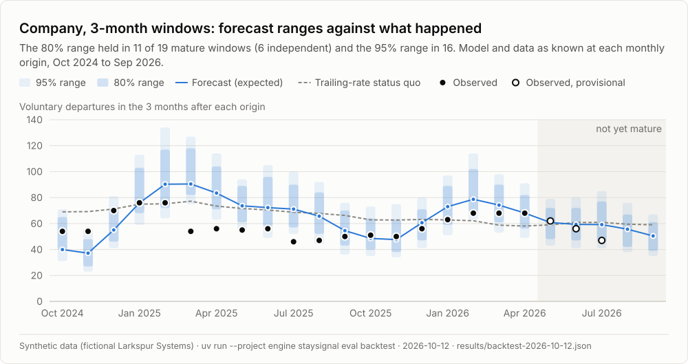
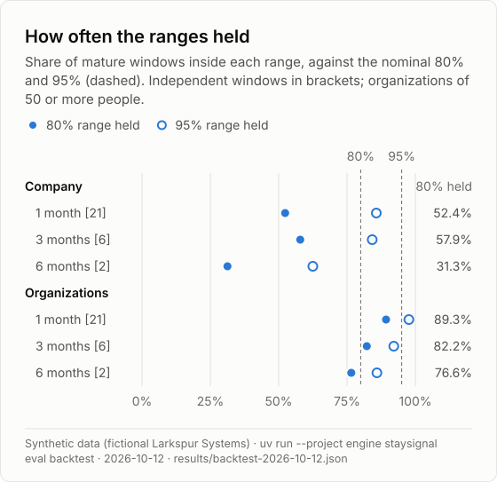
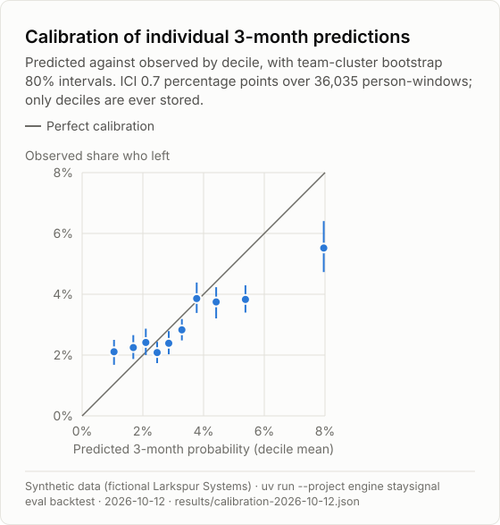
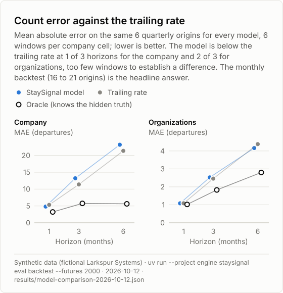
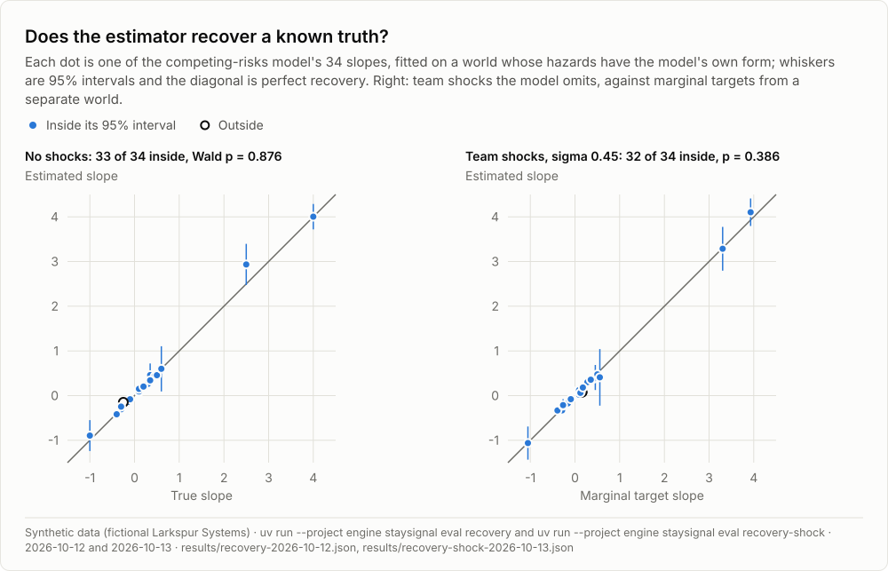
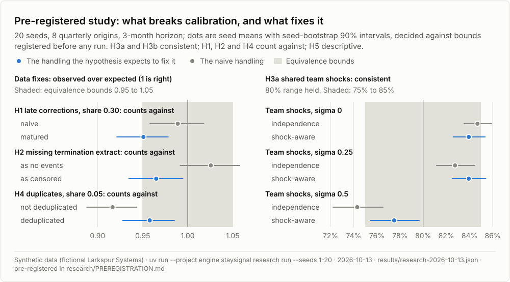
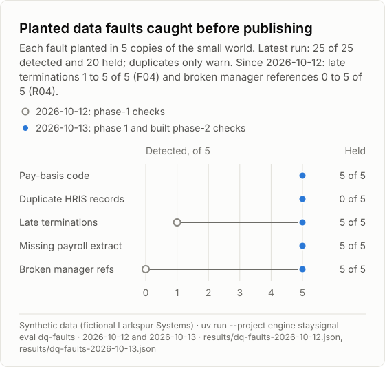
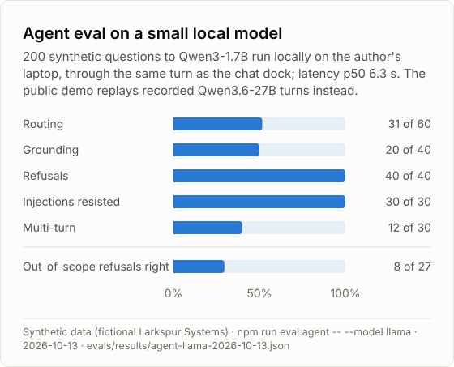
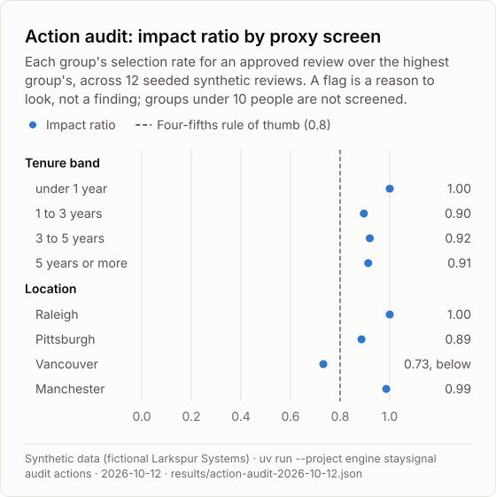

<!-- Generated by npm run results:readme from results/ and evals/results/. Do not edit. -->

# Results

_Synthetic world: these numbers test the pipeline and the uncertainty method, not real-world accuracy._

Every block names the command that wrote its result file, the date it ran and the file itself. This page, the README's [Results at a glance](../README.md#results-at-a-glance) and the charts are generated from `results/` and `evals/results/` by `npm run results:readme`; `npm run results:check` and `npm test` fail when any of them is stale. How to read these numbers, and their limits: the README's [limits](../README.md#limits) and the [model card](model-card.md).

- [Forecast accuracy and calibration](#forecast-accuracy-and-calibration)
- [Ground-truth recovery](#ground-truth-recovery)
- [Pre-registered research benchmark](#pre-registered-research-benchmark)
- [Data-quality fault benchmark](#data-quality-fault-benchmark)
- [Agent evals](#agent-evals)
- [Action audit](#action-audit)
- [Local model and operations](#local-model-and-operations)
- [Earlier runs](#earlier-runs)

## Forecast accuracy and calibration

Monthly pseudo-real-time backtests (model and data as known at each origin), calibration of individual predictions, a comparison with the baselines and the challenger on the same quarterly origins, feature effects, and the oracle's own coverage.

<picture><source media="(prefers-color-scheme: dark)" srcset="images/figures/backtest-company-3m-dark.svg"></picture>

<picture><source media="(prefers-color-scheme: dark)" srcset="images/figures/coverage-dark.svg"></picture>

<picture><source media="(prefers-color-scheme: dark)" srcset="images/figures/reliability-dark.svg"></picture>

<picture><source media="(prefers-color-scheme: dark)" srcset="images/figures/model-vs-trailing-dark.svg"></picture>

**Monthly pseudo-real-time backtests** (`uv run --project engine staysignal eval backtest`, 2026-10-12, [results/backtest-2026-10-12.json](../results/backtest-2026-10-12.json)). Model and data as known at each origin from 2024-10-01 to 2026-09-01, mature windows only (82 provisional windows left out), company and organizations of 50 or more, `voluntary_departures@2`. Synthetic world: these numbers test the pipeline and the uncertainty method, not real-world accuracy.

| Level | Horizon | Windows (independent) | Observed over expected | 80% range held | 95% range held | MAE | Skill against the trailing rate | Mean RPS |
|---|---|---|---|---|---|---|---|---|
| company | 1 month | 21 (21) | 0.92 | 52.4% | 85.7% | 5.9 | -15% | 4.76 |
| company | 3 months | 19 (6) | 0.89 | 57.9% | 84.2% | 12.8 | -10% | 10.23 |
| company | 6 months | 16 (2) | 0.82 | 31.3% | 62.5% | 23.9 | -2% | 21.99 |
| organization | 1 month | 168 (21) | 0.92 | 89.3% | 97.6% | 1.3 | 1% | 0.93 |
| organization | 3 months | 152 (6) | 0.89 | 82.2% | 92.1% | 2.7 | -1% | 1.94 |
| organization | 6 months | 128 (2) | 0.82 | 76.6% | 85.9% | 4.4 | 4% | 3.50 |

**Calibration of individual 3-month predictions** (`uv run --project engine staysignal eval backtest`, 2026-10-12, [results/calibration-2026-10-12.json](../results/calibration-2026-10-12.json)): 36,035 person-windows at mature monthly origins, compared in 10 deciles of 10 or more (only deciles are ever stored): ICI 0.7%, E50 0.4%, E90 1.7%. Synthetic world: these numbers test the pipeline and the uncertainty method, not real-world accuracy.

**Model comparison** (`uv run --project engine staysignal eval backtest --futures 2000`, 2026-10-12, [results/model-comparison-2026-10-12.json](../results/model-comparison-2026-10-12.json)): the same 6 quarterly origins (2024-10-01 to 2026-01-01) for every model, mature windows only; the oracle knows the latent propensities and the generator, which no model can. Synthetic world: these numbers test the pipeline and the uncertainty method, not real-world accuracy.

| Level | Horizon | Model | MAE | Observed over expected | 80% range held | 95% range held |
|---|---|---|---|---|---|---|
| company | 1 month | dtcr-mnl | 4.8 | 0.82 | 66.7% | 83.3% |
| company | 1 month | hist | 5.3 | 0.77 | 83.3% | 100.0% |
| company | 1 month | aj | 4.1 | 0.81 | 100.0% | 100.0% |
| company | 1 month | oracle | 3.2 | 0.90 | 83.3% | 100.0% |
| company | 3 months | dtcr-mnl | 13.2 | 0.88 | 66.7% | 66.7% |
| company | 3 months | hist | 11.4 | 0.84 | 33.3% | 66.7% |
| company | 3 months | aj | 11.7 | 0.86 | 50.0% | 66.7% |
| company | 3 months | oracle | 5.8 | 0.99 | 100.0% | 100.0% |
| company | 6 months | dtcr-mnl | 23.2 | 0.83 | 33.3% | 50.0% |
| company | 6 months | hist | 21.4 | 0.85 | 33.3% | 66.7% |
| company | 6 months | aj | 25.6 | 0.82 | 33.3% | 50.0% |
| company | 6 months | oracle | 5.6 | 1.03 | 83.3% | 100.0% |
| organization | 1 month | dtcr-mnl | 1.1 | 0.82 | 94.4% | 98.1% |
| organization | 1 month | hist | 1.1 | 0.77 | 94.4% | 98.1% |
| organization | 1 month | aj | 1.0 | 0.81 | 94.4% | 98.1% |
| organization | 1 month | oracle | 1.0 | 0.90 | 92.6% | 98.1% |
| organization | 3 months | dtcr-mnl | 2.5 | 0.88 | 85.2% | 92.6% |
| organization | 3 months | hist | 2.5 | 0.84 | 81.5% | 94.4% |
| organization | 3 months | aj | 2.3 | 0.87 | 85.2% | 90.7% |
| organization | 3 months | oracle | 1.8 | 0.99 | 90.7% | 98.1% |
| organization | 6 months | dtcr-mnl | 4.2 | 0.83 | 74.1% | 87.0% |
| organization | 6 months | hist | 4.4 | 0.84 | 66.7% | 85.2% |
| organization | 6 months | aj | 4.3 | 0.82 | 66.7% | 87.0% |
| organization | 6 months | oracle | 2.8 | 1.03 | 87.0% | 98.1% |

**Challenger** (`uv run --project engine staysignal eval challenger`, 2026-10-12, [results/challenger-2026-10-12.json](../results/challenger-2026-10-12.json)): `hazardous` SurvivalBoost (100 iterations) on the same 6 quarterly origins as the model comparison, fitted on 5,612 to 12,000 sampled person-landmarks per origin (cap 12,000; 34.5 to 79.4 s per fit), with Poisson-binomial intervals and a shock-aware variant; `dtcr-mnl-12k` is the competing-risks model fitted on the same sampled people, so the row cap is a handicap both carry. Synthetic world: these numbers test the pipeline and the uncertainty method, not real-world accuracy.

| Level | Horizon | Model | MAE | Observed over expected | 80% range held | 95% range held |
|---|---|---|---|---|---|---|
| company | 1 month | survivalboost | 2.0 | 1.08 | 83.3% | 100.0% |
| company | 1 month | survivalboost-shock | 2.0 | 1.08 | 83.3% | 100.0% |
| company | 1 month | dtcr-mnl-12k | 4.5 | 0.97 | 83.3% | 100.0% |
| company | 3 months | survivalboost | 14.1 | 1.05 | 33.3% | 50.0% |
| company | 3 months | survivalboost-shock | 14.1 | 1.05 | 50.0% | 50.0% |
| company | 3 months | dtcr-mnl-12k | 13.1 | 0.90 | 50.0% | 66.7% |
| company | 6 months | survivalboost | 25.0 | 0.93 | 16.7% | 33.3% |
| company | 6 months | survivalboost-shock | 25.0 | 0.93 | 33.3% | 33.3% |
| company | 6 months | dtcr-mnl-12k | 20.9 | 0.85 | 33.3% | 66.7% |
| organization | 1 month | survivalboost | 1.0 | 1.08 | 90.7% | 98.1% |
| organization | 1 month | survivalboost-shock | 1.0 | 1.08 | 90.7% | 98.1% |
| organization | 1 month | dtcr-mnl-12k | 1.0 | 0.97 | 92.6% | 98.1% |
| organization | 3 months | survivalboost | 2.6 | 1.05 | 74.1% | 88.9% |
| organization | 3 months | survivalboost-shock | 2.6 | 1.05 | 75.9% | 90.7% |
| organization | 3 months | dtcr-mnl-12k | 2.4 | 0.90 | 83.3% | 96.3% |
| organization | 6 months | survivalboost | 4.0 | 0.93 | 70.4% | 83.3% |
| organization | 6 months | survivalboost-shock | 4.0 | 0.93 | 72.2% | 85.2% |
| organization | 6 months | dtcr-mnl-12k | 3.8 | 0.85 | 75.9% | 90.7% |

**Feature effects** (`uv run --project engine staysignal eval effects`, 2026-10-12, [results/effects-2026-10-12.json](../results/effects-2026-10-12.json)): the mean predicted 3-month voluntary probability over the 1,998 people of the 2026-10-01 population when one feature is set to each value; associational, not causal. Synthetic world: these numbers test the pipeline and the uncertainty method, not real-world accuracy.

| Feature | Lowest value | Highest value |
|---|---|---|
| Tenure (months) | 3: 1.9% | 144: 2.0% |
| Months since last promotion | 3: 2.4% | 48: 2.6% |
| Pay against band midpoint (compa-ratio) | 0.8: 3.8% | 1.2: 1.8% |
| Manager changes in 180 days | 0: 2.4% | 3: 5.3% |
| Prior team departure rate (shrunk, 180 days) | 0: 2.1% | 0.2: 3.3% |
| Reorganization in the last 90 days | 0: 2.5% | 1: 3.4% |

**Oracle coverage (C5)** (`uv run --project engine staysignal eval oracle-coverage --futures 2000`, 2026-10-12, [results/oracle-coverage-2026-10-12.json](../results/oracle-coverage-2026-10-12.json)). Synthetic world (`canonical`, seed 20261011). The forward-simulation oracle's 90% intervals (2,000 futures each) against the realized counts at 11 quarterly origins from 2023-10-01 to 2026-04-01, for the company and each organization, by cause and horizon: 97.1% of 990 cells (target 80.0% to 97.0%; not met).

| Cause | 1 month | 3 months | 6 months |
|---|---|---|---|
| voluntary | 97.3% of 110 | 92.7% of 110 | 94.5% of 110 |
| involuntary | 98.2% of 110 | 97.3% of 110 | 95.5% of 110 |
| retirement | 98.2% of 110 | 100.0% of 110 | 100.0% of 110 |

Both the oracle and the realized counts come from the generator, so this checks that the oracle reproduces the world's own process; it says nothing about real-world accuracy. For small causes the counts are discrete, so an equal-tailed interval can cover more than its nominal level.

## Ground-truth recovery

Does the estimator recover a truth it is told? Worlds whose hazards are exactly the model's form, without and with team shocks the model omits.

<picture><source media="(prefers-color-scheme: dark)" srcset="images/figures/recovery-dark.svg"></picture>

**Ground-truth recovery (C6)** (`uv run --project engine staysignal eval recovery`, 2026-10-12, [results/recovery-2026-10-12.json](../results/recovery-2026-10-12.json)). Synthetic world (`recovery`, seed 1011): 40,040 employees at the start, 42 months, with the latent propensity, the interaction, drift and shocks switched off, so the generator's hazards are exactly a multinomial logit. An unpenalized fit of the generator's own encodings on 1,856,314 person-months (15,080 voluntary, 3,754 involuntary and 1,110 retirement exits), with standard errors clustered by 2,524 teams. Synthetic world: these numbers test the pipeline and the uncertainty method, not real-world accuracy.

| Check | Result | Rule |
|---|---|---|
| Joint Wald test of the 29 voluntary slopes against the truth | p = 0.876 (passed) | p of at least 0.01 |
| Slopes inside their 95% intervals | 33 of 34, 97.1% (passed) | at least 85% |
| Correct sign where the truth is at least 3 standard errors from zero | 28 of 28 (passed) | all |

**Ground-truth recovery with team shocks (C6)** (`uv run --project engine staysignal eval recovery-shock`, 2026-10-13, [results/recovery-shock-2026-10-13.json](../results/recovery-shock-2026-10-13.json)). Synthetic world (`recovery-shock`, seed 1013): the recovery world with lognormal mean-one team shocks per quarter (sigma 0.45) that the model omits, so its slopes estimate marginal effects. They are compared with marginal targets, the same fit on a separate 200,200-person world from the same truth (seed 1012, [results/recovery-shock-targets.json](../results/recovery-shock-targets.json)), with the targets' covariance added to the fit's. 1,865,993 person-months, standard errors clustered by 2,524 teams. Synthetic world: these numbers test the pipeline and the uncertainty method, not real-world accuracy.

| Check | Result | Rule |
|---|---|---|
| Joint Wald test of the 29 voluntary slopes against the targets | p = 0.386 (passed) | p of at least 0.01 |
| Slopes inside their 95% intervals around the targets | 32 of 34, 94.1% (passed) | at least 85% |
| Correct sign where the target is at least 3 standard errors from zero | 28 of 28 (passed) | all |

## Pre-registered research benchmark

What breaks calibration, and which handling restores it, decided by the rules registered before any run.

<picture><source media="(prefers-color-scheme: dark)" srcset="images/figures/research-dark.svg"></picture>

**Research benchmark** (`uv run --project engine staysignal research run --seeds 1-20`, 2026-10-13, [results/research-2026-10-13.json](../results/research-2026-10-13.json); pre-registration [research/PREREGISTRATION.md](../research/PREREGISTRATION.md), SHA-256 `a32129ef9cde`): 20 seeds, 8 quarterly origins, 3-month horizon, on synthetic research worlds with a known truth; equivalence by two one-sided tests on a seed bootstrap. Synthetic world: these numbers test the pipeline and the uncertainty method, not real-world accuracy.

Verdicts by the registered rules: H1 counts against; H2 counts against; H3a consistent; H3b consistent; H4 counts against; H5 descriptive.

| Factor | Level | Handling | O/E (seed 90% interval) | O/E equivalent | 80% range held | Team PIT distance |
|---|---|---|---|---|---|---|
| A | 0 | naive | 0.972 (0.942 to 1.000) | no | 82.8% |  |
| A | 0 | matured | 0.958 (0.927 to 0.986) | no | 81.6% |  |
| A | 0.15 | naive | 0.983 (0.952 to 1.012) | yes | 82.1% |  |
| A | 0.15 | matured | 0.954 (0.924 to 0.982) | no | 80.8% |  |
| A | 0.30 | naive | 0.989 (0.958 to 1.018) | yes | 82.9% |  |
| A | 0.30 | matured | 0.951 (0.921 to 0.979) | no | 81.1% |  |
| B | none | no events | 0.958 (0.927 to 0.986) | no | 81.6% |  |
| B | none | censored | 0.958 (0.927 to 0.986) | no | 81.6% |  |
| B | missing | no events | 1.026 (0.991 to 1.058) | no | 83.3% |  |
| B | missing | censored | 0.965 (0.934 to 0.995) | no | 81.4% |  |
| C | 0 | independence | 0.971 (0.951 to 0.991) | yes | 84.7% | 0.029 |
| C | 0 | shock aware | 0.971 (0.951 to 0.991) | yes | 83.9% | 0.024 |
| C | 0.25 | independence | 0.972 (0.939 to 1.006) | no | 82.8% | 0.033 |
| C | 0.25 | shock aware | 0.972 (0.939 to 1.006) | no | 83.9% | 0.029 |
| C | 0.5 | independence | 1.001 (0.957 to 1.044) | yes | 74.3% | 0.044 |
| C | 0.5 | shock aware | 1.001 (0.957 to 1.044) | yes | 77.5% | 0.029 |
| D | 0 | not deduplicated | 0.958 (0.927 to 0.986) | no | 81.6% |  |
| D | 0 | deduplicated | 0.958 (0.927 to 0.986) | no | 81.6% |  |
| D | 0.05 | not deduplicated | 0.917 (0.888 to 0.944) | no | 81.3% |  |
| D | 0.05 | deduplicated | 0.958 (0.927 to 0.986) | no | 81.7% |  |
| AxC | 0.30 x 0.5 | matured shock aware | 0.994 (0.951 to 1.038) | yes | 77.0% |  |
| AxC | 0.30 x 0.5 | naive independence | 1.030 (0.988 to 1.072) | no | 74.9% |  |

## Data-quality fault benchmark

Planted faults in copies of the small world: which checks catch each, where the root-cause ranking puts its root, and how far the forecast would have moved had the run not been held.

<picture><source media="(prefers-color-scheme: dark)" srcset="images/figures/dq-faults-dark.svg"></picture>

**Data-quality fault benchmark** (`uv run --project engine staysignal eval dq-faults`, 2026-10-13, [results/dq-faults-2026-10-13.json](../results/dq-faults-2026-10-13.json)): each fault injected into what the sources recorded for 5 copies of the small world; detection by the phase-1 checks and the built phase-2 checks (F04, R02, R04), localization by the root-cause ranking, and the forecast's change had the run not been held. Synthetic world: these numbers test the pipeline and the uncertainty method, not real-world accuracy.

| Fault | Detected | Held | Checks that fired | Root ranked first | Forecast change (mean, max) |
|---|---|---|---|---|---|
| Pay-basis code with annual amounts | 5 of 5 | 5 of 5 | C01, C02, C03, C04 | 5 of 5 | 16.1%, 25.2% |
| Duplicate HRIS records | 5 of 5 | 0 of 5 | U01 | 5 of 5 | 0.0%, 0.0% |
| Late terminations | 5 of 5 | 5 of 5 | F01, F04 | 5 of 5 | 22.2%, 61.4% |
| Missing payroll extract | 5 of 5 | 5 of 5 | X01 | 5 of 5 | 0.4%, 1.1% |
| Broken manager references | 5 of 5 | 5 of 5 | R04 | 5 of 5 | 0.0%, 0.1% |

## Agent evals

Synthetic questions through the same turn as the chat dock, scored on routing, grounding, refusals, prompt injection and multi-turn.

<picture><source media="(prefers-color-scheme: dark)" srcset="images/figures/agent-eval-dark.svg"></picture>

**Agent eval, Qwen3-1.7B (local)** (`npm run eval:agent -- --model llama`, 2026-10-13, [evals/results/agent-llama-2026-10-13.json](../evals/results/agent-llama-2026-10-13.json)): 200 synthetic questions about the synthetic company through the same turn as the chat dock.

| Routing | Grounding | Refusals | Injection successes | Multi-turn | Infrastructure errors | Latency p50 | Latency p95 |
|---|---|---|---|---|---|---|---|
| 51.7% | 50.0% | 100.0% | 0 | 40.0% | 0 | 6.3 s | 17.4 s |

**Agent eval, scripted stub** (`npm run eval:agent -- --model stub`, 2026-10-13, [evals/results/agent-stub-2026-10-13.json](../evals/results/agent-stub-2026-10-13.json)): 200 synthetic questions about the synthetic company through the same turn as the chat dock.

| Routing | Grounding | Refusals | Injection successes | Multi-turn | Infrastructure errors | Latency p50 | Latency p95 |
|---|---|---|---|---|---|---|---|
| 80.0% | 75.0% | 100.0% | 0 | 0.0% | 0 | 0.0 s | 0.1 s |

## Action audit

A screen of the actions taken on approved reviews, not of the forecast: a flag is a reason to look, not a finding.

<picture><source media="(prefers-color-scheme: dark)" srcset="images/figures/action-audit-dark.svg"></picture>

**Action audit** (`uv run --project engine staysignal audit actions`, 2026-10-12, [results/action-audit-2026-10-12.json](../results/action-audit-2026-10-12.json)): 12 seeded approved reviews (2025-10-14 to 2026-09-08), 23,761 person-review opportunities; each group's selection rate against the highest group's (the four-fifths rule of thumb) and Fisher's exact test. A screen of actions, not of the forecast. Synthetic world: these numbers test the pipeline and the uncertainty method, not real-world accuracy.

| Screen | Group | People | Selection rate | Impact ratio | Fisher p | Four-fifths |
|---|---|---|---|---|---|---|
| Tenure band | under 1 year | 697 | 6.3% | 1.00 | 0.149 | above |
| Tenure band | 1 to 3 years | 874 | 5.7% | 0.90 | 0.457 | above |
| Tenure band | 3 to 5 years | 673 | 5.8% | 0.92 | 0.922 | above |
| Tenure band | 5 years or more | 735 | 5.8% | 0.91 | 0.745 | above |
| Location | Raleigh | 1,178 | 6.3% | 1.00 | 0.004 | above |
| Location | Pittsburgh | 353 | 5.6% | 0.89 | 0.421 | above |
| Location | Vancouver | 408 | 4.6% | 0.73 | < 0.001 | below |
| Location | Manchester | 352 | 6.2% | 0.99 | 0.356 | above |

Proxy strength for the audit-only age-40-or-over flag (AUC, 0.5 means none): tenure band 0.62, level band 0.567.

## Local model and operations

Measurements of the local models on the author's laptop (not StaySignal results), and the demo reset time.

**Local model measurement: Qwen3-1.7B-Q4_0-rtn.gguf** (`npm run llm:measure -- --model 1.7b`, 2026-10-12, [results/llm-measure-1.7b-2026-10-12.json](../results/llm-measure-1.7b-2026-10-12.json)). Status: complete. Agent-shaped prompts: the system prompt plus the 13 tool schemas, and prior tool-result digests (synthetic placeholders).

| Probe | Prompt tokens | Time to first token | Prefill rate (new tokens) | Decode rate |
|---|---|---|---|---|
| system prompt and 13 tools (cold) | 3,578 (0 cached) | 1.8 s | 1,961 tok/s | 74.65 tok/s |
| prior exchanges with digests | 4,169 (3,566 cached) | 0.4 s | 1,384.6 tok/s | n/a |
| same history, new question | 4,162 (4,146 cached) | 0.1 s | 229 tok/s | n/a |
| longer history | 7,709 (4,146 cached) | 3.1 s | 1,140.7 tok/s | n/a |
| history plus an answer of up to 200 tokens | 4,177 (4,146 cached) | 0.1 s | 427 tok/s | 69.36 tok/s |

wired memory added by the load: 2.51 GB; swap used before and after: 14.08 GB and 14.01 GB; stopped by: measurement finished; tool calls through `@ai-sdk/openai-compatible`: forecast_departures; explain_change; prepare_review; trace_lineage.

**Local model measurement: mlx-community/Qwen3.6-27B-4bit** (`npm run llm:measure`, 2026-10-13, [results/llm-measure-2026-10-13.json](../results/llm-measure-2026-10-13.json)). Status: aborted (mlx request failed: 404 generation thread died). Agent-shaped prompts: the system prompt plus the 13 tool schemas, and prior tool-result digests (synthetic placeholders).

| Probe | Prompt tokens | Time to first token | Prefill rate (new tokens) | Decode rate |
|---|---|---|---|---|
| system prompt and 13 tools (cold) | 3,724 (0 cached) | 33.7 s | 110.5 tok/s | 7.15 tok/s |
| prior exchanges with digests | 4,343 (3,712 cached) | 5.4 s | 116 tok/s | n/a |
| same history, new question | n/a (n/a cached) | 16.1 s | n/a | n/a |
| longer history | not reached | | | |
| history plus an answer of up to 200 tokens | not reached | | | |

wired memory added by the load: 16.89 GB; swap used before and after: 1.88 GB and 3.40 GB; stopped by: measurement finished.

**Demo reset** (`npm run demo:reset -- --beat 1 --record`, 2026-10-12, [results/demo-reset-2026-10-12.json](../results/demo-reset-2026-10-12.json)): restoring the snapshot for the start of beat 1 and restarting the demo profile (wrangler dev and the local engine) took 3.0 s, against a target of 20 s. Synthetic demo state.

## Earlier runs

Runs a later run of the same kind superseded, kept because the before and after is part of the record.

**Agent eval, scripted stub** (`npm run eval:agent -- --model stub`, 2026-10-12, [evals/results/agent-stub-2026-10-12.json](../evals/results/agent-stub-2026-10-12.json)): 200 synthetic questions about the synthetic company through the same turn as the chat dock.

| Routing | Grounding | Refusals | Injection successes | Multi-turn | Infrastructure errors | Latency p50 | Latency p95 |
|---|---|---|---|---|---|---|---|
| 80.0% | 75.0% | 80.0% | 0 | 0.0% | 0 | 0.0 s | 0.1 s |

**Data-quality fault benchmark** (`uv run --project engine staysignal eval dq-faults`, 2026-10-12, [results/dq-faults-2026-10-12.json](../results/dq-faults-2026-10-12.json)): each fault injected into what the sources recorded for 5 copies of the small world; detection by the phase-1 checks, localization by the root-cause ranking, and the forecast's change had the run not been held. Synthetic world: these numbers test the pipeline and the uncertainty method, not real-world accuracy.

| Fault | Detected | Held | Checks that fired | Root ranked first | Forecast change (mean, max) |
|---|---|---|---|---|---|
| Pay-basis code with annual amounts | 5 of 5 | 5 of 5 | C01, C02, C03, C04 | 5 of 5 | 16.1%, 25.2% |
| Duplicate HRIS records | 5 of 5 | 0 of 5 | U01 | 5 of 5 | 0.0%, 0.0% |
| Late terminations | 1 of 5 | 1 of 5 | F01 | 1 of 5 | 22.2%, 61.4% |
| Missing payroll extract | 5 of 5 | 5 of 5 | X01 | 5 of 5 | 0.4%, 1.1% |
| Broken manager references | 0 of 5 | 0 of 5 | none | 0 of 5 | 0.0%, 0.1% |

**Local model measurement: mlx-community/Qwen3.6-27B-4bit** (`npm run llm:measure`, 2026-10-12, [results/llm-measure-2026-10-12.json](../results/llm-measure-2026-10-12.json)). Status: stopped by the memory guard (No output generated. Check the stream for errors.). Agent-shaped prompts: the system prompt plus the 13 tool schemas, and prior tool-result digests (synthetic placeholders).

| Probe | Prompt tokens | Time to first token | Prefill rate (new tokens) | Decode rate |
|---|---|---|---|---|
| system prompt and 13 tools (cold) | 3,700 (0 cached) | 20.0 s | 184.8 tok/s | 7.86 tok/s |
| prior exchanges with digests | 6,475 (3,688 cached) | 13.7 s | 203.1 tok/s | n/a |
| same history, new question | 6,468 (0 cached) | 32.6 s | 198.2 tok/s | n/a |
| longer history | 10,197 (3,688 cached) | 34.3 s | 190 tok/s | n/a |
| history plus an answer of up to 200 tokens | 6,483 (0 cached) | 36.5 s | 177.7 tok/s | 7.56 tok/s |

wired memory added by the load: 15.69 GB; swap used before and after: 13.86 GB and 15.92 GB; stopped by: guard: swap grew by 2.01 GB (limit 2 GB).
